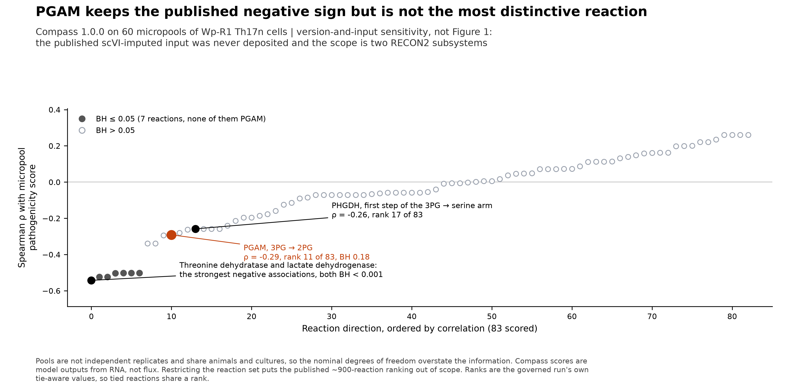

# Ravel: Public Omics Reanalysis of Cellular States, Tissue Homeostasis and Disease

[](https://github.com/xorca0711/ravel/actions/workflows/repository-checks.yml)
[](https://www.python.org/)

Ravel grew out of a question about lung repair after influenza. How do inflammatory
signals from immune and stromal cells shape the states that alveolar epithelial
cells enter after injury, and what determines whether those states lead to
functional repair or persistent remodelling?

The project uses critical reading of primary literature and reanalysis of public
data to investigate cell identity, signalling and function across tissues and
experimental contexts. Analyses include single-cell and bulk RNA
sequencing, RNA–chromatin comparisons, and accessible spatial, imaging,
perturbation and clonal measurements. Each study retains its own biological
units, measured endpoints and interpretation limits.

Each study starts with a published finding and a defined comparison. Positive,
mixed and unfavorable results can narrow the biological context, reveal a failed
generalization or identify a measurement needed to answer the next question.

**Research interests** · Inflammation-driven cell plasticity ·
epithelial–immune–stromal crosstalk · cell-state stability and persistence ·
tissue repair and pathological remodelling.

**Related interests** · Epigenetic regulation and inflammatory memory · cell
fate and lineage dynamics. Lineage tracing is an approach to studying cell
fate, and clonal evolution is a focus of the cancer branch.

Previously named `scRNA_seq`; the
[migration record](docs/migrations/2026-10-07-ravel/README.md) documents the rename
and preservation of historical evidence.

## Start here

| What you need | Where to start |
|---|---|
| Browse related biological topics across questions and papers | [Topic map](docs/guides/RESEARCH_TOPICS.md) |
| Questions, biological rationale and proposed comparisons | [Question homes](RQ_Specified/README.md) · [Scientific dossiers](docs/research_dossiers/README.md) · [Question register](RESEARCH_QUESTIONS.md) |
| Source papers, reading status and article analyses | [Research article roadmap](Research%20Article/README.md) |
| Public-data use, local deposits and eligibility | [Single source register](docs/DATASETS.md) |
| Current results and remaining work | [Project state](PROGRESS.md) · [Current question findings](RQ_Specified/README.md#current-questions) |
| Evidence grades, corrections and negative results | [Claim summary](docs/CLAIM_SUMMARY.md) · [Full register](CLAIMS.md) · [Negative results](docs/NEGATIVE_RESULTS.md) |
| Reproduction and research development | [Reproducibility](REPRODUCIBILITY.md) · [Research governance](docs/RESEARCH_GOVERNANCE.md) · [Documentation index](docs/README.md) |

## Bioinformatics methods in practice

Selected results from completed repository analyses. The panel highlights
single-cell, epigenomic, spatial and statistical workflows; each preview opens
the full-resolution figure, with methods and source values linked below.

| Single-cell RNA · UMAP | Patient-paired expression · PCA and heatmaps |
|---|---|
| [](Research%20Article/gate2_N3_travaglini_nabhan_lung_atlas_2020/figures/extended_v2/07_stromal_umap.png) | [](analysis/figures/rq/rq_a11_epithelial_programs.png) |
| Variable-gene selection, PCA and neighborhood embedding of 5,033 stromal cells, with donor and anatomical structure visible. **Transcriptional neighborhoods**, without lineage inference. [Methods and data](Research%20Article/gate2_N3_travaglini_nabhan_lung_atlas_2020/FIGURES.md#figure-7-new-stromal-umap-with-technical-context). | Seventy patient–histology pseudobulks and 23 matched normal/LUAD pairs. PCA, within-patient contrasts and fixed-programme heatmaps retain the **patient as the comparison unit**; histology does not establish malignant-cell identity. [Methods and data](analysis/figures/rq/README.md#a11). |

| CUT&Tag · Histone signal tracks | Gene-set enrichment · Dot heatmaps |
|---|---|
| [](RQ_Specified/A1_transitional_epithelial_state_distinction/figures/second_batch_verified/a1_histone_loci.png) | [](Research%20Article/gate2_N2_nabhan_2026/figures/followup_v1/Nb3_F08_hallmark_context.png) |
| Native-assembly locus profiles retain H3 controls and both preparations per state. **One iPSC line**; CPM-scaled signal is descriptive and does not measure absolute occupancy. Linked results include promoter-window and alternate-TSS sensitivity. [Methods and data](RQ_Specified/A1_transitional_epithelial_state_distinction/figures/README.md#direct-histone-profiles-and-controls). | Rank-based testing and multiple-testing correction compare programmes across targets and species. **Intergene-correlation sensitivity** is displayed alongside enrichment; these exploratory RNA results do not measure pathway activity. [Methods and data](Research%20Article/gate2_N2_nabhan_2026/FIGURES.md#figure-8-hallmark-context-and-correlation-sensitivity). |

| Spatial transcriptomics · Tissue maps | Compass · Ranked metabolic-reaction scores |
|---|---|
| [](Research%20Article/gate2_C3_yu_lee_choi_min_2026/figures/human_spatial_measured_maps.png) | [](analysis/research/runs/wp_figures_v2/figure_5_compass_reactions.png) |
| Barcode–coordinate checks, spot QC and shared per-gene scales locate RNA in tissue. This illustration shows **two sections from one patient**; mixed-cell spots do not identify direct cell contact. [Methods and data](Research%20Article/gate2_C3_yu_lee_choi_min_2026/trials/u5_spatial_context/REPORT.md). | Spearman correlations between **83 Compass-scored reaction directions** and the pathogenicity score of Th17n micropools. PGAM is highlighted. The figure shows RNA-derived model scores from a bounded version-and-input sensitivity analysis. [Methods and data](Research%20Article/gate2_W2_wagner_Th17_PGAM/FIGURES.md#figure-5-pgam-keeps-the-published-negative-sign-but-is-not-the-most-distinctive-reaction). |

These figures show measured data and analyses derived from them, with source
reuse and interpretation limits retained. Complete galleries and current
research status remain in the
[article](Research%20Article/README.md) and [question](RQ_Specified/README.md) indexes.

## How it works

The research moves through six stages. Findings can revise an earlier question,
connect previously separate questions or close a branch that the evidence does
not support.

1. **Read the paper.** Examine its question, design, findings and unresolved issues;
   identify accessible data and source-specific limitations.
2. **Reanalyse eligible data.** Reproduce accessible findings and test defined
   comparisons with appropriate quality control, biological units and sensitivity checks.
3. **Develop a research question.** Connect published findings and repository
   observations through the [literature workflow](docs/governance/LITERATURE_WORKFLOW.md).
   State the remaining gap, informative comparison and interpretation limit.
4. **Investigate the question.** Develop its plan in
   [RQ_Specified](RQ_Specified/README.md), qualify inputs, and freeze a versioned
   contract before running a new analysis. Retain prior outcome exposure and all results.
5. **Connect the evidence.** Assess recurring phenotypes, complementary measurements
   and differences across studies. Check shared samples and gene sets before
   interpreting agreement as independent replication or biological convergence.
6. **Evaluate what changed.** Decide whether the evidence narrows an explanation,
   supports a description or prediction, limits generalization, or leaves the
   comparison unresolved. For confirmatory testing, define predictions and
   contrary outcomes in advance. Comparisons requiring new experiments remain
   proposed, with the missing measurements stated.

Different questions are at different stages. Completing an analysis can resolve a
measurement or data limitation while leaving the biological hypothesis open. The
[research architecture](docs/RESEARCH_ARCHITECTURE.md) explains the evidence layers,
while [current project state](PROGRESS.md), the [question homes](RQ_Specified/README.md)
and [article reports](Research%20Article/README.md) locate active dependencies.
The [older remaining-work ledger](docs/history/planning/REMAINING_WORK.md)
preserves dated grounding and package decisions.

## How the research is organized

Paper packages own source context and study-specific analyses. The canonical
question register owns stable A-series identities, while question workspaces and
[dossiers](docs/research_dossiers/README.md) develop their evidence and next tests.
The research registry locates prospective contracts, execution receipts and
versioned outputs. Registration or successful execution does not imply scientific
acceptance; dated reports preserve earlier results and corrections.

## Datasets

The [single public-source register](docs/DATASETS.md) lists sources used in
analyses, inspected or rejected for particular comparisons, pending qualification,
and retained as search leads or references. Each entry links its decision and
source evidence. Parent accessions and reused cohorts do not become independent
replication.

The same page links dated local-directory/file inventories. Local raw caches
are ignored and are not supplied by a fresh clone. Source use, accession mentions
and files present on one machine are distinct records.

## Try it yourself

From a clean clone, Python 3.12 can check the tracked evidence and local links
without downloading raw datasets or installing the scientific stack:

```bash
python analysis/scripts/validate_repository.py
python -m unittest discover -s analysis/tests -q
```

These checks cover artifact consistency and selected numerical contracts;
they do not reproduce every scientific result. Scientific reruns require the
inputs, dependencies and run-specific instructions in
[REPRODUCIBILITY.md](REPRODUCIBILITY.md). Completed evidence directories should
be preserved when running a new version.

## Repository map

```text
RESEARCH_QUESTIONS.md       canonical biological questions and readiness
Research Article/           source studies, paper analyses and galleries
RQ_Specified/               question-specific plans, scripts and results
analysis/                   shared code, resources, corrections and figures
analysis/research/          question registry, contracts and execution receipts
docs/DATASETS.md            dataset roles, units and eligibility map
docs/portfolio_extensions/  grouped reviews, extension results and synthesis
docs/audits/                reviews, corrections and evidence checks
CLAIMS.md                   historical graded evidence register
PROGRESS.md                 current state and handoff
DEVELOPMENT.md              responsibility and decision history
AI_CONTEXT.md               working context for agents
```

The [structure contract](docs/guides/REPOSITORY_STRUCTURE.md) defines ownership and
identifier scope. [References](REFERENCES.md) and study reports provide source
citations. [DEVELOPMENT.md](DEVELOPMENT.md) records AI assistance, responsibility
and rejected or revised proposals.

## Still open

Open requirements differ by question: independent biological replication,
linked early/later measurements, qualified source metadata or a direct functional
endpoint. Some repair comparisons lack a common functional outcome. Age,
genotype, processing and cell mixtures can remain alternative explanations.
Molecular scores alone do not establish fate or causality. Negative results,
stopped branches and corrections remain part of the evidence record.

## Licence

Code and original written material are copyright 2026 Xorca; no reuse licence
is granted. See [LICENSE](LICENSE). Source papers and public datasets retain
their respective authors' and publishers' rights.
