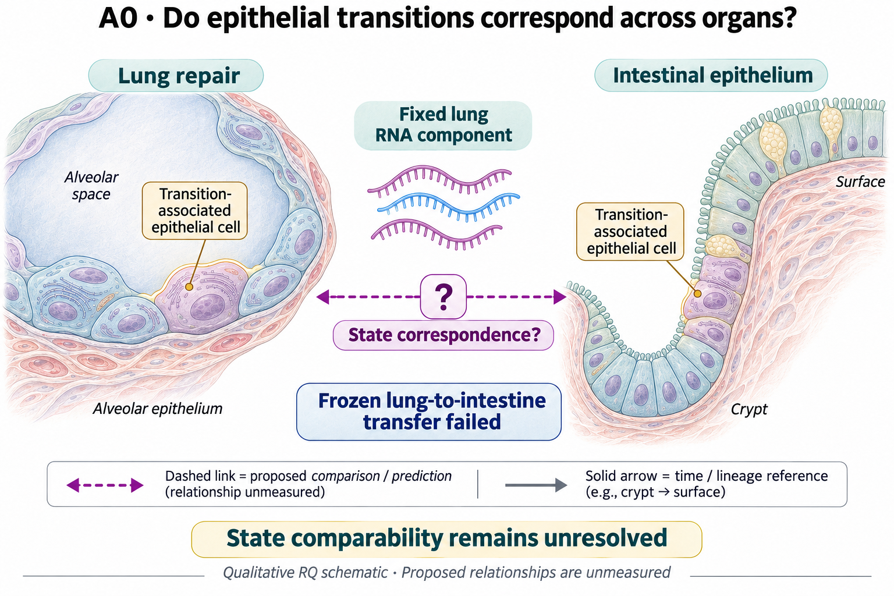

# A0: literature context and hypothesis schematic

[Question home](README.md) · [Scientific dossier](../../docs/research_dossiers/A0.md).

Primary-source reviews retain their recorded dates and access limits. Synthesis updated 4 November 2026 using those records and current results, without a new literature search. This is a bounded rationale assessment, not novelty clearance or scientific acceptance.

## Published starting point

Transition-associated RNA and developmental epithelial states are established starting points. Shared genes make correspondence plausible, but do not establish the same state or fate across organs.

| Primary source | Inspected locator and access record |
|---|---|
| [Strunz 2020](https://www.nature.com/articles/s41467-020-17358-3) | Krt8-associated repair transition; abstract and source identification. [Access / prior review](../../docs/research_dossiers/review_2026-10-03/SOURCES.md#s05) |
| [Guo 2019](https://www.nature.com/articles/s41467-018-07770-1) | Neonatal epithelial subtype results. [Access / prior review](../../docs/research_dossiers/review_2026-10-03/SOURCES.md#s04) |

Sources above reuse the named review unless the update ledger explicitly records a fresh inspection. Published-source evidence and reanalysis of the same material are not independent replication.

## Repository observation

The frozen 50-gene lung programme passed its discovery comparison but failed the specified intestinal intermediate-versus-mature ordering in three mice; only one mouse had the intended positive direction. The intermediate-versus-stem result does not rescue the failed mature-endpoint contrast. The prespecified stop pruned later specificity tests.

Discovery used nine injured-lung mice and eleven early human-airway donors; its favorable contrasts are selected estimates, not independent confirmation. Prior Strunz/A5 outcomes were exposed. The 50-gene membership was fixed before scoring the three intestinal mice. The endpoint is a within-cell percentile-rank RNA score averaged by biological unit/state, not fate or function; species, assay, state mapping and untested lung specificity remain limits.

[Current result, design and limits](reports/PILOT_V1_RESULTS.md). This reuses existing evidence rather than providing a new run or independent replication.

## What this question could add

Informative failed generalization. The result restricts this signature, population mapping and endpoint contrast, not all conserved repair biology. Selecting a replacement gene set using the failed target would create a new exposed question rather than rescue the frozen transfer.

The failed RNA ordering does not distinguish a tissue-specific signature from noncomparable states, timing, species or assay effects; conserved function was not measured. None of these explanations is selected by the negative result.

## Current hypothesis and rival

Biological aim: adult epithelial repair recruits part of a transition programme also used in other epithelial contexts. The frozen 50-gene lung-to-intestine test failed its intended ordering; the remaining task is to determine whether independently justified source and target states are comparable. No replacement signature or conserved fate-control mechanism is proposed by that failure.

**Strongest rival:** The target populations are not comparable biological transitions; sampling time or coverage obscures the intended contrast; alternatively the proposed cross-tissue specificity is absent.

## What the comparison would teach

Retain the stopped transfer. Review the source-recovery evidence for an independent biological rationale for a different mapping question. Without one, do not tune the signature again. With one, specify a new exposed comparison and informative outcomes separately; the original failure remains unchanged.

## Hypothesis schematic

GPT-generated matte illustration, 3 November 2026. Proposed relationships and cell counts are qualitative; the owning context defines the comparison and interpretation limits. [Editorial review](../../docs/audits/2026-11-02-rq-schematic-review/MATTE_PUBLICATION_2026-11-03.md) · [Selected edit prompt](schematics/A0_gpt_matte_v1.prompt.txt). Earlier SVG files are retained as history.

The frozen lung-to-intestine component failed its intended ordering. The remaining question concerns independently justified state comparability in independent animals, not a replacement signature or conserved fate mechanism. Counts and geometry are qualitative.

Class-level glyphs and qualitative geometry are not molecular structures, organelle measurements or evidence of functional assembly. Neutral epithelial/stromal shapes do not assert subtype identity or organelle loss, and icon counts are illustrative. Read locally labelled solid premises/references separately from dashed proposed comparisons; no complete mechanism follows from their juxtaposition.

## Next literature check

Planned query (not reported as newly executed): `conserved epithelial transition lung intestine independent lineage state correspondence 2025 2026`. Expand to synonyms, nearest source references/citations and conflicting results using the [literature workflow](../../docs/LITERATURE_WORKFLOW.md). Recheck the exact population, comparison, timing, unit and endpoint before making a stronger contribution claim.

**Current unresolved specification:** The failed RNA ordering leaves biological state correspondence, tissue specificity and technical/context differences unresolved; it does not test conserved function. No alternative licenses post hoc signature rescue.

**Interpretation limit:** The negative transfer restricts this signature and contrast; it neither proves absence of all conserved epithelial biology nor supplies a lung maturation predictor.

[Current dossier](../../docs/research_dossiers/A0.md) · [All-question context index](../../docs/research_dossiers/literature_context_2026-10-03/README.md)
