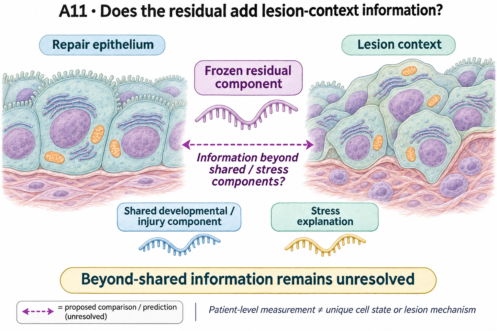

# A11: literature context and hypothesis schematic

[Question home](README.md) · [Scientific dossier](../../docs/research_dossiers/A11.md).

**7 October refresh:** [current comparison and targeted primary-source review](../../docs/portfolio_extensions/2026-10-07/g1_epithelial/LITERATURE.md), with [executed results and capacity qualification](../../docs/portfolio_extensions/2026-10-07/g1_epithelial/RESULTS.md). The fixed genes remain unchanged; no novelty or untouched validation claim is made.

Primary-source reviews retain their recorded dates and access limits. Synthesis updated 4 November 2026 using those records and current results, without a new literature search. This is a bounded rationale assessment, not novelty clearance or scientific acceptance.

## Published starting point

Cancer plasticity and regenerative/stress programmes are established. The closest recent comparison strengthens shared stress as a rival to a lesion-specific interpretation.

| Primary source | Inspected locator and access record |
|---|---|
| [Marjanovic 2020](https://pmc.ncbi.nlm.nih.gov/articles/PMC7745838/) | HPCS result and author-signature provenance. [Access / prior review](../../docs/research_dossiers/followup_2026-10-03/NOVELTY.md) |
| [Chan 2026](https://www.nature.com/articles/s41586-025-09985-x) | Fig. 5c–e and Extended Data 11–12. [Access / prior review](../../docs/research_dossiers/followup_2026-10-03/NOVELTY.md) |

Sources above reuse the named review unless the update ledger explicitly records a fresh inspection. Published-source evidence and reanalysis of the same material are not independent replication.

## Repository observation

The eight-patient lesion association is supported, while the original beyond-shared criterion remains unresolved (q=0.0547). A later paired model lowers mean log loss from 0.226980 to 0.191987 nats after adding the fixed component. Duplicating an existing p53 feature lowers it to 0.190882 without adding information. That control is a model diagnostic, not another biological cohort.

The follow-up and capacity amendment are outcome-exposed reuse of the same eight patients. Training excludes the held-out patient, but this does not make the earlier feature-discovery history untouched. Both original models already order all eight pairs correctly: the gain concerns confidence/log loss, not newly correct pair ordering. Normal-AT2 versus author tumour-epithelial composition remains an alternative.

[Current result, design and limits](../../docs/portfolio_extensions/2026-10-07/g1_epithelial/RESULTS.md#a11-lower-log-loss-does-not-establish-distinct-residual-information). This reuses existing evidence rather than providing a new run or independent replication.

## What this question could add

Supported association with an unfavorable information diagnostic. The apparent increment cannot establish a distinct lesion programme because altered regularization geometry can produce comparable improvement without new information. This corrects the narrowing rationale; it does not prove that p53 explains lesion biology.

Distinct lesion-context information and a functional mediator remain unresolved. The fixed shared/stress comparisons do not exhaust all plasticity, composition or measurement explanations.

## Current hypothesis and rival

The frozen lesion-associated residual component may contain reproducible lesion-context information beyond the specified shared developmental/injury and stress explanations. It is a set-defined measurement, not an identified cancer-specific state or mechanism. The paired-patient beyond-shared criterion remains unresolved, and no lesion-relevant functional mediator is nominated.

**Strongest rival:** The signal is generic stress/plasticity, composition or uncertain baseline adjustment rather than a lesion-specific programme.

## What the comparison would teach

Keep the association and adverse capacity control together. A future information comparison needs a justified baseline and matched model capacity with outcome exposure retained. A gain persisting under that design could support bounded incremental information; gain reproduced by capacity controls would not. No new component or mechanism is selected here.

## Hypothesis schematic

GPT-generated matte illustration, 3 November 2026. Proposed relationships and cell counts are qualitative; the owning context defines the comparison and interpretation limits. [Editorial review](../../docs/audits/2026-11-02-rq-schematic-review/MATTE_PUBLICATION_2026-11-03.md) · [Selected edit prompt](schematics/A11_gpt_matte_v1.prompt.txt). Earlier SVG files are retained as history.

Patient-level information from the frozen residual is evaluated beyond the specified shared/stress comparison. The beyond-shared criterion remains unresolved, and a limited injury contrast does not prove specificity. This is measurement utility, not a cancer-specific state or causal lesion mechanism.

Class-level glyphs and qualitative geometry are not molecular structures, organelle measurements or evidence of functional assembly. Neutral epithelial/stromal shapes do not assert subtype identity or organelle loss, and icon counts are illustrative. Read locally labelled solid premises/references separately from dashed proposed comparisons; no complete mechanism follows from their juxtaposition.

## Next literature check

Planned query (not reported as newly executed): `HPCS regenerative stress programme residual lesion signature independent nonneoplastic comparator 2026`. Expand to synonyms, nearest source references/citations and conflicting results using the [literature workflow](../../docs/LITERATURE_WORKFLOW.md). Recheck the exact population, comparison, timing, unit and endpoint before making a stronger contribution claim.

**Current unresolved specification:** The evidence does not yet identify a component with robust contextual specificity and an independently measured biological consequence.

**Interpretation limit:** A lesion score cannot establish malignant identity, transformation, lineage origin or clinical risk.

[Current dossier](../../docs/research_dossiers/A11.md) · [All-question context index](../../docs/research_dossiers/literature_context_2026-10-03/README.md)
