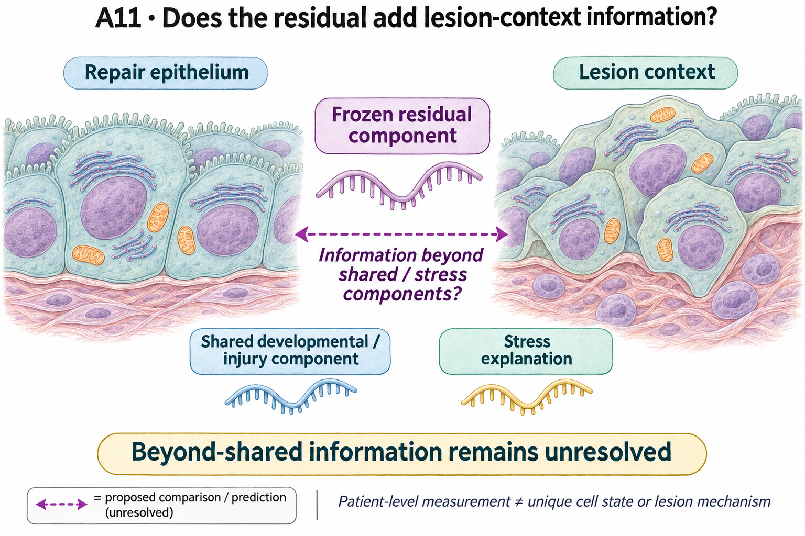

# A11: lesion-associated programme beyond shared plasticity

## Organizing Biological Q

Does the fixed lesion-associated RNA component add distinct information beyond specified shared developmental, injury and stress features?

Published plasticity and regenerative/stress programmes make shared biology a serious rival to lesion specificity. Association with lesions and incremental information beyond those features are separate questions.

Current synthesis: 4 November 2026. [Full rationale](../../docs/research_dossiers/A11.md) · [Source context](LITERATURE_CONTEXT.md).

<!-- literature-visual-context:start -->

## Literature context & visual hypothesis

[What previous findings contribute, what remains, and what the readouts would decide](LITERATURE_CONTEXT.md).

GPT-generated matte illustration, 3 November 2026. Proposed relationships and cell counts are qualitative; the owning context defines the comparison and interpretation limits. [Editorial review](../../docs/audits/2026-11-02-rq-schematic-review/MATTE_PUBLICATION_2026-11-03.md) · [Selected edit prompt](schematics/A11_gpt_matte_v1.prompt.txt). Earlier SVG files are retained as history.

*Explanatory proposal, not measured results. Read the linked context and caption; arrows do not certify a mechanism or novelty.*
<!-- literature-visual-context:end -->

The illustration presents the registered question and untested relationships. The current argument follows the result below; the drawing does not establish its proposed mechanism.

## What the analysis changed

The eight-patient lesion association is supported, while the original beyond-shared criterion remains unresolved (q=0.0547). A later paired model lowers mean log loss from 0.226980 to 0.191987 nats after adding the fixed component. Duplicating an existing p53 feature lowers it to 0.190882 without adding information. That control is a model diagnostic, not another biological cohort.

The follow-up and capacity amendment are outcome-exposed reuse of the same eight patients. Training excludes the held-out patient, but this does not make the earlier feature-discovery history untouched. Both original models already order all eight pairs correctly: the gain concerns confidence/log loss, not newly correct pair ordering. Normal-AT2 versus author tumour-epithelial composition remains an alternative.

[Current result, design and limits](../../docs/portfolio_extensions/2026-10-07/g1_epithelial/RESULTS.md#a11-lower-log-loss-does-not-establish-distinct-residual-information).

**Rationale check.** Supported association with an unfavorable information diagnostic. The apparent increment cannot establish a distinct lesion programme because altered regularization geometry can produce comparable improvement without new information. This corrects the narrowing rationale; it does not prove that p53 explains lesion biology.

## Current interpretation and next decision

Distinct lesion-context information and a functional mediator remain unresolved. The fixed shared/stress comparisons do not exhaust all plasticity, composition or measurement explanations.

Keep the association and adverse capacity control together. A future information comparison needs a justified baseline and matched model capacity with outcome exposure retained. A gain persisting under that design could support bounded incremental information; gain reproduced by capacity controls would not. No new component or mechanism is selected here.

## Registered scope and analysis history

The records below preserve earlier framing and execution checkpoints. Read the current result before an older plan. Historical unfinished-work wording does not supersede completed later diagnostics. Registered hypotheses remain unchanged; this synthesis grants no claim grade or human acceptance.

Registered framing and retained analysis history

<!-- current-rq-framing:start -->

## Organizing Biological Q

The frozen lesion-associated residual component may contain reproducible lesion-context information beyond the specified shared developmental/injury and stress explanations. It is a set-defined measurement, not an identified cancer-specific state or mechanism. The paired-patient beyond-shared criterion remains unresolved, and no lesion-relevant functional mediator is nominated.

**What is already known, and what remains:** HPCS, regenerative overlap and stress-associated plasticity have close published precedents. A disjoint gene list alone is not novelty; the exact incremental information and biological value remain unresolved. [Primary-source comparison](../../docs/history/reviews/NOVELTY_SPECIFICITY_APPLICATION_2026-10-03.md#a11).

**What the measurements would decide:** A stable patient-level increment against the frozen shared/stress comparison could support measurement utility. Comparable recruitment in matched non-neoplastic injury or no increment favors shared plasticity. Preserve the beyond-shared BH q=0.0547 result; this comparison cannot establish causal lesion specificity.

**Current disposition:** Measurement contribution unresolved. This revision specifies proposed work; scientific acceptance, model access and assay qualification remain pending.

| Evidence and implementation | Current boundary |
|---|---|
| Biological unit and endpoint | Independent patients with source-supported pairing and comparable injury controls. The proposed discriminator is held-out patient log-loss improvement over the same shared/stress baseline; patients define holdouts, not cells. |
| Current evidence and limit | Lesion association is supported across eight patients, but the beyond-shared test remains unresolved at q = 0.0547. The three-donor injury comparison does not establish injury specificity. |
| Next decision / hold | Exact residual novelty and comparator validity await scientific review. Keep the lists fixed and preserve the unresolved result; no cancer-specific mechanism or biomarker acceptance follows from the measurement definition. |

**Read in this order:** [current evidence](../A5_A11_shared_component_contract/reports/REVISED_TEST_RESULTS.md),
[development dossier](../../docs/research_dossiers/A11.md),
[conditional hypothesis package](../../docs/research_dossiers/packages_2026-10-03/A11.md).
[Deferred work](../../docs/history/planning/REMAINING_WORK.md) and
[execution requirements](../../docs/RESEARCH_GOVERNANCE.md) govern any later
analysis. Draft completion does not establish assay validity, resource access,
meaningful effects, precision or scientific acceptance. Existing numerical
results and original plans below retain their recorded scope.
<!-- current-rq-framing:end -->

## Evidence, analyses and next steps

<!-- evidence-followthrough:start -->
**Evidence follow-through — 3 November 2026:** Exclude the affirmative claim
“Lower penalized loss establishes distinct lesion information.” from current conclusions.
[Bounded fill, stop rule and reopening evidence](../../docs/audits/2026-11-03-rq-evidence-trajectory/CUT_OR_FILL_PLAN.md#a11).
The hypothesis remains a proposal where its decisive comparison is untested.
<!-- evidence-followthrough:end -->

The existing analysis records below retain their scope. Read the latest linked result or amendment before an older plan.

**Subsequent evidence — 7 October 2026:** [patient-held-out prediction and capacity qualification](../../docs/portfolio_extensions/2026-10-07/g1_epithelial/RESULTS.md) preserve the positive log-loss gain but show that a duplicated p53 baseline feature can do slightly better. Unique lesion information is unestablished; this is exposed internal paired discrimination, not independent validation or later outcome prediction.

### Earlier organizing question

> Which lesion-associated programmes add to a shared epithelial plasticity component?

The working hypothesis is that neoplasia-associated epithelial states combine a
shared remodelling response with additional lesion-associated programmes. A
programme found in a tumour context could also accompany non-neoplastic repair.

This folder tests a frozen lesion-associated module in paired human lung samples
and asks whether its change exceeds the shared component. A separate acute-injury
assay challenges its specificity. A5 tests developmental reuse; A11 asks what
lesion-associated information remains beyond shared plasticity.

**Read first:** [question card](../../RESEARCH_QUESTIONS.md#a11),
[plan](PLAN.md), [paired-patient results](../A5_A11_shared_component_contract/reports/REVISED_TEST_RESULTS.md),
[acute-injury results](reports/ACUTE_INJURY_RESULTS.md).

### Evidence and analysis history

**Latest follow-through:** [A11 results and candidate decisions](../../docs/roadmap_runs/2026-09-27-followthrough/EXPANDED_CANDIDATE_AUDIT.md). Historical specifications and numerical results below are preserved; read the dated follow-through for the current execution state.

Question-specific work for [A11](../../RESEARCH_QUESTIONS.md#a11). The canonical
hypothesis stays in the register.

**Status: amended test completed.** Read the [plan](PLAN.md),
[biological rationale](../A5_A11_shared_component_contract/BIOLOGICAL_LOGIC.md) and
[results](../A5_A11_shared_component_contract/reports/REVISED_TEST_RESULTS.md).

Lesion-associated expression replicates in all eight paired patients: HL +0.681
log2 CPM (exact 95% CI 0.386–0.976; p=0.0078125). The stress-excluded sensitivity
is positive (BH q=0.0234). The beyond-shared comparison is unresolved (BH q=0.0547),
so the stronger relative-activation criterion is not met. Cancer specificity,
malignant identity and a separate mechanism remain unestablished.

### Second assay: the acute-injury falsification in GSE198864

A separate assay under this question asks whether the same frozen module rises in acute injury,
which would challenge a tumour-associated reading of it. It has its own contract, its own cohort and
its own verdict, and it does not revise the Kim test above.

**Verdict: unresolved.** In lung explants the module is higher in SARS-CoV-1 infected than in
medium-matched mock type 2 cells by +0.225 log2 CPM across three identity-concordant paired donors,
positive in all three, at an exact p of 0.25 which is the floor at that unit count. The
beyond-shared contrast is -0.039, so the rise is not separable from the shared remodelling component
rising with it. The type 2 cells scored carry a viral read in 5 of 1,039, so this is a bystander
response. These explants come from surgical cancer patients and are not a cancer-naive population.

Read the [results](reports/ACUTE_INJURY_RESULTS.md), the [intake](reports/ACUTE_INJURY_INTAKE.md)
and the [contract](config/gse198864_acute_injury_contract.json). The assay was executed under the
computational pipeline and moved into this folder afterwards; the move is recorded in
[the migration note](../../docs/migrations/2026-09-27-a11-acute-into-rq/README.md).

### Why the test moved to a new cohort

The lesion-specific module frozen by the
[shared component contract](../A5_A11_shared_component_contract/README.md) is
identical, gene for gene, to a module the completed human run had already scored in
23 patients. That cohort is therefore the discovery, and a fresh test needs fresh
patients. The Kim 2020 deposit has ten verified tumour-normal pairs and had never
been scored with these modules.

### Layout

| Path | Contents |
|---|---|
| [PLAN.md](PLAN.md) | The pre-registration: populations, instrument, estimands, decision rules, power |
| [config/kim2020_test_contract.json](config/kim2020_test_contract.json) | The same, machine-readable |
| [config/gse198864_acute_injury_contract.json](config/gse198864_acute_injury_contract.json) | The second assay's frozen contract |
| [reports/](reports/) | The second assay's intake, environment gate and results |
| `tables/acute_injury_gse198864/` | Its intake, gate, scores, diagnostics and identity-concordant outputs |
| `scripts/05` to `scripts/15` | Its instruments, continuing this folder's numbering |
| `scripts/00_power_calculation.py` | Power from the discovery's tracked differences only |
| `scripts/01_eligibility_gates.py` | Gene coverage and patient eligibility from names and labels only |
| `tables/` | Power, pairing, cell counts, coverage and run records |

Original gate/power outputs are retained. New results use `tables/test_v2/`.

### Reproduce the completed test

Use a clean output directory and the tracked amended configuration. Run
`Rscript scripts/02_reproduce_discovery.R REPO_ROOT DATA_ROOT`, then the Python
launcher with `scripts/03_prepare_kim.py --data-root DATA_ROOT`, then
`Rscript scripts/04_score_kim.R REPO_ROOT DATA_ROOT`. These scripts refuse to
overwrite results. The Python step verifies all original Kim input hashes and
requires the successful discovery reproduction before reading counts for scoring.

