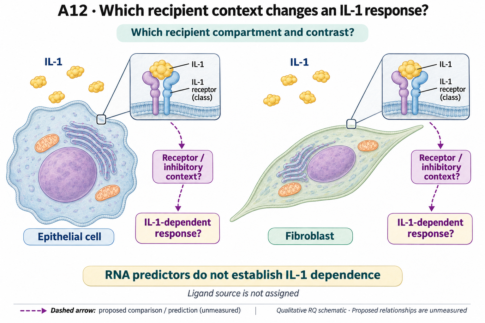

# A12: literature context and current argument

[Question home](README.md) · [Scientific dossier](../../docs/research_dossiers/A12.md).

Synthesis updated 8 November 2026 to integrate the completed public-cell result.
The same-day source and literature reviews below are reused; this narrative repair
adds no new search, calculation or canonical hypothesis. Published premises and
reused-data observations remain separate evidence types.

**Addendum, 8 November 2026:** A fresh bounded reading of Peng et al. (2026),
Figs. 4D and 5E/K, and the supplied supplement adds related spatial/state
context, with [search and access records](../../docs/research_reviews/2026-11-08-peng-spatial-reading/README.md#literature-context-and-actual-search-coverage).
High IL1R1 in KACs is a different estimand from this pilot's LUAD-minus-normal
contrast; it does not resolve its state-mixture or general-inflammation alternatives.
The study's GSE308103 cohort is already reused here. [Interpretation and proposed
next qualification](../../docs/research_reviews/2026-11-08-peng-spatial-reading/README.md#a12-related-evidence-different-estimands)
preserve the current hypothesis, results and registered illustration.

## Published starting point

IL-1-dependent epithelial transitions and fibroblast exposure effects already show that responding compartments matter.

| Primary source | Inspected locator and access record |
|---|---|
| [Choi 2020](https://pmc.ncbi.nlm.nih.gov/articles/PMC7487779/) | Fig. 7 and Discussion. [Access / prior review](../../docs/history/reviews/NOVELTY_SPECIFICITY_APPLICATION_2026-10-03.md) |
| [Ciminieri 2023](https://pmc.ncbi.nlm.nih.gov/articles/PMC12042164/) | Fig. 1 and Results; fibroblast pre-exposure and organoid growth. [Access / prior review](../../docs/history/reviews/NOVELTY_SPECIFICITY_APPLICATION_2026-10-03.md) |

Sources above reuse the named review unless the update ledger explicitly records a fresh inspection. Published-source evidence and reanalysis of the same material are not independent replication.

The [3 November ERBB source record](../../RQ_Specified/A12_recipient_context/reports/ERBB_SORTED_SPEC_V1.md)
and [Lin read](../../RQ_Specified/A12_recipient_context/reports/LIN_REFERENCE_READ_V1.md)
are adjacent receptor/identity context, not a new IL-1 validation lineage.
The close Gomez/Koyama 2026 report (DOI
[10.1093/ajrccm/aamaf106](https://doi.org/10.1093/ajrccm/aamaf106), Fig. 2A and
supplementary Figs. 2/3) cautions that HTII-280 sorting need not yield homogeneous
AT2 cells; its GSE150068 reanalysis shares the sorted source. The resulting
ERBB4/ERBB2 RNA detection in one preparation is described separately in the
[completed report](../../RQ_Specified/A12_recipient_context/reports/ERBB_SORTED_RESULTS_V1.md).
A usable between-state map and Lin replicate/preparation values remain
unrecovered. None of these observations transfers a functional mechanism into
the current human IL-1 prediction.

## Repository observation

The [original pilot](../../docs/roadmap_runs/2026-09-27-followthrough/A12_PILOT.md)
uses **12 matched patients and 48 patient/histology/recipient units** in GSE308103.
All features and outcomes are LUAD-minus-normal within patient. The outcome is a
gene-disjoint TNF/NFkB inflammatory RNA score, not an IL-1-specific activity assay.
The fixed comparison adds recipient context to the same source/mixture model
already containing TNF; patients are held out from fitting.

| Recipient | Source + TNF RMSE | With recipient index | Interpretation |
|---|---:|---:|---|
| AT2 candidate label | 0.4271 | 0.3244 | Lower prediction error; 7/12 patients improve. |
| Alveolar fibroblast candidate label | 0.2098 | 0.2283 | Worse primary prediction; direction changes in sensitivity analyses. |

Cross-validation training sets overlap, so these are exploratory prediction
results without fold-based significance claims. Healthy-reference labels do not
independently establish malignant identity. The [ten-gene attribution](../../RQ_Specified/A12_recipient_context/reports/IL1_COMPONENTS_V1_RESULTS.md)
reuses the same 12 patients: 24 patient/recipient paired contrasts, not new donors.
In epithelium, IL1RAP increases while IL1R1 decreases; lower IL1R2/SIGIRR contributes
positively to the signed index, while higher IL1RN contributes negatively.
The index is therefore not uniform receptor activation or uniform inhibitor loss.
MYD88/IRAK1/IRAK4 add RNA context, not activation measurements.
**NFKBIA and TNFAIP3 overlap the old response**, so they cannot independently
validate it.

The [A12-S1 source map](../../RQ_Specified/A12_recipient_context/reports/A12_S1_SOURCE_IDENTITY_MAP.md)
reports **median patient-level unassigned fractions of recovered IL1B counts
of roughly 52-72% across histologies** under the recorded assignments. These are
not pooled tissue fractions or secretion measurements. The source term describes
assigned macrophages; it cannot assign all active ligand to macrophages.

### What the public-cell follow-up changes

The [8 November cell description](../../Research%20Article/ungated_peng_2026_spatial_omics/PUBLIC_DATA_RESULTS.md) retains
these original twelve patients and exact prior counts. IL1RAP detection rises
by 2.45 percentage points while positive-nucleus intensity falls; IL1R1 detection
is mixed and changes direction with candidate selection. IL1R1/IL1RAP joint
detection rises by 1.01 points, attenuating to 0.16 under the depth sensitivity.
This narrows a uniform receptor-upregulation account of the RNA pattern. It
leaves unresolved whether different epithelial populations or expression within
a population carry the pattern, and does not decompose the prior predictive gain.
These are exposed descriptions, not a new predictive fit or independent validation.

That distinction supplies a biological branch point: does the recipient-associated
RNA occur in a changed population mixture or within comparable epithelial states?
A population-associated result can inform the broader Peng tissue-context question;
it would not establish A12's additional information beyond its specified mixture
comparison. Concordant within-state RNA could motivate a receptor-context branch,
while still leaving protein activity and IL-1 dependence unmeasured. The transferred
labels cannot independently settle that comparison. [Measured figures](../../Research%20Article/ungated_peng_2026_spatial_omics/PUBLIC_DATA_FIGURES.md)
and the [source/context review](../../Research%20Article/ungated_peng_2026_spatial_omics/PUBLIC_DATA_CONTEXT.md) retain denominators,
selection limits and the already completed literature search.

## Does the evidence warrant the narrowing?

**Rationale verdict: supported exploratory predictive narrowing, with an
incomplete causal interpretation.** Published recipient-context effects make the
question plausible; the actual support is lower held-out inflammatory-RNA error
in 12 epithelial patient pairs and an unfavorable fibroblast comparison. This
warrants prioritizing epithelial prediction for independent validation. It does
not select a causal receptor configuration, establish IL-1 specificity or show
that the fibroblast biology is absent.

The [pilot exposure record](../../docs/roadmap_runs/2026-09-27-followthrough/A12_PILOT.md)
distinguishes a comparison specified before its new scores/fits from exposure to
earlier results and coverage. Epithelial prioritization followed those outcomes;
the later component display reuses the same patients. Candidate-label transfer,
composition, shared normalization and general inflammation remain alternatives.
Mixed receptor/inhibitor directions and the unfavorable fibroblast result are
part of the evidence, not grounds to choose a favorable subset. The next
informative decision is whether the fixed epithelial prediction transports to a
qualified independent context. Current evidence cannot determine how much of
the gain is biological versus technical or sampling variation.

## What this question could add

The computational contribution is recipient-specific predictive narrowing and
interpretation of the original signed index. Epithelial association is useful
without proving reception. The unchanged registered hypothesis below remains a
functional proposal: an epithelial lead has been prioritized, but the mechanistic
receptor/inhibitory contrast and consequence are still unqualified.

## Current hypothesis and rival

IL-1 receptor and inhibitory context in recipient epithelial cells or fibroblasts may explain an IL-1-dependent response beyond ligand RNA abundance. Those are separate recipient questions; the current portfolio has not fixed one compartment, receptor/inhibitory contrast and biological consequence for a mechanistic experiment. General NF-kB or inflammation scores cannot establish IL-1 specificity.

**Strongest rival:** The index tracks general inflammatory state, cell composition or another stimulus rather than specific IL-1 reception.

## What the comparison would teach

The unfavorable fibroblast comparison remains. The epithelial gain and new RNA
distributions motivate a specific intermediate comparison: are the receptor and
accessory RNA differences carried by different epithelial populations, or retained
within independently supported state/pathology strata? The new description makes
a uniform increase less defensible but has not estimated this within-state contrast.
A pattern carried by population abundance would inform the broader tissue question
without establishing A12's beyond-mixture claim; a retained within-state pattern
would motivate further recipient-context work. Either can coexist with other
inflammatory inputs and neither establishes IL-1-dependent function.

Independent fixed-procedure prediction remains a separate test of generalization.
No score refit, new state classifier or mandatory functional-assay sequence is
introduced by this interpretation repair.

The cell-library and count joins are qualified. Author state/pathology labels and
endpoint independence remain unresolved; the healthy-reference transfer used some
candidate genes. [Source intake](../../docs/research_reviews/2026-11-03-tool-assisted-screening-review/A12_SOURCE_INTAKE.md)
and [supplement qualification](../../Research%20Article/ungated_peng_2026_spatial_omics/SUPPLEMENTS_RESULTS.md) distinguish recovered
metadata from missing author exports. Functional reception and source attribution
need separate evidence; new public descriptions do not settle those claims.

## Reading the registered illustration

The retained illustration depicts the registered proposal. The
[measured figure in the question home](README.md#evidence-analyses-and-next-steps)
has a separate evidence-display purpose; no registered asset is replaced.

## Hypothesis schematic

GPT-generated matte illustration, 3 November 2026. Proposed relationships and cell counts are qualitative; the owning context defines the comparison and interpretation limits. [Editorial review](../../docs/audits/2026-11-02-rq-schematic-review/MATTE_PUBLICATION_2026-11-03.md) · [Selected edit prompt](schematics/A12_gpt_matte_v1.prompt.txt). Earlier SVG files are retained as history.

Epithelial and fibroblast reception are separate developing questions. The current RNA predictor behaves differently between compartments and ligand-source attribution remains uncertain. Biological units and model need qualification; generic inflammatory RNA cannot identify IL-1 dependence or the active source.

Class-level glyphs and qualitative geometry are not molecular structures, organelle measurements or evidence of functional assembly. Neutral epithelial/stromal shapes do not assert subtype identity or organelle loss, and icon counts are illustrative. Read locally labelled solid premises/references separately from dashed proposed comparisons; no complete mechanism follows from their juxtaposition.

## Next literature check

This synthesis reuses the recorded 3 October primary review and the bounded
3 November adjacent-reference/source records above; no fresh search was performed.
The earlier planned IL-1 recipient query remains a possible future check, not an
executed search. Refresh exact epithelial input, receptor context and
IL-1-dependent endpoint precedents if a new comparison is specified.
[Independent-source qualification](../../docs/audits/2026-11-03-rq-evidence-trajectory/A12_TECHNICAL_RESULT.md)
does not confer novelty or laboratory readiness.

[Current evidence and history](README.md#evidence-and-planning-records) ·
[Research governance](../../docs/RESEARCH_GOVERNANCE.md).
