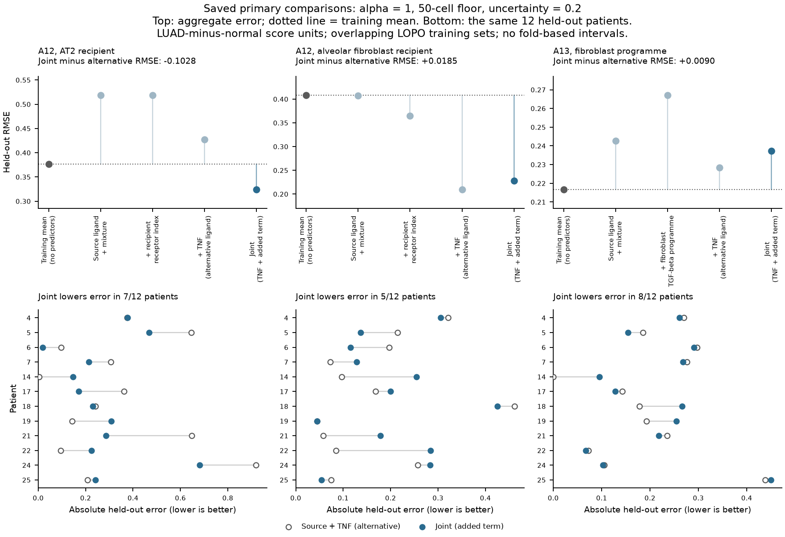
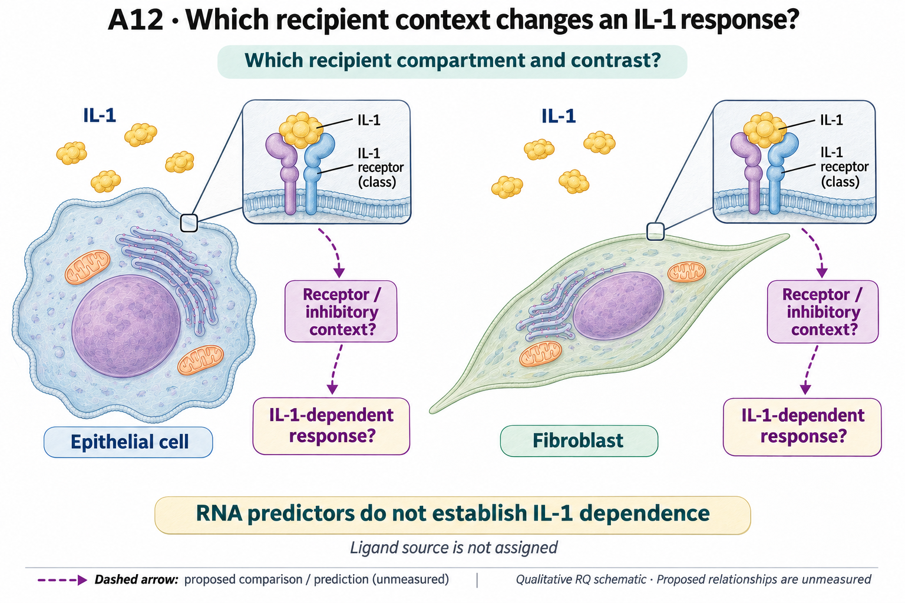

# A12: recipient context beyond ligand RNA

**Source qualification, 8 November:** the [Peng metadata result](../../Research%20Article/ungated_peng_2026_spatial_omics/RESULTS.md) verifies 185 GEO records and shared-source alias/patient joins, retaining six filename discrepancies and a P6 WES identity hold. Author state/pathology exports, geometry and measured panels remain unqualified; the within-state A12 extension is unestimated. The A12 estimand, prior results (including unfavorable fibroblast prediction) and claim status are unchanged.

## Organizing Biological Q

Does the recipient's receptor and inhibitory context explain an inflammatory RNA
response beyond ligand RNA and cell mixture? The completed pilot has already
narrowed the useful recipient comparison toward the **epithelial candidate
compartment**: adding the index improves its patient-held-out prediction, while
the fibroblast result is unfavorable and unstable. The subsequent component
view explains what the index contains; it does not establish IL-1-specific
reception or a macrophage-to-recipient mechanism.

The next question is whether the epithelial association reflects receptor/accessory/
inhibitory configuration, different epithelial populations, or broader inflammation.
Choosing a mechanistic axis and functional consequence remains separate from this
exploratory predictive compartment narrowing.

Current synthesis: 4 November 2026. [Question card](../../RESEARCH_QUESTIONS.md#a12)
· [Literature context](LITERATURE_CONTEXT.md) · [Dossier](../../docs/research_dossiers/A12.md).

**Literature annotation, 8 November 2026:** Peng et al. (2026), Figs. 4D and
5E/K, provide related state-specific IL1R1 and spatial-neighborhood evidence in
the same GSE308103 source lineage. Their KAC/state comparison does not directly
explain this pilot's LUAD-minus-normal index, including its decreasing epithelial
IL1R1 component. [Paper assessment and proposed annotation qualification](../../docs/research_reviews/2026-11-08-peng-spatial-reading/README.md#a12-related-evidence-different-estimands).
The current results, hypothesis, illustration and acceptance status are unchanged.

## Literature context & visual hypothesis

Published IL-1 epithelial-transition and fibroblast pre-exposure experiments
show that recipient context can matter. They do not validate this cohort's
predictive index. [Choi Fig. 7 and Ciminieri Fig. 1, with access records](../../docs/history/reviews/NOVELTY_SPECIFICITY_APPLICATION_2026-10-03.md)
supply the premises; the [local literature context](LITERATURE_CONTEXT.md) separates
those models from the present human disease contrast.

The [registered illustration](#registered-scope-and-illustration) retains both
recipient possibilities as a functional proposal. The measured result below
explains why current computational attention has narrowed toward epithelium.

## Evidence, analyses and next steps

The [original pilot](../../docs/roadmap_runs/2026-09-27-followthrough/A12_PILOT.md)
uses **12 matched patients and 48 patient/histology/recipient units** in GSE308103.
All features and outcomes are LUAD-minus-normal within patient. The outcome is a
gene-disjoint TNF/NFkB inflammatory RNA score, not an IL-1-specific activity assay.
The fixed comparison adds recipient context to the same source/mixture model
already containing TNF; patients are held out from fitting.

| Recipient | Source + TNF RMSE | With recipient index | Interpretation |
|---|---:|---:|---|
| AT2 candidate label | 0.4271 | 0.3244 | Lower prediction error; 7/12 patients improve. |
| Alveolar fibroblast candidate label | 0.2098 | 0.2283 | Worse primary prediction; direction changes in sensitivity analyses. |

Cross-validation training sets overlap, so these are exploratory prediction
results without fold-based significance claims. Healthy-reference labels do not
independently establish malignant identity. The [ten-gene attribution](../../RQ_Specified/A12_recipient_context/reports/IL1_COMPONENTS_V1_RESULTS.md)
reuses the same 12 patients: 24 patient/recipient paired contrasts, not new donors.
In epithelium, IL1RAP increases while IL1R1 decreases; lower IL1R2/SIGIRR contributes
positively to the signed index, while higher IL1RN contributes negatively.
The index is therefore not uniform receptor activation or uniform inhibitor loss.
MYD88/IRAK1/IRAK4 add RNA context, not activation measurements.
**NFKBIA and TNFAIP3 overlap the old response**, so they cannot independently
validate it.

The [A12-S1 source map](../../RQ_Specified/A12_recipient_context/reports/A12_S1_SOURCE_IDENTITY_MAP.md)
reports **median patient-level unassigned fractions of recovered IL1B counts
of roughly 52-72% across histologies** under the recorded assignments. These are
not pooled tissue fractions or secretion measurements. The source term describes
assigned macrophages; it cannot assign all active ligand to macrophages.

The left and middle columns are A12's epithelial and fibroblast comparisons;
the right column belongs to A13 and is not additional A12 evidence. Lower error
is better. The bottom panels reuse the same 12 held-out patients; overlapping
training sets are not independent validation cohorts.

## Does the evidence warrant the narrowing?

**Rationale verdict: supported exploratory predictive narrowing, with an
incomplete causal interpretation.** Published recipient-context effects make the
question plausible; the actual support is lower held-out inflammatory-RNA error
in 12 epithelial patient pairs and an unfavorable fibroblast comparison. This
warrants prioritizing epithelial prediction for independent validation. It does
not select a causal receptor configuration, establish IL-1 specificity or show
that the fibroblast biology is absent.

The [pilot exposure record](../../docs/roadmap_runs/2026-09-27-followthrough/A12_PILOT.md)
distinguishes a comparison specified before its new scores/fits from exposure to
earlier results and coverage. Epithelial prioritization followed those outcomes;
the later component display reuses the same patients. Candidate-label transfer,
composition, shared normalization and general inflammation remain alternatives.
Mixed receptor/inhibitor directions and the unfavorable fibroblast result are
part of the evidence, not grounds to choose a favorable subset. The next
informative decision is whether the fixed epithelial prediction transports to a
qualified independent context. Current evidence cannot determine how much of
the gain is biological versus technical or sampling variation.

## What the result changes and the next decision

The unfavorable fibroblast comparison is retained, so the next decision follows
the epithelial gain: does an independently supported epithelial configuration
carry predictive information beyond composition and general inflammation?
Concordant evidence within a qualified epithelial context would strengthen that
interpretation. Dependence on state mixture, ambiguous labels or general
inflammation would narrow it to a contextual predictor. Neither outcome alone
establishes IL-1-dependent function.

The [23-patient/75-library CSC intake](../../docs/research_reviews/2026-11-03-tool-assisted-screening-review/A12_SOURCE_INTAKE.md)
establishes that cell-level counts and annotations exist. It is metadata/source
work, not a completed rerun or validation. Some candidate genes participated in
healthy-reference label transfer; exact joins and independently supported state
definitions remain prerequisites for a within-state comparison. No malignant-state
classifier or prediction refit was authorized by that intake.

[Independent fixed-procedure replication](../../docs/audits/2026-11-03-rq-evidence-trajectory/A12_TECHNICAL_RESULT.md)
remains held at its unchanged patient/state/count gate. Functional IL-1 dependence
and the active ligand source require their own qualified measurements. The
[adjacent ERBB sorted-library reference](../../RQ_Specified/A12_recipient_context/reports/ERBB_SORTED_RESULTS_V1.md)
is a separate single-preparation RNA result, not validation of this IL-1 pilot.

## Registered scope and illustration

The following registered text remains unchanged. Its unresolved
compartment/axis/endpoint language concerns a qualified mechanistic experiment;
it does not erase the epithelial prioritization from the completed predictive
comparison. The schematic depicts that broader proposal, not two equally
supported predictive results.

<!-- current-rq-framing:start -->

## Organizing Biological Q

IL-1 receptor and inhibitory context in recipient epithelial cells or fibroblasts may explain an IL-1-dependent response beyond ligand RNA abundance. Those are separate recipient questions; the current portfolio has not fixed one compartment, receptor/inhibitory contrast and biological consequence for a mechanistic experiment. General NF-kB or inflammation scores cannot establish IL-1 specificity.

**What is already known, and what remains:** IL-1-dependent epithelial and stromal effects are published, including recipient-history effects. Exact-compartment novelty is unresolved until the contrast and consequence are specified. [Primary-source comparison](../../docs/history/reviews/NOVELTY_SPECIFICITY_APPLICATION_2026-10-03.md#a12).

**What the measurements would decide:** A recipient-context effect under a qualified IL-1-dependent contrast supports specific reception. The same response without IL-1 dependence favors a general inflammatory marker. Source-attribution uncertainty and a generic pathway score cannot identify which cells delivered the active input.

**Current disposition:** Recipient compartment/axis/endpoint required. This revision specifies proposed work; scientific acceptance, model access and assay qualification remain pending.

| Evidence and implementation | Current boundary |
|---|---|
| Biological unit and endpoint | Identified donor/preparation units, with epithelial and fibroblast recipients analyzed separately. A future contrast needs a validated IL-1-dependent consequence per starting viable recipient input; the current measured endpoint is inflammatory RNA. |
| Current evidence and limit | The recipient index improves epithelial prediction in twelve patients while fibroblast results are unstable. Unassigned sources account for roughly 52–72% of IL1B, limiting macrophage-specific attribution. |
| Next decision / hold | Scientific review and assay qualification are deferred. Retain A12-S1 source uncertainty; protein/input and receptor evidence are required before IL-1/source-specific causal interpretation. |

**Read in this order:** [current evidence](../../docs/roadmap_runs/2026-09-27-followthrough/A12_PILOT.md),
[development dossier](../../docs/research_dossiers/A12.md),
[conditional hypothesis package](../../docs/research_dossiers/packages_2026-10-03/A12.md).
[Deferred work](../../docs/history/planning/REMAINING_WORK.md) and
[execution requirements](../../docs/RESEARCH_GOVERNANCE.md) govern any later
analysis. Draft completion does not establish assay validity, resource access,
meaningful effects, precision or scientific acceptance. Existing numerical
results and original plans below retain their recorded scope.
<!-- current-rq-framing:end -->

<!-- literature-visual-context:start -->

## Literature context & visual hypothesis

[What previous findings contribute, what remains, and what the readouts would decide](LITERATURE_CONTEXT.md).

GPT-generated matte illustration, 3 November 2026. Proposed relationships and cell counts are qualitative; the owning context defines the comparison and interpretation limits. [Editorial review](../../docs/audits/2026-11-02-rq-schematic-review/MATTE_PUBLICATION_2026-11-03.md) · [Selected edit prompt](schematics/A12_gpt_matte_v1.prompt.txt). Earlier SVG files are retained as history.

*Explanatory proposal, not measured results. Read the linked context and caption; arrows do not certify a mechanism or novelty.*
<!-- literature-visual-context:end -->

## Evidence and planning records

[Rationale](RATIONALE.md) · [Closed-pilot plan](PLAN.md) ·
[Original external recovery](external_validation_20260928/reports/RECOVERY_REPORT.md) ·
[Lin reference read](reports/LIN_REFERENCE_READ_V1.md) ·
[ERBB source/specification](reports/ERBB_SORTED_SPEC_V1.md).
The ERBB result measures 11,352 QC-passing barcodes in one HTII-280-sorted library;
unknown donor/state identities leave the nine-library state comparison
unestimated. It supplies no IL-1 mechanism. Older conditional packages remain
planning records, not an automatic work queue.

Preserved review and follow-through records

The complete earlier blocks below are retained. Current owning result reports
supply scientific interpretation; execution and review do not confer human
acceptance or promote a claim.

<!-- evidence-followthrough:start -->
**Evidence follow-through — 3 November 2026:** Exclude the affirmative claim
“The recipient index identifies IL-1-specific signaling or macrophage transmission.” from current conclusions.
[Bounded fill, stop rule and reopening evidence](../../docs/audits/2026-11-03-rq-evidence-trajectory/CUT_OR_FILL_PLAN.md#a12).
The hypothesis remains a proposal where its decisive comparison is untested.
<!-- evidence-followthrough:end -->

