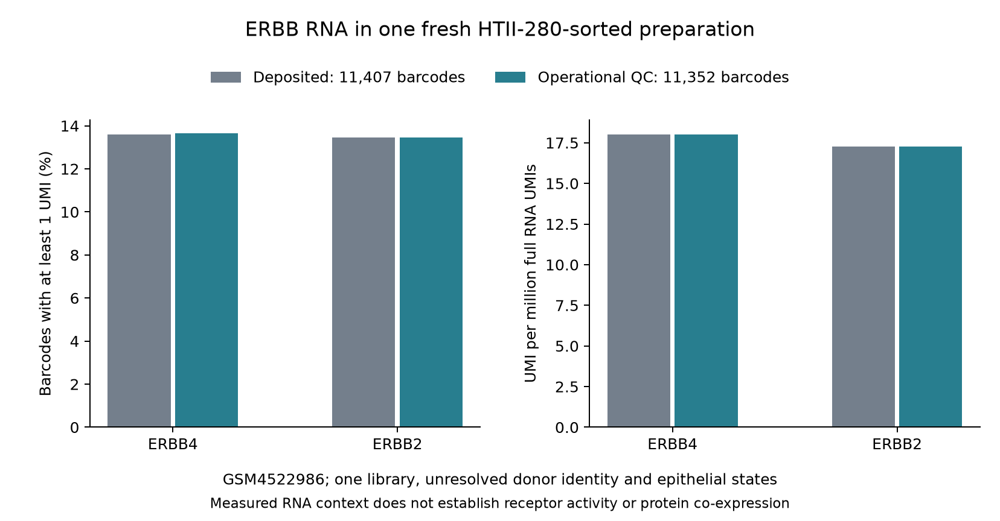

# A12-adjacent ERBB RNA reference in a fresh HTII-280-sorted preparation

**Completed descriptive screen, 3 November 2026.** Both fixed receptor transcripts are detected in the single source-defined GSM4522986 preparation. Operational QC retains 11,352 of 11,407 deposited barcodes: ERBB4 is detected in 13.65%, ERBB2 in 13.46%, and both in 2.03%. This is a measured, sparse RNA reference for the sorted preparation. The nine-library epithelial-state comparison remains **unestimated** because a usable barcode-to-state map was not recovered. One library and thousands of barcodes do not establish biological replication.

## Biological purpose and source

The bounded question is whether this preparation supplies measurable ERBB4/ERBB2 RNA context relevant to the published NRG1 receptor/identity comparison. It does not reproduce Lin's perturbation or explain A12's closed IL-1 pilot. [Prospective question, comparison, validity threats, search and source-access record](ERBB_SORTED_SPEC_V1.md) · [Lin primary-source reading](LIN_REFERENCE_READ_V1.md) · [A19 reused source intake](../../A19_fzd_response_reversibility/EXTERNAL_EVIDENCE.md).

GEO describes [GSM4522986](https://www.ncbi.nlm.nih.gov/geo/query/acc.cgi?acc=GSM4522986) as fresh HTII-280-positive mature AEC2s; we retain **HTII-280-sorted origin**, without certifying a homogeneous AT2 state. Kathiriya's original Fig. 1a/Extended Data Fig. 1a-c and methods define that origin. Gomez/Koyama's 2026 primary finding cautions against assuming purity; its GSE150068 reanalysis shares this source. Exact versions, dates, locators, direct repository checks and access limits are in the specification. No new cell annotation was manufactured.

## Complete measured results

UMI is a recovered RNA molecule count; CPM uses the sum over **all 32,738 source RNA features**, not the two targets. Detection requires at least one target UMI. All detection denominators below count barcodes, not donors.

| Subset | Target | Target UMIs | Full RNA UMIs | Full RNA CPM | Detected / all barcodes | Detection |
|---|---|---:|---:|---:|---:|---:|
| Deposited | ERBB4 | 1,737 | 96,445,036 | 18.0103 | 1,551 / 11,407 | 13.5969% |
| Deposited | ERBB2 | 1,667 | 96,445,036 | 17.2845 | 1,534 / 11,407 | 13.4479% |
| Operational QC | ERBB4 | 1,735 | 96,274,533 | 18.0214 | 1,549 / 11,352 | 13.6452% |
| Operational QC | ERBB2 | 1,661 | 96,274,533 | 17.2527 | 1,528 / 11,352 | 13.4602% |

Both-target co-detection is **231/11,407 (2.0251%)** deposited and **231/11,352 (2.0349%)** after QC. These are co-detected transcripts in the same barcodes, not proof of protein co-expression, receptor assembly or an NRG1-responsive cell state.

The figure shows the four prespecified rows; legend sample counts are **barcodes** from one library. No inferential interval or significance test is appropriate here. The v2 rendering corrects a legend overlap in the archived v1 image; it reads the unchanged summary and supersedes only that display. Raw counts, thresholds and estimates were not rerun or changed.

## QC, source support and unknowns

The operational subset uses positive RNA depth, 200-6000 detected features inclusive and at most 10% mitochondrial UMI, identified by the 13 source `MT-` symbols. It is an **author-method-informed operational reconstruction**, not an exact reproduction of author QC: original wording `unique gene counts` is ambiguous and source code was not recovered. Mitochondrial fraction is UMI-weighted over the full gene matrix. All 55 excluded barcodes exceed the mitochondrial limit; zero barcodes have zero depth, fewer than 200 or more than 6000 detected features. Exclusion reasons and mitochondrial identifiers are retained.

Eight mixed libraries were not numerically screened: organoid day 7/14/21 and live/CD45-negative IPF libraries in GSE150068, plus the three intentionally mixed epithelial/mesenchymal GSE150247 libraries. A whole-library signal would not identify an epithelial recipient state. For all nine libraries, the requested between-state comparison is unestimated. The sorted library's 11,407 barcodes retain unknown cell-state and donor identifiers; no donor continuity, time trajectory, independent donor count or source-state label is invented.

## Interpretation and next decision

Confirmed: this deposited preparation contains detectable ERBB4 and ERBB2 RNA, with sparse joint barcode detection; the fixed QC reconstruction changes these descriptive measurements little. This supplies a reference measurement for the named preparation, not evidence that it is the best recipient model.

Unresolved: ambient RNA, dropout, sort heterogeneity, cellular recovery and unverified donor provenance. A single UMI can reflect technical/background contribution; absence of a detected UMI does not establish biological absence. RNA amounts are not receptor abundance/activity or protein localization. No state ranking, Lin perturbation effect, independent replication, IL-1 specificity, lineage or repair-function claim follows.

The bounded available screen is complete. A between-state follow-up requires recoverable independently justified barcode identities and a new prospective design. A functional NRG1/ERBB comparison additionally needs qualified preparation/protein/response evidence and the missing source effect values; the original A12 independent-replication gate remains unchanged. No more cohorts, thresholds, access applications or outreach were added. Scientific acceptance remains unassessed.

## Reproducibility and review

- Numerical freeze: `5daa3de6310b798ffe423051ad448d071901539e`; [contract](../config/erbb_sorted_contract_v1.json), [source manifest](../config/erbb_sorted_sources_v1.json), [run receipt](../../../analysis/research/runs/A12_erbb_sorted_reference_v1_20261103/receipt.json).
- [Complete summary](../../../analysis/research/runs/A12_erbb_sorted_reference_v1_20261103/receptor_summary.csv), [all barcode measurements](../../../analysis/research/runs/A12_erbb_sorted_reference_v1_20261103/cell_measurements.csv), [source inventory](../../../analysis/research/runs/A12_erbb_sorted_reference_v1_20261103/source_inventory.csv), [QC details](../../../analysis/research/runs/A12_erbb_sorted_reference_v1_20261103/qc_summary.json).
- [Independent original-matrix verification](../../../analysis/research/runs/A12_erbb_sorted_reference_v1_20261103/independent_verification.json): native R 4.6.1/Matrix 1.7.5 and Python streaming agree exactly on all 11,407 barcodes, six integer fields per barcode and four summary rows. R locale startup warnings were retained; no arithmetic mismatch occurred. Internal arithmetic verification is not independent biological validation.
- Figure-only freeze: `1c39f57`; [new contract](../config/erbb_sorted_figure_contract_v2.json), [new receipt](../../../analysis/research/runs/A12_erbb_sorted_figure_v2_20261103/receipt.json). The original image remains in the numerical receipt. Visual review of the corrected image shows a clear outside legend and explicit barcode counts.
- The coordinator separately reconstructed QC, exclusions, IDs and summaries from the barcode deposit (68,488 checks), reusing the original-matrix parity audit. [Coordinator review](../../../docs/research_reviews/2026-11-03-primary-candidate-literature/REMAINING_SCREENING_REVIEW.md) owns that independent review and integration decision.

No biological run failed. Source workbook retrieval remained access-limited; payload types and the missing state map are documented rather than treated as valid evidence. The plotting contract's predecessor reference was corrected during preflight before freeze. Final repository checks and integration status are recorded in the coordinator review/PROGRESS; they do not assign scientific acceptance.

### Provenance registration correction

The first final changed-asset check failed because the two declarative JSON files were registered only as hash-locked inputs. The original freeze, files, numerical/figure contracts, scripts and outputs were preserved. A separate metadata-only freeze `89dd772` binds those same declarative dependencies and verifies their exact bytes against commit `5daa3de` and the original numerical contract input hashes. [Correction contract](../config/erbb_configuration_contract_v1.json) · [verification result](../../../analysis/research/runs/A12_erbb_configuration_binding_v1_20261103/configuration_binding.json) · [receipt](../../../analysis/research/runs/A12_erbb_configuration_binding_v1_20261103/receipt.json). Both records matched exactly. This repairs publication provenance; it adds no biological calculation, changed threshold or validator exception.
