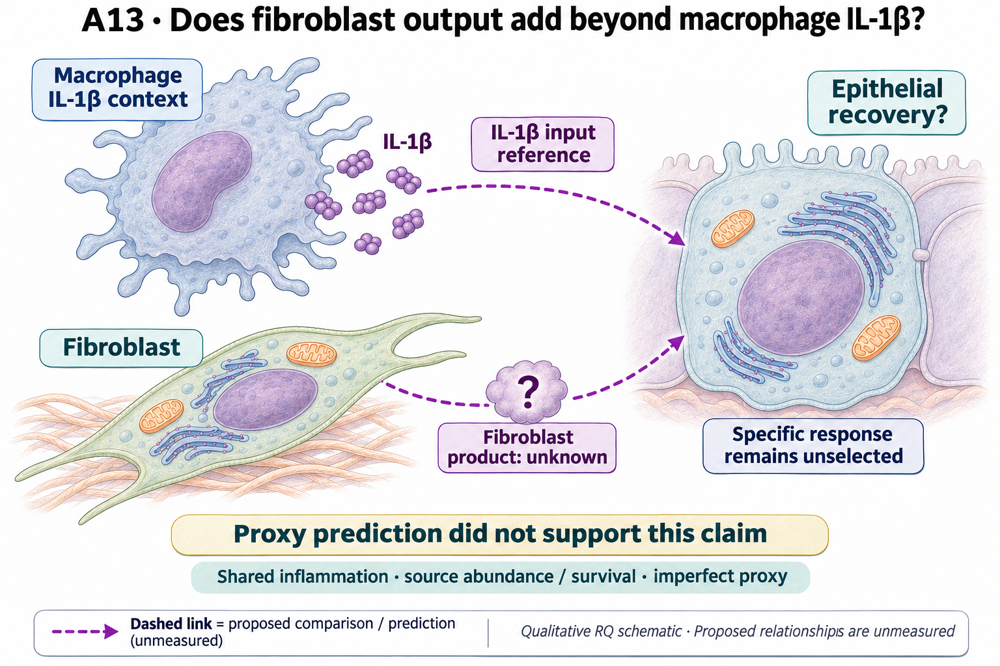

# A13: literature context and hypothesis schematic

[Question home](README.md) · [Scientific dossier](../../docs/research_dossiers/A13.md).

Reviewed 3 October 2026. This note connects published findings to the current proposed question. It is a bounded synthesis, not novelty clearance or scientific acceptance.

## Published starting point

Fibroblast exposure can alter epithelial organoid growth; epithelial IL-1 transitions are also established. These findings motivate asking what fibroblasts add to a macrophage/IL-1 account.

| Primary source | Inspected locator and access record |
|---|---|
| [Ciminieri 2023](https://pmc.ncbi.nlm.nih.gov/articles/PMC12042164/) | Fig. 1 and Results; fibroblast pre-exposure and organoid growth. [Access / prior review](../../docs/history/reviews/NOVELTY_SPECIFICITY_APPLICATION_2026-10-03.md) |
| [Choi 2020](https://pmc.ncbi.nlm.nih.gov/articles/PMC7487779/) | Fig. 7 and Discussion. [Access / prior review](../../docs/history/reviews/NOVELTY_SPECIFICITY_APPLICATION_2026-10-03.md) |

Sources above reuse the named review unless the update ledger explicitly records a fresh inspection. Published-source evidence and reanalysis of the same material are not independent replication.

## Repository observation

The exposed 12-patient paired-triad extension adds the fibroblast TGF-hallmark RNA proxy to macrophage IL1B, mixture and TNF predictors of the epithelial HPCS RNA proxy. Primary held-out MSE worsens by 0.004181 despite smaller individual errors in eight patients; every eligible prespecified sensitivity also worsens. This is an unfavorable predictive result and selects no mediator. Source capture and cohort coverage constrain the replication question. The failed predictor is a specific operational test rather than a comprehensive assay of fibroblast biology. The compartment rule was explicitly amended from the historical gate, and the specification followed prior outcome and A12-result exposure; it is not independent evidence or an execution of the old test.

[Paired-triad prediction and external coverage](../../docs/roadmap_runs/2026-09-27-followthrough/A13_PILOT_AND_COVERAGE.md) · [Separate historical coverage audit](reports/COVERAGE_RESULTS.md). This reuses existing evidence rather than providing a new run or independent replication.

## What this question could add

Useful unfavorable prediction result. It restricts this proxy extension and does not establish absence of all fibroblast contributions. Replacing it with another generic pathway score would require a new biological rationale, not merely an opportunity to obtain a positive result.

A specific source product and an independently measured epithelial consequence remain unnominated. The assigned macrophage term does not establish all active IL1B input or exhaust other cell sources.

## Current hypothesis and rival

Fibroblast output may alter epithelial recovery beyond the effect of macrophage IL-1-beta input. The existing TGF-beta-hallmark/HPCS-proxy pilot found no aggregate held-out gain and nominates no mediator. The biological idea remains incomplete until a particular fibroblast product, epithelial response and source-directed contrast are supported; output nomination is preparatory work, not the hypothesis itself.

**Strongest rival:** Inflammation independently drives both compartments; fibroblast abundance or survival changes total support; the selected transcript score does not measure the relevant output.

## What the comparison would teach

Retain the unfavorable operational result. A future extension should follow a specific published or measured source-product premise and a consequence that could distinguish it. Evidence beyond the current proxy could advance that bounded question; another association in the same score family would not by itself identify feedback.

## Hypothesis schematic

GPT-generated matte illustration, 3 November 2026. Proposed relationships and cell counts are qualitative; the owning context defines the comparison and interpretation limits. [Editorial review](../../docs/audits/2026-11-02-rq-schematic-review/MATTE_PUBLICATION_2026-11-03.md) · [Selected edit prompt](schematics/A13_gpt_matte_v1.prompt.txt). Earlier SVG files are retained as history.

The macrophage IL-1β input is an explicit context/reference; the separate fibroblast-product link asks about additional epithelial support. Neither a particular product nor a fibroblast-mediated route is established. The unfavorable proxy result remains, and source/recipient preparations require biological qualification.

Class-level glyphs and qualitative geometry are not molecular structures, organelle measurements or evidence of functional assembly. Neutral epithelial/stromal shapes do not assert subtype identity or organelle loss, and icon counts are illustrative. Read locally labelled solid premises/references separately from dashed proposed comparisons; no complete mechanism follows from their juxtaposition.

## Next literature check

Planned query (not reported as newly executed): `fibroblast secreted product alveolar epithelial recovery beyond macrophage IL1 functional`. Expand to synonyms, nearest source references/citations and conflicting results using the [literature workflow](../../docs/LITERATURE_WORKFLOW.md). Recheck the exact population, comparison, timing, unit and endpoint before making a stronger contribution claim.

**Current unresolved specification:** The failed TGF-hallmark/HPCS proxy model does not identify a fibroblast output that changes epithelial recovery beyond shared inflammatory context. No mediator is presently nominated by this dossier.

**Interpretation limit:** The failed model is neither a feedback test nor evidence against all fibroblast contributions; a new score cannot retroactively rescue it.

[Current dossier](../../docs/research_dossiers/A13.md) · [All-question context index](../../docs/research_dossiers/literature_context_2026-10-03/README.md)
