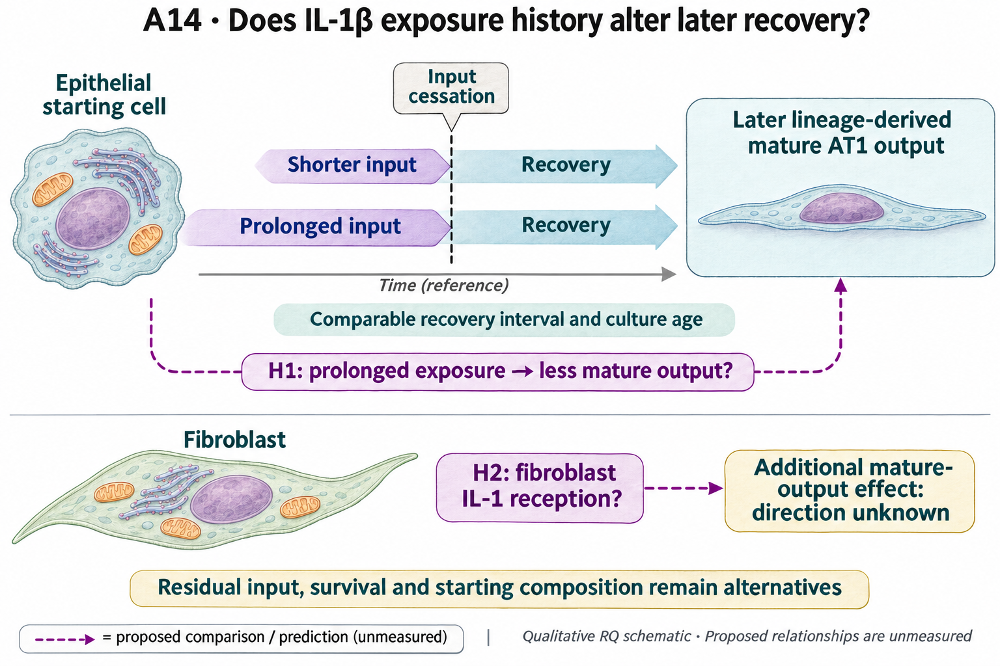

# A14: literature context and hypothesis schematic

[Question home](README.md) · [Scientific dossier](../../docs/research_dossiers/A14.md).

<!-- full-priority-screening-20261103:start -->
**Screening follow-through — 3 November 2026:** The original Choi withdrawal panel and its twelve qPCR endpoints were identified in the primary figure/legend. This completes source intake, not numerical reproduction. Fig7E preparation-level values and the preparation-to-experiment/condition map were not found in the checked attachments. Gapdh/delta-Ct normalization is reported, but the values remain unavailable; continuous-exposure RNA cannot substitute for withdrawal. [Source/endpoint/unit manifest](../../docs/research_reviews/2026-11-03-full-priority-screening/A14_SOURCE_MANIFEST.md). [Reviewed screening sequence](../../docs/research_reviews/2026-11-03-full-priority-screening/PLANS.md) · [Coordination and review](../../docs/research_reviews/2026-11-03-full-priority-screening/README.md).
<!-- full-priority-screening-20261103:end -->

**External context, 1 November 2026:** [Arozamena article-local evidence and limits](../../Research%20Article/ungated_arozamena_2026_inflammatory_memory/RQ_CONNECTIONS.md). The intestinal history reference motivates separating molecular persistence from later response capacity; it does not establish verified input cessation or this question's epithelial/fibroblast mechanisms. This is a context link; the canonical hypothesis, registered illustration and scientific disposition are unchanged.

**Proposed Wagner companion, 4 October 2026:** [Wg-P05](../../Research%20Article/gate2_W1_wagner_th17_autoimmunity/rq_derivation/P05.md) nominates early epithelial glycolytic relaxation after IL-1β withdrawal as a proposed early feature alongside this question's existing history/reception alternatives. It remains an article-local proposal; the canonical hypothesis, prior outcomes and registered illustration here are unchanged. Linked biochemical/output measurements and scientific adoption are not yet qualified.

Reviewed 3 October 2026. This note connects published findings to the current proposed question. It is a bounded synthesis, not novelty clearance or scientific acceptance.

## Published starting point

Withdrawal-associated epithelial recovery and fibroblast IL-1 pre-exposure effects are precedents. Generic reversibility or growth suppression alone would revisit those findings.

| Primary source | Inspected locator and access record |
|---|---|
| [Choi 2020](https://pmc.ncbi.nlm.nih.gov/articles/PMC7487779/) | Fig. 7 and Discussion. [Access / prior review](../../docs/research_dossiers/NOVELTY_SPECIFICITY_APPLICATION_2026-10-03.md) |
| [Ciminieri 2023](https://pmc.ncbi.nlm.nih.gov/articles/PMC12042164/) | Fig. 1 and Results; fibroblast pre-exposure and organoid growth. [Access / prior review](../../docs/research_dossiers/NOVELTY_SPECIFICITY_APPLICATION_2026-10-03.md) |

Sources above reuse the named review unless the update ledger explicitly records a fresh inspection. Published-source evidence and reanalysis of the same material are not independent replication.

## Repository observation

Source intake identified Choi Figure 7E's twelve qPCR endpoints and the relevant withdrawal comparison. The legend reports four biological replicates from two experiments but does not map preparation identities or pairing. Preparation-linked numerical values were not found in the inspected attachments; the figure/methods Limch1 versus Limch2 discrepancy is retained. Continuous-input RNA and a separate metabolic intervention do not reproduce withdrawal.

[Current result, design and limits](../../docs/research_reviews/2026-11-03-full-priority-screening/A14_SOURCE_MANIFEST.md). This reuses existing evidence rather than providing a new run or independent replication.

## What this question could add

Completed source/endpoint clarification with an unestimated local withdrawal effect. Published plausibility does not mean the proposed mature-output or fibroblast-reception question has run. Failure to recover values from these attachments is not proof that no suitable data exist elsewhere.

Preparation-level values, their experimental map and a qualified relation to the intended mature-output endpoint remain missing. RNA marker recovery does not by itself establish mature lineage output or functional recovery.

## Current hypothesis and rival

H1: longer IL-1-beta exposure reduces subsequent lineage-derived mature AT1 recovery after input cessation, with comparable recovery intervals and culture age. H2, assessed separately: fibroblast IL-1 reception modifies that mature-output recovery beyond direct epithelial reception. H2 has no justified direction yet. The proposed increment concerns post-cessation maturation, not the already published effects of withdrawal or fibroblast pre-exposure on organoid formation.

**Strongest rival:** Residual stimulation, different survival or starting composition explains apparent persistence after withdrawal.

## What the comparison would teach

Use the identified source comparison to define what recoverable values could actually estimate. A qualified post-cessation contrast could inform marker recovery; the stronger mature-output and separate fibroblast-reception claims require their own linked endpoints. No direction for fibroblast reception or new interaction effect is invented, and continuous-input data do not substitute for the missing withdrawal contrast.

## Hypothesis schematic

GPT-generated matte illustration, 3 November 2026. Proposed relationships and cell counts are qualitative; the owning context defines the comparison and interpretation limits. [Editorial review](../../docs/audits/2026-11-02-rq-schematic-review/MATTE_PUBLICATION_2026-11-03.md) · [Selected edit prompt](schematics/A14_gpt_matte_v1.prompt.txt). Earlier SVG files are retained as history.

H1 concerns lineage-derived mature recovery after different exposure durations with comparable culture age and recovery interval. H2 separately asks about fibroblast reception without a fixed direction. Units follow the qualified biological preparation; mature yield, function, survival and residual stimulation remain distinct.

Class-level glyphs and qualitative geometry are not molecular structures, organelle measurements or evidence of functional assembly. Neutral epithelial/stromal shapes do not assert subtype identity or organelle loss, and icon counts are illustrative. Read locally labelled solid premises/references separately from dashed proposed comparisons; no complete mechanism follows from their juxtaposition.

## Next literature check

Planned query (not reported as newly executed): `IL1 duration cessation mature AT1 recovery fibroblast epithelial history 2025 2026`. Expand to synonyms, nearest source references/citations and conflicting results using the [literature workflow](../../docs/LITERATURE_WORKFLOW.md). Recheck the exact population, comparison, timing, unit and endpoint before making a stronger contribution claim.

**Current unresolved specification:** Recovery differences have not been separated into lasting cell-state change, residual input, recipient compartment and differential survival.

**Interpretation limit:** A delayed RNA response after nominal withdrawal does not establish intrinsic memory or irreversible fate.

[Current dossier](../../docs/research_dossiers/A14.md) · [All-question context index](../../docs/research_dossiers/literature_context_2026-10-03/README.md)
