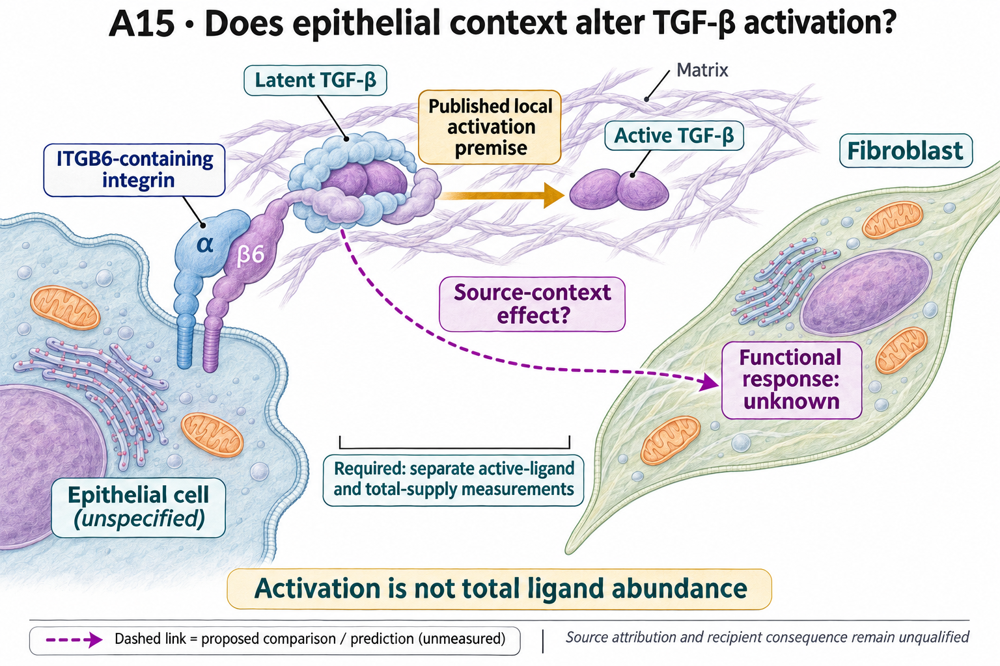

# A15: literature context and current argument

[Question home](README.md) · [Scientific dossier](../../docs/research_dossiers/A15.md).

Synthesis updated 4 November 2026 using the recorded primary-source reviews and
current owning results. Their actual search dates, versions, access and figure
locators remain in the records below. No new literature search or biological run
was performed for this documentation batch.

## Published starting point

Epithelial alpha-v-beta-6 activation of latent TGF-beta is an established mechanism. A15 should explicitly build on it instead of rediscovering it from receptor RNA.

| Primary source | Inspected locator and access record |
|---|---|
| [Munger 1999](https://pubmed.ncbi.nlm.nih.gov/10025398/) | Primary record/abstract, integrin activation of latent TGF-beta. [Access / prior review](../../docs/research_dossiers/review_2026-10-03/SOURCES.md#s12) |

Sources above reuse the named review unless the update ledger explicitly records a fresh inspection. Published-source evidence and reanalysis of the same material are not independent replication.

Munger's published epithelial alpha-v-beta-6 mechanism is an explicit premise, not a discovery from receptor RNA. Horan supplies the prior antibody-response direction used by the separate mouse side branch. [Primary-source context](../../RQ_Specified/A15_epithelial_integrin_tgfb_activation/LITERATURE_CONTEXT.md#published-starting-point) and the [interpretation clarification](../../RQ_Specified/A15_epithelial_integrin_tgfb_activation/reports/INTERPRETATION_AUDIT_2026-09-27.md) distinguish a general mechanism, a downstream response and the untested A2-specific attribution.

## Repository observation

Read the [28 September normalization erratum](../../RQ_Specified/A15_epithelial_integrin_tgfb_activation/reports/NORMALIZATION_ERRATUM_2026-09-28.md) before the [original result](../../RQ_Specified/A15_epithelial_integrin_tgfb_activation/reports/RIVAL2_RESULTS.md). The separate GSE190821 comparison has **four antibody-treated versus four control mice**, with paired epithelial-enriched immunoprecipitate and whole-lung input. It is not the technically confounded A2 split-well association.

Whole-lung collagen/myofibroblast RNA falls under the antibody contrast: the original standardized score difference is -1.2424, with complete observed separation. This is downstream pharmacodynamic RNA evidence, not integrin occupancy or isolated fibroblast function. The epithelial transitional and identity panels do not separate groups. The original normalization sensitivity double-counted a depth component and is withdrawn; the versioned correction uses unchanged panels and remains non-separating.

| Corrected epithelial panel | Mean difference in log2 normalized-count score | Exact rank-sum p |
|---|---:|---:|
| Transitional | -0.085856 | 0.685714 |
| Identity | +0.021399 | 0.885714 |

These corrected scores are not on the original standardized CPM scale. Wide endpoint intervals remain compatible with substantial shifts. The paired marker audit supports epithelial enrichment with no flagged large measured arm difference; it does not prove pure, equivalent or composition-invariant epithelium. Four mice per arm, unknown allocation randomization and a day-7 enriched translatome leave consequential limits.

## Does the evidence warrant the narrowing?

**Rationale verdict: a corrected diagnostic boundary; source-specific activation remains an incomplete inference.** A matrix-RNA change alongside non-separating epithelial panels does not exclude epithelial mediation, earlier transient effects or altered subtype composition. The historical algorithmic label is retained but supplies no causal bound on the parent mechanism. Failure to detect a mediator is not a mediation test.

The initial side-branch freeze preceded its outcomes; the correction was frozen before corrected estimates after the original result was known. Repairing normalization adds no animals or independent validation. The original Itgb6 association remains vulnerable to split-well/position and preparation effects. Published integrin biology makes activation plausible, but neither that premise nor the corrected negative panels selects it over ligand supply, other activators or recipient context.

## What remains unmeasured

Active versus total ligand and a meaningful recipient endpoint are absent from an identifiable source-specific comparison. The corrected side branch does not pass the parent comparison's missing eligibility requirements or qualify a new mechanism test.

The unchanged registered hypothesis below is a proposal. The rationale assessment
does not select its mechanism or confer scientific acceptance.

## Current hypothesis and rival

Epithelial ITGB6-containing integrin activity may change fibroblast response by activating latent TGF-beta, rather than by changing total ligand supply. That pathway is already established. The repository-specific idea is whether the epithelial Itgb6-associated fibroblast response in the A2 context is explained by this activation route; neither active TGF-beta nor a decisive fibroblast functional endpoint was measured there.

**Strongest rival:** Differences reflect total ligand, another activator, matrix context, recipient composition or technical depth/preparation effects.

## What the comparison would teach

A source-attributable active-ligand change at comparable latent supply, linked to a qualified recipient response, would support the activation account. Supply-only changes or a response that persists independently of the activation contrast would restrict it. An unresolved or imprecise epithelial effect remains unresolved; non-significance is not equivalence.

Reuse the corrected measurements and interpretation audit. The next decision is whether an eligible source can distinguish ligand activation from supply in the stated recipient context. More receptor RNA or the same non-separating epithelial score cannot do so. This documentation pass nominates no assay, margin or new execution.

## Hypothesis schematic

GPT-generated matte illustration, 3 November 2026. Proposed relationships and cell counts are qualitative; the owning context defines the comparison and interpretation limits. [Editorial review](../../docs/audits/2026-11-02-rq-schematic-review/MATTE_PUBLICATION_2026-11-03.md) · [Selected edit prompt](schematics/A15_gpt_matte_v1.prompt.txt). Earlier SVG files are retained as history.

The local published premise is activation of latent TGF-β by an ITGB6-containing epithelial integrin. Active versus total ligand supply and the proposed source-context effect remain separate. The fibroblast recipient is explicit, while its functional response and source attribution remain unresolved.

Class-level glyphs and qualitative geometry are not molecular structures, organelle measurements or evidence of functional assembly. Neutral epithelial/stromal shapes do not assert subtype identity or organelle loss, and icon counts are illustrative. Read locally labelled solid premises/references separately from dashed proposed comparisons; no complete mechanism follows from their juxtaposition.

## Earlier source and development records

The following records preserve dated searches, access limits, outcome exposure,
earlier interpretations and review blocks. Read current results/amendments above
before any older plan. Planned queries remain plans; an absent hit never proves
novelty or global data absence. A newly specified comparison needs its relevant
source review under the [literature workflow](../../docs/LITERATURE_WORKFLOW.md).

Dated source searches and retained development notes

[Question home](README.md) · [Scientific dossier](../../docs/research_dossiers/A15.md).

<!-- full-priority-screening-20261103:start -->
**Screening follow-through — 3 November 2026:** Reuse the corrected 28 September normalization and the four-versus-four-mouse perturbation RNA comparison: matrix RNA declines, while the epithelial panels do not separate the groups. Direct active-versus-total TGF-beta measurements are absent. Non-separation is not equivalence or exclusion of epithelial mediation; the obsolete normalization remains superseded. [Authoritative normalization erratum](reports/NORMALIZATION_ERRATUM_2026-09-28.md). [Reviewed screening sequence](../../docs/research_reviews/2026-11-03-full-priority-screening/PLANS.md) · [Coordination and review](../../docs/research_reviews/2026-11-03-full-priority-screening/README.md).
<!-- full-priority-screening-20261103:end -->

Reviewed 3 October 2026. This note connects published findings to the current proposed question. It is a bounded synthesis, not novelty clearance or scientific acceptance.

## Repository observation

The Itgb6 side branch is observational and technically confounded by split wells and position. The 28 September normalization correction supersedes the earlier double-depth-normalized result; the parent mechanism remains blocked.

Exact current result locators:

- [RQ_Specified/A15_epithelial_integrin_tgfb_activation/README.md](README.md)
- [RQ_Specified/A15_epithelial_integrin_tgfb_activation/reports/RIVAL2_RESULTS.md](reports/RIVAL2_RESULTS.md)
- [docs/research_dossiers/followup_2026-10-03/NOVELTY.md](../../docs/research_dossiers/followup_2026-10-03/NOVELTY.md)

## What this question could add

A context-qualified activity comparison could attribute activation to an epithelial route versus another source. The relevant context, functional consequence and owner review remain open; this is not a new general pathway.

## What the comparison would teach

A source-attributable change in active TGF-beta and the nominated recipient response at comparable latent supply would favor activation. Supply-only change or a response independent of the activation contrast favors rivals. Itgb6 RNA, total TGF-beta and a fibroblast RNA score cannot substitute for active ligand and function.

## Next literature check

Planned query (not reported as newly executed): `epithelial ITGB6 latent TGFbeta activation context functional fibroblast rival`. Expand to synonyms, nearest source references/citations and conflicting results using the [literature workflow](../../docs/LITERATURE_WORKFLOW.md). Recheck the exact population, comparison, timing, unit and endpoint before making a stronger contribution claim.

**Current unresolved specification:** Active ligand, total ligand, epithelial integrin context and fibroblast response have not been measured in an identifiable comparison.

**Interpretation limit:** Itgb6 RNA, ligand RNA and a TGF response score do not individually identify the activation mechanism.

[Current dossier](../../docs/research_dossiers/A15.md) · [All-question context index](../../docs/research_dossiers/literature_context_2026-10-03/README.md)

