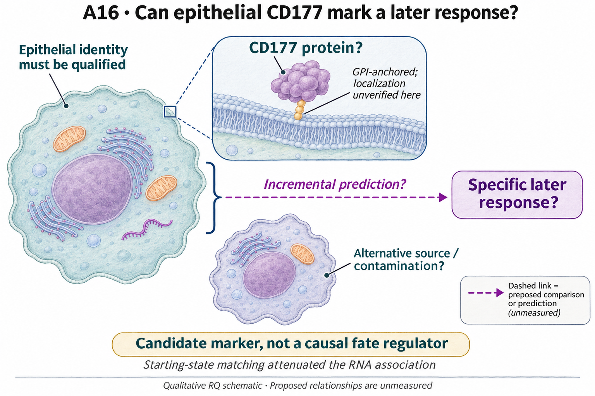

# A16: does CD177 identify a priming phenotype within comparable mutant cells?

## Organizing Biological Q

Does CD177 identify a useful prospective epithelial response context, or merely a concurrent transcriptional neighborhood?

A marker can be predictive without being causal. Before interpreting CD177 as intrinsic priming, source identity and the timing of the proposed response must be distinguished from RNA proximity.

Current synthesis: 4 November 2026. [Full rationale](../../docs/research_dossiers/A16.md) · [Source context](LITERATURE_CONTEXT.md).

<!-- literature-visual-context:start -->
<a id="literature-context-and-visual-hypothesis"></a>

## Literature context & visual hypothesis

[What previous findings contribute, what remains, and what the readouts would decide](LITERATURE_CONTEXT.md).



GPT-generated matte illustration, 3 November 2026. Proposed relationships and cell counts are qualitative; the owning context defines the comparison and interpretation limits. [Editorial review](../../docs/audits/2026-11-02-rq-schematic-review/MATTE_PUBLICATION_2026-11-03.md) · [Selected edit prompt](schematics/A16_gpt_matte_v1.prompt.txt). Earlier SVG files are retained as history.

*Explanatory proposal, not measured results. Read the linked context and caption; arrows do not certify a mechanism or novelty.*
<!-- literature-visual-context:end -->

The illustration presents the registered question and untested relationships. The current argument follows the result below; the drawing does not establish its proposed mechanism.

## What the analysis changed

Matching attenuates the fixed four-gene mean log1p(full-library CP10k) score contrast from 1.256 to 0.410 and from 1.332 to 0.315 in the two libraries, while substantial imbalance remains. Independent animal identities, a linked later response and complete exclusion of contamination are not available. This was an amended computation on fully exposed data. Matching uses concurrent RNA coordinates, not an independently measured pre-intervention starting state; the registered hypothesis's historical phrase "starting-state matching" must be read with that limit. Excluding the 660 direct grouping/outcome genes does not eliminate correlated-feature overadjustment, shared normalization or detection-dependent selection. Matching does not convert these libraries into independent animal-level evidence.

[Current result, design and limits](correction_20260928/reports/CORRECTED_C1_REPORT.md).

**Rationale check.** A diagnostic restriction on the marker interpretation. The attenuation shows sensitivity to the measured context but neither proves all of the signal is confounded nor establishes an intrinsic programme. No priming mechanism or later fate prediction has been selected.

## Current interpretation and next decision

Source/protein attribution, qualified biological units and a specified later response remain unlinked. Current marker-positive RNA cannot establish prospective competence.

Keep the matched and unmatched observations together. Independently attributed CD177 status linked to a later response could support a prospective marker claim; loss of that relationship under source/context qualification would restrict it. A causal perturbation claim is a different question and is not required merely to evaluate a marker.

## Registered scope and analysis history

The records below preserve earlier framing and execution checkpoints. Read the current result before an older plan. Historical unfinished-work wording does not supersede completed later diagnostics. Registered hypotheses remain unchanged; this synthesis grants no claim grade or human acceptance.

<details>
<summary>Registered framing and retained analysis history</summary>

<!-- current-rq-framing:start -->
<a id="current-biological-hypothesis-and-novelty-boundary--3-october-2026"></a>

## Organizing Biological Q

Epithelial CD177 protein may identify a priming phenotype within comparable mutant transitional cells that differs in a later response. It is a candidate marker, not a proposed causal fate regulator. Source/protein attribution and one specific later response still need qualification; the corrected RNA comparison attenuated after improved starting-state matching.

**What is already known, and what remains:** State markers and mutant epithelial heterogeneity are precedents. A prospective, source-validated marker contribution is possible, but the missing response prevents a complete novelty judgment. [Primary-source comparison](../../docs/research_dossiers/NOVELTY_SPECIFICITY_APPLICATION_2026-10-03.md#a16).

**What the measurements would decide:** Confirmed epithelial protein followed by a later response difference within comparable baseline states supports marker utility. Disappearance after source or state control favors contamination or mixture. Endpoint RNA differences alone do not show priming, and CD177 perturbation would ask a different causal question.

**Current disposition:** Protein attribution and later endpoint required. This revision specifies proposed work; scientific acceptance, model access and assay qualification remain pending.

| Evidence and implementation | Current boundary |
|---|---|
| Biological unit and endpoint | Source/genotype-identified epithelial populations nested in animal/preparation units. First qualify protein localization and specificity; nominate one later response and denominator before testing, keeping expansion, survival and switching distinct. |
| Current evidence and limit | Corrected matching attenuates the RNA association and leaves residual imbalance. It does not establish intrinsic priming, complete exclusion of contamination or a later lineage advantage. |
| Next decision / hold | Scientific review is deferred. Hold later-response fitting until a valid baseline marker and linked endpoint are available; the existing residual does not establish a causal CD177 role. |

**Read in this order:** [current evidence](correction_20260928/reports/CORRECTED_C1_REPORT.md),
[development dossier](../../docs/research_dossiers/A16.md),
[conditional hypothesis package](../../docs/research_dossiers/packages_2026-10-03/A16.md).
[Deferred work](../../docs/research_dossiers/REMAINING_WORK.md) and
[execution requirements](../../docs/RESEARCH_GOVERNANCE.md) govern any later
analysis. Draft completion does not establish assay validity, resource access,
meaningful effects, precision or scientific acceptance. Existing numerical
results and original plans below retain their recorded scope.
<!-- current-rq-framing:end -->


## Evidence, analyses and next steps

<!-- evidence-followthrough:start -->
**Evidence follow-through — 3 November 2026:** Exclude the affirmative claim
“Residual CD177-associated RNA proves intrinsic priming or excludes contamination.” from current conclusions.
[Bounded fill, stop rule and reopening evidence](../../docs/audits/2026-11-03-rq-evidence-trajectory/CUT_OR_FILL_PLAN.md#a16).
The hypothesis remains a proposal where its decisive comparison is untested.
<!-- evidence-followthrough:end -->

The existing analysis records below retain their scope. Read the latest linked result or amendment before an older plan.

**Later evidence reconciled 1 October 2026:** the [corrected C1 analysis on main](https://github.com/xorca0711/scRNA_seq/blob/f61343cc16c83e979b071393adccdcf8084ea294/RQ_Specified/A16_cd177_state_attribution/correction_20260928/reports/CORRECTED_C1_REPORT.md)
has executed the population/neighbourhood amendment. The [canonical card](../../RESEARCH_QUESTIONS.md#a16)
now reflects its attenuation and residual imbalance. Intrinsic priming and the
functional test remain unresolved; historical Stage 1 results below are preserved.

<a id="biological-question"></a>

<a id="organizing-biological-question"></a>

### Earlier organizing question

> Does CD177 identify a priming phenotype within comparable mutant cells?

The proposed hypothesis is that CD177 identifies a priming-associated RNA
phenotype within the same transitional mutant epithelial compartment, beyond
differences in the mixture of states. A stable intrinsic programme and a
neighbourhood-associated phenotype could coexist.

This folder tests attribution using population restrictions, depth and
contamination sensitivities, and local matching within libraries. Those checks
address alternative explanations for an RNA association; persistence,
CD177-specific function and growth potential need independent outcomes.

**Read first:** [question card](../../RESEARCH_QUESTIONS.md#a16),
[rationale amendment, corrected 29 September 2026](RATIONALE.md#amendment-28-september-2026-the-rationale-as-successive-evidence-states),
[plan](PLAN.md), [integration review](reports/INTEGRATION_REVIEW.md),
[corrected C1 result](correction_20260928/reports/CORRECTED_C1_REPORT.md).

### Evidence and analysis history

**Current status, 28 September 2026: proposed; partly measured and inconclusive.**
The [shared question card](../../RESEARCH_QUESTIONS.md#a16) owns the hypothesis.
Read the [integration review](reports/INTEGRATION_REVIEW.md) before the original
Stage 1 report. Publication of these results does not establish a mechanism or
change a historical claim grade.

A separately frozen [corrected C1 comparison](correction_20260928/reports/CORRECTED_C1_REPORT.md)
now preserves the original population per library and excludes tested genes
before neighbourhood construction. Priming differences attenuate but remain
positive; substantial residual imbalance and other biological limits remain.
This completes the bounded computational correction, with original Stage 1 intact.

**Rationale amended, 28 September 2026.** The Stage 0 text in [RATIONALE.md](RATIONALE.md)
is preserved unedited and followed by a dated amendment that restates the
question as *what can be attributed to a CD177-associated priming RNA phenotype
within comparable mutant transitional cells, and what remains unresolved about
state mixture, detection and contamination*. It records four successive evidence
states and a claim-by-claim ledger of which original statements the integration
review and corrected C1 superseded or qualified. No analysis, claim row or grade
changed; the frozen contract and erratum are untouched.

### What has run

C3/C4 and then C1/C2/C5 ran on previously exposed England data. The population
amendment distinguishes the transition gate per library from FU_C's original
pooled, all-cell subclusters. The latter is a diagnostic of the old result,
not a within-transition, per-library contrast. C1 used UMAP as a declared
substitute for the frozen integrated space.

Matched-gene specificity is inconclusive: seven of nine descriptive entries
have fewer than 40 control genes. Remaining effects under the neutrophil-panel
adjustment do not exclude ambient contamination. Full-depth cutoff stability
does not replace thinning: all four primary-library thinning rows fail the
cell floor. The original report's stronger exclusions are superseded.

### What remains open

The corrected same-population attribution test needs a prospective amendment
if pursued. Independent marker/outcome linkage is required for a stable,
functionally distinct phenotype. Existing external candidates have not become
matched validation simply because Stage 1 ran. No new biological analysis was
executed during branch integration.

| Record | Role |
|---|---|
| [Current integration review](reports/INTEGRATION_REVIEW.md) | Current interpretation and unresolved comparisons |
| [Original Stage 1 results](reports/STAGE1_RESULTS.md) | Historical numerical report; stronger interpretations superseded |
| [Population erratum](reports/STAGE1_ERRATUM.md) | Pre-execution two-arm amendment |
| [Rationale](RATIONALE.md): Stage 0 text plus dated amendment | Stage 0 premises preserved as history; the amendment is the current argument and ledger |
| [Plan](PLAN.md), [contract](config/a16_question_contract.json) | Preserved planning history; original status lines are not the current verdict |
| [Public-data search](reports/PUBLIC_DATA_SEARCH.md) | Dated search boundaries |
| [Verification record](reports/INTEGRATION_VALIDATION.json), [verifier](scripts/verify_stage1_evidence.py) | Lightweight provenance and table checks; no raw-data replay |

Run the verifier from a clean clone with standard-library Python:

```bash
python RQ_Specified/A16_cd177_state_attribution/scripts/verify_stage1_evidence.py
```

Keep cell thresholds, exposure history and missing biological-unit identities
explicit. Do not pool libraries to claim independent replication or substitute
cycling RNA for a measured outcome. Original execution scripts overwrite
outputs; they must not be replayed over the archived evidence.

</details>
