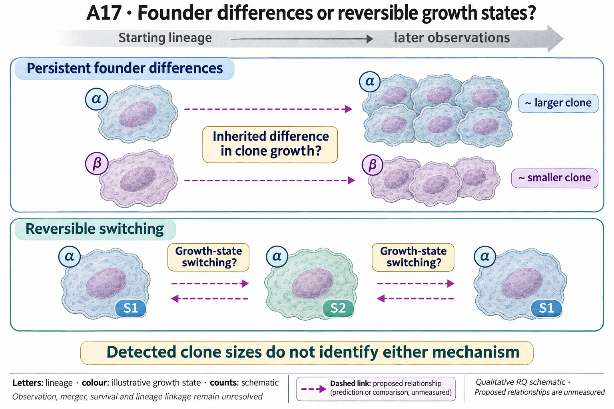

# A17: literature context and hypothesis schematic

[Question home](README.md) · [Scientific dossier](../../docs/research_dossiers/A17.md).

Primary-source reviews retain their recorded dates and access limits. Synthesis updated 4 November 2026 using those records and current results, without a new literature search. This is a bounded rationale assessment, not novelty clearance or scientific acceptance.

## Published starting point

The source clonal experiments motivate models of growth heterogeneity and state change. A latent founder class is a model component, not an independently identified cell type.

| Primary source | Inspected locator and access record |
|---|---|
| [England 2025](https://doi.org/10.1016/j.stem.2025.01.011) | Clonal evidence and mutant-state plasticity; abstract/source audit. [Access / prior review](../../docs/research_dossiers/review_2026-10-03/SOURCES.md#s08) |

Sources above reuse the named review unless the update ledger explicitly records a fresh inspection. Published-source evidence and reanalysis of the same material are not independent replication.

## Repository observation

The completed synthetic qualification uses terminal weeks 1/2/4 and the 11-mouse sampling design. Candidate size laws differ under uniform detection. Under unconstrained size/time-dependent detection, however, persistent-founder, switching and combined families can yield the same retained-size law. This is a mathematical existence result and a numerical diagnostic: no England clone outcome was fitted, and the constructed detection weights were not measured in the experiment.

Prior source outcomes and simulator/ascertainment results were exposed. The switching rates are illustrative numerical fixtures, not inferred biology or justified empirical search bounds. Synthetic replicates use the source sampling design; they add no independent mice.

[Current result, design and limits](../../docs/audits/2026-11-03-rq-evidence-trajectory/A17_TECHNICAL_RESULT.md). This reuses existing evidence rather than providing a new run or independent replication.

## What this question could add

Useful diagnostic boundary. The earlier simulator and denominator checks now lead to a concrete reason to stop empirical mechanism selection: growth and observation can be confounded. This does not disprove founder persistence or discover a cell type. Solver/recoverability work is completed; older unfinished-work wording is historical.

The actual detection/merger process and a justified bounded model domain remain unqualified. Retained sizes alone do not identify founder incidence, extinction or longitudinal state transitions.

## Current hypothesis and rival

Persistent differences inherited from founder lineages may contribute to unequal mutant clone growth beyond reversible state switching and observation effects. A fitted founder class is a latent model term, not a discovered cell type. The current comparison concerns detected clone-size distributions until ascertainment and longitudinal linkage are qualified; numerical solver and identifiability work remain unfinished.

**Strongest rival:** State switching, differential survival, clone merger or observation error accounts for apparent founder persistence.

## Current disposition of the registered scope

The registered wording above retains its earlier unfinished-work statement. The 3 November solver/recoverability diagnostic is now complete; empirical mechanism selection remains stopped for the observation limits above.

## What the comparison would teach

Keep empirical mechanism selection stopped under current observation uncertainty. Independent evidence constraining detection/merger and the model domain could justify a conditional prediction comparison. Distinguishable models under those constraints would make that comparison informative; continued ambiguity would retain the limit. Neither outcome makes a latent model class a molecular cell type.

## Hypothesis schematic

GPT-generated matte illustration, 3 November 2026. Proposed relationships and cell counts are qualitative; the owning context defines the comparison and interpretation limits. [Editorial review](../../docs/audits/2026-11-02-rq-schematic-review/MATTE_PUBLICATION_2026-11-03.md) · [Selected edit prompt](schematics/A17_gpt_matte_v1.prompt.txt). Earlier SVG files are retained as history.

Persistent inherited founder differences in unequal clone growth are contrasted with reversible growth-state switching and observation effects. Symbols denote lineage and colours illustrate growth state; icons are conceptual model patterns, not measured clone sizes. Loss, survival and detection must be assessed before interpreting observed clone-size distributions.

Class-level glyphs and qualitative geometry are not molecular structures, organelle measurements or evidence of functional assembly. Neutral epithelial/stromal shapes do not assert subtype identity or organelle loss, and icon counts are illustrative. Read locally labelled solid premises/references separately from dashed proposed comparisons; no complete mechanism follows from their juxtaposition.

## Next literature check

Planned query (not reported as newly executed): `alveolar mutant clone size founder heterogeneity switching observation model identifiability`. Expand to synonyms, nearest source references/citations and conflicting results using the [literature workflow](../../docs/LITERATURE_WORKFLOW.md). Recheck the exact population, comparison, timing, unit and endpoint before making a stronger contribution claim.

**Current unresolved specification:** Synthetic recoverability under common observations has been evaluated. No empirical source-clone outcome comparison was fitted; a predictive comparison remains conditional on qualified ascertainment and a justified model domain.

**Interpretation limit:** A fitted latent founder class is not a distinct biological cell type or a demonstrated molecular mechanism.

[Current dossier](README.md) · [All-question context index](../../docs/research_dossiers/literature_context_2026-10-03/README.md)

## Cut-or-fill execution — 3 November 2026

The new synthetic observation qualification is executed. Unqualified size-dependent detection admits observationally equivalent families; empirical mechanism selection remains held. Uniform-detection indistinguishability is not claimed.

[Current technical result and limits](../../docs/audits/2026-11-03-rq-evidence-trajectory/A17_TECHNICAL_RESULT.md) · [Execution ledger](../../docs/audits/2026-11-03-rq-evidence-trajectory/TECHNICAL_STATUS.md).
