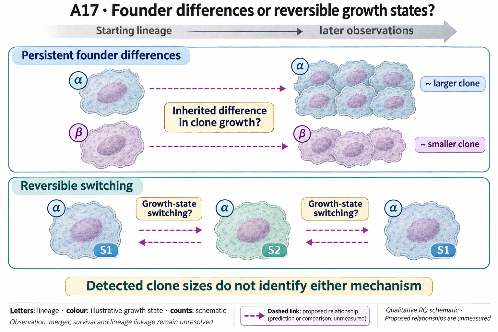
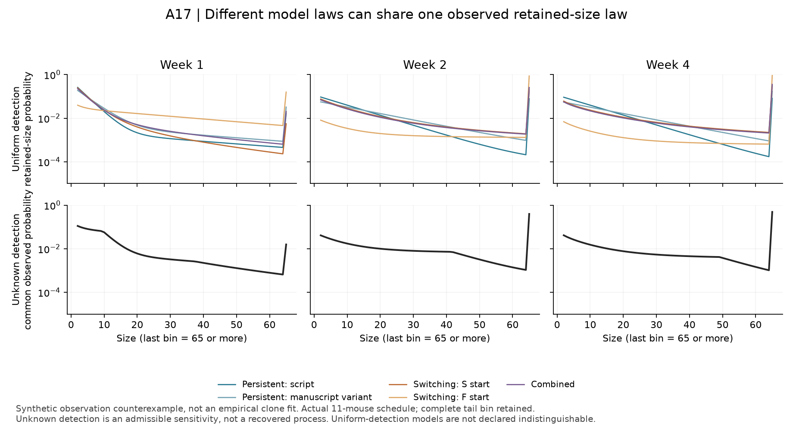

# A17: clonal growth persistence

## Organizing Biological Q

Do persistent founder differences explain unequal mutant clone growth, and can observed clone sizes distinguish that account from reversible state switching?

England's clonal observations motivate competing growth models. A founder class is a latent model term, not an independently identified molecular cell type.

Current synthesis: 4 November 2026. [Full rationale](../../docs/research_dossiers/A17.md) · [Source context](LITERATURE_CONTEXT.md).

<!-- literature-visual-context:start -->

## Literature context & visual hypothesis

[Published findings, repository observations and interpretation limits](LITERATURE_CONTEXT.md).

GPT-generated matte illustration, 3 November 2026. Proposed relationships and
cell counts are qualitative. [Editorial review](../../docs/audits/2026-11-02-rq-schematic-review/MATTE_PUBLICATION_2026-11-03.md) · [Selected edit prompt](schematics/A17_gpt_matte_v1.prompt.txt). Earlier artwork is retained as history.
<!-- literature-visual-context:end -->

The illustration presents the registered question and untested relationships. The current argument follows the result below; the drawing does not establish its proposed mechanism.

## What the analysis changed

The completed synthetic qualification uses terminal weeks 1/2/4 and the 11-mouse sampling design. Candidate size laws differ under uniform detection. Under unconstrained size/time-dependent detection, however, persistent-founder, switching and combined families can yield the same retained-size law. This is a mathematical existence result and a numerical diagnostic: no England clone outcome was fitted, and the constructed detection weights were not measured in the experiment.

Prior source outcomes and simulator/ascertainment results were exposed. The switching rates are illustrative numerical fixtures, not inferred biology or justified empirical search bounds. Synthetic replicates use the source sampling design; they add no independent mice.

[Current result, design and limits](../../docs/audits/2026-11-03-rq-evidence-trajectory/A17_TECHNICAL_RESULT.md).

The existing result figure is reused unchanged. Its owning report records the units, provenance and display limits.

**Rationale check.** Useful diagnostic boundary. The earlier simulator and denominator checks now lead to a concrete reason to stop empirical mechanism selection: growth and observation can be confounded. This does not disprove founder persistence or discover a cell type. Solver/recoverability work is completed; older unfinished-work wording is historical.

## Current interpretation and next decision

The actual detection/merger process and a justified bounded model domain remain unqualified. Retained sizes alone do not identify founder incidence, extinction or longitudinal state transitions.

Keep empirical mechanism selection stopped under current observation uncertainty. Independent evidence constraining detection/merger and the model domain could justify a conditional prediction comparison. Distinguishable models under those constraints would make that comparison informative; continued ambiguity would retain the limit. Neither outcome makes a latent model class a molecular cell type.

## Registered scope and analysis history

The records below preserve earlier framing and execution checkpoints. Read the current result before an older plan. Historical unfinished-work wording does not supersede completed later diagnostics. Registered hypotheses remain unchanged; this synthesis grants no claim grade or human acceptance.

Registered framing and retained analysis history

## Organizing Biological Q

Do persistent founder differences improve prediction of mutant clone growth over switching, survival and measurement alternatives?

**Unresolved gap:** Competing model families have not been compared under common observations, biological units and held-out predictive criteria.

[Working hypothesis and competing explanations](../../docs/research_dossiers/A17.md#working-hypothesis) · [Canonical card](../../RESEARCH_QUESTIONS.md#a17).

## Current evidence and interpretation

<!-- evidence-followthrough:start -->
**Evidence follow-through — 3 November 2026:** Exclude the affirmative claim
“A diagnostic recovered actual founder prevalence or disproved the founder model.” from current conclusions.
[Bounded fill, stop rule and reopening evidence](../../docs/audits/2026-11-03-rq-evidence-trajectory/CUT_OR_FILL_PLAN.md#a17).
The hypothesis remains a proposal where its decisive comparison is untested.
<!-- evidence-followthrough:end -->

**Subsequent evidence — 7 October 2026:** The [source-parameter ascertainment extension](../../docs/portfolio_extensions/2026-10-07/g1_epithelial/RESULTS.md) now separates founder, retained-clone and expected-cell fractions. At week 4, 8% fast founders yield 8.24% of retained size>=2 clones and 95.01% of expected retained cells under the fixed model. This is a mathematical ratio of expectations, not measured tissue composition or a fitted founder-versus-switching result.

**Current entrypoints:** [existing source-analysis context](../../Research%20Article/gate2_C2_england_2025/README.md) ·
[conditional hypothesis package](../../docs/research_dossiers/packages_2026-10-03/A17.md).
The package draft exists. The requested specificity/novelty revision is applied;
scientific acceptance and experiment-specific qualification remain pending. Use [current work disposition](../../docs/history/planning/REMAINING_WORK.md), not an older
package-pending checkpoint, to decide what is active.
The [numerically qualified model specification](../../docs/research_dossiers/continuation_2026-10-03/A17_MODEL_SPEC.md) is available; probability/tail, observation and identifiability work before biological fitting remains deferred and unfinished.

Do persistent founder differences help explain unequal mutant clone growth?

Status: proposed refinement, 3 October 2026. This is a development aid, not scientific acceptance or an experimental protocol.

Source accounting covers 58 rows and 11 source mice. The deposited slow-loss branch is unreachable in its current simulator implementation; the corrected stochastic model comparison remains unrun.

Evidence locators (source citations and numerical details remain in these records):

- [Research Article/gate2_C2_england_2025/README.md](../../Research%20Article/gate2_C2_england_2025/README.md)

## Analysis plan and next decision

Freeze competing model families, source-unit handling and identifiability diagnostics before a corrected fit. Preserve the original code defect and do not treat model fit as lineage proof.

[Plan and existing implementation](PLAN.md) · [Full scientific dossier](../../docs/research_dossiers/A17.md) · [Current interpretation boundary](../../docs/research_dossiers/A17.md#interpretation-boundary).

This folder is the question home. Existing paper-owned analyses, shared code and frozen runs retain their original ownership and paths.

## Cut-or-fill execution — 3 November 2026

The new synthetic observation qualification is executed. Unqualified size-dependent detection admits observationally equivalent families; empirical mechanism selection remains held. Uniform-detection indistinguishability is not claimed.

[Current technical result and limits](../../docs/audits/2026-11-03-rq-evidence-trajectory/A17_TECHNICAL_RESULT.md) · [Execution ledger](../../docs/audits/2026-11-03-rq-evidence-trajectory/TECHNICAL_STATUS.md).

[SVG](../../analysis/research/runs/cut_fill_a17_figure_v1_20261103/a17_observation_ambiguity_v1.svg) · [render receipt](../../analysis/research/runs/cut_fill_a17_figure_v1_20261103/receipt.json).

