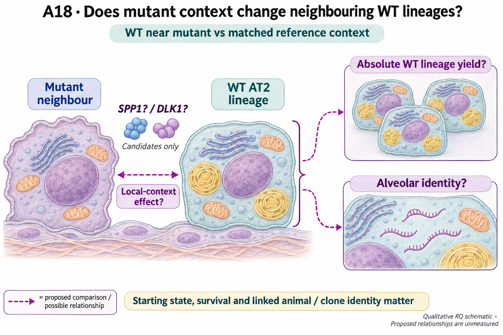

# A18: literature context and hypothesis schematic

[Question home](README.md) · [Scientific dossier](../../docs/research_dossiers/A18.md).

<!-- full-priority-screening-20261103:start -->
**Screening follow-through — 3 November 2026:** Existing spatial descriptions separate WT-neighbor size from AT2-identity fraction and retain the log-size/logit-fraction sensitivity and declining distal occupancy. Spatial rows lack verified mouse/clone/pair linkage and may repeat neighbors. Separate mouse-indexed arrays cannot be joined by assumption. Molecular mediator/range and animal-level distance interactions remain unestimated. [Reviewed screening sequence](../../docs/research_reviews/2026-11-03-full-priority-screening/PLANS.md) · [Coordination and review](../../docs/research_reviews/2026-11-03-full-priority-screening/README.md).
<!-- full-priority-screening-20261103:end -->

Reviewed 3 October 2026. This note connects published findings to the current proposed question. It is a bounded synthesis, not novelty clearance or scientific acceptance.

## Published starting point

Mutant epithelial context can affect neighbouring wild-type cells. That motivates asking which wild-type consequences travel together and which can separate.

| Primary source | Inspected locator and access record |
|---|---|
| [England 2025](https://doi.org/10.1016/j.stem.2025.01.011) | Clonal evidence and mutant-state plasticity; abstract/source audit. [Access / prior review](../../docs/research_dossiers/review_2026-10-03/SOURCES.md#s08) |

Sources above reuse the named review unless the update ledger explicitly records a fresh inspection. Published-source evidence and reanalysis of the same material are not independent replication.

## Repository observation

The exposed pooled-pair analysis measures WT-neighbor size and the pro-Sftpc-negative fraction, an identity-loss proxy. Size-gradient separation from homeostatic references holds at one and two weeks under both original and dense-bin estimators; four-week separation depends on the estimator. Identity-loss distance slopes have inconsistent signs, which does not demonstrate distance independence. Log-size/logit-fraction sensitivity and declining distal occupancy remain relevant, but the two transformed slopes are not biologically interchangeable. Spatial rows lack verified mouse/clone/pair linkage and may repeat neighbors; separate mouse-indexed arrays cannot be joined to these rows by assumption.

[Corrected interpretation and spatial-unit audit](../../docs/audits/2026-09-28-england-paper-rqs/REPORT.md#a18-retain-as-a-conditional-mechanism-question) · [Deposited spatial description](../../Research%20Article/gate2_C2_england_2025/RESULTS_FOLLOWUP.md#fu_w--the-sources-growth-versus-differentiation-decoupling-recovered-from-the-deposit). This reuses existing evidence rather than providing a new run or independent replication.

## What this question could add

A useful separation of descriptive readouts and correction of an earlier mechanistic story. Different size and identity patterns do not establish two independent channels, identify a mediator or estimate an animal-level distance interaction.

Qualified spatial units and linked growth/identity measurements remain missing for the joint biological question. Pooled neighborhoods are not independent animals, and a marker fraction is not a directly traced fate change.

## Current hypothesis and rival

The local mutant epithelial context may alter absolute expansion of neighboring WT AT2 lineages separately from loss of WT alveolar identity. The immediate biological question is whether those outcomes dissociate after survival and starting state are measured. SPP1 and DLK1 remain possible source candidates; no two molecular signaling channels have been established.

**Strongest rival:** A single shared stress or compositional process changes both, or pooled sampling creates an apparent separation.

## What the comparison would teach

Retain the descriptive distinction without assigning channels. A unit-qualified joint comparison could show whether growth and identity changes dissociate; concordance or dissociation would then constrain which explanation merits study. A molecular candidate needs its own published or independently measured rationale; the shape of these pooled spatial plots alone does not select one.

## Hypothesis schematic

GPT-generated matte illustration, 3 November 2026. Proposed relationships and cell counts are qualitative; the owning context defines the comparison and interpretation limits. [Editorial review](../../docs/audits/2026-11-02-rq-schematic-review/MATTE_PUBLICATION_2026-11-03.md) · [Selected edit prompt](schematics/A18_gpt_matte_v1.prompt.txt). Earlier SVG files are retained as history.

The question is whether local mutant context affects absolute WT lineage expansion separately from WT identity. Animal/clone linkage, starting state and survival must be measured. Pooled spatial observations do not supply independent units, and nominated SPP1/DLK1 interactions remain candidates.

Class-level glyphs and qualitative geometry are not molecular structures, organelle measurements or evidence of functional assembly. Neutral epithelial/stromal shapes do not assert subtype identity or organelle loss, and icon counts are illustrative. Read locally labelled solid premises/references separately from dashed proposed comparisons; no complete mechanism follows from their juxtaposition.

## Next literature check

Planned query (not reported as newly executed): `mutant alveolar neighbouring wild type expansion identity loss dissociation lineage`. Expand to synonyms, nearest source references/citations and conflicting results using the [literature workflow](../../docs/governance/LITERATURE_WORKFLOW.md). Recheck the exact population, comparison, timing, unit and endpoint before making a stronger contribution claim.

**Current unresolved specification:** The two WT outcomes have not been separated with identifiable biological units and compartment-specific causal evidence.

**Interpretation limit:** Co-localization and nominated SPP1/DLK1 interactions are not evidence of distinct causal pathways.

[Current dossier](README.md) · [All-question context index](../../docs/research_dossiers/literature_context_2026-10-03/README.md)
