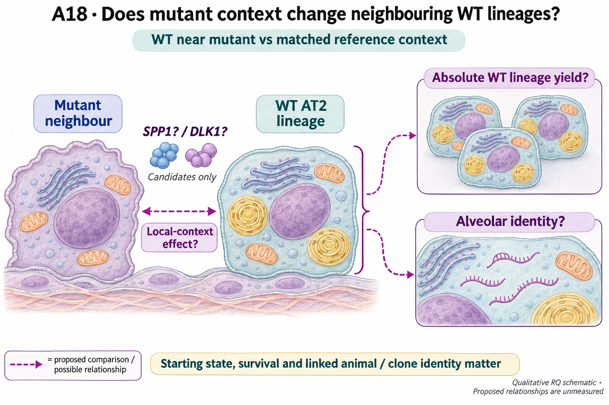

# A18: neighbor wt expansion identity

## Organizing Biological Q

Do neighboring mutant cells influence WT expansion and loss of AT2 identity through separable processes?

**Unresolved gap:** The two WT outcomes have not been separated with identifiable biological units and compartment-specific causal evidence.

[Working hypothesis and competing explanations](../../docs/research_dossiers/A18.md#working-hypothesis) · [Canonical card](../../RESEARCH_QUESTIONS.md#a18).

<!-- literature-visual-context:start -->

## Literature context & visual hypothesis

[Published findings, repository observations and interpretation limits](LITERATURE_CONTEXT.md).

GPT-generated matte illustration, 3 November 2026. Proposed relationships and
cell counts are qualitative. [Editorial review](../../docs/audits/2026-11-02-rq-schematic-review/MATTE_PUBLICATION_2026-11-03.md) · [Selected edit prompt](schematics/A18_gpt_matte_v1.prompt.txt). Earlier artwork is retained as history.
<!-- literature-visual-context:end -->

## Current evidence and interpretation

<!-- full-priority-screening-20261103:start -->
**Screening follow-through — 3 November 2026.** Existing spatial descriptions separate WT-neighbor size from AT2-identity fraction and retain the log-size/logit-fraction sensitivity and declining distal occupancy.

**Remaining discriminator:** Spatial rows lack verified mouse/clone/pair linkage and may repeat neighbors. Separate mouse-indexed arrays cannot be joined by assumption. Molecular mediator/range and animal-level distance interactions remain unestimated.

[Reviewed screening sequence](../../docs/research_reviews/2026-11-03-full-priority-screening/PLANS.md) · [Coordination and review](../../docs/research_reviews/2026-11-03-full-priority-screening/README.md). This reuses reviewed evidence and does not record human scientific acceptance.
<!-- full-priority-screening-20261103:end -->

<!-- evidence-followthrough:start -->
**Evidence follow-through — 3 November 2026:** Exclude the affirmative claim
“WT growth/identity differences establish two signaling channels.” from current conclusions.
[Bounded fill, stop rule and reopening evidence](../../docs/audits/2026-11-03-rq-evidence-trajectory/CUT_OR_FILL_PLAN.md#a18).
The hypothesis remains a proposal where its decisive comparison is untested.
<!-- evidence-followthrough:end -->

**Current entrypoints:** [existing source-analysis context](../../Research%20Article/gate2_C2_england_2025/README.md) ·
[conditional hypothesis package](../../docs/research_dossiers/packages_2026-10-03/A18.md).
The package draft exists. The requested specificity/novelty revision is applied;
scientific acceptance and experiment-specific qualification remain pending. Use [current work disposition](../../docs/research_dossiers/REMAINING_WORK.md), not an older
package-pending checkpoint, to decide what is active.

Are WT expansion and loss of AT2 identity regulated differently near mutant clones?

Status: proposed refinement, 3 October 2026. This is a development aid, not scientific acceptance or an experimental protocol.

Source Figures 5–6 motivate both outcomes, but available pooled spatial data lack the mouse/clone identities required for the proposed independent-unit comparison. SPP1/DLK1 remain nominated interactions.

Evidence locators (source citations and numerical details remain in these records):

- [Research Article/gate2_C2_england_2025/README.md](../../Research%20Article/gate2_C2_england_2025/README.md)

## Analysis plan and next decision

Recover source mouse/clone identities and qualify separate endpoints. If identities are unavailable, retain descriptive spatial observations and stop population-level claims.

[Plan and existing implementation](PLAN.md) · [Full scientific dossier](../../docs/research_dossiers/A18.md) · [Current interpretation boundary](../../docs/research_dossiers/A18.md#interpretation-boundary).

This folder is the question home. Existing paper-owned analyses, shared code and frozen runs retain their original ownership and paths.
