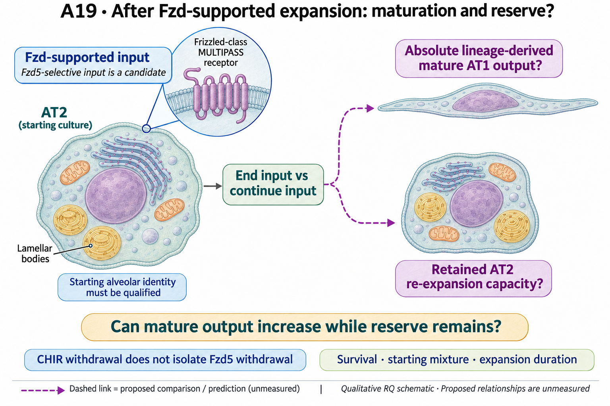
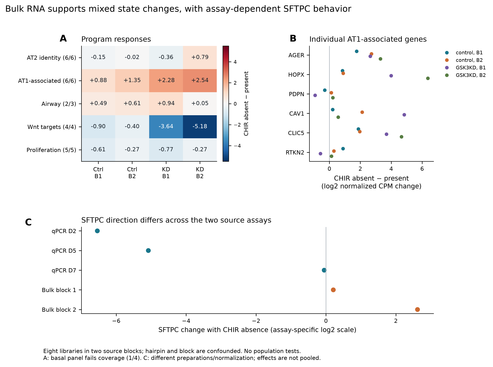

# A19: ending receptor input, mature output and retained reserve

## Organizing Biological Q

Can ending a specified Fzd-supported expansion input increase mature AT1 output while retaining AT2 descendants able to respond again? Current culture-context results show why marker change alone cannot answer that joint question. Starting-state competence, schedule and input identity remain distinct decisions.

Current synthesis: 4 November 2026. [Literature context](LITERATURE_CONTEXT.md) ·
[Dossier](../../docs/research_dossiers/A19.md) · [Canonical card](../../RESEARCH_QUESTIONS.md#a19).

<!-- literature-visual-context:start -->

## Literature context & visual hypothesis

[What previous findings contribute, what remains, and what the readouts would decide](LITERATURE_CONTEXT.md).

GPT-generated matte illustration, 3 November 2026. Proposed relationships and cell counts are qualitative; the owning context defines the comparison and interpretation limits. [Editorial review](../../docs/audits/2026-11-02-rq-schematic-review/MATTE_PUBLICATION_2026-11-03.md) · [Selected edit prompt](schematics/A19_gpt_matte_v1.prompt.txt). Earlier SVG files are retained as history.

*Explanatory proposal, not measured results. Read the linked context and caption; arrows do not certify a mechanism or novelty.*
<!-- literature-visual-context:end -->

Compartment-specific Fzd growth and alveolar differentiation are published premises. The [2022 human organoid source](../../RQ_Specified/A19_fzd_response_reversibility/SOURCES.md) provides donor-coded qPCR and source-block RNA comparisons under CHIR media conditions. Nabhan and the later expansion/differentiation precedents motivate the receptor question; they do not turn the CHIR comparison into Fzd-selective cessation or a measured reserve.

The retained illustration describes the registered proposal. Its dashed relationships
are unmeasured; the completed comparisons below have their own narrower endpoints.

## Evidence, analyses and next steps

The [completed result](../../RQ_Specified/A19_fzd_response_reversibility/RESULTS.md) reports CHIR-absent versus present qPCR in three matched HTII-280-positive-derived donor lines. SFTPC falls in all three, while FOXJ1, TP63 and SCGB1A1 rise; intervals are mostly wide. In separate airway-derived source lines, early SFTPC induction diminishes from passage 1 to 3 despite continued CHIR. Changing donor labels and non-detects in another passage series prevent treating it as another three-donor trajectory.

Eight bulk libraries in GSE197949 represent two source blocks; explicit donor mapping is unresolved and the knockdown hairpin differs by block. They are not eight donors. CHIR absence increases both AT1-associated and airway RNA panels, with gene-level exceptions. **Bulk SFTPC increases in both control blocks whereas the three qPCR effects are negative.** Different preparations and normalization prevent pooling these into a universal identity-loss estimate.

GSK3B knockdown lowers its RNA but yields nonuniform marker changes; it does not prove a CHIR off-target mechanism. The measurements are normalized qPCR expression or bulk RNA panels, not traced mature output, barrier function or response to a later bout. Separate source figures do not identify a treatment-by-starting-state interaction.

The existing bulk panel retains mixed AT1/airway responses and the SFTPC disagreement with qPCR. Two source blocks are not eight independent donors; programs are RNA summaries, not pathway activity or a measured reserve.

## Does the evidence warrant the narrowing?

**Rationale verdict: useful context diagnostics and an exploratory competence lead; the receptor-specific schedule/reserve inference is incomplete.** The mixed marker responses undermine a simple equation of input removal with productive alveolar maturation. They do not select an airway programme as the causal barrier, establish irreversible loss of competence, or identify Fzd5 as the operative input.

Source narratives and prior Nb2 outcomes were exposed; new workbook/count estimates followed a frozen exploratory plan. The competence refinement was post-analysis. Donor codes shared across figures do not create replication, and qPCR/bulk discordance remains part of the evidence. Selective growth/survival, changing populations, passage, missing cues and downstream GSK3 context remain alternatives. A mechanistic label cannot resolve that ambiguity or establish random noise.

## What a further comparison would decide

Greater mature output with retained responsive AT2 reserve would support the joint benefit in that context; greater output with depleted reserve would reveal a tradeoff. Marker induction or area alone decides neither. A state-dependent schedule effect would refine the comparison but would not alone prove that acquiring that state caused reduced competence.

Specify which input, schedule and outcome a qualified source can compare. A source-qualified narrower context question remains useful, but the registered joint benefit requires both mature output and reserve. Historical pipeline priorities are not automatically active; each further comparison needs a stated scientific purpose.

**Current boundary:** RNA marker changes are not mature repair, functional reserve or an irreversible fate change. The current data do not establish receptor selectivity, a source-origin interaction or a causal state barrier.

## Registered scope and earlier records

The complete earlier framing below retains its dated scope and registered hypotheses.
Current results and amendments govern interpretation. Older unfinished-work, source-access
or priority statements do not supersede this synthesis or start an execution queue.
Registration and completed analysis confer neither human acceptance nor a claim promotion.

Registered framing, source links and retained development history

<!-- current-rq-framing:start -->

## Organizing Biological Q

In primary AT2-derived cultures retaining alveolar identity before the schedule comparison, ending Fzd-supported expansion may increase later absolute lineage-derived mature AT1 output while preserving AT2 descendants capable of renewed expansion. Continued receptor input is the comparator. Fzd5-selective stimulation is a source-supported candidate input, not a frozen reagent choice; schedule, starting-state competence and input identity retain separate decisions.

**What is already known, and what remains:** Fzd-supported AT2 growth, Wnt withdrawal and differentiation are established. The possible increment is the joint receptor-specific AT1-output/functional-reserve tradeoff; existing CHIR withdrawal and expanded-cell differentiation do not establish it. [Primary-source comparison](../../docs/history/reviews/NOVELTY_SPECIFICITY_APPLICATION_2026-10-03.md#a19).

**What the measurements would decide:** More mature AT1 output with a retained responsive AT2 reserve supports productive withdrawal in that context. More AT1 output with reserve depletion is a tradeoff; more area alone tests neither. Lineage-linked absolute counts address yield, independent identity/function addresses maturity, and later response capacity addresses reserve. CHIR withdrawal does not isolate Fzd5 withdrawal.

**Current disposition:** Conditional joint outcome; novelty provisional. This revision specifies proposed work; scientific acceptance, model access and assay qualification remain pending.

| Evidence and implementation | Current boundary |
|---|---|
| Biological unit and endpoint | Lineage-defined donor/animal preparations. Jointly assess absolute mature descendants and viable, functionally responsive AT2 reserve per starting AT2 input; mature markers or survivor fractions alone do not establish both. |
| Current evidence and limit | Executed qPCR/bulk RNA context results and newer Rochelle source labels do not measure the full receptor-specific withdrawal, mature-output and reserve contrast. CHIR and Fzd-specific inputs are not interchangeable. |
| Next decision / hold | Scientific acceptance is pending; M11 retains the evidence hold. Reopen only for linked input/cessation, pre-withdrawal state, mature function and reserve measurements. An alias table cannot supply an unmeasured reserve endpoint. |

**Read in this order:** [current evidence](RESULTS.md),
[development dossier](../../docs/research_dossiers/A19.md),
[conditional hypothesis package](../../docs/research_dossiers/packages_2026-10-03/A19.md).
Source-mapping closeout: [M11 and reopening conditions](../../docs/research_dossiers/source_mapping_closeout_2026-10-03/README.md).
[Deferred work](../../docs/history/planning/REMAINING_WORK.md) and
[execution requirements](../../docs/RESEARCH_GOVERNANCE.md) govern any later
analysis. Draft completion does not establish assay validity, resource access,
meaningful effects, precision or scientific acceptance. Existing numerical
results and original plans below retain their recorded scope.
<!-- current-rq-framing:end -->

## Evidence, analyses and next steps

<!-- full-priority-screening-20261103:start -->
**Screening follow-through — 3 November 2026.** Existing source/passage qPCR distinguishes CHIR media context and changing epithelial markers; it does not measure receptor-selective Fzd withdrawal or retained regenerative reserve.

**Remaining discriminator:** Matched starting-state history, cessation and absolute mature output/reserve are missing. Reuse the donor/source contrasts without treating different source lines or culture ages as a factorial experiment.

[Reviewed screening sequence](../../docs/research_reviews/2026-11-03-full-priority-screening/PLANS.md) · [Coordination and review](../../docs/research_reviews/2026-11-03-full-priority-screening/README.md). This reuses reviewed evidence and does not record human scientific acceptance.
<!-- full-priority-screening-20261103:end -->

<!-- evidence-followthrough:start -->
**Evidence follow-through — 3 November 2026:** Exclude the affirmative claim
“CHIR transcript changes establish Fzd-specific maturation and functional reserve.” from current conclusions.
[Bounded fill, stop rule and reopening evidence](../../docs/audits/2026-11-03-rq-evidence-trajectory/CUT_OR_FILL_PLAN.md#a19).
The hypothesis remains a proposal where its decisive comparison is untested.
<!-- evidence-followthrough:end -->

The existing analysis records below retain their scope. Read the latest linked result or amendment before an older plan.

**DY1 contextual link, 29 October 2026:** [Paper and human-atlas relevance](DY1_CONTEXT_2026-10-29.md). Article-local observations do not change this question's hypothesis, current evidence or endpoint requirements.

### Earlier organizing question

> Does epithelial state determine whether ending Fzd stimulation converts AT2 expansion into mature AT1 output while retaining an AT2 reserve?

**Working hypothesis (untested):** Retention of alveolar identity during Fzd-supported AT2 expansion permits subsequent AT1 maturation after withdrawal while preserving a responsive AT2 reserve.

**Exploratory context analysis completed 30 September 2026; direct H1–H3 remain unresolved.**
[Canonical card](../../RESEARCH_QUESTIONS.md#a19) ·
[Nb2 derivation](../../Research%20Article/gate2_N1_nabhan_2023/RQ_DERIVATION.md) ·
[Investigation plan](PLAN.md) · [Results](RESULTS.md) · [Figure gallery](FIGURES.md) ·
[Methods](METHODS.md) · [Source inventory](SOURCES.md) ·
[Extension pipeline](EXTENSION_PIPELINE.md) · [External evidence](EXTERNAL_EVIDENCE.md).

### Current analysis

The [executed analysis](RESULTS.md) extracts 143 qPCR source rows and analyzes
eight human alveolar-organoid bulk libraries in two source blocks. CHIR absence
lowers SFTPC and raises airway markers in three qPCR donor lines, while bulk
RNA shows mixed AT1/airway changes and an opposing SFTPC direction. In
**airway-derived** cultures, early SFTPC induction declines despite continued
CHIR. The results motivate an alveolar-competence constraint on temporal control;
they do not measure Fzd withdrawal, lineage-derived mature output or AT2 reserve.

Three main figures and one supplementary figure are deposited as PNG, PDF and
SVG with captions, source tables, scripts and verification. The original Nb2
analyses remain paper-local. This is exploratory secondary analysis, not
independent validation or biological acceptance. The current scientific next
step follows [three integrated priorities](EXTENSION_PIPELINE.md): cellular
identity/context analysis, a bounded report of existing GSK3B-by-CHIR contrasts,
and linked state/engagement/fate/reserve eligibility. The external review is
complete; new single-cell and functional extension runs are not yet executed.

The focused hypothesis concerns whether an airway-associated state acquired
during expansion limits the later withdrawal response under a specified
maturation environment. The pipeline distinguishes pre-exposure and
pre-withdrawal states and treats missing cues, selection and input-dependent
plasticity as rivals. H1–H3 and the full reserve requirement remain unchanged.

### Working hypothesis and biological logic

Receptor-selective Fzd signaling supports an expandable AT2 state, whereas its
termination allows competent descendants to enter an AT1 maturation program.
A finite off-period therefore increases mature alveolar output while leaving
a responsive AT2 reserve. Initial epithelial state sets the competence to make
this transition; receptor-level input may tune that balance differently from
GSK3 inhibition. These are proposed biological processes, not observed mechanisms.

The central idea is **temporal separation of expansion and differentiation**.
An apparent gain in cell number is useful for repair only if descendants can
subsequently contribute mature tissue. A state that expands under stimulation
could remain reversible, become persistently transitional, or simply select a
pre-existing population. The question distinguishes those biological outcomes.

### Predictions that distinguish the hypothesis

| Hypothesis | Biological prediction | Contrary result |
|---|---|---|
| H1: a reversible expansion-to-maturation transition | Verified termination of stimulation increases lineage-derived mature AT1 output relative to sustained input, while retaining a responsive AT2 reserve | A precise absence of useful mature-output gain, a reliable reverse effect, or depletion of the retained reserve |
| H2: initial-state competence | The same exposure history yields different expansion-to-maturation responses from independently identified initial states | A precise absence of a useful initial-state interaction under comparable engagement and baseline receptor context |
| H3: input-dependent regulation | Receptor-level inputs produce a different activity trajectory and later fate balance than comparator inputs within a prospectively calibrated engagement range | Only transient RNA differences remain, or independently calibrated inputs produce equivalent later outcomes within the chosen margin |

H1 is primary; H2/H3 have separate decisions. The YAP/TAZ-associated signal is a
candidate component of the trajectory, not an established mediator. Active Hippo
MST/LATS kinases restrain YAP/TAZ; their activation is not synonymous with increased
YAP/TAZ output. A specific mediator claim needs its own dependency evidence.

### Why the results motivate it, and what they do not show

The withdrawal24-to-withdrawal48 AT1-associated RNA direction survives library
omissions but is imprecise and not serially linked. Fzd agonists compare above
CHIR and below withdrawal48 in point estimates. The narrow source YAP panel rises
while a broad sustained-YT projection is unstable. In four matched atlas samples,
AT1 has more Fzd5 RNA but less canonical-target RNA than AT2. Together these
motivate a state- and time-dependent response, without demonstrating it.
[Observed evidence](../../Research%20Article/gate2_N1_nabhan_2023/branch_analysis/RESULTS.md).

Selection of pre-existing mature cells, toxicity, exposure differences and a
single generic growth response are competing explanations. Traced absolute mature
output per initial viable population, retained AT2 capacity and later-bout response
must distinguish them. RNA scores alone cannot decide the biological hypothesis.

No inspected Nb2 dataset joins Fzd withdrawal, initial state and later function.
The [completed inventory](SOURCES.md) identified supporting human RNA contrasts,
but no inspected source supplies that complete linked test.
[The parent contract](config/question_contract.json) still leaves confirmatory assay choices, effect
margins and validation data unset. A4's Wnt/IL-1 sequence, A8's maturation predictor,
A10's growth question and A1's regulatory-state question keep their own scope.

