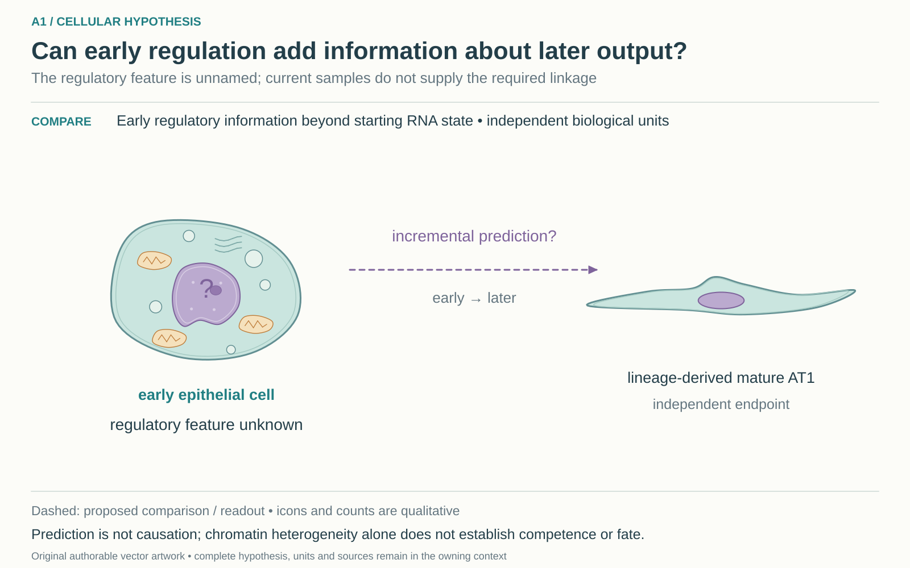

# A1: literature context and hypothesis schematic

**External context, 1 November 2026:** [Arozamena article-local evidence and limits](../../Research%20Article/ungated_arozamena_2026_inflammatory_memory/RQ_CONNECTIONS.md). RNA-QC and fixed TSS-window versus gene-body sensitivity in the intestinal reference distinguish measurement/selection from within-state regulation. The third-deposit four-locus recount supplies common regions and paired barcodes, but no qualified state labels or later-output join. This is a context link; the canonical hypothesis, registered illustration and scientific disposition are unchanged.

**Proposed Wagner companion, 4 October 2026:** [Wg-P05](../../Research%20Article/gate2_W1_wagner_th17_autoimmunity/rq_derivation/P05.md) nominates early epithelial glycolytic relaxation after IL-1β withdrawal as a proposed biochemical feature for this existing question. It remains an article-local proposal; the canonical hypothesis, prior outcomes and registered illustration here are unchanged. Linked biochemical/output measurements and scientific adoption are not yet qualified.

Reviewed 3 October 2026. This note connects published findings to the current proposed question. It is a bounded synthesis, not novelty clearance or scientific acceptance.

## Published starting point

Published regulatory and reparative heterogeneity motivates looking beyond an RNA label. It does not nominate the missing A1 feature or establish its independent future-outcome information.

| Primary source | Inspected locator and access record |
|---|---|
| [Hassan and Chen 2024](https://www.nature.com/articles/s41467-024-48632-3) | Results and Figs. 3, 5, 6. [Access / prior review](../../docs/research_dossiers/review_2026-10-03/SOURCES.md#s02) |
| [Sawhney 2025](https://www.nature.com/articles/s41467-025-64224-1) | Fig. 7 and Discussion. [Access / prior review](../../docs/research_dossiers/review_2026-10-03/SOURCES.md#s03) |

Sources above reuse the named review unless the update ledger explicitly records a fresh inspection. Published-source evidence and reanalysis of the same material are not independent replication.

## Repository observation

The workspace compares regulatory and RNA evidence, including histone and pathway sensitivity checks. Its comparison matrix does not establish paired early regulatory state and later fate in the same biological units.

Exact current result locators:

- [RQ_Specified/A1_transitional_epithelial_state_distinction/README.md](README.md)
- [RQ_Specified/A1_transitional_epithelial_state_distinction/COMPARISON_MATRIX.md](COMPARISON_MATRIX.md)
- [docs/research_dossiers/followup_2026-10-03/NOVELTY.md](../../docs/research_dossiers/followup_2026-10-03/NOVELTY.md)
- [docs/research_dossiers/followup_2026-10-03/OUTCOMES.md](../../docs/research_dossiers/followup_2026-10-03/OUTCOMES.md)

## What this question could add

Nominate one early regulatory feature and compare its added information against early RNA and starting mixture for a separately measured later mature endpoint. A positive marker result would still leave causation open.

## Current hypothesis and rival

RNA-similar transitional alveolar epithelial cells may differ in regulatory competence for later AT1 maturation. The remaining hypothesis would require an early regulatory feature to distinguish later lineage-derived mature AT1 output beyond the starting RNA state. No particular regulatory feature has yet been nominated for that prospective contrast; a generic chromatin assay does not complete it.

**Strongest rival:** Regulatory differences reflect composition, collection time or assay processing; apparent competence is inferred from markers already used to label the population.

## What the comparison would teach

Early regulatory information that improves prediction in independent biological units would support a competence marker. It would not establish a causal regulator; absent incremental information weakens the proposed marker. Current unlinked RNA/regulatory samples cannot perform this comparison.

## Hypothesis schematic

[Editable cellular SVG](schematics/hypothesis_cellular_v1.svg), source revision `862f3335bad7700ba89ce8d5bcc794c7c9094fbc`. This 2 November 2026 redraw supersedes the [prior illustration](schematics/hypothesis_v2.svg) for display; that SVG remains unchanged. The working hypothesis, source evidence and scientific disposition are unchanged.

A1 asks whether an early regulatory feature improves prediction of independent later mature AT1 output beyond RNA state. The feature and longitudinal biological-unit linkage remain missing; regulatory heterogeneity alone does not establish competence or causation.

Class-level glyphs and qualitative geometry are not molecular structures, organelle measurements or evidence of functional assembly. Neutral epithelial/stromal shapes do not assert subtype identity or organelle loss, and icon counts are illustrative. Read locally labelled solid premises/references separately from dashed proposed comparisons; no complete mechanism follows from their juxtaposition.

## Next literature check

Planned query (not reported as newly executed): `early alveolar transitional chromatin regulatory competence lineage mature AT1 prediction 2025 2026`. Expand to synonyms, nearest source references/citations and conflicting results using the [literature workflow](../../docs/LITERATURE_WORKFLOW.md). Recheck the exact population, comparison, timing, unit and endpoint before making a stronger contribution claim.

**Current unresolved specification:** Which regulatory feature precedes a difference in independently measured mature output, rather than merely distinguishing contemporaneous states, is unresolved.

**Interpretation limit:** Accessibility, histone marks and RNA similarity do not by themselves demonstrate recoverability or irreversible commitment.

[Current dossier](../../docs/research_dossiers/A1.md) · [All-question context index](../../docs/research_dossiers/literature_context_2026-10-03/README.md)
