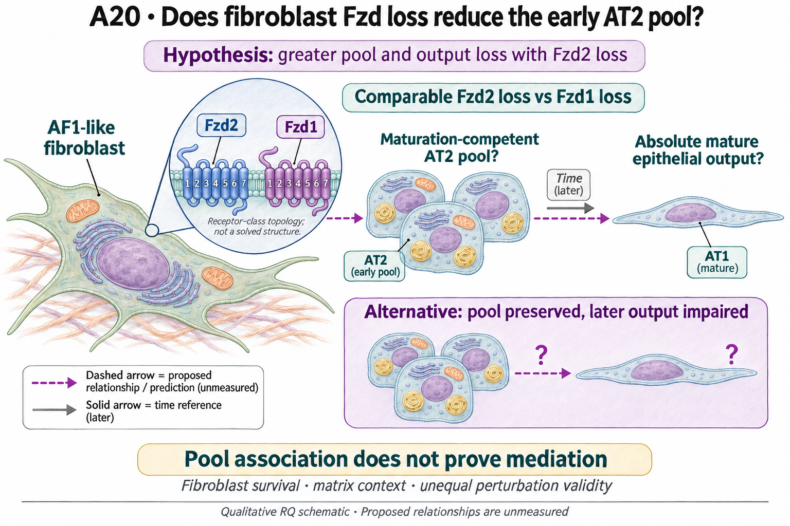
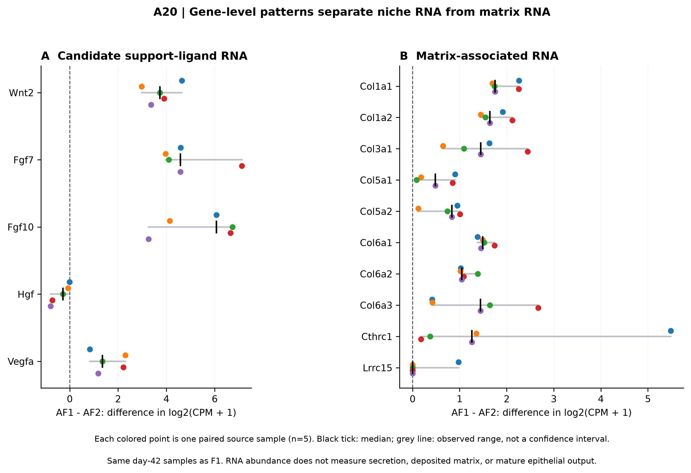

# A20: fibroblast Fzd context, epithelial pool and later output

## Organizing Biological Q

Does comparable Fzd2 versus Fzd1 loss in an adult AF1-like context affect the early competent AT2 pool and later absolute mature output differently? The receptor contrast is source-motivated and owner-specified. Current RNA findings describe context; they have not selected pool maintenance as the mechanism.

Current synthesis: 4 November 2026. [Literature context](LITERATURE_CONTEXT.md) ·
[Dossier](../../docs/research_dossiers/A20.md) · [Canonical card](../../RESEARCH_QUESTIONS.md#a20).

<!-- literature-visual-context:start -->

## Literature context & visual hypothesis

[What previous findings contribute, what remains, and what the readouts would decide](LITERATURE_CONTEXT.md).

GPT-generated matte illustration, 3 November 2026. Proposed relationships and cell counts are qualitative; the owning context defines the comparison and interpretation limits. [Editorial review](../../docs/audits/2026-11-02-rq-schematic-review/MATTE_PUBLICATION_2026-11-03.md) · [Selected edit prompt](schematics/A20_gpt_matte_v1.prompt.txt). Earlier SVG files are retained as history.

*Explanatory proposal, not measured results. Read the linked context and caption; arrows do not certify a mechanism or novelty.*
<!-- literature-visual-context:end -->

Zhou already reports mesenchymal Fzd2, AF1 identity and repair involvement. The possible increment is the matched receptor comparison and early-pool/later-output distinction. Ng-Blichfeldt's fibroblast-preconditioning study and Riccetti's neonatal work show why support, matrix and differentiation endpoints must be kept separate. [Published locators](../../RQ_Specified/A20_fibroblast_fzd_context/LITERATURE_CONTEXT.md#published-starting-point) and the [extension source interpretation](../../RQ_Specified/A20_fibroblast_fzd_context/extensions/extension_v1/RESULTS.md) do not establish a shared adult Fzd mechanism.

The retained illustration describes the registered proposal. Its dashed relationships
are unmeasured; the completed comparisons below have their own narrower endpoints.

## Evidence, analyses and next steps

The [parent RNA analysis](../../RQ_Specified/A20_fibroblast_fzd_context/RESULTS.md) uses five paired day-42 source samples at its primary cell floor, with cells nested in samples. AF1 has higher Fzd2 and lower Fzd1 in all five pairs; Pdgfra/Pdgfrb and Col13a1 support the local labels. Wnt2/Fgf7/Fgf10 are higher but Hgf is lower. All eight selected collagen genes are higher. These are differences in log2(CPM+1), not literal fold changes, secreted support or matrix deposition. At the stricter cell floor no pair qualifies; that is unavailable support, not a negative biological effect.

The [extension](../../RQ_Specified/A20_fibroblast_fzd_context/extensions/extension_v1/RESULTS.md) examines four human fibroblast RNA donors under CHIR/TGF contexts. All four show higher canonical-response RNA and lower selected support-panel RNA after CHIR; TGF alone raises FZD2/collagen RNA while lowering the support-panel mean. Individual genes are heterogeneous. Simultaneous CHIR-by-TGF interaction is not receptor-specific signaling or an initial-subtype interaction.

The published organoid-support comparison uses **eight different function donors**, versus four RNA donors, with different treatment durations. These are not matched RNA/function observations. Pretreatment with fixed initial co-culture inputs motivates altered support beyond expansion, but does not exclude subsequent survival, residual exposure, mechanics or secreted activity. No RNA-to-function regression or mediation claim follows.

The existing five-source-sample comparison retains selective support-gene directions alongside matrix RNA. The support-panel average does not erase the opposing Hgf result. These are matched source-sample RNA contrasts, not secretion, repair or independent functional validation.

## Does the evidence warrant the narrowing?

**Rationale verdict: supported descriptive context and a justified comparison proposal; receptor preference and pool mediation remain untested.** Source-specific Fzd2/Fzd1 RNA and support/matrix coexistence make the proposed comparison concrete. They do not show that higher Fzd2 causes beneficial support, that matrix is uniformly harmful, or that a smaller early pool explains later output. The narrowed hypothesis is a proposal, not a data-selected mechanism.

The atlas was already exposed through Nb2. Extension panels were frozen before new estimates after prior results/source narratives were known. The same samples, overlapping sensitivities and unrelated RNA/function donor sets supply no independent confirmation. State crosswalk, sampling, normalization, survival, matrix and unequal perturbation validity remain alternatives. FZD10 is unavailable in the extension table, not zero.

## What a further comparison would decide

A smaller early competent pool with reduced later output is compatible with pool maintenance; preserved early pool with lower later output favors a later support defect. A comparable or reversed receptor effect would weaken the nominated Fzd2 preference. These outcomes require adequate precision and perturbation interpretation; timing alone does not identify mediation. A narrower receptor-attributable support effect can be informative without proving the whole route.

Retain the restored receptor contrast and qualify a source appropriate to the intended effect. Use existing RNA results as context, not a ranking of functional targets. Do not pair the four RNA donors with the eight organoid donors or automatically launch the older multi-stage pipeline.

**Current boundary:** Receptor/support-ligand RNA rank is not functional dependence, and collagen RNA is not deposited matrix or fibrosis. Species, developmental context and donor mismatch prevent stitching the cited sources into one causal pathway.

## Registered scope and earlier records

The complete earlier framing below retains its dated scope and registered hypotheses.
Current results and amendments govern interpretation. Older unfinished-work, source-access
or priority statements do not supersede this synthesis or start an execution queue.
Registration and completed analysis confer neither human acceptance nor a claim promotion.

Registered framing, source links and retained development history

<!-- current-rq-framing:start -->

## Organizing Biological Q

In adult AF1-like fibroblasts, comparable Fzd2 loss reduces support of a maturation-competent AT2 pool and subsequent absolute mature epithelial output more than comparable Fzd1 loss. Pool maintenance is the proposed explanation, distinct from a later maturation-specific defect, general fibroblast loss or matrix effects. This restores the existing narrowed hypothesis and does not claim discovery of Fzd2-dependent repair.

**What is already known, and what remains:** Zhou already reports mesenchymal Fzd2, AF1 identity and repair involvement. The possible increment is the matched Fzd2-versus-Fzd1 comparison and early-pool versus later-output distinction; its independent value remains provisional. [Primary-source comparison](../../docs/history/reviews/NOVELTY_SPECIFICITY_APPLICATION_2026-10-03.md#a20).

**What the measurements would decide:** A smaller early competent pool followed by reduced mature output is compatible with pool maintenance. Preserved early pool with reduced later output favors maturation-specific support. Unequal receptor engagement or fibroblast survival makes the receptor comparison ambiguous. Do not adjust away the post-treatment pool deficit or call timing alone mediation.

**Current disposition:** Restored receptor contrast; novelty provisional. This revision specifies proposed work; scientific acceptance, model access and assay qualification remain pending.

| Evidence and implementation | Current boundary |
|---|---|
| Biological unit and endpoint | Prospectively identified AF1-like fibroblasts and matched starting AT2 populations in mapped source/recipient units. The primary contrast is absolute mature output per starting AT2 input; early competent-pool maintenance is a proposed route, not an automatic adjustment covariate. |
| Current evidence and limit | The narrowed H1 and existing atlas/four-donor context extension motivate the comparison. RNA abundance does not establish receptor dependence or a matched Fzd2-versus-Fzd1 functional effect. |
| Next decision / hold | Review is deferred and M12 retains the matched-comparison/linkage hold. Keep the total-effect question distinct from mediation; do not normalize away post-treatment pool depletion. |

**Read in this order:** [current evidence](NARROWED_HYPOTHESIS.md),
[development dossier](../../docs/research_dossiers/A20.md),
[conditional hypothesis package](../../docs/research_dossiers/packages_2026-10-03/A20.md).
Source-mapping closeout: [M12 and reopening conditions](../../docs/research_dossiers/source_mapping_closeout_2026-10-03/README.md).
[Deferred work](../../docs/history/planning/REMAINING_WORK.md) and
[execution requirements](../../docs/RESEARCH_GOVERNANCE.md) govern any later
analysis. Draft completion does not establish assay validity, resource access,
meaningful effects, precision or scientific acceptance. Existing numerical
results and original plans below retain their recorded scope.
<!-- current-rq-framing:end -->

## Evidence, analyses and next steps

<!-- full-priority-screening-20261103:start -->
**Screening follow-through — 3 November 2026.** Current screening retains Fzd2 versus Fzd1 in AF1 and coexistence of support/ECM RNA changes. RNA donors and organoid-function donors are different sets.

**Remaining discriminator:** The missing comparison links receptor-specific perturbation to the early epithelial pool and later absolute mature output. No donor pairing or functional coupling is inferred across the separate sources.

[Reviewed screening sequence](../../docs/research_reviews/2026-11-03-full-priority-screening/PLANS.md) · [Coordination and review](../../docs/research_reviews/2026-11-03-full-priority-screening/README.md). This reuses reviewed evidence and does not record human scientific acceptance.
<!-- full-priority-screening-20261103:end -->

<!-- evidence-followthrough:start -->
**Evidence follow-through — 3 November 2026:** Exclude the affirmative claim
“The screen established Fzd2 dependence or chose pool maintenance over maturation.” from current conclusions.
[Bounded fill, stop rule and reopening evidence](../../docs/audits/2026-11-03-rq-evidence-trajectory/CUT_OR_FILL_PLAN.md#a20).
The hypothesis remains a proposal where its decisive comparison is untested.
<!-- evidence-followthrough:end -->

The existing analysis records below retain their scope. Read the latest linked result or amendment before an older plan.

### Earlier organizing question

> Does Fzd2 sustain AF1 fibroblast support of an AT2 pool capable of mature alveolar repair more strongly than Fzd1?

**Working hypothesis (untested):** Fzd2 is more necessary than Fzd1 for AF1 fibroblasts to maintain AT2 cells that subsequently produce mature alveolar descendants.

**Exploratory phase complete; primary scope narrowed, 30 September 2026.
Functional H1 remains untested; original subtype H2 is deferred.**

[Focused hypothesis and decision table](NARROWED_HYPOTHESIS.md) ·
[Execution plan](PLAN.md) · [Canonical question](../../RESEARCH_QUESTIONS.md#a20).

**H1:** In a defined adult alveolar repair context, comparable Fzd2 loss in prospectively identified AF1-like fibroblasts reduces functional epithelial support and absolute mature AT2-descendant output more than comparable Fzd1 loss.

The mechanistic focus is maintenance of an AT2 pool capable of later maturation.
This is a proposal to distinguish from maturation-specific support, fibroblast
loss and matrix effects. The primary endpoint remains absolute lineage-linked
mature epithelial output; RNA abundance cannot answer it.

The completed atlas analysis and four-donor input-context extension motivate
this distinction. Higher Fzd2 or canonical-response RNA does not establish
greater functional support. No inspected source provides the comparable
Fzd1/Fzd2 functional contrast.

[Atlas results](RESULTS.md) · [Extension results](extensions/extension_v1/RESULTS.md) ·
[Six figures](FIGURES.md) · [Baseline sources](SOURCES.md) ·
[Extension sources](extensions/extension_v1/SOURCES.md) · [Methods](METHODS.md).

The [source eligibility gate](PLAN.md#functional-eligibility-gate) is the next
step for any new candidate dataset. Original H1/H2 and pre-narrowing documents
are preserved in [scope history](metadata/history/scope_refinement_v1/document_snapshots.json).
No new numerical fit, claim grade or biological acceptance is recorded.

