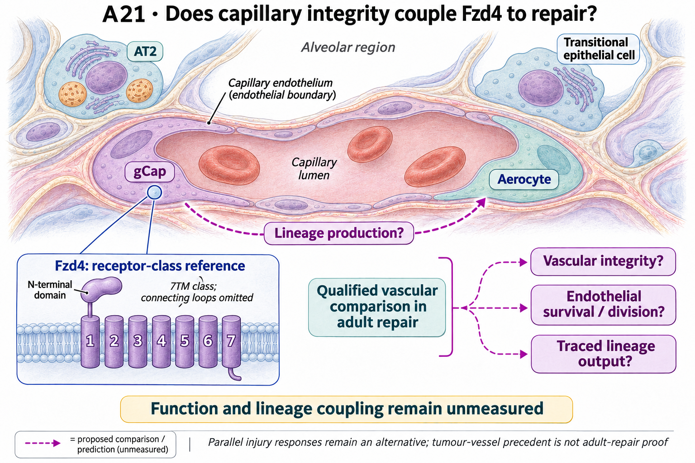

# A21: literature context and current argument

[Question home](README.md) · [Scientific dossier](../../docs/research_dossiers/A21.md).

Synthesis updated 4 November 2026 using the recorded source reviews and current
results. No fresh literature search or biological calculation was performed for
this documentation batch. Published premises and reused-data observations remain
separate evidence types.

## Published starting point

Capillary subtype/lineage work supplies the repair premise; Bian supplies the vascular-restoration precedent. Nabhan's epithelial Fzd results are adjacent compartment context, not evidence of Fzd4-dependent vascular function. None answers the complete normal adult-repair comparison.

| Primary source | Inspected locator and access record |
|---|---|
| [Nabhan 2023](https://pubmed.ncbi.nlm.nih.gov/37321220/) | Compartment-specific Fzd results; Figs. 3–4 for A19. [Access / prior review](../../docs/research_dossiers/NOVELTY_SPECIFICITY_APPLICATION_2026-10-03.md) |
| [Gillich 2020](https://www.nature.com/articles/s41586-020-2822-7) | Capillary subtype/renewal findings; indexed primary abstract. [Access / prior review](../../docs/research_dossiers/review_2026-10-03/SOURCES.md#s17) |

Sources above reuse the named review unless the update ledger explicitly records a fresh inspection. Published-source evidence and reanalysis of the same material are not independent replication.

[Bian 2024](https://doi.org/10.1038/s44321-024-00064-8) is the closest vascular
restoration precedent. The [recovered source reconstruction](../../RQ_Specified/A21_fzd4_capillary_function/extensions/extension_v1/RESULTS.md)
binds Fig. 7F to beta-catenin, 7G to collagen IV/CD31, 7E to gCap Fzd4 and 7D to
tumor size under Fzd4 restoration after Foxf1 loss. Fig. 3F measures lectin/CD31
under Foxf1 loss versus control. These are separate contrasts. Five workbooks
contain 88 observations across panels with anonymous cross-outcome identities;
they are not 88 independent mice or a joint mediation dataset.

The [3 November refresh](../../docs/research_reviews/2026-11-03-full-priority-screening/A21_SOURCE_REFRESH.md)
inspected James 2025/2026 HTML Results and Figs. 1-4, and Lan 2026 Results/legends
Figs. 1 and 4. The former distinguishes endothelial states/sprouting from traced
lineage; the latter supplies a non-FZD4 transplant/exosome repair context.
Supplements/source values and candidate-file joins were not audited in that
refresh. Neither supplies the missing Fzd4-specific adult-repair coupling.

## Repository observation

The [parent analysis](../../RQ_Specified/A21_fzd4_capillary_function/RESULTS.md)
uses GSE211335: **5,423 endothelial cells from 12 animals**, with cells and technical
pools nested within animal. Differences are in log2(CPM+1), not literal log2 fold
changes. Different injury days contain different animals.

At the fixed 20-cell floor, Fzd4 is higher in gCap than aerocytes in **7/7**
eligible paired animals, with sparse injury-day support. In **11/11** eligible
transitional-minus-major gCap pairs, Fzd4 is lower. Cycling-panel RNA has a
different pattern, including a negative day-5 contrast; within-condition
three-animal correlations are inconsistent. The dedicated cycling state never
meets the primary floor. Thus gCap enrichment does not support a simple
high-Fzd4 regenerative-entry marker.

The older eight-animal pooled correlation is retained historically, but round,
sex and reporter-genotype imbalance prevent it from restoring that interpretation.
Those reporter genotypes did not perturb Fzd4. The [family extension](../../RQ_Specified/A21_fzd4_capillary_function/extensions/extension_v1/RESULTS.md)
reuses the same 12 animals and 5,423 cells: none of the alternative Fzd receptors
meets the complete frozen nomination rule. This is not proof of receptor absence
or compensation. Foxf1, Fzd4 and Lrp6 are lower in all 11 primary substate pairs;
RNA concordance does not establish a causal regulatory sequence.

The recovered Bian workbooks preserve **88 panel observations, not 88 unique mice**.
Anonymous rows cannot be joined across endpoints:

| Published contrast | Exact panel/readout | What it does not establish |
|---|---|---|
| Fzd4 restoration after endothelial Foxf1 loss in tumor vessels | Fig. 7F: nuclear beta-catenin; 7G: collagen IV/CD31 area; 7E: Fzd4-positive gCap; 7D: tumor size | Normal adult-repair lineage output or Fzd4-mediated perfusion rescue. |
| Foxf1 loss versus control | Fig. 3F: lectin/CD31 area ratio | A perfusion measurement under Fzd4 restoration. |

The first comparison supports pathway/structural restoration in its tumor setting.
Combining it with the second would invent an unmeasured rescue endpoint.

## Does the evidence warrant the narrowing?

**Rationale verdict: useful negative/diagnostic boundary; maintenance remains
an exploratory possibility.** The 12-animal state/cycling RNA contrasts weaken
a simple high-Fzd4 regenerative-entry marker. They do not select maintenance,
survival or lineage production as the explanation. Bian's tumor-vessel
restoration provides a separate biological premise, not the missing adult-repair
effect or a perfusion-rescue result.

The [parent methods](../../RQ_Specified/A21_fzd4_capillary_function/METHODS.md)
record freezing new estimates after exposure to the original associations and
source narratives; the [extension](../../RQ_Specified/A21_fzd4_capillary_function/extensions/extension_v1/METHODS.md)
was specified after parent-result exposure and reuses its animals. Neither is
confirmation of the revised mechanism. Sparse state coverage, annotation and
composition, different animals across injury days, and the original round/sex/
reporter-genotype imbalance constrain interpretation. The family screen's lack
of a robust alternative receptor does not establish Fzd4's unique function. The
next decision is a qualified Fzd4 effect on a specified maintenance, survival or
lineage endpoint; the stronger coupling claim needs evidence linking endpoints.
The present disagreement does not itself demonstrate random noise or a
maintenance mechanism.

## What this question could add

A21 contributes a boundary test of a high-Fzd4 renewal-marker interpretation
and a precise separation of vascular precedents. A future adult-repair effect
study may answer a narrower maintenance, survival or lineage question. The
stronger registered coupling hypothesis below remains unchanged and untested;
a narrow effect result should not silently be promoted to that whole route.

## Current hypothesis and rival

Fzd4-dependent capillary integrity may permit gCap self-renewal and subsequent aerocyte production during normal adult alveolar repair. The proposed route links vascular function to lineage output; it must be distinguished from direct regenerative entry, endothelial survival and parallel injury responses. Tumor-vessel rescue is a precedent, not evidence that this complete adult repair route has been demonstrated.

**Strongest rival:** Fzd4 marks a stable endothelial state; barrier change and lineage output are parallel consequences of injury or altered composition.

## What the comparison would teach

A receptor-attributable change in vascular performance would support a
maintenance effect in the tested setting. A separate lineage comparison could
test gCap renewal or aerocyte production; a survival effect would require its
own interpretation. These are useful estimands without an obligatory complete
mechanistic sequence.

The registered integrity-mediated output claim is stronger. It needs linked
function and lineage evidence that can address survival/parallel responses;
matched changes alone do not identify mediation. A precise unfavorable lineage
result would weaken the nominated output prediction, while poor engagement or
sparse lineage measurements would leave it unresolved. The present RNA findings
select none of maintenance, survival or direct entry as a demonstrated mechanism.

## Reading the registered illustration

The retained illustration depicts the registered proposal. The
[measured figure in the question home](README.md#evidence-analyses-and-next-steps)
has a separate evidence-display purpose; no registered asset is replaced.

## Hypothesis schematic

GPT-generated matte illustration, 3 November 2026. Proposed relationships and cell counts are qualitative; the owning context defines the comparison and interpretation limits. [Editorial review](../../docs/audits/2026-11-02-rq-schematic-review/MATTE_PUBLICATION_2026-11-03.md) · [Selected edit prompt](schematics/A21_gpt_matte_v1.prompt.txt). Earlier SVG files are retained as history.

Independent animals would link qualified vascular function, division, survival and traced gCap/aerocyte output. Current Fzd4 RNA context does not establish the route. Parallel injury responses or cell loss may explain joint changes; tumour-vessel precedents do not prove adult repair coupling.

Class-level glyphs and qualitative geometry are not molecular structures, organelle measurements or evidence of functional assembly. Neutral epithelial/stromal shapes do not assert subtype identity or organelle loss, and icon counts are illustrative. Read locally labelled solid premises/references separately from dashed proposed comparisons; no complete mechanism follows from their juxtaposition.

## Next literature check

Reuse the recorded 30 September source reconstruction, 3 October review and
3 November bounded recent-primary refresh; this editorial pass performed no new
search. The refresh records exact queries, version dates, inspected HTML/legends
and unread leads, without a systematic citation or correction-database census.
Refresh around the specific narrower outcome if a new comparison is proposed.
No absent hit certifies novelty or global data absence.

[Current evidence and history](README.md#evidence-and-planning-records) ·
[Research governance](../../docs/RESEARCH_GOVERNANCE.md).

## Preserved review record

The following unchanged block retains its review-date scope; current results
and the synthesis above specify the present evidence limits.

<!-- full-priority-screening-20261103:start -->
**Screening follow-through — 3 November 2026:** Fzd4 is higher in gCap than aCap in all seven eligible paired units, while transitional ECs are lower in all eleven; cycling does not consistently explain the pattern. Existing structural rescue evidence and the recent source refresh retain maintenance, survival and output as separate possibilities. No qualified adult-repair Fzd4-specific comparison links vascular function, survival and traced regenerative output. Tumor structural rescue and separate loss-of-function perfusion data cannot be combined into that causal chain. [Recent primary-source refresh](../../docs/research_reviews/2026-11-03-full-priority-screening/A21_SOURCE_REFRESH.md). [Reviewed screening sequence](../../docs/research_reviews/2026-11-03-full-priority-screening/PLANS.md) · [Coordination and review](../../docs/research_reviews/2026-11-03-full-priority-screening/README.md).
<!-- full-priority-screening-20261103:end -->
