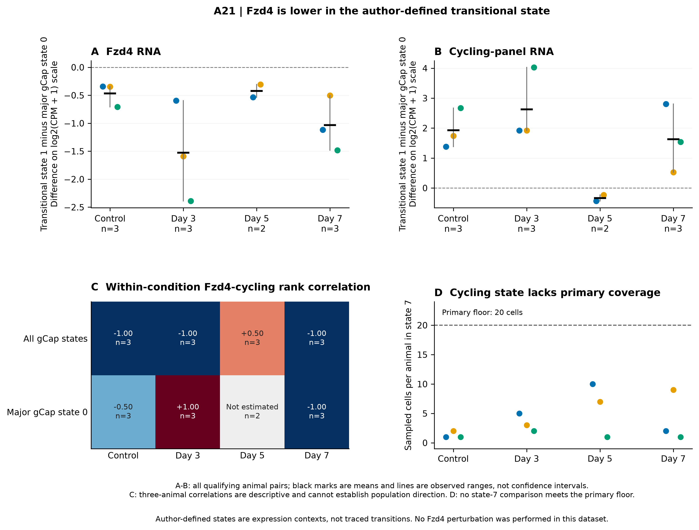
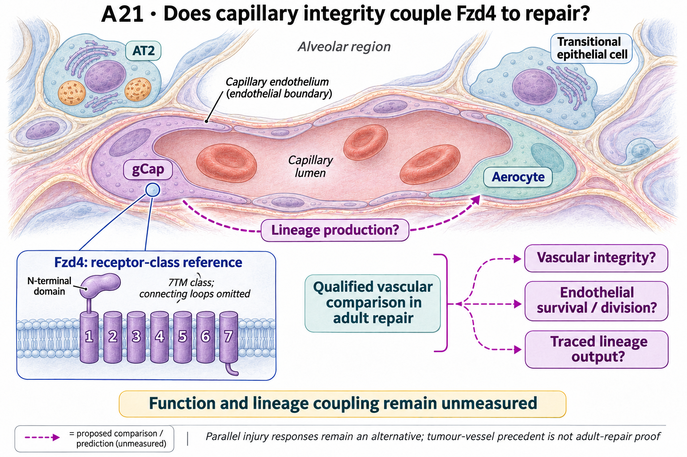

# A21: Fzd4 vascular context and capillary repair

## Organizing Biological Q

Does Fzd4-dependent vascular integrity support gCap renewal and aerocyte
production during adult alveolar repair? The completed evidence has weakened a
simpler entry-marker explanation: Fzd4 is enriched in gCap relative to aerocytes,
yet is lower in the author-defined transitional gCap state and does not track
cycling consistently. Maintenance, survival and selective regenerative output
remain alternatives to assess, not mechanisms selected by these RNA patterns.

A21's contribution is this narrowing and the separation of published vascular
endpoints. The registered function-to-lineage route remains a proposal.

Current synthesis: 4 November 2026. [Question card](../../RESEARCH_QUESTIONS.md#a21)
· [Literature context](LITERATURE_CONTEXT.md) · [Dossier](../../docs/research_dossiers/A21.md).

## Literature context & visual hypothesis

[Gillich's capillary lineage findings and the source audit](SOURCES.md) motivate
the gCap/aerocyte question. [Bian's tumor-vessel restoration results](extensions/extension_v1/RESULTS.md)
make vascular maintenance a concrete possibility, but concern a different
perturbation context. The [3 November primary-source refresh](../../docs/research_reviews/2026-11-03-full-priority-screening/A21_SOURCE_REFRESH.md)
also distinguishes endothelial state, sprouting, survival and repair outcomes.

The [registered schematic](#registered-scope-and-illustration) illustrates a
conditional adult-repair route. The measured substate figure below tests the
RNA/cycling explanation; it contains no traced descendants or receptor intervention.

## Evidence, analyses and next steps

The [parent analysis](../../RQ_Specified/A21_fzd4_capillary_function/RESULTS.md)
uses GSE211335: **5,423 endothelial cells from 12 animals**, with cells and technical
pools nested within animal. Differences are in log2(CPM+1), not literal log2 fold
changes. Different injury days contain different animals.

At the fixed 20-cell floor, Fzd4 is higher in gCap than aerocytes in **7/7**
eligible paired animals, with sparse injury-day support. In **11/11** eligible
transitional-minus-major gCap pairs, Fzd4 is lower. Cycling-panel RNA has a
different pattern, including a negative day-5 contrast; within-condition
three-animal correlations are inconsistent. The dedicated cycling state never
meets the primary floor. Thus gCap enrichment does not support a simple
high-Fzd4 regenerative-entry marker.

The older eight-animal pooled correlation is retained historically, but round,
sex and reporter-genotype imbalance prevent it from restoring that interpretation.
Those reporter genotypes did not perturb Fzd4. The [family extension](../../RQ_Specified/A21_fzd4_capillary_function/extensions/extension_v1/RESULTS.md)
reuses the same 12 animals and 5,423 cells: none of the alternative Fzd receptors
meets the complete frozen nomination rule. This is not proof of receptor absence
or compensation. Foxf1, Fzd4 and Lrp6 are lower in all 11 primary substate pairs;
RNA concordance does not establish a causal regulatory sequence.

The recovered Bian workbooks preserve **88 panel observations, not 88 unique mice**.
Anonymous rows cannot be joined across endpoints:

| Published contrast | Exact panel/readout | What it does not establish |
|---|---|---|
| Fzd4 restoration after endothelial Foxf1 loss in tumor vessels | Fig. 7F: nuclear beta-catenin; 7G: collagen IV/CD31 area; 7E: Fzd4-positive gCap; 7D: tumor size | Normal adult-repair lineage output or Fzd4-mediated perfusion rescue. |
| Foxf1 loss versus control | Fig. 3F: lectin/CD31 area ratio | A perfusion measurement under Fzd4 restoration. |

The first comparison supports pathway/structural restoration in its tumor setting.
Combining it with the second would invent an unmeasured rescue endpoint.

Points are animal values; black marks are means and grey lines observed ranges,
not confidence intervals. Author states are RNA annotations, not traced
transitions. The sparse cycling-state panel and inconsistent rank summaries
remain visible rather than being pooled into a positive regeneration claim.

## Does the evidence warrant the narrowing?

**Rationale verdict: useful negative/diagnostic boundary; maintenance remains
an exploratory possibility.** The 12-animal state/cycling RNA contrasts weaken
a simple high-Fzd4 regenerative-entry marker. They do not select maintenance,
survival or lineage production as the explanation. Bian's tumor-vessel
restoration provides a separate biological premise, not the missing adult-repair
effect or a perfusion-rescue result.

The [parent methods](../../RQ_Specified/A21_fzd4_capillary_function/METHODS.md)
record freezing new estimates after exposure to the original associations and
source narratives; the [extension](../../RQ_Specified/A21_fzd4_capillary_function/extensions/extension_v1/METHODS.md)
was specified after parent-result exposure and reuses its animals. Neither is
confirmation of the revised mechanism. Sparse state coverage, annotation and
composition, different animals across injury days, and the original round/sex/
reporter-genotype imbalance constrain interpretation. The family screen's lack
of a robust alternative receptor does not establish Fzd4's unique function. The
next decision is a qualified Fzd4 effect on a specified maintenance, survival or
lineage endpoint; the stronger coupling claim needs evidence linking endpoints.
The present disagreement does not itself demonstrate random noise or a
maintenance mechanism.

## What the result changes and the next decision

The relevant decision is which Fzd4-attributable outcome a new source could
actually estimate. A qualified vascular-function comparison can inform maintenance;
a survival comparison can inform cell preservation; traced gCap/aerocyte output
can address lineage production. None is required to measure every other endpoint
to be informative within its own scope.

The stronger registered claim that integrity permits later renewal needs evidence
linking those endpoints while distinguishing cell loss and parallel injury
responses. Coincident changes or temporal order alone would not identify
mediation. The [functional design](extensions/extension_v1/FUNCTIONAL_DESIGN.md)
retains separate output estimands; the [source refresh](../../docs/research_reviews/2026-11-03-full-priority-screening/A21_SOURCE_REFRESH.md)
explicitly permits narrower directly measured questions. No inspected source
currently establishes the complete adult-repair route. Further pooling or
pseudotime in the same RNA data would not supply that missing effect.

## Registered scope and illustration

The unchanged registered hypothesis below concerns the complete adult-repair
function/lineage route. It is not an accepted maintenance mechanism and does not
impose all its measurements on every narrower future study. The illustration's
arrows remain proposed relationships.

<!-- current-rq-framing:start -->

## Organizing Biological Q

Fzd4-dependent capillary integrity may permit gCap self-renewal and subsequent aerocyte production during normal adult alveolar repair. The proposed route links vascular function to lineage output; it must be distinguished from direct regenerative entry, endothelial survival and parallel injury responses. Tumor-vessel rescue is a precedent, not evidence that this complete adult repair route has been demonstrated.

**What is already known, and what remains:** Capillary lineage specialization and Fzd4 vascular effects are established. The candidate increment is adult repair function/lineage linkage; co-occurrence alone does not establish integrity-mediated renewal. [Primary-source comparison](../../docs/research_dossiers/NOVELTY_SPECIFICITY_APPLICATION_2026-10-03.md#a21).

**What the measurements would decide:** A Fzd4-dependent output difference with independently measured vascular function, division, lineage and survival supports functional coupling. An output difference explained by cell loss favors maintenance. Even matched function and lineage changes do not identify mediation without a further discriminating comparison.

**Current disposition:** Conditional adult-repair route; novelty provisional. This revision specifies proposed work; scientific acceptance, model access and assay qualification remain pending.

| Evidence and implementation | Current boundary |
|---|---|
| Biological unit and endpoint | Validated starting gCap lineages nested in animals. Measure gCap progeny with division evidence and aerocyte descendants per starting labelled population, alongside separately qualified vascular function and survival. |
| Current evidence and limit | Expression-context and extension results do not supply direct normal-repair lineage/function coupling. Tumor-context vascular restoration remains a distinct source observation. |
| Next decision / hold | Review is deferred and M13 retains the context/linkage hold. Reopen for the appropriate adult-repair function/lineage design; do not attribute all Foxf1-loss perfusion results to Fzd4 restoration. |

**Read in this order:** [current evidence](extensions/extension_v1/RESULTS.md),
[development dossier](../../docs/research_dossiers/A21.md),
[conditional hypothesis package](../../docs/research_dossiers/packages_2026-10-03/A21.md).
Source-mapping closeout: [M13 and reopening conditions](../../docs/research_dossiers/source_mapping_closeout_2026-10-03/README.md).
[Deferred work](../../docs/research_dossiers/REMAINING_WORK.md) and
[execution requirements](../../docs/RESEARCH_GOVERNANCE.md) govern any later
analysis. Draft completion does not establish assay validity, resource access,
meaningful effects, precision or scientific acceptance. Existing numerical
results and original plans below retain their recorded scope.
<!-- current-rq-framing:end -->

<!-- literature-visual-context:start -->

## Literature context & visual hypothesis

[What previous findings contribute, what remains, and what the readouts would decide](LITERATURE_CONTEXT.md).

GPT-generated matte illustration, 3 November 2026. Proposed relationships and cell counts are qualitative; the owning context defines the comparison and interpretation limits. [Editorial review](../../docs/audits/2026-11-02-rq-schematic-review/MATTE_PUBLICATION_2026-11-03.md) · [Selected edit prompt](schematics/A21_gpt_matte_v1.prompt.txt). Earlier SVG files are retained as history.

*Explanatory proposal, not measured results. Read the linked context and caption; arrows do not certify a mechanism or novelty.*
<!-- literature-visual-context:end -->

## Evidence and planning records

[Parent methods](METHODS.md) · [Parent figure gallery](FIGURES.md) ·
[Extension results](extensions/extension_v1/RESULTS.md) ·
[Source-reconstruction figure and exact panel captions](extensions/extension_v1/FIGURES.md) ·
[Original plan](PLAN.md) · [M13 closeout](../../docs/research_dossiers/source_mapping_closeout_2026-10-03/README.md).
The extension superseded an earlier workbook-access limitation; it did not
complete a normal-repair perturbation/lineage experiment. Historical plans and
review summaries below do not restart an execution queue.

Preserved review and follow-through records

The complete earlier blocks below are retained. Current owning result reports
supply scientific interpretation; execution and review do not confer human
acceptance or promote a claim.

<!-- full-priority-screening-20261103:start -->
**Screening follow-through — 3 November 2026.** Fzd4 is higher in gCap than aCap in all seven eligible paired units, while transitional ECs are lower in all eleven; cycling does not consistently explain the pattern. Existing structural rescue evidence and the recent source refresh retain maintenance, survival and output as separate possibilities.

**Remaining discriminator:** No qualified adult-repair Fzd4-specific comparison links vascular function, survival and traced regenerative output. Tumor structural rescue and separate loss-of-function perfusion data cannot be combined into that causal chain. [Recent primary-source refresh](../../docs/research_reviews/2026-11-03-full-priority-screening/A21_SOURCE_REFRESH.md).

[Reviewed screening sequence](../../docs/research_reviews/2026-11-03-full-priority-screening/PLANS.md) · [Coordination and review](../../docs/research_reviews/2026-11-03-full-priority-screening/README.md). This reuses reviewed evidence and does not record human scientific acceptance.
<!-- full-priority-screening-20261103:end -->

<!-- evidence-followthrough:start -->
**Evidence follow-through — 3 November 2026:** Exclude the affirmative claim
“The data select direct regenerative entry or an integrity-mediated route.” from current conclusions.
[Bounded fill, stop rule and reopening evidence](../../docs/audits/2026-11-03-rq-evidence-trajectory/CUT_OR_FILL_PLAN.md#a21).
The hypothesis remains a proposal where its decisive comparison is untested.
<!-- evidence-followthrough:end -->

