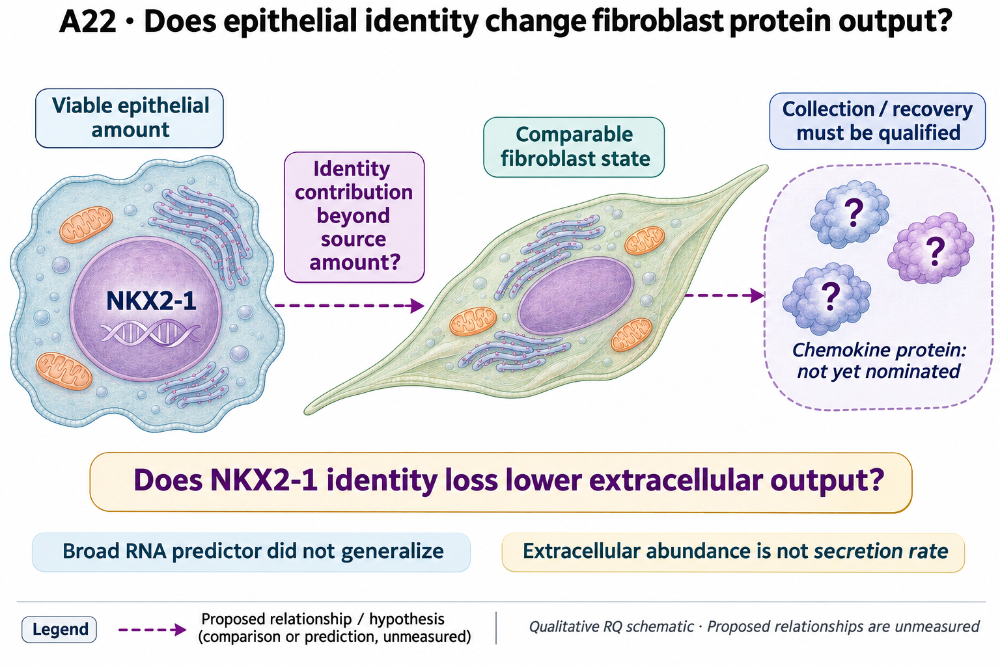

# A22: literature context and hypothesis schematic

[Question home](README.md) · [Scientific dossier](../../docs/research_dossiers/A22.md).

<!-- full-priority-screening-20261103:start -->
**Screening follow-through — 3 November 2026:** All seven focal chemokine RNA effects are already available after NKX2-1 perturbation. The small broad-identity predictor gain fails whole-plate transfer and disappears without NKX2-1. Viable source-cell amount, extracellular protein output and recipient selection are not jointly measured. Reuse the focal RNA screen; do not repeat the broad predictor or infer secretion from RNA. [Reviewed screening sequence](../../docs/research_reviews/2026-11-03-full-priority-screening/PLANS.md) · [Coordination and review](../../docs/research_reviews/2026-11-03-full-priority-screening/README.md).
<!-- full-priority-screening-20261103:end -->

Primary-source reviews retain their recorded dates and access limits. Synthesis updated 4 November 2026 using those records and current results, without a new literature search. This is a bounded rationale assessment, not novelty clearance or scientific acceptance.

## Published starting point

NKX2-1-dependent epithelial identity and a fibroblast chemokine RNA effect are source findings. A22 starts from that specific result rather than claiming a new niche programme.

| Primary source | Inspected locator and access record |
|---|---|
| [Nabhan 2026](https://doi.org/10.1073/pnas.2606113123) | Fig. 4/S7F and niche context; local primary PDF audit. [Access / prior review](../../docs/history/reviews/NOVELTY_SPECIFICITY_APPLICATION_2026-10-03.md) |

Sources above reuse the named review unless the update ledger explicitly records a fresh inspection. Published-source evidence and reanalysis of the same material are not independent replication.

## Repository observation

The retrospective predictor uses 672 wells across 201 targets. Adding the inherited AT2 identity score reduces equal-target mean squared error by 0.64% in target holdouts, increases it by 35.00% in whole-plate holdouts, and loses the small target-held-out gain without NKX2-1. Day-14 RNA and imaging are concurrent; day-7 imaging is also post-perturbation. Whole-screen TMM normalization was not refitted within folds, so held-out count distributions contributed to upstream processing. Adjustment for these treatment-dependent proxies does not identify mediation or an epithelial-amount effect. These are processing-conditional screen diagnostics, not independent preparation-level or clean prospective validation.

[Current result, design and limits](reports/identity_amount_v2/RESULTS.md). This reuses existing evidence rather than providing a new run or independent replication.

## What this question could add

Useful failed transport of the broad identity predictor. A focal NKX2-1 output question remains justified by the published contrast; it does not rescue the failed generalization or identify a new mediator. The seven focal chemokine RNA effects are not measurements of secretion or functional competence.

Viable epithelial amount, extracellular chemokine protein and recipient selection/state are not jointly measured. Imaging area/read depth are imperfect proxies and may be treatment consequences.

## Current hypothesis and rival

Loss of NKX2-1-dependent AT2 identity may lower actual fibroblast chemokine output within comparable fibroblast states beyond a change in viable epithelial source amount. The RNA direction is already published. The proposed extension asks whether it reaches extracellular protein output; the primary chemokine protein and collection/recovery definition have not been nominated, and broad AT2-score generalization failed.

**Strongest rival:** Fibroblast selection, survival, epithelial amount or a target-specific effect unrelated to the proposed alveolar-identity route explains the output. The focal NKX2-1 contrast does not establish generality across epithelial perturbations.

## What the comparison would teach

Retain the failed broad predictor. A focal extension would specify an extracellular output and how source amount and recipient context affect its interpretation. Concordant RNA/protein changes in qualified units would advance the output question; RNA-only or selection-dependent effects would restrict it. Another general predictor or RNA score does not supply secretion.

## Hypothesis schematic

GPT-generated matte illustration, 3 November 2026. Proposed relationships and cell counts are qualitative; the owning context defines the comparison and interpretation limits. [Editorial review](../../docs/audits/2026-11-02-rq-schematic-review/MATTE_PUBLICATION_2026-11-03.md) · [Selected edit prompt](schematics/A22_gpt_matte_v1.prompt.txt). Earlier SVG files are retained as history.

The focal hypothesis concerns extracellular fibroblast protein output beyond viable epithelial amount, within comparable recipient states and qualified independent preparations. The broad predictor failed and C3 is not a stable proxy. Secretion-rate claims require calibrated collection/recovery.

Class-level glyphs and qualitative geometry are not molecular structures, organelle measurements or evidence of functional assembly. Neutral epithelial/stromal shapes do not assert subtype identity or organelle loss, and icon counts are illustrative. Read locally labelled solid premises/references separately from dashed proposed comparisons; no complete mechanism follows from their juxtaposition.

## Next literature check

Planned query (not reported as newly executed): `NKX2-1 alveolar fibroblast chemokine extracellular protein output viable source`. Expand to synonyms, nearest source references/citations and conflicting results using the [literature workflow](../../docs/governance/LITERATURE_WORKFLOW.md). Recheck the exact population, comparison, timing, unit and endpoint before making a stronger contribution claim.

**Current unresolved specification:** Within-state chemokine induction has not been separated from fibroblast abundance/selection, epithelial amount and a dominant perturbation-specific effect.

**Interpretation limit:** A score or C3 proxy does not establish secretion, recruitment or generalized epithelial identity control.

[Current dossier](../../docs/research_dossiers/A22.md) · [All-question context index](../../docs/research_dossiers/literature_context_2026-10-03/README.md)
