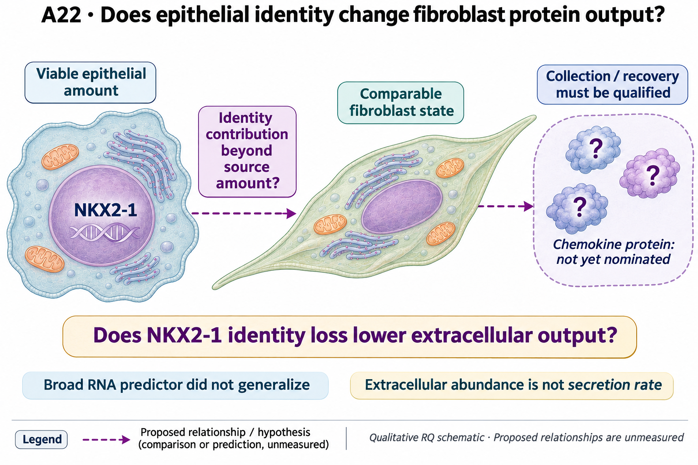

# A22: does epithelial identity determine fibroblast chemokine competence?

## Organizing Biological Q

How far does the focal NKX2-1 epithelial identity result generalize, and does its fibroblast chemokine RNA effect extend to extracellular output?

NKX2-1-dependent epithelial identity and the focal chemokine RNA direction are published premises. A general identity-to-niche rule and a protein-output extension are additional questions.

Current synthesis: 4 November 2026. [Full rationale](../../docs/research_dossiers/A22.md) · [Source context](LITERATURE_CONTEXT.md).

<!-- literature-visual-context:start -->

## Literature context & visual hypothesis

[What previous findings contribute, what remains, and what the readouts would decide](LITERATURE_CONTEXT.md).

GPT-generated matte illustration, 3 November 2026. Proposed relationships and cell counts are qualitative; the owning context defines the comparison and interpretation limits. [Editorial review](../../docs/audits/2026-11-02-rq-schematic-review/MATTE_PUBLICATION_2026-11-03.md) · [Selected edit prompt](schematics/A22_gpt_matte_v1.prompt.txt). Earlier SVG files are retained as history.

*Explanatory proposal, not measured results. Read the linked context and caption; arrows do not certify a mechanism or novelty.*
<!-- literature-visual-context:end -->

The illustration presents the registered question and untested relationships. The current argument follows the result below; the drawing does not establish its proposed mechanism.

## What the analysis changed

The retrospective predictor uses 672 wells across 201 targets. Adding the inherited AT2 identity score reduces equal-target mean squared error by 0.64% in target holdouts, increases it by 35.00% in whole-plate holdouts, and loses the small target-held-out gain without NKX2-1. Day-14 RNA and imaging are concurrent; day-7 imaging is also post-perturbation. Whole-screen TMM normalization was not refitted within folds, so held-out count distributions contributed to upstream processing. Adjustment for these treatment-dependent proxies does not identify mediation or an epithelial-amount effect. These are processing-conditional screen diagnostics, not independent preparation-level or clean prospective validation.

[Current result, design and limits](reports/identity_amount_v2/RESULTS.md).

**Rationale check.** Useful failed transport of the broad identity predictor. A focal NKX2-1 output question remains justified by the published contrast; it does not rescue the failed generalization or identify a new mediator. The seven focal chemokine RNA effects are not measurements of secretion or functional competence.

## Current interpretation and next decision

Viable epithelial amount, extracellular chemokine protein and recipient selection/state are not jointly measured. Imaging area/read depth are imperfect proxies and may be treatment consequences.

Retain the failed broad predictor. A focal extension would specify an extracellular output and how source amount and recipient context affect its interpretation. Concordant RNA/protein changes in qualified units would advance the output question; RNA-only or selection-dependent effects would restrict it. Another general predictor or RNA score does not supply secretion.

## Registered scope and analysis history

The records below preserve earlier framing and execution checkpoints. Read the current result before an older plan. Historical unfinished-work wording does not supersede completed later diagnostics. Registered hypotheses remain unchanged; this synthesis grants no claim grade or human acceptance.

Registered framing and retained analysis history

<!-- current-rq-framing:start -->

## Organizing Biological Q

Loss of NKX2-1-dependent AT2 identity may lower actual fibroblast chemokine output within comparable fibroblast states beyond a change in viable epithelial source amount. The RNA direction is already published. The proposed extension asks whether it reaches extracellular protein output; the primary chemokine protein and collection/recovery definition have not been nominated, and broad AT2-score generalization failed.

**What is already known, and what remains:** Nabhan already reports NKX2-1-dependent fibroblast chemokine transcripts and niche changes. The possible contribution is source-amount/selection-qualified protein output, not rediscovery of the transcript effect or an assumed immune-recruitment function. [Primary-source comparison](../../docs/research_dossiers/NOVELTY_SPECIFICITY_APPLICATION_2026-10-03.md#a22).

**What the measurements would decide:** Lower measured protein output within comparable recipient states at comparable viable epithelial input would support the extension. An amount/selection-only effect or unchanged protein weakens it. Calibrated collection/recovery is needed for secretion-rate language; the failed broad predictor cannot support all epithelial identity perturbations.

**Current disposition:** Published focal effect; protein endpoint required. This revision specifies proposed work; scientific acceptance, model access and assay qualification remain pending.

| Evidence and implementation | Current boundary |
|---|---|
| Biological unit and endpoint | Mapped epithelial and fibroblast donor/preparation units with shared mixtures and split wells nested. Measure total extracellular output of a prospectively selected chemokine per starting recipient population; report viable-cell-normalized output separately. |
| Current evidence and limit | The 672-well analysis shows a small gain that reverses after NKX21 omission and in whole-plate prediction. It weakens the broad predictor; RNA scores do not establish secretion or recruitment. |
| Next decision / hold | Review is deferred. M05/M06 retain preparation and spatial animal/treatment holds; chemokine output, within-state identity and function need separate qualification before stronger claims. |

**Read in this order:** [current evidence](reports/identity_amount_v2/RESULTS.md),
[development dossier](../../docs/research_dossiers/A22.md),
[conditional hypothesis package](../../docs/research_dossiers/packages_2026-10-03/A22.md).
Source-mapping closeout: [M05/M06 and reopening conditions](../../docs/research_dossiers/source_mapping_closeout_2026-10-03/README.md).
[Deferred work](../../docs/research_dossiers/REMAINING_WORK.md) and
[execution requirements](../../docs/RESEARCH_GOVERNANCE.md) govern any later
analysis. Draft completion does not establish assay validity, resource access,
meaningful effects, precision or scientific acceptance. Existing numerical
results and original plans below retain their recorded scope.
<!-- current-rq-framing:end -->

## Evidence, analyses and next steps

<!-- full-priority-screening-20261103:start -->
**Screening follow-through — 3 November 2026.** All seven focal chemokine RNA effects are already available after NKX2-1 perturbation. The small broad-identity predictor gain fails whole-plate transfer and disappears without NKX2-1.

**Remaining discriminator:** Viable source-cell amount, extracellular protein output and recipient selection are not jointly measured. Reuse the focal RNA screen; do not repeat the broad predictor or infer secretion from RNA.

[Reviewed screening sequence](../../docs/research_reviews/2026-11-03-full-priority-screening/PLANS.md) · [Coordination and review](../../docs/research_reviews/2026-11-03-full-priority-screening/README.md). This reuses reviewed evidence and does not record human scientific acceptance.
<!-- full-priority-screening-20261103:end -->

<!-- evidence-followthrough:start -->
**Evidence follow-through — 3 November 2026:** Exclude the affirmative claim
“The focal NKX2-1 result generalizes to a broad identity-to-chemokine rule.” from current conclusions.
[Bounded fill, stop rule and reopening evidence](../../docs/audits/2026-11-03-rq-evidence-trajectory/CUT_OR_FILL_PLAN.md#a22).
The hypothesis remains a proposal where its decisive comparison is untested.
<!-- evidence-followthrough:end -->

The existing analysis records below retain their scope. Read the latest linked result or amendment before an older plan.

**DY1 contextual link, 29 October 2026:** [Paper and human-atlas relevance](DY1_CONTEXT_2026-10-29.md). Article-local observations do not change this question's hypothesis, current evidence or endpoint requirements.

**Nb4 follow-through, 3 October 2026:** [scoped sequential analyses](../../Research%20Article/gate2_N3_travaglini_nabhan_lung_atlas_2020/reports/RQ_SEQUENCE_RESULTS.md) and [pipelines](../../Research%20Article/gate2_N3_travaglini_nabhan_lung_atlas_2020/reports/RQ_PIPELINES.md). Article-local diagnostics preserve this question’s existing evidence and biological endpoint gates; no claim grade or acceptance decision changes.

### Executed extension, 1 October 2026

[Identity–amount results](reports/identity_amount_v2/RESULTS.md) |
[Figure gallery](FIGURES.md) | [Frozen v2 contract](config/identity_amount_v2.json).
The same-screen P2 extension now covers 672 wells and 201 targets. Identity
reduces equal-target held-out MSE by 0.64%, but worsens it by 0.97% after NKX21
omission and by 35.00% in whole-plate prediction. The broad operational
predictor is weakened; the focal mechanism, within-state response and
protein/function hypotheses remain open. No scientific acceptance or grade changes.

**Proposed 1 October 2026; P2 descriptive extension executed, mechanism open.**
The [shared question card](../../RESEARCH_QUESTIONS.md#a22) owns the hypothesis.
The owner requested derivation after Nb3 follow-up; retain/reject and scientific
acceptance remain open. No claim grade is added.

**Hypothesis.** NKX2-1-dependent alveolar epithelial identity sustains a
fibroblast chemokine response. Loss of that identity favours wound-associated
fibroblast activity beyond differences in epithelial amount alone. The proposed
functional consequence is changed immune-cell recruitment,
which the present RNA screen has not measured.

NKX21 has AT2 −2.072, fibroblast chemokines −3.357 and wound markers +1.468 in
Nb3's marker-score contrast units. All three directions persist through the
tested control/gene/well omissions; paired-depth sensitivity retains AT2 and
chemokine reductions. Across 195 targets, however, the paired association is
only rho 0.210, falling to 0.151 with depth covariates. Strong focal motivation
does not establish a general rule or a growth-independent causal effect.

| Read | Purpose |
|---|---|
| [Rationale](RATIONALE.md) | Biological context, evidence, rivals and relationship to existing questions |
| [Analysis pipeline](PIPELINE.md) | P0-P6 stages, estimands, source gates, output hierarchy and figure plan |
| [Intake results](reports/intake_v1/INTAKE.md) | 64 checks of inherited evidence; 18 extracted values and four source eligibility records; no new fit |
| [Source eligibility](SOURCES.md) | Same-screen reuse, conditional spatial work and unmet independent RNA/function requirements |
| [Plan](PLAN.md) | Functional outcomes, design requirements and decision boundaries |
| [Related branches after strict review](../../RESEARCH_QUESTIONS.md#a22-candidates-20261001) | E7 induction versus selection; E8 tissue specificity and immune/clinical links remain distinct unresolved hypotheses |
| [Nb3 follow-up](../../Research%20Article/gate2_N2_nabhan_2026/reports/FOLLOWUP_RESULTS.md) | Completed analysis, sensitivities and remaining source/design gaps |
| [Nb3 figures](../../Research%20Article/gate2_N2_nabhan_2026/FIGURES.md) | Figures 4, 7 and 8 plus source tables |

The paper package retains ownership of the motivating discovery fits; A22 owns
the new P2 diagnostic fits. Corrected human S5/code,
independent preparations, state/composition measurements and a secreted-protein/
recipient-function endpoint are still needed for the stronger answer.

### Execution status and next step

P0 ran as a provenance/evidence audit. P1 has a bounded source registry; no
independent RNA or functional source is admitted yet. P2 has completed the RNA–imaging join and frozen descriptive comparison of
amount-related proxies versus proxies plus epithelial identity. P3-P5 have separate source/design gates and need
not wait for a favorable P2 result. Details and the runnable intake commands are
in the [pipeline](PIPELINE.md#run-the-intake).

The pipeline draft remains historical. The executed extension uses a separate
exploratory contract and adds one current figure. No functional result or
claim-grade promotion is reported.

