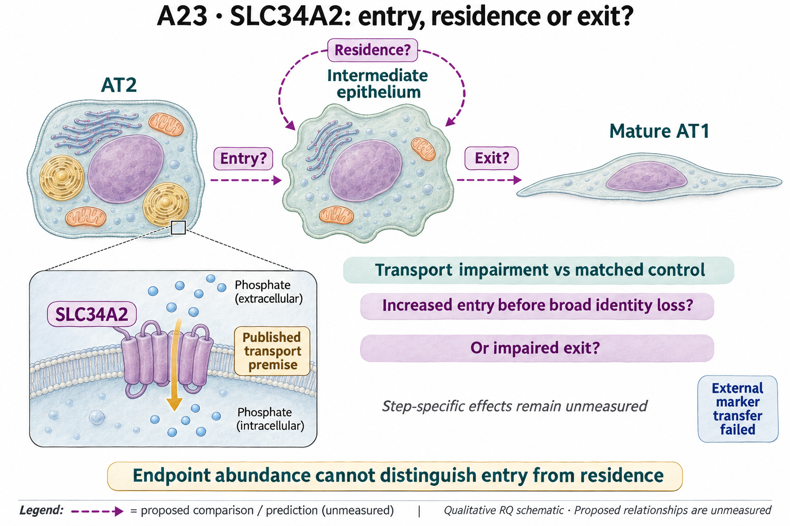

# A23: literature context and hypothesis schematic

[Question home](README.md) · [Scientific dossier](../../docs/research_dossiers/A23.md).

<!-- full-priority-screening-20261103:start -->
**Screening follow-through — 3 November 2026:** Existing transition and alternative-transporter screens are complete. SLC20A1/SLC20A2 RNA is lower in the single PAM case across overlapping selections; this is not evidence of transport compensation. Static fractions and marker endpoints cannot distinguish entry from persistence or exit. Repeated/dynamic unit-linked measurements are missing; pseudotime or relabelled scores would not supply them. [Reviewed screening sequence](../../docs/research_reviews/2026-11-03-full-priority-screening/PLANS.md) · [Coordination and review](../../docs/research_reviews/2026-11-03-full-priority-screening/README.md).
<!-- full-priority-screening-20261103:end -->

Primary-source reviews retain their recorded dates and access limits. Synthesis updated 4 November 2026 using those records and current results, without a new literature search. This is a bounded rationale assessment, not novelty clearance or scientific acceptance.

## Published starting point

A transitional RNA module after identity perturbation and phosphate-linked alveolar regeneration failure are published. A generic transporter-to-repair claim is therefore too broad.

| Primary source | Inspected locator and access record |
|---|---|
| [Nabhan 2026](https://doi.org/10.1073/pnas.2606113123) | Fig. 4/S7F and niche context; local primary PDF audit. [Access / prior review](../../docs/history/reviews/NOVELTY_SPECIFICITY_APPLICATION_2026-10-03.md) |
| [Lv 2023](https://pubmed.ncbi.nlm.nih.gov/37139431/) | Full-text XML Results 3.2 and Fig. 3–4 captions; pixels not inspected. [Access / prior review](../../docs/history/reviews/NOVELTY_SPECIFICITY_APPLICATION_2026-10-03.md) |

Sources above reuse the named review unless the update ledger explicitly records a fresh inspection. Published-source evidence and reanalysis of the same material are not independent replication.

## Repository observation

The external comparison of one PAM case with one adult control does not reproduce coordinated KRT8/SPRR1A/CLU elevation. Separate fractions of the PAM subject are not independent patients. SLC20A1/SLC20A2 RNA is lower across overlapping selections, so an increased-transporter-RNA explanation is unsupported; compensatory transport activity remains untested. Disease, donor, age and sampling are inseparable in the case comparison.

The original candidate markers were disjoint from the reported readouts; published-annotation and complete-cell-set sensitivities reuse the same case and can retain identity-selection bias. The alternative-transporter readouts were fixed before inspecting their values, after exposure to the preceding case results. These are overlapping sensitivity/extension observations, not independent confirmations. See the [transporter result](../../RQ_Specified/A23_slc34a2_transition_homeostasis/reports/transporter_context_v1/RESULTS.md).

[Current result, design and limits](reports/external_pilot_v2/RESULTS.md). This reuses existing evidence rather than providing a new run or independent replication.

## What this question could add

Unfavorable external marker transfer and an unsupported RNA-surrogate compensation account. Entry versus delayed exit is a legitimate remaining distinction, not an explanation selected by static RNA observations. Endpoint fractions can change through survival, division and starting composition as well as transition timing.

The current contrasts do not measure entry, residence time, exit or transport function in linked units. Relabelled scores and pseudotime cannot supply the missing dynamic endpoint.

## Current hypothesis and rival

SLC34A2 transport impairment may increase acquisition of a transition-associated epithelial stress state before broad AT2 identity loss, rather than merely prolong an existing intermediate state by impairing exit to AT1 maturation. This entry-versus-residence distinction narrows the original proposal. Phosphate-dependent repair failure and the Slc34a2-loss transitional RNA module already have published precedents; the mechanism cannot be claimed new from their combination.

**Strongest rival:** An existing intermediate state persists because exit/maturation is impaired; generalized injury, extracellular mineral context, survival, division or starting-state composition changes endpoint abundance without increased state entry.

## What the comparison would teach

Keep the external failure and compensation limit visible. A timing comparison would need unit-linked repeated or lineage-resolved measurements appropriate to entry versus exit. Increased entry with unchanged exit and prolonged residence without increased entry would have different implications; endpoint occupancy alone leaves the question open. No same-data retuning follows automatically.

## Hypothesis schematic

GPT-generated matte illustration, 3 November 2026. Proposed relationships and cell counts are qualitative; the owning context defines the comparison and interpretation limits. [Editorial review](../../docs/audits/2026-11-02-rq-schematic-review/MATTE_PUBLICATION_2026-11-03.md) · [Selected edit prompt](schematics/A23_gpt_matte_v1.prompt.txt). Earlier SVG files are retained as history.

Independent lineage-linked units must separate acquisition from subsequent exit; endpoint state abundance cannot do so. Transport, compartment-specific phosphate, survival and injury require distinct measurements. The external negative marker result remains; restoration of counts alone does not identify the affected step.

Class-level glyphs and qualitative geometry are not molecular structures, organelle measurements or evidence of functional assembly. Neutral epithelial/stromal shapes do not assert subtype identity or organelle loss, and icon counts are illustrative. Read locally labelled solid premises/references separately from dashed proposed comparisons; no complete mechanism follows from their juxtaposition.

## Next literature check

Planned query (not reported as newly executed): `SLC34A2 phosphate alveolar transition entry residence exit lineage 2025 2026`. Expand to synonyms, nearest source references/citations and conflicting results using the [literature workflow](../../docs/LITERATURE_WORKFLOW.md). Recheck the exact population, comparison, timing, unit and endpoint before making a stronger contribution claim.

**Current unresolved specification:** The repository lacks linked state acquisition and exit observations with direct transport and compartment-specific phosphate measurements. Phosphate-linked repair failure is published; whether the proposed transition-step comparison adds a worthwhile contribution remains provisional. The external negative result constrains transfer.

**Interpretation limit:** Three markers are not a fate transition, RNA is not phosphate flux, and absence of a marker pattern is not absence of every identity change.

[Current dossier](../../docs/research_dossiers/A23.md) · [All-question context index](../../docs/research_dossiers/literature_context_2026-10-03/README.md)
