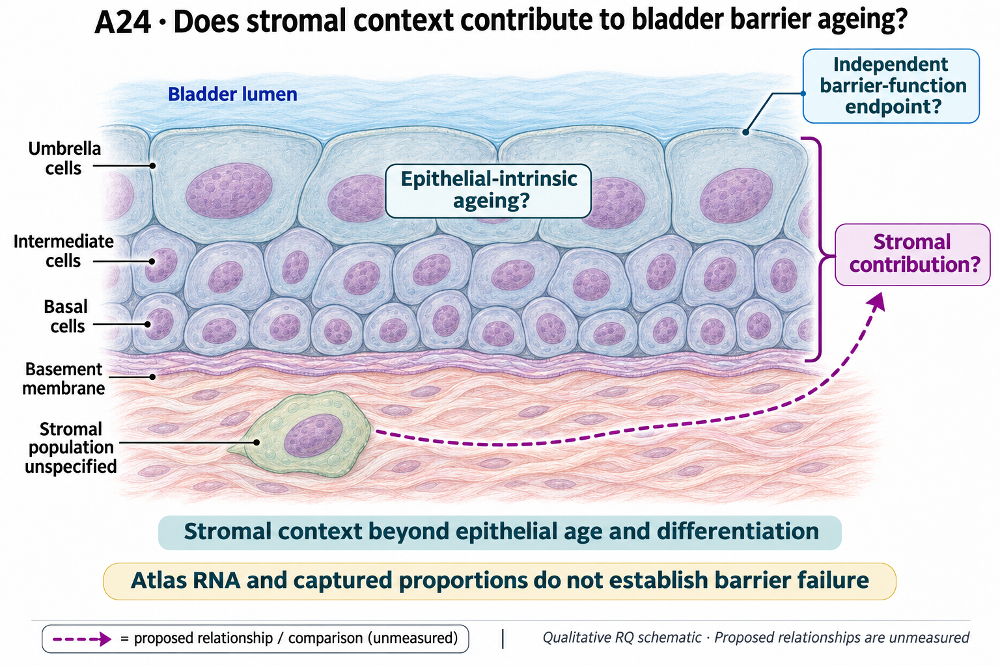

# A24: literature context and hypothesis schematic

[Question home](README.md) · [Scientific dossier](../../docs/research_dossiers/A24.md).

Reviewed 3 October 2026. This note connects published findings to the current proposed question. It is a bounded synthesis, not novelty clearance or scientific acceptance.

## Published starting point

Umbrella-cell senescence-like features across lifespan and an aged fibroblast tumour niche are established. They suggest epithelial differentiation and stromal context as separate possibilities.

| Primary source | Inspected locator and access record |
|---|---|
| [Al-Naggar et al.](https://doi.org/10.1111/acel.14399) | Umbrella-cell lifespan/senescence-like comparison. [Access / prior review](../../docs/research_dossiers/literature_context_2026-10-03/SOURCE_UPDATE.md) |
| [Meguro et al.](https://www.nature.com/articles/s43587-024-00704-1) | Aged fibroblasts in bladder tumour permissiveness. [Access / prior review](../../docs/research_dossiers/literature_context_2026-10-03/SOURCE_UPDATE.md) |

Sources above reuse the named review unless the update ledger explicitly records a fresh inspection. Published-source evidence and reanalysis of the same material are not independent replication.

## Repository observation

In three young and three old mice, the 24-minus-3-month bladder Cdkn2a detection difference is -1.238 percentage points. Lmnb1 detection decreases within the broad urothelial annotation (-1.519 points) but increases within mesenchymal cells (+3.952 points), despite an aggregate increase. These exposed source summaries measure detection frequency, distinct from normalized mean RNA, senescence burden or barrier function. All old mice are male; capture, sex and finer-state replacement within broad annotations remain limitations. No stromal mediator is selected.

[Bladder detection and composition result](../../Research%20Article/gate2_N4_nabhan_aging_atlas_2020/EXTENSION_RESULTS.md#p01-tissue-remodelling-and-within-type-rna). This reuses existing evidence rather than providing a new run or independent replication.

## What this question could add

Descriptive compartment context with an untested stromal-to-barrier proposal. The conflicting marker directions usefully prevent treating a generic senescence score as the biological answer; they do not select a barrier mechanism or refute senescence in the tissue.

A specified normal-bladder stromal population, linked epithelial consequence and independent barrier measurement are not supplied by the atlas observations.

## Current hypothesis and rival

An age-associated change in a specified bladder stromal population reduces urothelial barrier maintenance beyond epithelial age and terminal differentiation alone. This is a proposed intercompartmental contribution, not a conclusion from the atlas. The particular stromal population and mechanism remain open.

**Strongest rival:** Epithelial-intrinsic ageing or altered umbrella-cell differentiation explains the functional change, while stromal RNA and captured proportions merely covary with age. Differential survival, tissue sampling and immune or vascular changes can also explain an apparent stromal association.

## What the comparison would teach

Keep the atlas observations as context. A justified extension should specify a stromal population and an independently measured epithelial/barrier consequence. Concordant changes would motivate a bounded support question; effects accounted for by epithelial state or capture would restrict it. Another generic senescence score does not identify the missing mediator.

## Hypothesis schematic

GPT-generated matte illustration, 3 November 2026. Proposed relationships and cell counts are qualitative; the owning context defines the comparison and interpretation limits. [Editorial review](../../docs/audits/2026-11-02-rq-schematic-review/MATTE_PUBLICATION_2026-11-03.md) · [Selected edit prompt](schematics/A24_gpt_matte_v1.prompt.txt). Earlier SVG files are retained as history.

The proposal separates stromal context from epithelial age/terminal differentiation using an independently measured barrier endpoint in qualified biological units. Existing atlas RNA and captured proportions do not identify a causal stromal population, absolute senescence burden or barrier dysfunction.

Class-level glyphs and qualitative geometry are not molecular structures, organelle measurements or evidence of functional assembly. Neutral epithelial/stromal shapes do not assert subtype identity or organelle loss, and icon counts are illustrative. Read locally labelled solid premises/references separately from dashed proposed comparisons; no complete mechanism follows from their juxtaposition.

## Next literature check

Planned query (not reported as newly executed): `normal bladder aged stroma urothelial barrier maintenance epithelial differentiation 2026`. Expand to synonyms, nearest source references/citations and conflicting results using the [literature workflow](../../docs/LITERATURE_WORKFLOW.md). Recheck the exact population, comparison, timing, unit and endpoint before making a stronger contribution claim.

**Current unresolved specification:** The stromal population, its relevant change and a paired independent epithelial barrier endpoint remain unqualified. A mediator is not required to pose the question, but the source population and functional measurement must be nominated before an identifiable causal experiment.

**Interpretation limit:** RNA detection and captured fractions do not establish protein output, secretion, senescence, barrier failure or stromal causation. The normal bladder question is not inferred from the published tumour niche, and no therapeutic direction is assigned.

[Current dossier](../../docs/research_dossiers/A24.md) · [All-question context index](../../docs/research_dossiers/literature_context_2026-10-03/README.md)
