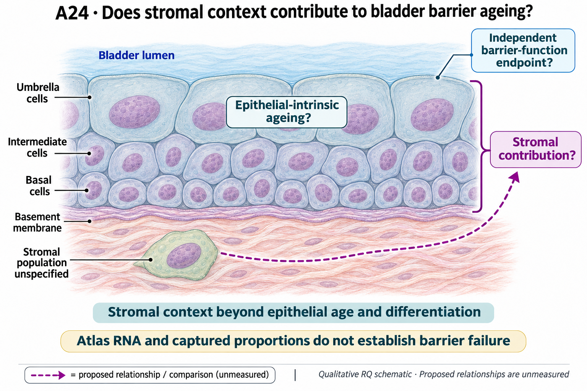

# A24: Bladder stromal ageing and urothelial barrier maintenance

## Organizing Biological Q

Does aged bladder stroma contribute to loss of urothelial barrier maintenance beyond epithelial-intrinsic ageing and changing epithelial composition?

Stromal support and tissue ageing make the question plausible, but senescence-associated transcripts and barrier function are different measurements. A normal-bladder mechanism is not supplied by a generic ageing signature.

Current synthesis: 4 November 2026. [Full rationale](../../docs/research_dossiers/A24.md) · [Source context](LITERATURE_CONTEXT.md).

<!-- literature-visual-context:start -->

## Literature context & visual hypothesis

[What previous findings contribute, what remains, and what the readouts would decide](LITERATURE_CONTEXT.md).

GPT-generated matte illustration, 3 November 2026. Proposed relationships and cell counts are qualitative; the owning context defines the comparison and interpretation limits. [Editorial review](../../docs/audits/2026-11-02-rq-schematic-review/MATTE_PUBLICATION_2026-11-03.md) · [Selected edit prompt](schematics/A24_gpt_matte_v1.prompt.txt). Earlier SVG files are retained as history.

*Explanatory proposal, not measured results. Read the linked context and caption; arrows do not certify a mechanism or novelty.*
<!-- literature-visual-context:end -->

The illustration presents the registered question and untested relationships. The current argument follows the result below; the drawing does not establish its proposed mechanism.

## What the analysis changed

In three young and three old mice, the 24-minus-3-month bladder Cdkn2a detection difference is -1.238 percentage points. Lmnb1 detection decreases within the broad urothelial annotation (-1.519 points) but increases within mesenchymal cells (+3.952 points), despite an aggregate increase. These exposed source summaries measure detection frequency, distinct from normalized mean RNA, senescence burden or barrier function. All old mice are male; capture, sex and finer-state replacement within broad annotations remain limitations. No stromal mediator is selected.

[Bladder detection and composition result](../../Research%20Article/gate2_N4_nabhan_aging_atlas_2020/EXTENSION_RESULTS.md#p01-tissue-remodelling-and-within-type-rna).

**Rationale check.** Descriptive compartment context with an untested stromal-to-barrier proposal. The conflicting marker directions usefully prevent treating a generic senescence score as the biological answer; they do not select a barrier mechanism or refute senescence in the tissue.

## Current interpretation and next decision

A specified normal-bladder stromal population, linked epithelial consequence and independent barrier measurement are not supplied by the atlas observations.

Keep the atlas observations as context. A justified extension should specify a stromal population and an independently measured epithelial/barrier consequence. Concordant changes would motivate a bounded support question; effects accounted for by epithelial state or capture would restrict it. Another generic senescence score does not identify the missing mediator.

## Registered scope and analysis history

The records below preserve earlier framing and execution checkpoints. Read the current result before an older plan. Historical unfinished-work wording does not supersede completed later diagnostics. Registered hypotheses remain unchanged; this synthesis grants no claim grade or human acceptance.

Registered framing and retained analysis history

## Organizing Biological Q

Does the aged bladder stromal compartment contribute to loss of normal urothelial barrier maintenance independently of epithelial-intrinsic ageing and changing epithelial differentiation?

**Unresolved gap:** The stromal population, its relevant change and a paired independent epithelial barrier endpoint remain unqualified. A mediator is not required to pose the question, but the source population and functional measurement must be nominated before an identifiable causal experiment.

[Full working hypothesis and alternatives](../../docs/research_dossiers/A24.md#working-hypothesis).

## Evidence, analyses and next steps

<!-- evidence-followthrough:start -->
**Evidence follow-through — 3 November 2026:** Exclude the affirmative claim
“Atlas marker differences establish stromal senescence-driven barrier loss.” from current conclusions.
[Bounded fill, stop rule and reopening evidence](../../docs/audits/2026-11-03-rq-evidence-trajectory/CUT_OR_FILL_PLAN.md#a24).
The hypothesis remains a proposal where its decisive comparison is untested.
<!-- evidence-followthrough:end -->

The existing analysis records below retain their scope. Read the latest linked result or amendment before an older plan.

Registered 3 October 2026 as **proposed**, following the owner-authorized
scientific review and instruction to preserve distinct biological focus and
cell/context heterogeneity. Codex supplied the bounded scientific review;
human retain/reject and scientific acceptance remain unrecorded. Registration
is not a claim of novelty, functional validation or permission to execute an
unfinished numerical design.

**Question:** Does the aged bladder stromal compartment contribute to loss of normal urothelial barrier maintenance independently of epithelial-intrinsic ageing and changing epithelial differentiation?

**Hypothesis:** An age-associated change in a specified bladder stromal population reduces urothelial barrier maintenance beyond epithelial age and terminal differentiation alone. This is a proposed intercompartmental contribution, not a conclusion from the atlas. The particular stromal population and mechanism remain open.

**Strongest rival:** Epithelial-intrinsic ageing or altered umbrella-cell differentiation explains the functional change, while stromal RNA and captured proportions merely covary with age. Differential survival, tissue sampling and immune or vascular changes can also explain an apparent stromal association.

**Current evidence:** The exposed Nb5 bladder decomposition has opposing Lmnb1 detection directions in broad urothelial and mesenchymal annotations, while captured-bladder Cdkn2a detection declines. Those RNA summaries do not identify a causal stromal population, absolute abundance, senescence burden or barrier dysfunction. Existing Figures 7 and 8 are contextual evidence only.

**Next decision:** Qualify normal-bladder stromal subpopulations and epithelial identities in source-independent material, then determine whether a valid barrier endpoint and independent animals are available. Keep cancer-selected fibroblasts and constitutive umbrella-cell phenotypes separate. Do not fit a senescence score as a substitute for the missing function.

[Dossier](../../docs/research_dossiers/A24.md) · [Development plan](PLAN.md) · [Canonical card](../../RESEARCH_QUESTIONS.md#a24) · [Review and routing](../../Research%20Article/gate2_N4_nabhan_aging_atlas_2020/rq_review/README.md).

This workspace owns future question-specific planning. Existing figures, tables,
failed runs and amendments remain in the article package. No new analysis has
been executed under this RQ; shared inputs remain shared biological evidence.

