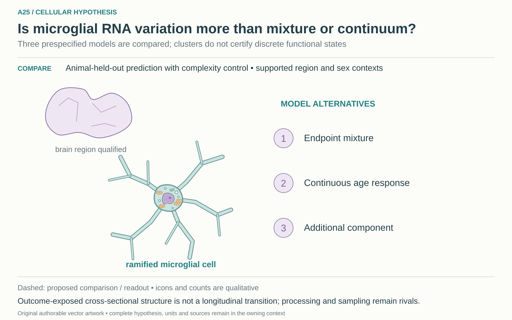

# A25: literature context and hypothesis schematic

Reviewed 3 October 2026. This note connects published findings to the current proposed question. It is a bounded synthesis, not novelty clearance or scientific acceptance.

## Published starting point

Sex-dependent middle-age microglial patterns and hippocampal intermediate ageing states have already been reported. Region plus intermediate age is not a novel premise.

| Primary source | Inspected locator and access record |
|---|---|
| [Li 2023](https://www.nature.com/articles/s43587-023-00479-x) | Sex-dependent microglial ageing and female middle-age pattern. [Access / prior review](../../docs/research_dossiers/literature_context_2026-10-03/SOURCE_UPDATE.md) |
| [Shea and Villeda, eLife 97671](https://elifesciences.org/articles/97671) | Hippocampal intermediates; publisher-indexed Results/PubMed, full page challenged. [Access / prior review](../../docs/research_dossiers/literature_context_2026-10-03/SOURCE_UPDATE.md) |

Sources above reuse the named review unless the update ledger explicitly records a fresh inspection. Published-source evidence and reanalysis of the same material are not independent replication.

## Repository observation

Nb5 recovered count-valued official expression, four region labels and exact identities for 13,130 source-labelled microglia. The source has 6/4/4 mice at 3/18/24 months; all 24-month mice are male. No state-versus-mixture model has run. Source clusters and trajectories are outcome-exposed observations, not longitudinal transitions.

Exact current result locators:

- [RQ_Specified/A25_microglial_midlife_configuration/README.md](README.md)
- [RQ_Specified/A25_microglial_midlife_configuration/PLAN.md](PLAN.md)
- [Research Article/gate2_N4_nabhan_aging_atlas_2020/EXTENSION_COMPLETION.md](../../Research%20Article/gate2_N4_nabhan_aging_atlas_2020/EXTENSION_COMPLETION.md)
- [Research Article/gate2_N4_nabhan_aging_atlas_2020/EXTENSION_RESULTS.md](../../Research%20Article/gate2_N4_nabhan_aging_atlas_2020/EXTENSION_RESULTS.md)
- [Research Article/gate2_N4_nabhan_aging_atlas_2020/rq_review/README.md](../../Research%20Article/gate2_N4_nabhan_aging_atlas_2020/rq_review/README.md)
- [Research Article/gate2_N4_nabhan_aging_atlas_2020/rq_review/OVERLAP_MATRIX.md](../../Research%20Article/gate2_N4_nabhan_aging_atlas_2020/rq_review/OVERLAP_MATRIX.md)
- [Research Article/gate2_N4_nabhan_aging_atlas_2020/rq_review/LITERATURE.md](../../Research%20Article/gate2_N4_nabhan_aging_atlas_2020/rq_review/LITERATURE.md)

## What this question could add

Compare qualified mixture, continuous and additional-component accounts in a defined region/sex, with animal-held-out prediction and later independent transport. This could test robustness and interpretation of reported intermediates; it does not announce the first state or infer function from RNA.

## Current hypothesis and rival

A region- and sex-qualified middle-age microglial distribution contains coherent structure that generalizes across animals and is inadequately represented by endpoint mixtures or a smooth age-response baseline. This is an RNA-organization hypothesis; a discrete cell state or functional role requires additional evidence.

**Strongest rival:** Changing proportions of existing microglial populations, continuous or nonlinear regulation, regional sampling, processing and sex imbalance explain the apparent intermediate configuration. A mean-profile residual can arise under these alternatives without a new state.

## What the comparison would teach

Compare animal-held-out predictive adequacy of prespecified endpoint-mixture, continuous and additional-component models with complexity control. Support for an added component must accompany reproducible cell-level coherence. Equivalent or unstable prediction leaves the models unresolved; training fit and embedding separation cannot decide.

## Hypothesis schematic

[Editable cellular SVG](schematics/hypothesis_cellular_v1.svg), source revision `862f3335bad7700ba89ce8d5bcc794c7c9094fbc`. This 2 November 2026 redraw supersedes the [prior illustration](schematics/hypothesis_v1.svg) for display; that SVG remains unchanged. The working hypothesis, source evidence and scientific disposition are unchanged.

A25 compares prespecified models using animal-held-out prediction and complexity control within supported region/sex contexts. Source clusters and trajectories are outcome-exposed, not longitudinal transitions. Added RNA structure would not alone establish a discrete state or function; sampling, processing and sex imbalance remain alternatives.

Class-level glyphs and qualitative geometry are not molecular structures, organelle measurements or evidence of functional assembly. Neutral epithelial/stromal shapes do not assert subtype identity or organelle loss, and icon counts are illustrative. Read locally labelled solid premises/references separately from dashed proposed comparisons; no complete mechanism follows from their juxtaposition.

## Next literature check

Planned query (not reported as newly executed): `microglia middle age hippocampus continuous mixture intermediate state animal replication 2026`. Expand to synonyms, nearest source references/citations and conflicting results using the [literature workflow](../../docs/LITERATURE_WORKFLOW.md). Recheck the exact population, comparison, timing, unit and endpoint before making a stronger contribution claim.

**Current unresolved specification:** The actual configuration, feature/model specification and supported region/sex population must be fixed. External datasets differ in age schedules, sex and regional sampling; independently mapped animal units and compatible endpoints remain unqualified.

**Interpretation limit:** No RNA configuration implies a cell transition, reversibility, beneficial state, Alzheimer mechanism or treatment target. A25 preserves the owner's disease-related motivation without turning it into a measured result. Old female absence cannot be repaired by regression.

[Current dossier](../../docs/research_dossiers/A25.md) · [All-question context index](../../docs/research_dossiers/literature_context_2026-10-03/README.md)
