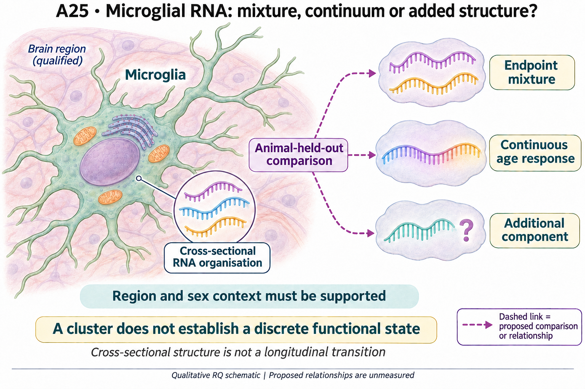
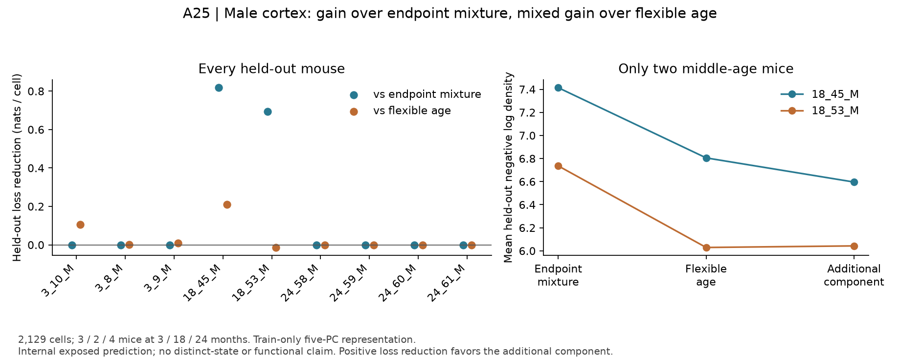

# A25: Regional microglial configuration during middle age

## Organizing Biological Q

Does a region- and sex-qualified middle-age microglial RNA distribution require an additional component beyond endpoint mixtures or a flexible age response?

Published sex-dependent and hippocampal intermediate-age patterns already motivate the question. Earlier regional and sex sensitivity makes the comparison more specific; intermediate age alone does not establish a distinct state.

Current synthesis: 4 November 2026. [Full rationale](../../docs/research_dossiers/A25.md) · [Source context](LITERATURE_CONTEXT.md).

<!-- literature-visual-context:start -->

## Literature context & visual hypothesis

[What previous findings contribute, what remains, and what the readouts would decide](LITERATURE_CONTEXT.md).

GPT-generated matte illustration, 3 November 2026. Proposed relationships and cell counts are qualitative; the owning context defines the comparison and interpretation limits. [Editorial review](../../docs/audits/2026-11-02-rq-schematic-review/MATTE_PUBLICATION_2026-11-03.md) · [Selected edit prompt](schematics/A25_gpt_matte_v1.prompt.txt). Earlier SVG files are retained as history.

*Explanatory proposal, not measured results. Read the linked context and caption; arrows do not certify a mechanism or novelty.*
<!-- literature-visual-context:end -->

The illustration presents the registered question and untested relationships. The current argument follows the result below; the drawing does not establish its proposed mechanism.

## What the analysis changed

The exposed internal prediction comparison uses 2,129 male cortex microglia from nine mice: 3/2/4 mice at 3/18/24 months. Whole mice are held out; feature selection, scaling and PCA use training mice. The added component beats endpoint mixture in both middle-age holdouts, but its gains against the flexible nonmonotone age model are +0.209465 and -0.013622 nats per cell in each fold's projection. The unfavorable comparison remains part of the result.

The flexible baseline allows nonmonotone quadratic mean/log-variance interpolation and is saturated at the three observed ages. Away from middle age, the added-component model equals the endpoint mixture by design; an aggregate advantage over flexible age is therefore not wholly attributable to the middle-age component.

[Current result, design and limits](../../docs/audits/2026-11-03-rq-evidence-trajectory/A25_TECHNICAL_RESULT.md).

The existing result figure is reused unchanged. Its owning report records the units, provenance and display limits.

**Rationale check.** Supported limitation of the endpoint-mixture representation, with mixed evidence against flexible age. A favorable average and similar reconstructed directions do not establish a distinct middle-age state. The two middle-age fits share most endpoint training mice and each trains on only one middle-age mouse; agreement is not independent replication.

## Current interpretation and next decision

Only two middle-age male cortex units support the key comparison. Other regions and sexes are not supplied by adjustment. Gaussian restrictions and age-associated processing remain alternatives; a predictive component is not a functional or discrete cell state.

Treat this comparison as complete with a mixed outcome. A transport question would need independently justified middle-age, region and sex support with explicit preprocessing/model choices. Consistent improvement beyond flexible age would strengthen a bounded RNA-organization claim; gain only beyond endpoint mixture would continue to restrict it. No rescue tuning or new state label follows.

## Registered scope and analysis history

The records below preserve earlier framing and execution checkpoints. Read the current result before an older plan. Historical unfinished-work wording does not supersede completed later diagnostics. Registered hypotheses remain unchanged; this synthesis grants no claim grade or human acceptance.

Registered framing and retained analysis history

## Organizing Biological Q

Within a specified brain region and sex, do middle-age microglia exhibit reproducible RNA organization that requires an additional configuration beyond redistribution of young/old populations or a continuous age response?

**Unresolved gap:** The actual configuration, feature/model specification and supported region/sex population must be fixed. External datasets differ in age schedules, sex and regional sampling; independently mapped animal units and compatible endpoints remain unqualified.

[Full working hypothesis and alternatives](../../docs/research_dossiers/A25.md#working-hypothesis).

## Evidence, analyses and next steps

<!-- evidence-followthrough:start -->
**Evidence follow-through — 3 November 2026:** Exclude the affirmative claim
“Source clusters establish a distinct universal middle-age state.” from current conclusions.
[Bounded fill, stop rule and reopening evidence](../../docs/audits/2026-11-03-rq-evidence-trajectory/CUT_OR_FILL_PLAN.md#a25).
The hypothesis remains a proposal where its decisive comparison is untested.
<!-- evidence-followthrough:end -->

The existing analysis records below retain their scope. Read the latest linked result or amendment before an older plan.

**Subsequent evidence — 7 October 2026:** The [region/sex occupancy extension](../../docs/portfolio_extensions/2026-10-07/g3_immune/A25_RESULTS.md) has executed on 13,130 source-labelled microglia from 14 mice. Complete-region support is 4/3/3 mice; male midlife comparison fails that support, and old female observations are absent. Region heterogeneity remains material. The distinct-state/mixture model is still unrun.

Registered 3 October 2026 as **proposed**, following the owner-authorized
scientific review and instruction to preserve distinct biological focus and
cell/context heterogeneity. Codex supplied the bounded scientific review;
human retain/reject and scientific acceptance remain unrecorded. Registration
is not a claim of novelty, functional validation or permission to execute an
unfinished numerical design.

**Question:** Within a specified brain region and sex, do middle-age microglia exhibit reproducible RNA organization that requires an additional configuration beyond redistribution of young/old populations or a continuous age response?

**Hypothesis:** A region- and sex-qualified middle-age microglial distribution contains coherent structure that generalizes across animals and is inadequately represented by endpoint mixtures or a smooth age-response baseline. This is an RNA-organization hypothesis; a discrete cell state or functional role requires additional evidence.

**Strongest rival:** Changing proportions of existing microglial populations, continuous or nonlinear regulation, regional sampling, processing and sex imbalance explain the apparent intermediate configuration. A mean-profile residual can arise under these alternatives without a new state.

**Current evidence:** Nb5 recovered count-valued official expression, four region labels and exact identities for 13,130 source-labelled microglia. The source has 6/4/4 mice at 3/18/24 months; all 24-month mice are male. No state-versus-mixture model has run. Source clusters and trajectories are outcome-exposed observations, not longitudinal transitions.

**Next decision:** Turn the existing Nb5 microglial design brief into a complete exploratory contract, with population/sex scope, feature set, observation scale, baseline flexibility and animal-level splits fixed before execution. Source availability is resolved; model choices and identifiability are unfinished. Qualify an external study separately.

[Dossier](../../docs/research_dossiers/A25.md) · [Development plan](PLAN.md) · [Canonical card](../../RESEARCH_QUESTIONS.md#a25) · [Review and routing](../../Research%20Article/gate2_N4_nabhan_aging_atlas_2020/rq_review/README.md).

This workspace owns future question-specific planning. Existing figures, tables,
failed runs and amendments remain in the article package. No new analysis has
been executed under this RQ; shared inputs remain shared biological evidence.

## Cut-or-fill execution — 3 November 2026

The supported male-cortex mouse-held-out comparison is executed. Both middle mice improve over endpoint mixture, but only one improves over flexible continuous age; a distinct-state interpretation remains unsupported.

[Current technical result and limits](../../docs/audits/2026-11-03-rq-evidence-trajectory/A25_TECHNICAL_RESULT.md) · [Execution ledger](../../docs/audits/2026-11-03-rq-evidence-trajectory/TECHNICAL_STATUS.md).

[SVG](../../analysis/research/runs/cut_fill_a25_figure_v1_20261103/a25_heldout_models_v1.svg) · [render receipt](../../analysis/research/runs/cut_fill_a25_figure_v1_20261103/receipt.json).

