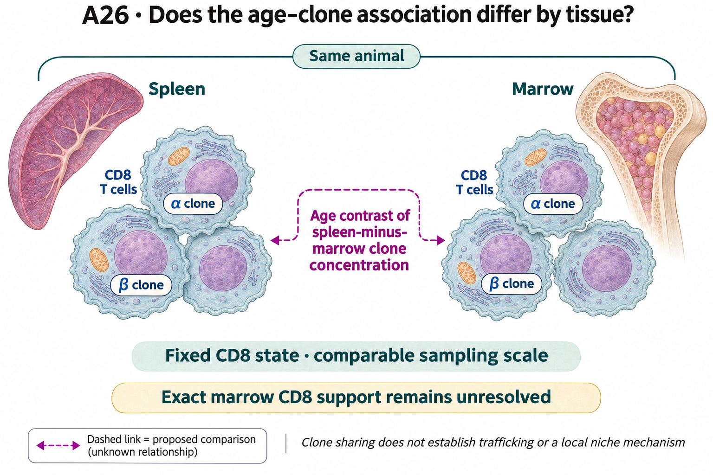

# A26: literature context and hypothesis schematic

[Question home](README.md) · [Scientific dossier](../../docs/research_dossiers/A26.md).

Reviewed 3 October 2026. This note connects published findings to the current proposed question. It is a bounded synthesis, not novelty clearance or scientific acceptance.

## Published starting point

Mark already includes CD8 subsets, spleen/marrow and age. Multi-organ clonal CD8 ageing also has precedent; the earlier CD4-only contrast was too weak a novelty boundary.

| Primary source | Inspected locator and access record |
|---|---|
| [Mark 2022](https://doi.org/10.3389/fimmu.2022.939394) | Publisher Results, uninfected age/tissue/subset comparisons. [Access / prior review](../../docs/research_dossiers/literature_context_2026-10-03/SOURCE_UPDATE.md) |
| [Mogilenko 2021](https://pubmed.ncbi.nlm.nih.gov/33271118/) | Clonal GZMK-positive CD8 ageing population. [Access / prior review](../../docs/research_dossiers/literature_context_2026-10-03/SOURCE_UPDATE.md) |

Sources above reuse the named review unless the update ledger explicitly records a fresh inspection. Published-source evidence and reanalysis of the same material are not independent replication.

## Repository observation

The exact marrow-CD8 coverage required by the current comparison fails. The registered spleen/marrow focus was chosen after inspection of the source outcomes, not preregistered before them. Missing qualifying labels are not zero CD8 cells, and different tissue-specific rarefaction depths cannot be ranked as a tissue effect. The newer A27 nominal-code source description is a different question and does not supply the missing paired-organ contrast.

[Exact subtype-support result](../../Research%20Article/gate2_N4_nabhan_aging_atlas_2020/EXTENSION_COMPLETION.md#completed-biological-follow-up-cd4cd8-repertoire-concentration). This reuses existing evidence rather than providing a new run or independent replication.

## What this question could add

A well-defined but currently unestimated tissue comparison. Source ineligibility is an observation about the proposed analysis, not evidence of absent tissue-specific biology or a negative age interaction.

Paired-organ animal identity, independently comparable state definition and receptor recovery support remain insufficient for the intended comparison.

## Current hypothesis and rival

At a fixed, independently defined CD8 state and comparable sampling scale, the older-versus-younger change in local clone concentration differs between spleen and marrow. This is a tissue-context association hypothesis, not evidence that a particular local niche causes expansion.

**Strongest rival:** Systemic age effects plus differing differentiation states, recirculating populations and receptor recovery explain the apparent organ difference. A few highly sampled clones or animal-selection differences can produce the same pattern.

## What the comparison would teach

Reopen only for a source supporting the intended paired state/receptor comparison. A reproducible tissue difference at comparable ascertainment would support a contextual association; disappearance with state or recovery matching would restrict it. Lowering the old floor or borrowing A27's codes cannot create the missing pairing.

## Hypothesis schematic

GPT-generated matte illustration, 3 November 2026. Proposed relationships and cell counts are qualitative; the owning context defines the comparison and interpretation limits. [Editorial review](../../docs/audits/2026-11-02-rq-schematic-review/MATTE_PUBLICATION_2026-11-03.md) · [Selected edit prompt](schematics/A26_gpt_matte_v1.prompt.txt). Earlier SVG files are retained as history.

The estimand is an age contrast of within-animal spleen-minus-marrow clone-concentration differences at fixed state and sampling scale. Animals, not cells, define independence. The contrast was chosen after exposure; receptor sharing does not prove trafficking or local niche causation.

Class-level glyphs and qualitative geometry are not molecular structures, organelle measurements or evidence of functional assembly. Neutral epithelial/stromal shapes do not assert subtype identity or organelle loss, and icon counts are illustrative. Read locally labelled solid premises/references separately from dashed proposed comparisons; no complete mechanism follows from their juxtaposition.

## Next literature check

Planned query (not reported as newly executed): `CD8 spleen bone marrow paired age clone concentration differentiation state 2025 2026`. Expand to synonyms, nearest source references/citations and conflicting results using the [literature workflow](../../docs/LITERATURE_WORKFLOW.md). Recheck the exact population, comparison, timing, unit and endpoint before making a stronger contribution claim.

**Current unresolved specification:** Paired animals with comparable spleen/marrow CD8 states, receptor ascertainment and common observation support have not been qualified. The local failure of exact subtype support cannot be repaired by treating an absent label as zero or relaxing the historical gate.

**Interpretation limit:** No tissue-local concentration estimate establishes migration direction, growth rate, organ residency or a systemic/local causal mechanism. Missing exact marrow support remains explicit. Shared animals across organs are pairing, not extra biological replication.

[Current dossier](../../docs/research_dossiers/A26.md) · [All-question context index](../../docs/research_dossiers/literature_context_2026-10-03/README.md)
