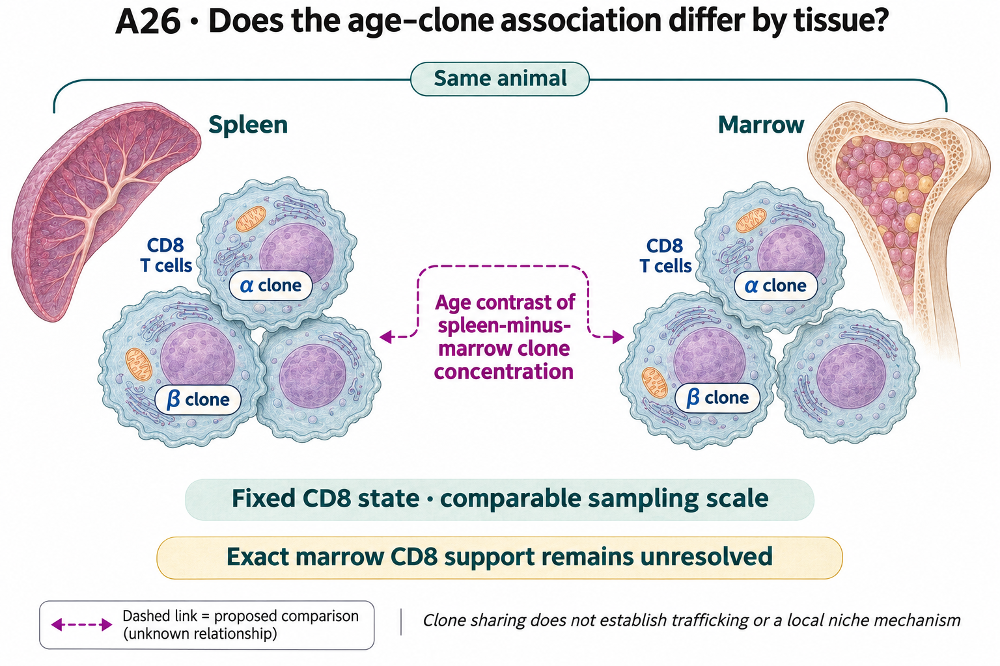

# A26: Tissue context of CD8 repertoire ageing

## Organizing Biological Q

Within the same animals and comparable CD8 states, does the age contrast in repertoire concentration differ between spleen and bone marrow?

Broad tissue differences motivate an association question, not a pre-established local ageing mechanism. Comparable state, receptor ascertainment and shared animals are necessary to interpret this particular paired-tissue contrast.

Current synthesis: 4 November 2026. [Full rationale](../../docs/research_dossiers/A26.md) · [Source context](LITERATURE_CONTEXT.md).

<!-- literature-visual-context:start -->

## Literature context & visual hypothesis

[What previous findings contribute, what remains, and what the readouts would decide](LITERATURE_CONTEXT.md).

GPT-generated matte illustration, 3 November 2026. Proposed relationships and cell counts are qualitative; the owning context defines the comparison and interpretation limits. [Editorial review](../../docs/audits/2026-11-02-rq-schematic-review/MATTE_PUBLICATION_2026-11-03.md) · [Selected edit prompt](schematics/A26_gpt_matte_v1.prompt.txt). Earlier SVG files are retained as history.

*Explanatory proposal, not measured results. Read the linked context and caption; arrows do not certify a mechanism or novelty.*
<!-- literature-visual-context:end -->

The illustration presents the registered question and untested relationships. The current argument follows the result below; the drawing does not establish its proposed mechanism.

## What the analysis changed

The exact marrow-CD8 coverage required by the current comparison fails. The registered spleen/marrow focus was chosen after inspection of the source outcomes, not preregistered before them. Missing qualifying labels are not zero CD8 cells, and different tissue-specific rarefaction depths cannot be ranked as a tissue effect. The newer A27 nominal-code source description is a different question and does not supply the missing paired-organ contrast.

[Exact subtype-support result](../../Research%20Article/gate2_N4_nabhan_aging_atlas_2020/EXTENSION_COMPLETION.md#completed-biological-follow-up-cd4cd8-repertoire-concentration).

**Rationale check.** A well-defined but currently unestimated tissue comparison. Source ineligibility is an observation about the proposed analysis, not evidence of absent tissue-specific biology or a negative age interaction.

## Current interpretation and next decision

Paired-organ animal identity, independently comparable state definition and receptor recovery support remain insufficient for the intended comparison.

Reopen only for a source supporting the intended paired state/receptor comparison. A reproducible tissue difference at comparable ascertainment would support a contextual association; disappearance with state or recovery matching would restrict it. Lowering the old floor or borrowing A27's codes cannot create the missing pairing.

## Registered scope and analysis history

The records below preserve earlier framing and execution checkpoints. Read the current result before an older plan. Historical unfinished-work wording does not supersede completed later diagnostics. Registered hypotheses remain unchanged; this synthesis grants no claim grade or human acceptance.

Registered framing and retained analysis history

## Organizing Biological Q

Within comparable CD8 differentiation states and the same animals, does the age contrast in repertoire concentration differ between spleen and bone marrow, suggesting a tissue-context association beyond a shared systemic shift?

**Unresolved gap:** Paired animals with comparable spleen/marrow CD8 states, receptor ascertainment and common observation support have not been qualified. The local failure of exact subtype support cannot be repaired by treating an absent label as zero or relaxing the historical gate.

[Full working hypothesis and alternatives](../../docs/research_dossiers/A26.md#working-hypothesis).

## Evidence, analyses and next steps

<!-- evidence-followthrough:start -->
**Evidence follow-through — 3 November 2026:** Exclude the affirmative claim
“Unequal sampling or absent marrow labels establish a tissue effect.” from current conclusions.
[Bounded fill, stop rule and reopening evidence](../../docs/audits/2026-11-03-rq-evidence-trajectory/CUT_OR_FILL_PLAN.md#a26).
The hypothesis remains a proposal where its decisive comparison is untested.
<!-- evidence-followthrough:end -->

The existing analysis records below retain their scope. Read the latest linked result or amendment before an older plan.

Registered 3 October 2026 as **proposed**, following the owner-authorized
scientific review and instruction to preserve distinct biological focus and
cell/context heterogeneity. Codex supplied the bounded scientific review;
human retain/reject and scientific acceptance remain unrecorded. Registration
is not a claim of novelty, functional validation or permission to execute an
unfinished numerical design.

**Question:** Within comparable CD8 differentiation states and the same animals, does the age contrast in repertoire concentration differ between spleen and bone marrow, suggesting a tissue-context association beyond a shared systemic shift?

**Hypothesis:** At a fixed, independently defined CD8 state and comparable sampling scale, the older-versus-younger change in local clone concentration differs between spleen and marrow. This is a tissue-context association hypothesis, not evidence that a particular local niche causes expansion.

**Strongest rival:** Systemic age effects plus differing differentiation states, recirculating populations and receptor recovery explain the apparent organ difference. A few highly sampled clones or animal-selection differences can produce the same pattern.

**Current evidence:** Nb5 broad T-cell results differ across spleen, marrow and thymus. Tissue-specific common depths preclude direct ranking. The later exact CD4/CD8 follow-up supports spleen only; absent exact marrow CD8 support remains a hold. This proposed spleen/marrow contrast was chosen after exposure to those results, not preregistered.

**Next decision:** Qualify paired animal identities, common CD8 states and receptor denominators in a new source before any model. Treat 3-versus-24 months as the proposed initial contrast and the middle-age comparison as separately declared secondary work; this proposal remains exposed and can be revised prospectively before a frozen design.

[Dossier](../../docs/research_dossiers/A26.md) · [Development plan](PLAN.md) · [Canonical card](../../RESEARCH_QUESTIONS.md#a26) · [Review and routing](../../Research%20Article/gate2_N4_nabhan_aging_atlas_2020/rq_review/README.md).

This workspace owns future question-specific planning. Existing figures, tables,
failed runs and amendments remain in the article package. No new analysis has
been executed under this RQ; shared inputs remain shared biological evidence.

