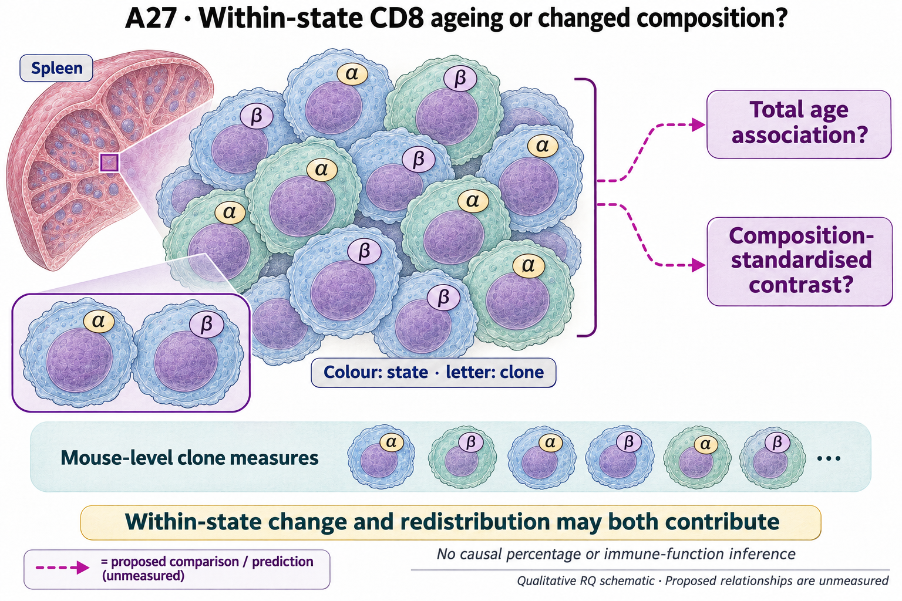

# A27: literature context and hypothesis schematic

[Question home](README.md) · [Scientific dossier](../../docs/research_dossiers/A27.md).

Reviewed 3 October 2026. This note connects published findings to the current proposed question. It is a bounded synthesis, not novelty clearance or scientific acceptance.

## Published starting point

Age-associated clonal change within naive CD8 cells and clonal ageing-associated populations are known. Within-state change should be treated as a prior finding to quantify or replicate.

| Primary source | Inspected locator and access record |
|---|---|
| [Ahmed 2009](https://pubmed.ncbi.nlm.nih.gov/19124721/) | Abstract and figure descriptions; aged naive CD8 repertoire. [Access / prior review](../../docs/research_dossiers/literature_context_2026-10-03/SOURCE_UPDATE.md) |
| [Mogilenko 2021](https://pubmed.ncbi.nlm.nih.gov/33271118/) | Clonal GZMK-positive CD8 ageing population. [Access / prior review](../../docs/research_dossiers/literature_context_2026-10-03/SOURCE_UPDATE.md) |

Sources above reuse the named review unless the update ledger explicitly records a fresh inspection. Published-source evidence and reanalysis of the same material are not independent replication.

## Repository observation

The newer source retains all nine mice and describes repeated operational alpha/beta receptor keys within nominal source codes. Concentration is the fraction of distinct eligible-cell pairs sharing a key, with N<2 reported as unavailable. Mouse0096's CD8.E code retains repeated keys under both chain conventions; some extreme tiles contain only two or three cells. The conventions change eligible cells as well as key matching. The 354 receptor-only records have mouse mappings but no state labels and remain outside RNA/CD8 denominators.

[Current result, design and limits](reports/SOURCE_CODE_CONCENTRATION_V1_RESULTS.md). This reuses existing evidence rather than providing a new run or independent replication.

## What this question could add

Supported finite-source description and an annotation/ascertainment lead. It does not establish an independently defined memory state, biological expansion rate or ageing mechanism. The code/notebook evidence does not establish final state-label independence from receptor information, and the sole 108-week male cannot support an age effect.

Independent state definitions, receptor recovery and adequate mouse/state support remain unresolved. Mathematical computability of a cell-pair fraction is not adequate precision or independent biological replication. The earlier unestimated contrasts remain unestimated.

## Current hypothesis and rival

For specified CD8 states, a measurable component of the spleen age contrast remains within states after composition and receptor ascertainment are accounted for; an alternative is that redistribution accounts for most of the observed difference. Both may contribute. No causal percentage of ageing explained is implied.

**Strongest rival:** Age-dependent abundance of already concentrated states, annotation shifts, differential receptor reconstruction and sparse sampling produce the apparent within-CD8 contrast without a reproducible within-state change.

## What the comparison would teach

Qualify what the nominated source codes represent before interpreting the pattern as within-state redistribution. Persistence under independently justified state definitions and comparable ascertainment would support a narrower descriptive context; dependence on labels or eligibility would limit it. Any age comparison needs its own biological-unit support. Do not rescue the earlier fixed-state comparison by relabelling the new codes.

## Hypothesis schematic

GPT-generated matte illustration, 3 November 2026. Proposed relationships and cell counts are qualitative; the owning context defines the comparison and interpretation limits. [Editorial review](../../docs/audits/2026-11-02-rq-schematic-review/MATTE_PUBLICATION_2026-11-03.md) · [Selected edit prompt](schematics/A27_gpt_matte_v1.prompt.txt). Earlier SVG files are retained as history.

Mouse-level state-specific clone measures and a declared fixed-composition contrast assess association components while retaining the aggregate result. Both redistribution and within-state change may contribute. Sparse reconstructed receptors, annotation and sampling limit inference; no percentage of ageing caused or immune function is inferred.

Class-level glyphs and qualitative geometry are not molecular structures, organelle measurements or evidence of functional assembly. Neutral epithelial/stromal shapes do not assert subtype identity or organelle loss, and icon counts are illustrative. Read locally labelled solid premises/references separately from dashed proposed comparisons; no complete mechanism follows from their juxtaposition.

## Next literature check

Planned query (not reported as newly executed): `spleen CD8 ageing repertoire concentration within state composition ascertainment 2026`. Expand to synonyms, nearest source references/citations and conflicting results using the [literature workflow](../../docs/LITERATURE_WORKFLOW.md). Recheck the exact population, comparison, timing, unit and endpoint before making a stronger contribution claim.

**Current unresolved specification:** Fine differentiation states, their independent definition, receptor recovery denominators and adequate mouse-level support remain unqualified. The common-depth eligibility minimum is not a power calculation. GSE145562 pools mice and cannot supply individual replicates without recovered identity.

**Interpretation limit:** RNA state, clone repetition and diversity are distinct from immune function, proliferation rate or disease risk. Existing evidence and internal deletions are not independent validation. Literature precedent prevents marketing a familiar within-state finding as a new mechanism.

[Current dossier](../../docs/research_dossiers/A27.md) · [All-question context index](../../docs/research_dossiers/literature_context_2026-10-03/README.md)
