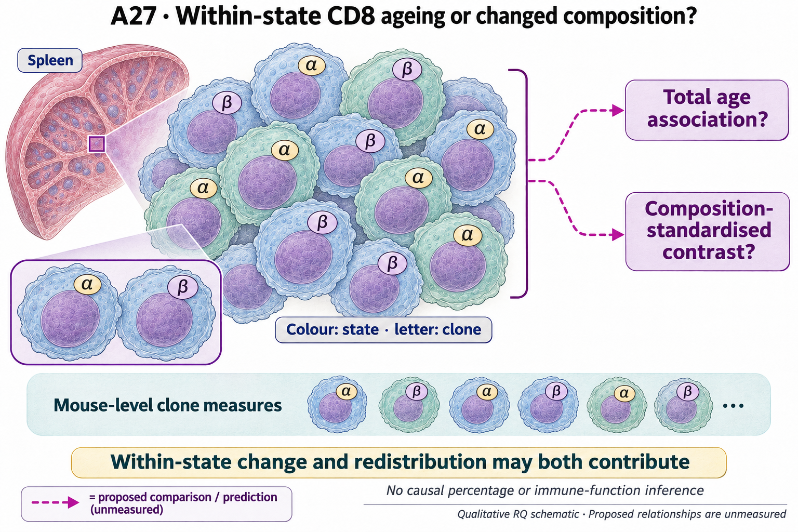
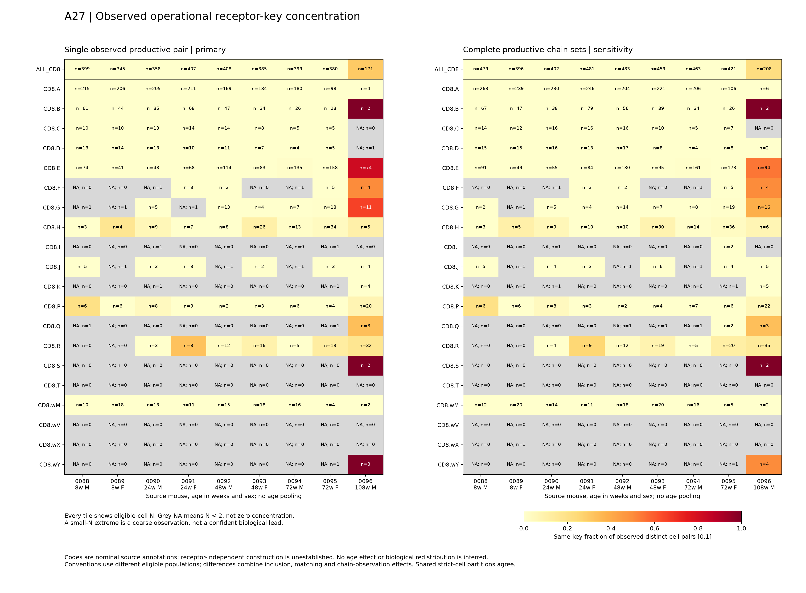
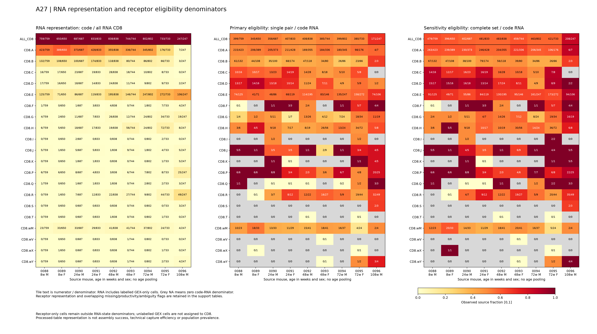

# A27: Within-state and compositional CD8 repertoire ageing

## Organizing Biological Q

Does a CD8 repertoire concentration pattern reflect redistribution among states, concentration within comparable states, or how receptor-bearing cells and state labels were observed?

The earlier ageing atlas motivated a spleen CD8 context, while its fixed finer-state contrasts remained unsupported. A later independent source can provide a different descriptive endpoint without validating the earlier age or diversity estimand.

Current synthesis: 4 November 2026. [Full rationale](../../docs/research_dossiers/A27.md) · [Source context](LITERATURE_CONTEXT.md).

<!-- literature-visual-context:start -->

## Literature context & visual hypothesis

[What previous findings contribute, what remains, and what the readouts would decide](LITERATURE_CONTEXT.md).

GPT-generated matte illustration, 3 November 2026. Proposed relationships and cell counts are qualitative; the owning context defines the comparison and interpretation limits. [Editorial review](../../docs/audits/2026-11-02-rq-schematic-review/MATTE_PUBLICATION_2026-11-03.md) · [Selected edit prompt](schematics/A27_gpt_matte_v1.prompt.txt). Earlier SVG files are retained as history.

*Explanatory proposal, not measured results. Read the linked context and caption; arrows do not certify a mechanism or novelty.*
<!-- literature-visual-context:end -->

The illustration presents the registered question and untested relationships. The current argument follows the result below; the drawing does not establish its proposed mechanism.

## What the analysis changed

The newer source retains all nine mice and describes repeated operational alpha/beta receptor keys within nominal source codes. Concentration is the fraction of distinct eligible-cell pairs sharing a key, with N<2 reported as unavailable. Mouse0096's CD8.E code retains repeated keys under both chain conventions; some extreme tiles contain only two or three cells. The conventions change eligible cells as well as key matching. The 354 receptor-only records have mouse mappings but no state labels and remain outside RNA/CD8 denominators.

[Current result, design and limits](reports/SOURCE_CODE_CONCENTRATION_V1_RESULTS.md).

The existing result figure is reused unchanged. Its owning report records the units, provenance and display limits.

The representation/eligibility display keeps the differing cell denominators visible; missing state labels are not treated as zero concentration.

**Rationale check.** Supported finite-source description and an annotation/ascertainment lead. It does not establish an independently defined memory state, biological expansion rate or ageing mechanism. The code/notebook evidence does not establish final state-label independence from receptor information, and the sole 108-week male cannot support an age effect.

## Current interpretation and next decision

Independent state definitions, receptor recovery and adequate mouse/state support remain unresolved. Mathematical computability of a cell-pair fraction is not adequate precision or independent biological replication. The earlier unestimated contrasts remain unestimated.

Qualify what the nominated source codes represent before interpreting the pattern as within-state redistribution. Persistence under independently justified state definitions and comparable ascertainment would support a narrower descriptive context; dependence on labels or eligibility would limit it. Any age comparison needs its own biological-unit support. Do not rescue the earlier fixed-state comparison by relabelling the new codes.

## Registered scope and analysis history

The records below preserve earlier framing and execution checkpoints. Read the current result before an older plan. Historical unfinished-work wording does not supersede completed later diagnostics. Registered hypotheses remain unchanged; this synthesis grants no claim grade or human acceptance.

Registered framing and retained analysis history

## Organizing Biological Q

In spleen CD8 cells, does the older repertoire concentration primarily reflect redistribution among differentiation states, or a change in concentration within comparable states under qualified receptor ascertainment?

**Unresolved gap:** Fine differentiation states, their independent definition, receptor recovery denominators and adequate mouse-level support remain unqualified. The common-depth eligibility minimum is not a power calculation. GSE145562 pools mice and cannot supply individual replicates without recovered identity.

[Full working hypothesis and alternatives](../../docs/research_dossiers/A27.md#working-hypothesis).

## Evidence, analyses and next steps

The [reviewed nominal-source-code result, 4 November 2026](reports/SOURCE_CODE_CONCENTRATION_V1_RESULTS.md) identifies repeated operational receptor keys in individual mouse/code contexts, while retaining source representation, chain selection, small-N extremes and unsupported strata. Mouse0096/CD8.E is a within-individual lead for source-label qualification: repetition remains under strict single-pair and complete-chain-set conventions, which use different eligible populations. It is not an independently defined memory state or an aging effect.

All nine source mice and 20 nominal codes remain visible. N<2 is unestimated; observed zero and sparse/flat results do not establish equivalence. Receptor-independent label construction remains unqualified, so the next discriminator concerns source-label and preparation validity before biological state interpretation. The older atlas's unsupported naive/effector-associated contrasts remain unfavorable evidence; this separate source and pair-collision endpoint do not replace or exactly replicate them. No biological redistribution attribution, antigen mechanism or automatic new run follows.

Concentration uses a shared [0,1] scale, with N/NA on every tile. Representation panels show explicit numerators/denominators. Conventions combine inclusion, matching and chain-observation differences; they are not independent replication or an isolated algorithm comparison. Complete tables and receipts are in the linked report.

**Historical screen snapshot, 3 November 2026:** The fixed CD8 RNA-state screen has completed with separate denominators of 354 RNA cells and 288 prior repertoire-table rows. All four naive/effector-associated age contrasts remain unsupported; four mixed/indeterminate contrasts qualify without resolving state redistribution. The 237 blank source clone labels retain an inherited singleton convention, not verified sequence uniqueness. Prior-table representation is not productive assembly success, and within-state depth-five comparisons are not fixed-composition attribution. [Complete result and evidence](reports/STATE_REPRESENTATION_V1_RESULTS.md); [reviewed sequence and source rationale](../../docs/research_reviews/2026-11-03-full-priority-screening/PLANS.md). Scientific acceptance and the registered hypothesis remain unchanged.

<!-- evidence-followthrough:start -->
**Evidence follow-through — 3 November 2026:** Exclude the affirmative claim
“Broad CD8 restriction resolves fine-state expansion or a causal aging fraction.” from current conclusions.
[Bounded fill, stop rule and reopening evidence](../../docs/audits/2026-11-03-rq-evidence-trajectory/CUT_OR_FILL_PLAN.md#a27).
The hypothesis remains a proposal where its decisive comparison is untested.
<!-- evidence-followthrough:end -->

The existing analysis records below retain their scope. Read the latest linked result or amendment before an older plan.

Registered 3 October 2026 as **proposed**, following the owner-authorized
scientific review and instruction to preserve distinct biological focus and
cell/context heterogeneity. Codex supplied the bounded scientific review;
human retain/reject and scientific acceptance remain unrecorded. Registration
is not a claim of novelty, functional validation or permission to execute an
unfinished numerical design.

**Question:** In spleen CD8 cells, does the older repertoire concentration primarily reflect redistribution among differentiation states, or a change in concentration within comparable states under qualified receptor ascertainment?

**Hypothesis:** For specified CD8 states, a measurable component of the spleen age contrast remains within states after composition and receptor ascertainment are accounted for; an alternative is that redistribution accounts for most of the observed difference. Both may contribute. No causal percentage of ageing explained is implied.

**Strongest rival:** Age-dependent abundance of already concentrated states, annotation shifts, differential receptor reconstruction and sparse sampling produce the apparent within-CD8 contrast without a reproducible within-state change.

**Current evidence:** The Nb5 broad CD8 restriction retains a higher older spleen mean at a conditional depth of only five reconstructed cells per mouse, with 4/3/4 mice at 3/18/24 months. CD4 has no 24-versus-3 difference; its 18-month result depends on one mouse. Neither outcome resolves finer states or receptor recovery.

**Next decision:** Qualify finer labels without using clone size or age-selected genes, retain all CD8 and receptor-recovered denominators, and identify independent animals in an external source. Fix clone definition, state set, standardization and sampling support in a new contract; do not relax failed strata after seeing effects.

[Dossier](../../docs/research_dossiers/A27.md) · [Development plan](PLAN.md) · [Canonical card](../../RESEARCH_QUESTIONS.md#a27) · [Review and routing](../../Research%20Article/gate2_N4_nabhan_aging_atlas_2020/rq_review/README.md).

This workspace owns future question-specific planning. Existing figures, tables,
failed runs and amendments remain in the article package. No new analysis has
been executed under this RQ; shared inputs remain shared biological evidence.

