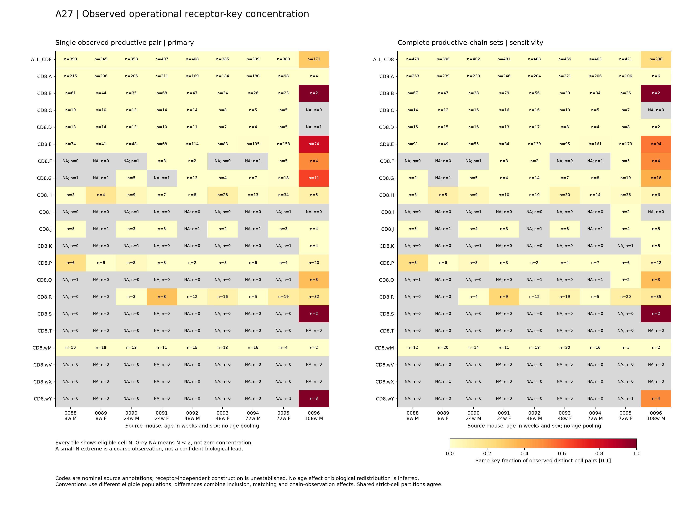
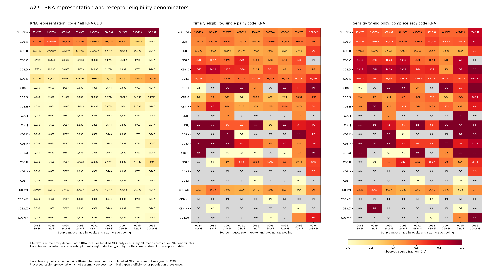

# A27: operational receptor-key concentration across nominal source codes v1

4 November 2026. The measured source contains repeated operational receptor keys within particular mouse/code combinations, with marked individual heterogeneity and sensitivity to chain inclusion. Mouse0096's CD8.E code retains repeated keys under both conventions, while several visually extreme tiles contain only two or three cells. These results nominate a source-code context for later label qualification. They do not establish receptor-independent RNA-state concentration, biological state redistribution or an aging effect. Coordinator numerical, biological and figure review passed on 4 November 2026.

## Question and source scope

The organizing question remains within-state repertoire concentration versus changes in state representation. The [earlier atlas state-representation result](STATE_REPRESENTATION_V1_RESULTS.md) could not estimate its main fixed naive-associated/effector-associated age contrasts. The new source supports a narrower description: where repeated operational receptor keys occur among nominal source codes, and whether processed-table representation or chain inclusion changes that nomination. It does not replace the unfavorable earlier result or independently replicate its depth-five diversity estimand.

The source is the [ImmGenT author's processed receptor/annotation distribution](https://zenodo.org/records/21839963), linked to [GSE347791](https://www.ncbi.nlm.nih.gov/geo/query/acc.cgi?acc=GSE347791). All nine mice, exact hashtags, age/sex and unpooled status are retained. [Source construction qualification](../../../docs/research_reviews/2026-11-03-tool-assisted-screening-review/prerequisites/A27_STATE_CONSTRUCTION_QUALIFICATION_V2.json) distinguishes code/notebook evidence from inaccessible full methods: the notebook loads curated labels and explicitly contains a separate receptor-aware P14 flag, so final level2 independence from receptor information is not established. Partial author biological comments do not justify relabeling all codes as validated naive/effector/memory identities.

The 13,332-cell source union includes 12,389 GEX/receptor matches,589 GEX-only and 354 receptor-only records. A separate annotation product supplies labels for564 GEX-only cells;25 GEX cells remain unannotated. The 354 receptor-only cells have exact source-hashtag mouse mapping but no state annotation, and remain outside RNA/CD8 denominators. [Versioned join correction](../../../docs/research_reviews/2026-11-03-tool-assisted-screening-review/prerequisites/A27_IGT29_SOURCE_JOIN_V3.json) preserves v1/v2 rather than overwriting them. The measured CD8 GEX population is 6,293 cells, of which6,075 have receptor records.

## Fixed endpoint and complete observations

The primary uses one observed complete productive alpha/beta pair; the sensitivity uses all complete productive chain sets. A slot retains its exact nucleotide junction and canonical full source V/J call sets, without choosing one ambiguous call or highest-read chain. Keys are formed within a mouse, without source code in the key. Incomplete productive/nonstandard records are excluded with reasons; unproductive, missing and dual/ambiguous flags remain explicit. The two conventions use different eligible populations, so their differences combine inclusion, matching and chain-observation effects rather than an isolated algorithm effect.

Concentration is the fraction of unordered distinct eligible-cell pairs sharing the same operational key. N<2 is NA; observed zero is zero collisions among those cells, not proof of absent biological concentration. Cell pairs are dependent and no binomial confidence intervals, tests, age pooling or population effects are reported. [Exact v4 specification](../../../docs/research_reviews/2026-11-03-tool-assisted-screening-review/prerequisites/A27_SOURCE_CODE_EXECUTION_SPEC_V4.md) and [output schema](../../../docs/research_reviews/2026-11-03-tool-assisted-screening-review/prerequisites/A27_OUTPUT_SCHEMA_V1.json).

All 20 codes and nine mice appear under both conventions with one shared [0,1] concentration scale; ALL_CD8 is a separate lineage row. Grey cells are unsupported, not zeros. Of180 code/mouse strata,97 primary and 102 sensitivity strata have N>=2; this is mathematical computability, not adequate precision. Exact values, pairs, collision resolution and support remain in [all 378 concentration rows](../../../analysis/research/runs/A27_source_code_concentration_v1_20261104/concentration_by_mouse_code.tsv).

| Source mouse | Age weeks / sex | Primary N | Primary concentration | Set N | Set concentration |
|---|---|---:|---:|---:|---:|
| mouse0088 | 8 / male | 399 | 0.000088 | 479 | 0.000061 |
| mouse0089 | 8 / female | 345 | 0.000017 | 396 | 0.000013 |
| mouse0090 | 24 / male | 358 | 0.000063 | 402 | 0.000050 |
| mouse0091 | 24 / female | 407 | 0.000194 | 481 | 0.000139 |
| mouse0092 | 48 / male | 408 | 0.000132 | 483 | 0.000094 |
| mouse0093 | 48 / female | 385 | 0.001150 | 459 | 0.000847 |
| mouse0094 | 72 / male | 399 | 0.001436 | 463 | 0.001066 |
| mouse0095 | 72 / female | 380 | 0.001375 | 421 | 0.001131 |
| mouse0096 | 108 / male | 171 | 0.298314 | 208 | 0.215394 |

These are nine individual descriptions, not age-group estimates. The sole108-week source mouse is male; its result cannot identify an age effect.

## What the code-level pattern narrows

In mouse0096, CD8.E has 106 source-labelled RNA cells and 106 receptor records. The strict pair subset has 74 eligible cells and 2,215 same-key pairs among 2,701 observed pairs (C=0.820067); the complete-set subset has 94 cells and 2,386/4,371 pairs (C=0.545871). Repeated keys therefore remain visible inside this nominal code under both conventions. The different magnitudes cannot be attributed solely to a matching algorithm because inclusion and observed chains also change. Code E is a candidate for source-label and preparation qualification in that individual, not a validated memory-state or aging mechanism.

Support changes the interpretation of other bright tiles. In mouse0096, CD8.B and CD8.S each have C=1 from only two eligible cells (one pair). CD8.wY has three primary cells with C=1, versus four set-eligible cells with C=0.5. Such extrema are coarse observations rather than stronger biological leads. Repetition is not confined to mouse0096: examples in the complete fixed table include mouse0088/CD8.P (3/15 pairs, N=6), mouse0091/CD8.R (9/28, N=8) and mouse0093/CD8.H (34/325, N=26). Their differing supports remain explicit; these examples do not define a new selected panel.

Unfavorable/unsupported findings remain visible. Primary CD8.A has no observed repeated key in any source mouse, with different finite supports; that is not equivalence or proof of biological absence. CD8.T and CD8.wV have no eligible pairs under either convention, and CD8.wX has no computable stratum. Many additional code/mouse cells have N=0 or1. Do not replace them with zero concentration or merge codes to recover a favorable estimate.

The source-code representation and eligibility fractions vary across animals and codes. Each tile supplies its numerator and denominator. RNA denominators include labelled GEX-only cells; receptor-only and unannotated GEX cells are not assigned to CD8. These are processed-table representation fractions, not assembly success or technical capture efficiency.

## Evidence, review and next discriminator

[All 189 support rows](../../../analysis/research/runs/A27_source_code_concentration_v1_20261104/support_by_mouse_code.tsv), [nine source dispositions](../../../analysis/research/runs/A27_source_code_concentration_v1_20261104/source_disposition_by_mouse.tsv), [all cell assignments/flags](../../../analysis/research/runs/A27_source_code_concentration_v1_20261104/cell_assignments.tsv) and [complete key-count tables](../../../analysis/research/runs/A27_source_code_concentration_v1_20261104/clone_counts.tsv) preserve both conventions and all missingness. Reused lineage/code counts and conventions are not independent observations. A key can span codes; the mouse-wide concentration is not a weighted within-code attribution.

The next decision is source-label and biological-unit qualification for the observed code contexts, particularly the supported individual CD8.E observation, before interpreting independent RNA states or biological redistribution. A later independently defined state measurement could determine whether the nominal-code association survives that distinction. A flat, sparse or convention-sensitive result would not prove equivalence. No antigen specificity, selection mechanism, repair function or causal aging conclusion follows, and no automatic additional repertoire run is justified by this display.

The [entrypoint](../scripts/source_code_concentration_v1.py), [contract](../../../analysis/research/contracts/A27.source_code_concentration_v1.json), v4 declaration and metadata dependencies were frozen at `0b67a8027270ce8ed34ecd3d2e88ef5ee84d3b52`. Targeted synthetic checks passed known concentration cases, N0/N1 NA, cross-mouse separation, cross-code shared keys, ambiguous-call order, duplicate/dual slots, incomplete/nonstandard records and known strict-subset partitions. Execution matched all 173,316 source-chain flag values, reconstructed clone counts and code support, and verified the strict subset's same-key partitions agree. The [receipt](../../../analysis/research/runs/A27_source_code_concentration_v1_20261104/receipt.json) verifies; [summary](../../../analysis/research/runs/A27_source_code_concentration_v1_20261104/summary.json) records all dimensions. Technical visual inspection found both figures legible with fixed scales, N/NA and explicit denominators. Independent coordinator reconstruction passed 358,840 checks with zero numerical discrepancy; both figures and the biological wording passed review. Report tables and named examples/unsupported cases also passed targeted checks. Current A27 evidence sections now carry the cleared synthesis. [Coordinator review](../../../docs/research_reviews/2026-11-03-tool-assisted-screening-review/COORDINATOR_REVIEW.md). Successful execution does not confer scientific acceptance or claim promotion.
