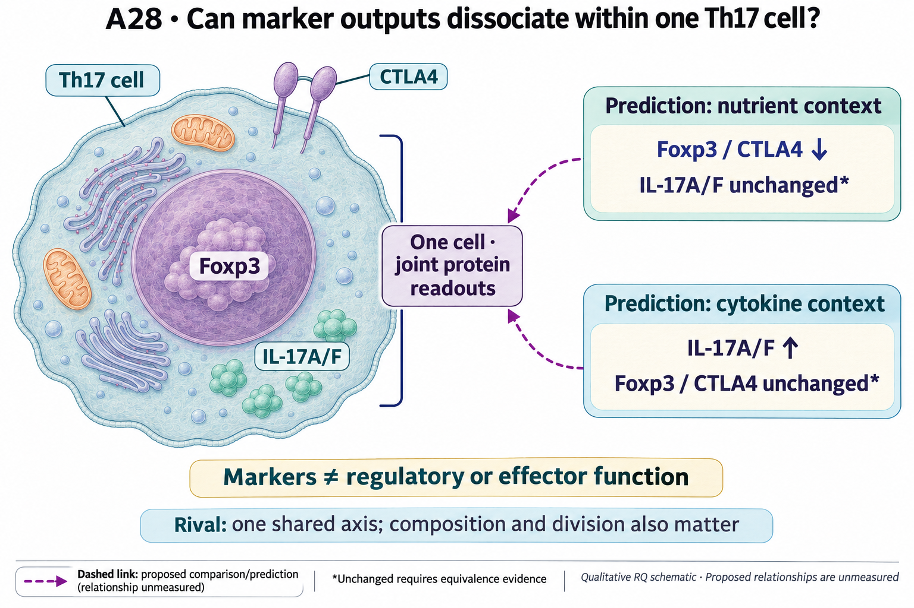

# A28: literature context and current argument

[Question home](README.md) · [Scientific dossier](../../docs/research_dossiers/A28.md).

Synthesis updated 4 November 2026 using the recorded source reviews and current
results. No fresh literature search or biological calculation was performed for
this documentation batch. Published premises and reused-data observations remain
separate evidence types.

## Published starting point

Published studies report Th17-lineage plasticity, and the two RNA module definitions were recovered from their source. These motivate the question; they are not evidence that the scored arms are separately regulated functions.

| Primary source | Inspected locator and access record |
|---|---|
| [Gaublomme et al. 2015, *Cell* 163:1400](https://doi.org/10.1016/j.cell.2015.11.009) (PMID 26607794) | Abstract inspected 5 October 2026; the source of the pro-inflammatory and pro-regulatory modules scored throughout the Wp package. Module membership and `is_HVG` flags were recovered from the source's Table S1. |
| [Front Immunol 2026, 1767639](https://doi.org/10.3389/fimmu.2026.1767639) (PMID 42131332) | Abstract inspected 5 October 2026; helminth exposure shifts IL-17-fate-reporter cells toward Tr1/Treg-like rather than Th1-like function. |
| [Immunity 2025](https://doi.org/10.1016/j.immuni.2025.09.007) (PMID 41043415) | Abstract inspected 5 October 2026; Notch3-DLL1 subverts Treg cells into Th17 cells in MS and EAE. |

Abstract-level inspection is not a figure and methods audit. Published-source evidence and reanalysis of the same material are not independent replication.

The current source-to-observation link runs through the Wp reproduction and
its [correction record](../../Research%20Article/gate2_W2_wagner_Th17_PGAM/CORRECTIONS_2026-10-07.md).
The mouse nutrient experiment, human CSF/blood contrast and published plasticity
studies differ in population, comparison and endpoint. Their juxtaposition
motivates a question; it is not evidence that one causal programme operates
identically across them. The corrected Compass sign cannot be reused as
corroboration of the old negative PGAM interpretation.

## Repository observation

The [mouse reproduction](../../Research%20Article/gate2_W2_wagner_Th17_PGAM/R1_RESULTS.md)
uses eight libraries from **two animals**, crossed over cell type and glucose
conditions; animal identity is prior-only. Four animal-by-cell-type paired
comparisons are not four independent animals. The deposited matrix does not
recover the paper's exact selected cells or scVI model.

| Existing comparison | What changed | What follows |
|---|---|---|
| Mouse low-minus-high glucose, library-mean RNA scores | The pathogenicity difference rises in 4/4 animal-by-cell-type pairs. The regulatory arm falls in all four; the inflammatory arm falls in three and rises slightly in one. | Arm-wise reporting clarifies the arithmetic; uniform effector gain is unsupported. |
| Corrected R4 v3, CSF minus blood in ten paired human donors | Inflammatory median +0.061825, 10/10 positive; regulatory median +0.006024, 6/10 positive, nominal paired p=0.232422. | The regulatory result is not evidence of an unchanged arm or equivalent function. |
| Mouse composition decomposition | Primary within-state terms are +0.034 and -0.037 in the two animals, while composition terms are positive. | The within-state result is inconclusive; marker-defined composition is itself dependent on the same RNA. |

The [score-construction study](../../Research%20Article/gate2_W2_wagner_Th17_PGAM/P01_RESULTS.md)
shows sensitivity to module/HVG definition, while the
[decomposition report](../../Research%20Article/gate2_W2_wagner_Th17_PGAM/P03_RESULTS.md)
retains its inconclusive stop rule. Correlation between arms in the same
transcriptome is not an independent test of biological antagonism.

The [correction](../../Research%20Article/gate2_W2_wagner_Th17_PGAM/CORRECTIONS_2026-10-07.md)
restores full-gene normalization for human transfer. M3 v2 has a different
finite-gene universe from R4 v3; its regulatory authors/all-gene size-only null
fractions are 0.292/0.884. Those values do not establish equivalence or
genome-wide specificity. The human cells are an operational CD4-lineage/non-CD8
selection, not independently certified Th17 cells, and a compartment contrast is
not a cytokine intervention. Mouse and human observations are distinct settings,
not replication of one within-cell mechanism.

The corrected Compass association is positive rather than the formerly claimed
negative direction; it does not reproduce the paper's PGAM direction under
substituted inputs. RNA-derived consistency supplies no metabolic-flux or
functional evidence for A28.

## Does the evidence warrant the narrowing?

**Rationale verdict: supported measurement decomposition and a useful
diagnostic boundary; separate functional competences remain an incomplete
inference.** Published modules and plasticity findings motivate the question.
The two-animal glucose contrast shows why a higher difference score need not
mean greater inflammatory output; the corrected ten-donor human contrast has a
different arm pattern. Neither measures suppressive or effector function.

The [grounding record](../../Research%20Article/gate2_W2_wagner_Th17_PGAM/rq_derivation/SOURCES_AND_GROUNDING.md)
records that the question followed exposure to the branch outcomes. Reused
article data, selected gene modules and operational cell labels are not
independent tests of two functions. Module/HVG sensitivity, full-gene
normalization corrections and opposing within-state terms leave composition
and score construction consequential. Rejecting a one-number description does
not reject a shared latent biological axis; a nonsignificant regulatory result
does not support an unchanged function. The next informative comparison depends
on the claim: joint protein measurements for marker-level dissociation, and
independent functional outcomes for competence. Current uncertainty is not
evidence that the arm observations are merely noise.

## What this question could add

The current contribution is interpretation of a composite measurement:
different arm patterns can produce a higher difference score. A28 then proposes
model discrimination beyond that arithmetic, without claiming a new module or
mechanism. RNA asymmetry does not certify two independently regulated functions,
and null contrasts do not demonstrate equivalence. The following registered
hypothesis remains unchanged as an untested functional proposal.

## Current hypothesis and rival

Regulatory and effector competence are separately regulated within the same Th17 cell rather than two ends of one axis, so a perturbation can remove one without adding the other. Nutrient restriction is predicted to lower per-cell Foxp3 and CTLA4 protein with IL-17 unchanged, and a pathogenic cytokine condition to raise IL-17 with Foxp3 and CTLA4 unchanged. A single latent axis predicts that both perturbations move both proteins reciprocally. No causal claim about which competence is upstream is implied.

**Strongest rival:** One latent axis: the two modules are anti-correlated by construction, so a one-sided move may be a property of the gene lists rather than of the cells. Composition rather than within-cell state, proliferation differences, and (in the human leg) local activation are the further rivals.

## What the comparison would teach

Joint same-cell protein distributions could discriminate marker-level
dissociation from reciprocal marker movement, population mixture and division
context. Opposite selective marker patterns would support a narrower
marker-regulation interpretation; reciprocal patterns would be compatible with
a shared axis. Neither observation alone proves regulatory or effector function.
Disjoint populations would favor composition, while unresolved animal-level
variation would leave the comparison inconclusive.

“Unchanged” requires justified equivalence evidence; a large p value, near-zero
mean or undetected protein change is insufficient. A functional claim additionally
needs a measured suppressive/effector outcome. The registered prediction is not
an executable protocol, and the current RNA-only package does not select an
effect margin or provide laboratory access.

## Reading the registered illustration

The retained illustration depicts the registered proposal. The
[measured figure in the question home](README.md#evidence-analyses-and-next-steps)
has a separate evidence-display purpose; no registered asset is replaced.

## Hypothesis schematic

GPT-generated matte illustration, 3 November 2026. Proposed relationships and cell counts are qualitative; the owning context defines the comparison and interpretation limits. [Editorial review](../../docs/audits/2026-11-02-rq-schematic-review/MATTE_PUBLICATION_2026-11-03.md) · [Selected edit prompt](schematics/A28_gpt_matte_v1.prompt.txt). Earlier SVG files are retained as history.

Both arm-specific patterns are predictions for joint same-cell protein measurements: nutrient context would lower Foxp3/CTLA4 while leaving IL-17A/F unchanged, whereas cytokine context would raise IL-17A/F while leaving Foxp3/CTLA4 unchanged. Unchanged requires equivalence evidence; non-significance is insufficient. Mouse is the unit, division and composition remain alternatives, and marker expression is not regulatory function or secretion.

Class-level glyphs and qualitative geometry are not molecular structures, organelle measurements or evidence of functional assembly. Neutral epithelial/stromal shapes do not assert subtype identity or organelle loss, and icon counts are illustrative. Read locally labelled solid premises/references separately from dashed proposed comparisons; no complete mechanism follows from their juxtaposition.

## Next literature check

The [5 October literature update](../../Research%20Article/gate2_W2_wagner_Th17_PGAM/rq_derivation/LITERATURE_UPDATE.md)
records actual queries, inspected abstracts and pending citation work. Reuse that
record with the 7 October corrections; this editorial pass performed no new
search. Before a new comparison, inspect the exact protein-versus-function
discriminator and contrary findings under the literature workflow. Earlier
external nutrient-source screening qualified no independent dataset; deferred
records are not proof that none exists.

[Current evidence and history](README.md#evidence-and-planning-records) ·
[Research governance](../../docs/RESEARCH_GOVERNANCE.md).

## Preserved review record

The following unchanged block retains its review-date scope; current results
and the synthesis above specify the present evidence limits.

<!-- full-priority-screening-20261103:start -->
**Screening follow-through — 3 November 2026:** The completed two-arm decomposition does not support a universal reciprocal regulatory-versus-inflammatory RNA switch. Low-glucose effects and the corrected human compartment contrast have different arm patterns. Regulatory and inflammatory functions need separately measured outputs. RNA scores, two mouse sources and shared donor contrasts cannot establish symmetric or independent functional competence. [Reviewed screening sequence](../../docs/research_reviews/2026-11-03-full-priority-screening/PLANS.md) · [Coordination and review](../../docs/research_reviews/2026-11-03-full-priority-screening/README.md).
<!-- full-priority-screening-20261103:end -->
