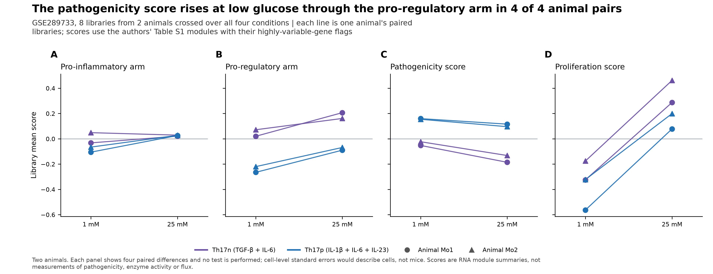
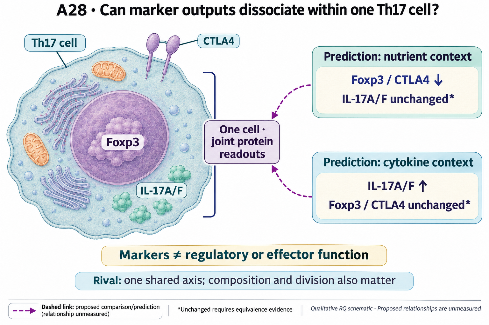

# A28: interpreting regulatory and inflammatory RNA-arm asymmetry

## Organizing Biological Q

A pathogenicity difference score can rise because its inflammatory arm rises,
its regulatory arm falls, or both change. A28 asks what these different
contributions mean biologically. The completed RNA analyses show that a score
shift is not a sufficient description of either arm: the mouse glucose contrast
and corrected human compartment contrast have different patterns.

That is a useful measurement result. It does **not** demonstrate independently
regulated antagonistic functions within the same cell. The registered
two-competence hypothesis remains a proposal, with one latent expression axis,
composition and division as consequential alternatives.

Current synthesis: 4 November 2026. [Question card](../../RESEARCH_QUESTIONS.md#a28)
· [Literature context](LITERATURE_CONTEXT.md) · [Dossier](../../docs/research_dossiers/A28.md).

## Literature context & visual hypothesis

The Gaublomme modules and published Th17-lineage plasticity provide the
premises; the [recorded literature context](LITERATURE_CONTEXT.md) separates
abstract-level source reads from a full methods audit. The Wp reproduction
package asks what can be recovered from the deposits. Its
[7 October correction report](../../Research%20Article/gate2_W2_wagner_Th17_PGAM/CORRECTIONS_2026-10-07.md)
takes precedence over historical human-score and Compass interpretations.

The [registered schematic](#registered-scope-and-illustration) depicts proposed
same-cell marker patterns. The measured glucose figure below shows RNA-arm
contributions from two animals, not those protein predictions or functional
competence.

## Evidence, analyses and next steps

The [mouse reproduction](../../Research%20Article/gate2_W2_wagner_Th17_PGAM/R1_RESULTS.md)
uses eight libraries from **two animals**, crossed over cell type and glucose
conditions; animal identity is prior-only. Four animal-by-cell-type paired
comparisons are not four independent animals. The deposited matrix does not
recover the paper's exact selected cells or scVI model.

| Existing comparison | What changed | What follows |
|---|---|---|
| Mouse low-minus-high glucose, library-mean RNA scores | The pathogenicity difference rises in 4/4 animal-by-cell-type pairs. The regulatory arm falls in all four; the inflammatory arm falls in three and rises slightly in one. | Arm-wise reporting clarifies the arithmetic; uniform effector gain is unsupported. |
| Corrected R4 v3, CSF minus blood in ten paired human donors | Inflammatory median +0.061825, 10/10 positive; regulatory median +0.006024, 6/10 positive, nominal paired p=0.232422. | The regulatory result is not evidence of an unchanged arm or equivalent function. |
| Mouse composition decomposition | Primary within-state terms are +0.034 and -0.037 in the two animals, while composition terms are positive. | The within-state result is inconclusive; marker-defined composition is itself dependent on the same RNA. |

The [score-construction study](../../Research%20Article/gate2_W2_wagner_Th17_PGAM/P01_RESULTS.md)
shows sensitivity to module/HVG definition, while the
[decomposition report](../../Research%20Article/gate2_W2_wagner_Th17_PGAM/P03_RESULTS.md)
retains its inconclusive stop rule. Correlation between arms in the same
transcriptome is not an independent test of biological antagonism.

The [correction](../../Research%20Article/gate2_W2_wagner_Th17_PGAM/CORRECTIONS_2026-10-07.md)
restores full-gene normalization for human transfer. M3 v2 has a different
finite-gene universe from R4 v3; its regulatory authors/all-gene size-only null
fractions are 0.292/0.884. Those values do not establish equivalence or
genome-wide specificity. The human cells are an operational CD4-lineage/non-CD8
selection, not independently certified Th17 cells, and a compartment contrast is
not a cytokine intervention. Mouse and human observations are distinct settings,
not replication of one within-cell mechanism.

The corrected Compass association is positive rather than the formerly claimed
negative direction; it does not reproduce the paper's PGAM direction under
substituted inputs. RNA-derived consistency supplies no metabolic-flux or
functional evidence for A28.

This unchanged mouse plate remains current under the article's figure
correction record. Each line joins libraries from the same animal; four paired
values represent two animals across two cell types. Scores are RNA summaries.
The superseded human/Compass v2 plates are not displayed; use the correction
report for those results.

## Does the evidence warrant the narrowing?

**Rationale verdict: supported measurement decomposition and a useful
diagnostic boundary; separate functional competences remain an incomplete
inference.** Published modules and plasticity findings motivate the question.
The two-animal glucose contrast shows why a higher difference score need not
mean greater inflammatory output; the corrected ten-donor human contrast has a
different arm pattern. Neither measures suppressive or effector function.

The [grounding record](../../Research%20Article/gate2_W2_wagner_Th17_PGAM/rq_derivation/SOURCES_AND_GROUNDING.md)
records that the question followed exposure to the branch outcomes. Reused
article data, selected gene modules and operational cell labels are not
independent tests of two functions. Module/HVG sensitivity, full-gene
normalization corrections and opposing within-state terms leave composition
and score construction consequential. Rejecting a one-number description does
not reject a shared latent biological axis; a nonsignificant regulatory result
does not support an unchanged function. The next informative comparison depends
on the claim: joint protein measurements for marker-level dissociation, and
independent functional outcomes for competence. Current uncertainty is not
evidence that the arm observations are merely noise.

## What the result changes and the next decision

The RNA work supports reporting both arms and their definition sensitivity.
A further summary of the same transcriptome cannot by itself establish
same-cell functional independence. Joint protein distributions could test whether
marker changes occur in the same cells, different populations or division
contexts. The registered predictions remain untested; apparent lack of change
requires an independently justified equivalence margin and adequate precision.

Even distinct Foxp3/CTLA4 and IL-17 marker patterns would not measure regulatory
suppression or effector secretion/function. Those stronger claims require
appropriate independent outcomes. The project has no qualified new functional
dataset or laboratory experiment here. An independent RNA source could test
transport of the arm pattern if it qualified, but would not replace the missing
functional comparison. No new run follows automatically from the old plan.

## Registered scope and illustration

The registered question, hypothesis and rival below are retained verbatim as
proposals. Their competence language is broader than what RNA decomposition or
marker protein alone can establish. The illustration already marks that boundary
and the need for equivalence evidence; it has not been replaced.

**Question:** In Th17 cells, does entry into the pathogenic transcriptional state proceed by loss of the regulatory programme, by gain of the effector programme, or by either route depending on the perturbation — and are the two routes distinguishable in the same cells at the protein level?

**Hypothesis:** Regulatory and effector competence are separately regulated within the same Th17 cell rather than two ends of one axis, so a perturbation can remove one without adding the other. Nutrient restriction is predicted to lower per-cell Foxp3 and CTLA4 protein with IL-17 unchanged, and a pathogenic cytokine condition to raise IL-17 with Foxp3 and CTLA4 unchanged. A single latent axis predicts that both perturbations move both proteins reciprocally. No causal claim about which competence is upstream is implied.

**Strongest rival:** One latent axis: the two modules are anti-correlated by construction, so a one-sided move may be a property of the gene lists rather than of the cells. Composition rather than within-cell state, proliferation differences, and (in the human leg) local activation are the further rivals.

<!-- literature-visual-context:start -->

## Literature context & visual hypothesis

[What previous findings contribute, what remains, and what the readouts would decide](LITERATURE_CONTEXT.md).

GPT-generated matte illustration, 3 November 2026. Proposed relationships and cell counts are qualitative; the owning context defines the comparison and interpretation limits. [Editorial review](../../docs/audits/2026-11-02-rq-schematic-review/MATTE_PUBLICATION_2026-11-03.md) · [Selected edit prompt](schematics/A28_gpt_matte_v1.prompt.txt). Earlier SVG files are retained as history.

*Explanatory proposal, not measured results. Read the linked context and caption; arrows do not certify a mechanism or novelty.*
<!-- literature-visual-context:end -->

## Evidence and planning records

[Development plan](PLAN.md) ·
[Corrected results](../../Research%20Article/gate2_W2_wagner_Th17_PGAM/CORRECTIONS_2026-10-07.md) ·
[Current figure record](../../Research%20Article/gate2_W2_wagner_Th17_PGAM/FIGURES.md) ·
[Historical derivation](../../Research%20Article/gate2_W2_wagner_Th17_PGAM/rq_derivation/Q1_arm_asymmetry.md) ·
[Exposure/grounding](../../Research%20Article/gate2_W2_wagner_Th17_PGAM/rq_derivation/SOURCES_AND_GROUNDING.md).
The article owns the executed runs and frozen outputs; assigning A28 did not
turn their exposed follow-ups into prospective tests or independent replication.

Preserved review and follow-through records

The complete earlier blocks below are retained. Current owning result reports
supply scientific interpretation; execution and review do not confer human
acceptance or promote a claim.

<!-- full-priority-screening-20261103:start -->
**Screening follow-through — 3 November 2026.** The completed two-arm decomposition does not support a universal reciprocal regulatory-versus-inflammatory RNA switch. Low-glucose effects and the corrected human compartment contrast have different arm patterns.

**Remaining discriminator:** Regulatory and inflammatory functions need separately measured outputs. RNA scores, two mouse sources and shared donor contrasts cannot establish symmetric or independent functional competence.

[Reviewed screening sequence](../../docs/research_reviews/2026-11-03-full-priority-screening/PLANS.md) · [Coordination and review](../../docs/research_reviews/2026-11-03-full-priority-screening/README.md). This reuses reviewed evidence and does not record human scientific acceptance.
<!-- full-priority-screening-20261103:end -->

<!-- evidence-followthrough:start -->
**Evidence follow-through — 3 November 2026:** Exclude the affirmative claim
“RNA-arm asymmetry proves two independently regulated functions in one cell.” from current conclusions.
[Bounded fill, stop rule and reopening evidence](../../docs/audits/2026-11-03-rq-evidence-trajectory/CUT_OR_FILL_PLAN.md#a28).
The hypothesis remains a proposal where its decisive comparison is untested.
<!-- evidence-followthrough:end -->

