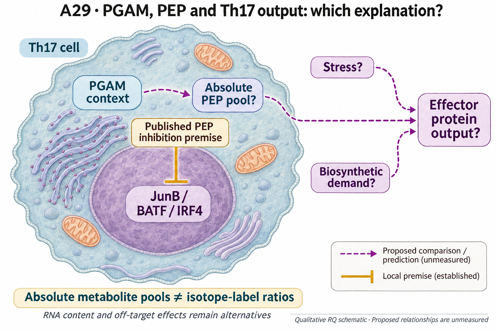

# A29: literature context and hypothesis schematic

[Question home](README.md) · [Scientific dossier](../../docs/research_dossiers/A29.md).

<!-- full-priority-screening-20261103:start -->
**Screening follow-through — 3 November 2026:** Existing demand, stress, effector and tracer comparisons are retained, including the corrected positive but non-BH-supported PGAM Compass association. A selective effector increase with falling demand is not a demonstrated PEP-signaling route. Calibrated PEP pools and discriminating protein/signaling measurements are absent. Isotope fractions are not flux or absolute pools; ATF4 RNA is not activity. No new score is added to rescue a preferred mechanism. [Reviewed screening sequence](../../docs/research_reviews/2026-11-03-full-priority-screening/PLANS.md) · [Coordination and review](../../docs/research_reviews/2026-11-03-full-priority-screening/README.md).
<!-- full-priority-screening-20261103:end -->

**Evidence update — 7 October 2026:** read the [Wp correction report](../../Research%20Article/gate2_W2_wagner_Th17_PGAM/CORRECTIONS_2026-10-07.md) before the historical derivation. Corrected scores remain descriptive; a null contrast is not equivalence, and marker protein changes alone do not establish functional competence.

**Interpretation correction — 3 November 2026:** the earlier statement that a
pool measurement alone separates the mechanisms is withdrawn. It addresses a
necessary prediction of the proposed bulk-pool route, not unique causal
attribution. The existing working hypothesis remains a proposal; no route is
selected and no complete experimental design or host access is established.
[Cut-or-fill decision](../../docs/audits/2026-11-03-rq-evidence-trajectory/CUT_OR_FILL_PLAN.md#a29).

Reviewed 5 October 2026. This note connects published findings to the current
proposed question. It is a bounded synthesis, not novelty clearance and not
scientific acceptance. The searches actually executed, their hit counts and
their coverage limits are recorded in the
[package literature update](../../Research%20Article/gate2_W2_wagner_Th17_PGAM/rq_derivation/LITERATURE_UPDATE.md).

## Published starting point

Three published mechanisms could produce the source's phenotype, and a fourth result points the opposite way in a different cell context. None is proposed here as new.

| Primary source | Inspected locator and access record |
|---|---|
| [Ishikawa and colleagues 2023, *Cell Rep* 42:112205](https://doi.org/10.1016/j.celrep.2023.112205) (PMID 36857180) | **Full text retrieved and read 5 October 2026** (open access). PEP binds JunB and blocks JunB/BATF/IRF4 DNA binding, suppressing IL-17A without significant change to glycolysis, proliferation or survival. PGAM sits two steps upstream of PEP. |
| [Brucklacher-Waldert et al. 2017, *Cell Rep* 19:2357](https://doi.org/10.1016/j.celrep.2017.05.052) (PMID 28614720) | **Full text read 5 October 2026** (earlier pass). Cellular stress supports Th17 differentiation in the ABSENCE of TGF-β; 2-DG enhances polarisation; mechanism is sustained cytoplasmic calcium with partial XBP1. |
| [Toriyama et al. 2020, *Commun Biol* 3:394](https://doi.org/10.1038/s42003-020-01122-w) (PMID 32709928) | Abstract inspected; complete T-cell *Pgam1* deletion attenuates CD4 and CD8 responses, so dose matters. |
| [iScience 2025, 114051](https://doi.org/10.1016/j.isci.2025.114051) (PMID 41399496) | Abstract inspected; 2-DG REDUCES IL-17A in lung Th17 tissue-resident memory cells — the opposite direction, in a different cell context. |
| [Huang et al. 2019, *Cell Metab* 30:1107](https://doi.org/10.1016/j.cmet.2019.09.014) (PMID 31607564) | **Paywalled; abstract only.** No TGF-β in the abstract. Remains a flag, not a refutation. |

## Repository observation

Against an expression-decile-matched null, EGCG in Th17n raises the Th17 effector programme (+0.544, 0/1,000 null draws as extreme; not an exact zero p value) while histones, serine/one-carbon, cell cycle and ribosomal proteins fall and the integrated stress response is the most downward-shifted set (−0.491, 0/1,000 null draws as extreme; not an exact zero p value); UPR, NRF2 and heat shock show no detected set-specific departure (not equivalence). A frozen sensitivity shows the ISR result is not carried by the two genes shared with the serine set. ATF4 output falls while ATF4 transcript shows no detected difference and SESN2 rises.

Exact current result locators:

- [A29 workspace](README.md) and [development plan](PLAN.md)
- [Derivation card](../../Research%20Article/gate2_W2_wagner_Th17_PGAM/rq_derivation/Q2_biosynthetic_demand.md)
- [Overlap screen against A0 to A27](../../Research%20Article/gate2_W2_wagner_Th17_PGAM/rq_derivation/OVERLAP_MATRIX.md)
- [Grounding and exposure record](../../Research%20Article/gate2_W2_wagner_Th17_PGAM/rq_derivation/SOURCES_AND_GROUNDING.md)
- [Reproduction scope and claim-by-claim outcome](../../Research%20Article/gate2_W2_wagner_Th17_PGAM/REPRODUCTION_SCOPE.md)

## What this question could add

Determine which published mechanism produces this paper's phenotype. The source's Discussion names stress, its own libraries move the stress programme downward, and the PEP mechanism attached to the very pathway segment its Compass analysis singles out is cited only as Introduction background (reference 7) and never evaluated against its result. Distinguishing them is model discrimination among existing mechanisms, not a claim of a new one.

## Current hypothesis and rival

PGAM restriction raises Th17 effector output by lowering the phosphoenolpyruvate pool and relieving PEP-mediated inhibition of the JunB/BATF/IRF4 complex, rather than by inducing a stress response; relief of biosynthetic and proliferative demand is a third, separable possibility. The PEP route predicts that the PEP pool falls under PGAM inhibition and that PEP supplementation abolishes the effector gain; the demand route predicts that matched growth slowing without PGAM inhibition reproduces it. No mechanism here is proposed as new, and a transcript-level observation cannot establish any of them.

**Strongest rival:** Absolute PEP might remain stable, which would challenge the proposed bulk-pool route; the reported isotope-label ratio does not establish that stability. Further rivals: ISR-independent stress through sustained cytoplasmic calcium that no transcript module sees; a per-cell-RNA-content compositional effect; division-rate dilution; and off-target action of EGCG.

## What the comparison would teach

Absolute pool abundance and isotope-label fraction answer different measurement
questions. A relevant pool decrease would be consistent with the proposed
bulk-pool route, but would not establish its causal contribution. A precisely
bounded absence of that decrease would weigh against that route without
excluding transient or compartment-specific changes. Stress activity, demand,
off-target effects and RNA composition remain separate explanations requiring
appropriate evidence. A supplementation response is not unique mechanistic
proof. The current transcriptome and published label ratio do not discriminate
all these possibilities; exact assays, comparisons and feasibility remain open.

## Hypothesis schematic

GPT-generated matte illustration, 3 November 2026. Proposed relationships and cell counts are qualitative; the owning context defines the comparison and interpretation limits. [Editorial review](../../docs/audits/2026-11-02-rq-schematic-review/MATTE_PUBLICATION_2026-11-03.md) · [Selected edit prompt](schematics/A29_gpt_matte_v1.prompt.txt). Earlier SVG files are retained as history.

Qualified independent biological preparations must distinguish absolute metabolite pools from isotope-label ratios and protein output from RNA. Stress, demand, off-target effects and RNA-content composition remain alternatives. A supplementation result is not unique mechanistic proof, and no secretion effect is established here.

Class-level glyphs and qualitative geometry are not molecular structures, organelle measurements or evidence of functional assembly. Neutral epithelial/stromal shapes do not assert subtype identity or organelle loss, and icon counts are illustrative. Read locally labelled solid premises/references separately from dashed proposed comparisons; no complete mechanism follows from their juxtaposition.

## Next literature check

Planned, not reported as newly executed: forward citations of the closest
inspected primary sources above, and the queries recorded as pending in the
[package literature update](../../Research%20Article/gate2_W2_wagner_Th17_PGAM/rq_derivation/LITERATURE_UPDATE.md).
Expand to synonyms and contrary findings using the
[literature workflow](../../docs/LITERATURE_WORKFLOW.md). Recheck the exact
population, comparison, timing, unit and endpoint before making any stronger
contribution claim.

**Current unresolved specification:** Qualify evidence that can distinguish the proposed routes. Absolute pool abundance can test the proposed bulk-pool decrease; it cannot by itself select the mechanism or exclude stress, demand, off-target or compositional explanations. The published label ratio does not supply absolute abundance. The exact comparison and model access remain unresolved; the current RNA findings select no route.

**Interpretation limit:** Module scores are RNA, not protein, secretion or
function. Reanalysis of the source deposits shares one evidence lineage with
the source paper and never becomes independent replication. No search
certifies novelty and no absence of a hit is evidence of a first.

[Current dossier](../../docs/research_dossiers/A29.md) · [Canonical card](../../RESEARCH_QUESTIONS.md#a29)
