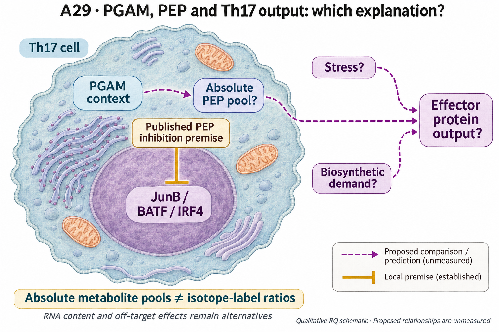

# A29: PGAM-related effector RNA and competing mechanisms

## Organizing Biological Q

Which account can explain the source's PGAM-related phenotype: a PEP-dependent route, altered biosynthetic demand, stress, or a combination? The local analyses describe relative RNA and correct a computational association; they have not selected one mechanism. The strongly directional registered hypothesis remains a proposal, not the conclusion of the current screen.

Current synthesis: 4 November 2026. [Literature context](LITERATURE_CONTEXT.md) ·
[Dossier](../../docs/research_dossiers/A29.md) · [Canonical card](../../RESEARCH_QUESTIONS.md#a29).

<!-- literature-visual-context:start -->

## Literature context & visual hypothesis

[What previous findings contribute, what remains, and what the readouts would decide](LITERATURE_CONTEXT.md).

GPT-generated matte illustration, 3 November 2026. Proposed relationships and cell counts are qualitative; the owning context defines the comparison and interpretation limits. [Editorial review](../../docs/audits/2026-11-02-rq-schematic-review/MATTE_PUBLICATION_2026-11-03.md) · [Selected edit prompt](schematics/A29_gpt_matte_v1.prompt.txt). Earlier SVG files are retained as history.

*Explanatory proposal, not measured results. Read the linked context and caption; arrows do not certify a mechanism or novelty.*
<!-- literature-visual-context:end -->

The [local primary-source review](../../RQ_Specified/A29_pgam_effector_mechanism/LITERATURE_CONTEXT.md#published-starting-point) records published PEP/JunB-related, stress and metabolic-context mechanisms, together with contrary findings in other T-cell settings. These are distinct premises, not a single established pathway in the source's preparation. The source's Fig. 1E isotope-label measurement is a labeling fraction, not an absolute metabolite pool; its lack of a detected PEP change is not equivalence or a calibrated pool result.

The retained illustration describes the registered proposal. Its dashed relationships
are unmeasured; the completed comparisons below have their own narrower endpoints.

## Evidence, analyses and next steps

The [7 October correction](../../Research%20Article/gate2_W2_wagner_Th17_PGAM/CORRECTIONS_2026-10-07.md) controls the Compass reading. Corrected forward PGAM consistency has a **positive association, rho +0.291248 and BH q 0.180810** under substituted inputs. It does not reproduce the paper's negative direction or identify PGAM as distinctive; the micropools reuse source animals and are not independent biological replicates. The old negative-penalty interpretation is historical.

The [bulk reproduction](../../Research%20Article/gate2_W2_wagner_Th17_PGAM/R3_RESULTS.md) uses deposited TPM with **library as the only verifiable unit**: animal/culture identities are absent. The focal Th17n/EGCG division-1 contrast has five libraries per arm. Gates and drug/cell contexts are not interchangeable. The [E3 result](../../Research%20Article/gate2_W2_wagner_Th17_PGAM/E3_RESULTS.md) shows relative effector-set enrichment (+0.544) and lower ISR-set transcripts (-0.491) against an expression-decile-matched null; zero of 1,000 draws as extreme is not zero probability or animal-level inference.

The two-gene-overlap sensitivity retains the ISR RNA direction. It does not measure stress activity, ATF4 protein/translation or absolute per-cell effector output. Expression matching does not remove TPM composition ambiguity. Published isotope fractions do not provide pools or metabolic flux, and the source's phenotype is not independently validated by reanalysis of its own libraries.

## Does the evidence warrant the narrowing?

**Rationale verdict: descriptive relative-RNA context and a corrected negative/diagnostic boundary; PEP-mechanism selection is unsupported.** Lower biosynthetic/ISR transcripts with higher relative effector RNA does not exclude stress or establish demand relief. Correcting the Compass sign removes a previously claimed corroboration rather than selecting its opposite mechanism. A new name for the same RNA pattern adds no causal evidence.

Question derivation followed exposed outcomes; the reduced-overlap sensitivity was frozen before its new estimates while reusing exposed full-set values. Declared gene sets, division gates, library-only units, finite null draws, drug specificity and unknown absolute RNA content constrain interpretation. A PEP pool decrease would address one prediction but cannot uniquely distinguish all routes, and a supplementation response would not be unique proof. None of the uncertain alternatives is demonstrated to be noise.

## What a further comparison would decide

A calibrated pool decrease would support one prediction of the proposed PEP account, without selecting its causal contribution. Appropriate independent evidence could favor stress or demand, possibly together. A non-significant label-fraction contrast or an RNA module cannot establish equivalent pool size or absent activity. The comparison must be chosen for the inference it can actually resolve.

Retain the corrected Compass and relative-RNA results, adverse directions and composition limits. Qualify evidence that separates the intended candidate accounts before any new calculation or experiment. The current synthesis selects no target priority or preferred route; another score would need a distinct informative comparison.

**Current boundary:** Library-level TPM and gene-set null draws are not independent animals, secretion or function. Isotope-label fractions are not pools or flux; ISR RNA is not stress activity. The published mechanisms remain competing premises, and the current evidence selects none.

## Registered scope and earlier records

The complete earlier framing below retains its dated scope and registered hypotheses.
Current results and amendments govern interpretation. Older unfinished-work, source-access
or priority statements do not supersede this synthesis or start an execution queue.
Registration and completed analysis confer neither human acceptance nor a claim promotion.

Registered framing, source links and retained development history

## Organizing Biological Q

Inhibiting one step of glycolysis — the phosphoglycerate mutase reaction, 3PG
to 2PG — increases Th17 effector output, while inhibiting neighbouring steps
decreases it. Why a single reaction behaves oppositely to the pathway it
belongs to is unexplained, and the answer determines whether PGAM is a
plausible target at all: a metabolite-signalling route, an energetic route and
a stress route imply different companion targets, different dose behaviour and
different off-target risks.

**Unresolved gap:** Co-occurrence in five bulk libraries per arm is not a mechanism, and no
transcript measures stress-response activity, which is set by eIF2α
phosphorylation and ATF4 translation. The PEP route predicts the phenotype
directly but the source's own ¹³C tracing reports PEP unchanged under EGCG — a
15-minute label ratio, not a pool size, in one condition. The source cites the
PEP work as reference 7, in the Introduction's opening citation bundle only; its
Discussion proposes stress and serine, closes by stating the mechanism needs
further study, and does not return to the PEP mechanism despite its Compass
analysis singling out the 3PG-to-PEP segment.

[Full working hypothesis and alternatives](../../docs/research_dossiers/A29.md#working-hypothesis).

## Evidence, analyses and next steps

<!-- full-priority-screening-20261103:start -->
**Screening follow-through — 3 November 2026.** Existing demand, stress, effector and tracer comparisons are retained, including the corrected positive but non-BH-supported PGAM Compass association. A selective effector increase with falling demand is not a demonstrated PEP-signaling route.

**Remaining discriminator:** Calibrated PEP pools and discriminating protein/signaling measurements are absent. Isotope fractions are not flux or absolute pools; ATF4 RNA is not activity. No new score is added to rescue a preferred mechanism.

[Reviewed screening sequence](../../docs/research_reviews/2026-11-03-full-priority-screening/PLANS.md) · [Coordination and review](../../docs/research_reviews/2026-11-03-full-priority-screening/README.md). This reuses reviewed evidence and does not record human scientific acceptance.
<!-- full-priority-screening-20261103:end -->

<!-- evidence-followthrough:start -->
**Evidence follow-through — 3 November 2026:** Exclude the affirmative claim
“Corrected Compass or relative RNA selects PEP, excludes stress, or fixes TPM composition.” from current conclusions.
[Bounded fill, stop rule and reopening evidence](../../docs/audits/2026-11-03-rq-evidence-trajectory/CUT_OR_FILL_PLAN.md#a29).
The hypothesis remains a proposal where its decisive comparison is untested.
<!-- evidence-followthrough:end -->

The existing analysis records below retain their scope. Read the latest linked result or amendment before an older plan.

**Evidence update — 7 October 2026:** read the [Wp correction report](../../Research%20Article/gate2_W2_wagner_Th17_PGAM/CORRECTIONS_2026-10-07.md) before the historical derivation. Corrected scores remain descriptive; a null contrast is not equivalence, and marker protein changes alone do not establish functional competence.

Registered 5 October 2026 as **proposed**, derived from the executed Wp
reproduction ladder, branch cards, metadata phenotypes and extension analyses
of Wang et al. 2025. The derivation supplied a bounded scientific review; human
retain/reject and scientific acceptance remain unrecorded. Registration is not
a claim of novelty, functional validation or permission to execute an
unfinished numerical design.

**Question:** Does restriction of glycolysis at PGAM raise Th17 effector output by lowering phosphoenolpyruvate and relieving PEP-mediated inhibition of the JunB/BATF/IRF4 complex, by relieving biosynthetic and proliferative demand, or by inducing a stress response?

**Hypothesis:** PGAM restriction raises Th17 effector output by lowering the phosphoenolpyruvate pool and relieving PEP-mediated inhibition of the JunB/BATF/IRF4 complex, rather than by inducing a stress response; relief of biosynthetic and proliferative demand is a third, separable possibility. The PEP route predicts that the PEP pool falls under PGAM inhibition and that PEP supplementation abolishes the effector gain; the demand route predicts that matched growth slowing without PGAM inhibition reproduces it. No mechanism here is proposed as new, and a transcript-level observation cannot establish any of them.

**Strongest rival:** Absolute PEP might remain stable, which would challenge the proposed bulk-pool route; the reported isotope-label ratio does not establish that stability. Further rivals: ISR-independent stress through sustained cytoplasmic calcium that no transcript module sees; a per-cell-RNA-content compositional effect; division-rate dilution; and off-target action of EGCG.

**Current evidence:** Against an expression-decile-matched null, EGCG in Th17n raises the Th17 effector programme (+0.544, 0/1,000 null draws as extreme; not an exact zero p value) while histones, serine/one-carbon, cell cycle and ribosomal proteins fall and the integrated stress response is the most downward-shifted set (−0.491, 0/1,000 null draws as extreme; not an exact zero p value); UPR, NRF2 and heat shock show no detected set-specific departure (not equivalence). A frozen sensitivity shows the ISR result is not carried by the two genes shared with the serine set. ATF4 output falls while ATF4 transcript shows no detected difference and SESN2 rises.

**Next decision:** Qualify evidence that can distinguish the proposed routes. Absolute pool abundance can test the proposed bulk-pool decrease; it cannot by itself select the mechanism or exclude stress, demand, off-target or compositional explanations. The published label ratio does not supply absolute abundance. The exact comparison and model access remain unresolved; the current RNA findings select no route. [3 November cut-or-fill decision](../../docs/audits/2026-11-03-rq-evidence-trajectory/CUT_OR_FILL_PLAN.md#a29).

[Dossier](../../docs/research_dossiers/A29.md) · [Development plan](PLAN.md) · [Canonical card](../../RESEARCH_QUESTIONS.md#a29) · [Derivation and overlap screen](../../Research%20Article/gate2_W2_wagner_Th17_PGAM/rq_derivation/README.md).

This workspace owns future question-specific planning. The executed reproduction
runs, frozen tables, receipts and branch cards remain in the article package and
keep their article-run ownership. No analysis has been executed under this RQ;
shared inputs remain shared biological evidence and never become independent
replication.

