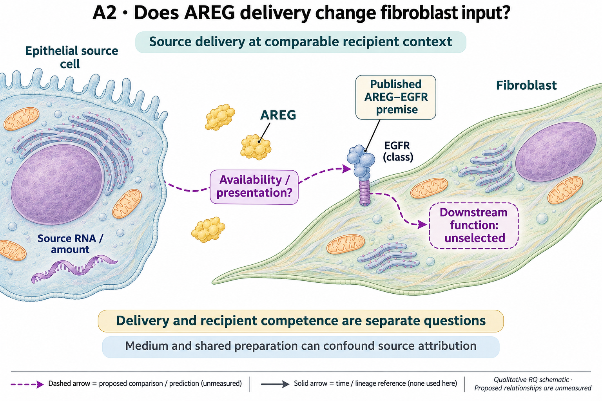

# A2: literature context and hypothesis schematic

[Question home](README.md) · [Scientific dossier](../../docs/research_dossiers/A2.md).

Reviewed 3 October 2026. This note connects published findings to the current proposed question. It is a bounded synthesis, not novelty clearance or scientific acceptance.

## Published starting point

AREG/EGFR niche support is already a biological premise. It suggests separating the amount/presentation of ligand reaching a fibroblast from the competence of that recipient.

| Primary source | Inspected locator and access record |
|---|---|
| [Cardoso 2026](https://www.nature.com/articles/s41586-026-10399-6) | Primary abstract, AREG/EGFR niche finding. [Access / prior review](../../docs/research_dossiers/review_2026-10-03/SOURCES.md#s10) |
| [Kaiser 2023 (online 2022)](https://pmc.ncbi.nlm.nih.gov/articles/PMC9767680/) | Mesenchymal EGFR/AREG niche results; indexed text and primary record. [Access / prior review](../../docs/research_dossiers/review_2026-10-03/SOURCES.md#s15) |

Sources above reuse the named review unless the update ledger explicitly records a fresh inspection. Published-source evidence and reanalysis of the same material are not independent replication.

## Repository observation

Source and database audits corrected specific label, coverage and interpretation errors. The depth-standardized machinery/activation RNA association is positive but inconclusive across 22 donors (rho 0.2931, nominal p 0.185637); it neither establishes zero coupling nor favors delivery over abundance. Partial source perturbation, recipient ligand expression, supplemented EGF and split wells do not isolate effective delivery in the existing sources.

[Current result, design and limits](reports/INTERPRETATION_AUDIT_2026-09-27.md). This reuses existing evidence rather than providing a new run or independent replication.

## What this question could add

Useful source/measurement correction; the delivery explanation remains untested. Failure to establish an RNA association does not select availability or delivery as the mechanism. This distinction prevents a plausible biological explanation from being presented as the winner of an inconclusive screen.

The existing evidence lacks a qualified effective-input/recipient-response contrast. Source RNA, active ligand amount and receiver competence are different endpoints; the last is developed separately in A9.

## Current hypothesis and rival

Epithelial AREG delivery can change the effective ligand reaching fibroblasts and thereby their response, even when epithelial AREG RNA or source-cell abundance is similar. The biological contrast is delivery through effective availability versus a recipient-context effect. The source/presentation comparison and downstream fibroblast function remain unnominated, so this is a developing hypothesis, not a specified wet experiment.

**Strongest rival:** Differences arise from total ligand exposure, recipient composition, EGF-containing medium or shared preparation and split-well effects.

## What the comparison would teach

Use the existing source audit to specify what an informative delivery comparison would measure. Differences in response tracking available input would support that route in its context; comparable input with different receiver responses would point to a recipient question. Another ligand ranking would not supply either measurement. No delivery mechanism is selected from the current positive but inconclusive association.

## Hypothesis schematic

GPT-generated matte illustration, 3 November 2026. Proposed relationships and cell counts are qualitative; the owning context defines the comparison and interpretation limits. [Editorial review](../../docs/audits/2026-11-02-rq-schematic-review/MATTE_PUBLICATION_2026-11-03.md) · [Selected edit prompt](schematics/A2_gpt_matte_v1.prompt.txt). Earlier SVG files are retained as history.

Independent source/recipient preparations must separate available AREG from recipient response. The corrected RNA association is inconclusive; medium composition and shared split-well preparation remain alternatives. The drawing selects neither a release mechanism nor a functional endpoint.

Class-level glyphs and qualitative geometry are not molecular structures, organelle measurements or evidence of functional assembly. Neutral epithelial/stromal shapes do not assert subtype identity or organelle loss, and icon counts are illustrative. Read locally labelled solid premises/references separately from dashed proposed comparisons; no complete mechanism follows from their juxtaposition.

## Next literature check

Planned query (not reported as newly executed): `amphiregulin epithelial fibroblast ligand delivery bioavailability recipient response 2025 2026`. Expand to synonyms, nearest source references/citations and conflicting results using the [literature workflow](../../docs/LITERATURE_WORKFLOW.md). Recheck the exact population, comparison, timing, unit and endpoint before making a stronger contribution claim.

**Current unresolved specification:** The source data do not separate effective ligand exposure from recipient competence, common-preparation effects or other growth-factor input.

**Interpretation limit:** Areg RNA is not ligand delivery; an integrin association does not establish an AREG delivery mechanism.

[Current dossier](../../docs/research_dossiers/A2.md) · [All-question context index](../../docs/research_dossiers/literature_context_2026-10-03/README.md)
