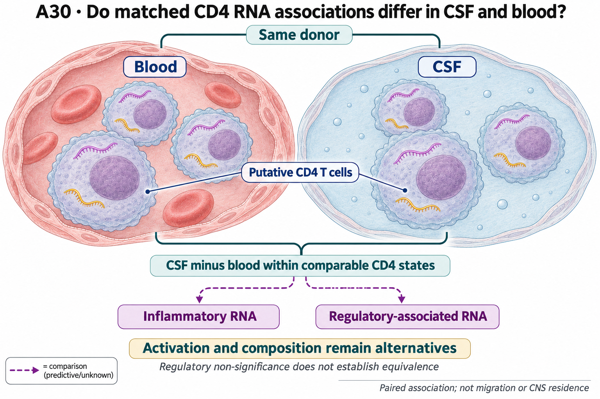

# A30: literature context and hypothesis schematic

[Question home](README.md) · [Scientific dossier](../../docs/research_dossiers/A30.md).

**Execution update — 7 October 2026:** [common-state and continuous-activation sensitivity](../../docs/portfolio_extensions/2026-10-07/g3_immune/A30_RESULTS.md) is now complete under a separate exposed contract. Restricted support, donor losses and floor-five uncertainty remain explicit. Other raw-QC/null/functional stages are unexecuted; this earlier baseline is not overwritten as if all stages completed.

Revised 7 October 2026 during the PR140 audit at the owner's request. This bounded
update replaces the 5 October framing; the earlier record remains in Git and the
[source derivation](../../Research%20Article/gate2_W2_wagner_Th17_PGAM/rq_derivation/README.md).
Outcomes were exposed. Scientific acceptance remains unrecorded.

## Published starting point

| Primary study and inspected locator | Consequence for A30 |
|---|---|
| [Wang, Wagner, Fessler et al., Cell Reports 2025](https://pmc.ncbi.nlm.nih.gov/articles/PMC12443480/), human-MS Results, Figure S4 and STAR Methods | The human analysis transports mouse-derived programmes to GSE138266 and compares disease groups. A30 asks a different, paired compartment question; it does not test the murine PGAM mechanism. |
| [Schafflick et al., Nature Communications 2020](https://doi.org/10.1038/s41467-019-14118-w), abstract and GSE138266 identity; full text inaccessible in this pass | CSF-associated composition and expression were already described. This is the same dataset, not independent replication. No new full-methods verification is claimed. |
| [van Puijfelik et al., EBioMedicine 2026](https://pmc.ncbi.nlm.nih.gov/articles/PMC13264205/), indexed full-text Results/Figures 2–3 and functional-assay sections | A CCR5-high Th17.1 population is enriched in paired CSF. Post-natalizumab reduction concerns **blood**, not longitudinal CSF. This supports a concrete trafficking/composition alternative. Its IFN-γ/GM-CSF and cytotoxic features make an IL-17-only follow-up incomplete for this subset. |
| [Hayashi, Mittl et al., Nature Immunology 2026](https://www.nature.com/articles/s41590-025-02412-3), Figure 1 and paired RNA/TCR methods | Paired repertoire measurements address clonal overlap. The major antigen-specific work concerns CD8 cells and does not validate A30's CD4 programme. Check reused-cohort provenance before claiming independent validation. |

Compartmentalisation is a premise. The remaining question is whether the RNA
association persists after credible adjustment for activation and cell state.
Shared TCR does not demonstrate residence, migration direction or local induction.

## Repository observation

The corrected all-cell paired inflammatory association is positive in all ten donors. Within observed shared-state and activation support, linear activation standardization retains seven donors, with median inflammatory RNA-score contrast +0.03810 and positive direction in six. Median retained coverage is 67.7% for CSF and 33.0% for blood, with only 3.9% CSF coverage for the least-covered retained donor; the floor-five sensitivity interval crosses zero. The standardized activation contrast is zero by construction, not evidence that biological activation has been controlled. The comparison changes the target population rather than explaining every cell in either compartment. Inputs and motivating outcomes were already exposed; a later frozen specification does not make this confirmatory.

[Current result, design and limits](../../docs/portfolio_extensions/2026-10-07/g3_immune/A30_RESULTS.md). This reuses existing evidence rather than providing a new run or independent replication.

## What this question could add

A bounded association survives a more restricted observed comparison. This is useful context narrowing, but it does not exclude biological activation or select local compartment induction. State and activation definitions share the transcriptome, and the sensitivity result limits a uniformly robust interpretation.

Independent lineage/activation qualification, clinical context and functional outcomes remain unresolved. Trimming to common support cannot identify unmeasured activation, trafficking or residency, nor demonstrate regulatory equivalence.

## Current hypothesis and rival

In paired CSF and blood, the inflammatory RNA programme remains higher in CSF
within comparable CD4 T-cell states after accounting for measured activation and
composition. Regulatory-associated RNA is evaluated separately, without presuming
unchanged regulatory function.

Residual activation and selective trafficking/subset or clonal composition are
biological alternatives; gating, depth and module/null construction are measurement
threats. These can coexist. Comparison tuple: human putative CD4 T cells; paired
CSF/PBMC samples; compartment contrast rather than intervention; timing incompletely
qualified; donor as unit; RNA programme difference as endpoint. A new cohort must
establish CD4 identity, paired timing, clinical covariates and assay validity.

## What the comparison would teach

Preserve both the all-cell and restricted estimands and their coverage. Independent state/activation or clinical qualification could determine whether the association transports to the intended population. Persistence would support a bounded contextual association; dependence on those definitions would restrict it. Further stratification of the same exposed data does not automatically resolve induction or function.

## Hypothesis schematic

GPT-generated matte illustration, 3 November 2026. Proposed relationships and cell counts are qualitative; the owning context defines the comparison and interpretation limits. [Editorial review](../../docs/audits/2026-11-02-rq-schematic-review/MATTE_PUBLICATION_2026-11-03.md) · [Selected edit prompt](schematics/A30_gpt_matte_v1.prompt.txt). Earlier SVG files are retained as history.

Donor is the unit for paired CSF/blood RNA contrasts in comparable putative CD4 states. Total and adjusted associations differ; conditioning on activation may remove biology as well as confounding. Shared clones do not prove residence or migration, and regulatory non-significance is not unchanged function.

Class-level glyphs and qualitative geometry are not molecular structures, organelle measurements or evidence of functional assembly. Neutral epithelial/stromal shapes do not assert subtype identity or organelle loss, and icon counts are illustrative. Read locally labelled solid premises/references separately from dashed proposed comparisons; no complete mechanism follows from their juxtaposition.

## Next literature check

The [search/access log](../../docs/audits/2026-10-07-pr140/LITERATURE_SCAN.md) records
actual queries, versions, locators and failures. The 5 October scan is reused for
unchanged premises. Full Schafflick methods access, 2026 cohort-overlap qualification,
and assay/perturbation review for a chosen extension remain pending. No exhaustive
search, novelty certification or laboratory readiness is claimed.

## Cut-or-fill execution — 3 November 2026

The saved-state/barcode key audit is executed. Equal cell totals do not supply a cell identity join; dependent lineage/doublet and matched-null work remains held.

[Current technical result and limits](../../docs/audits/2026-11-03-rq-evidence-trajectory/A30_TECHNICAL_RESULT.md) · [Execution ledger](../../docs/audits/2026-11-03-rq-evidence-trajectory/TECHNICAL_STATUS.md).
