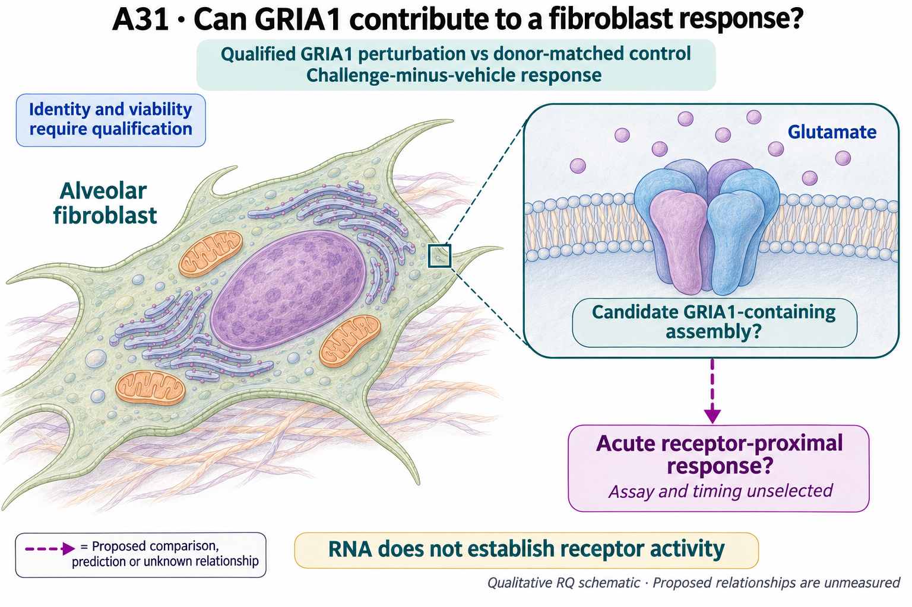

# A31: literature context and current argument

[Question home](README.md) · [Scientific dossier](../../docs/research_dossiers/A31.md).

Synthesis updated 4 November 2026 using the recorded source reviews and current
results. No fresh literature search or biological calculation was performed for
this documentation batch. Published premises and reused-data observations remain
separate evidence types.

## Published starting point

[Travaglini/Nabhan 2020](https://doi.org/10.1038/s41586-020-2922-4), stromal
annotation and Extended Data Figure 4, supplies source-defined fibroblast
expression. [Madissoon 2023](https://doi.org/10.1038/s41588-022-01243-4), Results
on airway peripheral nerves and Extended Data Figure 5a,j, makes neural SCN7A a
specificity rival. Older GRIA1-enriched lung fibroblast descriptions, recent
cardiac glutamate-response work and neural/fibroblast precedents are compared
at exact inspected locators in the [7 October primary-source review](../../docs/portfolio_extensions/2026-10-07/g2_niche/LITERATURE.md).
Expression and nerve-related wording are established premises, not new cell-type
discoveries. Source reanalysis and publication share the same evidence lineage.

The [7 October review](../../docs/portfolio_extensions/2026-10-07/g2_niche/LITERATURE.md)
records Travaglini Fig. 1/Extended Data Fig. 4, Madissoon nerve Results/Extended
Data Fig. 5a,j, the 2024 lung-homeostasis Fig. 4a,b/Supplementary Fig. 6a expression
precedent, Hall Fig. 4G glial localization, and Wang 2025 cardiac Figs. 4-6.
Access ranges from publisher Results/legends to indexed text with failed full-text
retrieval; supplements were not comprehensively reviewed. These are expression,
specificity or cross-context functional premises. The newest A31 report supplies
the current conditional RNA observation and supersedes any prospective wording
in the earlier source-search narrative.

## Repository observation

The [Nb4-P09 expression result](../../docs/portfolio_extensions/2026-10-07/g2_niche/RESULTS.md)
finds separate GRIA1 and SCN7A enrichment in eligible matched alveolar-versus-
adventitial fibroblast donor/region/assay contrasts. Source SS2/10x assays repeat
donors, and external cell/nucleus donor sets overlap. SCN7A is context, not a
required double-positive gate or a neuronal identity claim.

The [first partner screen](../../RQ_Specified/A31_gria1_fibroblast_response/reports/PARTNER_CONTEXT_V1_RESULTS.md)
preserves GRIA1 enrichment but finds heterogeneous partners: GRIA3 usually favors
adventitial fibroblasts, CNIH3 varies, and several targets are sparse or
assay-specific. Ten donor/assay contexts are not ten independent people.
This challenged the inference from one enriched receptor transcript to a
coordinated partner configuration.

The [newest shared-depth analysis](../../RQ_Specified/A31_gria1_fibroblast_response/reports/DEPTH_CONDITIONED_PARTNER_V1_RESULTS.md)
then asks whether joint detection exceeds what the marginal detection rates
predict within shared library-depth bins. It compares
observed-minus-marginal-expected joint detection between alveolar and adventitial
labels, using identical overlap weights. Fourteen primary strata qualify:
**112 estimated and 120 held partner-stratum rows**, summarized in **nine
donor/assay contexts** that still reuse people. The estimate describes selected
common-depth overlap cells, not every fibroblast.

| Conditional partner finding | Interpretation |
|---|---|
| CNIH3: 4 positive, 2 negative and 3 exact-zero contexts; range -0.322493 to +2.631652 pp | An exploratory source-dependent lead. P3 has opposite directions in SS2 and 10x. |
| Other seven partners: sparse, opposing, zero or single-nucleus-donor patterns | No uniformly coordinated partner configuration; all results remain in the display. |
| Exact-zero residuals | Arithmetic zeros can follow from absent marginal detection. They establish neither biological independence nor absent receptor machinery. |

Shared state, annotation, ambient RNA and residual depth within bins remain
alternatives. Conditioning the same sources is not independent replication of
GRIA1 enrichment, and assay-specific read/UMI protocols remain distinct.

## Does the evidence warrant the narrowing?

**Rationale verdict: exploratory context lead and a useful diagnostic boundary;
a stable complex is unsupported.** Published and local GRIA1 enrichment motivate
the acute-response question. The newer endpoint is conditional joint RNA
detection in a selected common-depth population. CNIH3's four positive, two
negative and three zero donor/assay contexts, including an opposing P3 assay
contrast, warrant a conditional lead rather than a broadly conserved partner
claim. Nine contexts reuse people; they are not independent replication.

The [conditional specification](../../docs/research_reviews/2026-11-03-tool-assisted-screening-review/prerequisites/A31_CONDITIONING_SPEC_V1.md)
was prospective for its new endpoint on an already exposed source. All eight
fixed partners remain reported; highlighting CNIH3 after seeing these results
does not validate its selection. Depth restriction addresses one technical
explanation while changing the target population; state/annotation, ambient RNA
and remaining depth or assay effects persist. Weakening a uniform partner
account does not support a special CNIH3 mechanism or functional absence. A
nonoverlapping context, protein localization or a qualified direct functional
comparison could each be informative. The existing evidence cannot decide
whether the opposing contexts reflect biological heterogeneity or technical/
sampling variation.

## What this question could add

The contribution is a progression from separate-gene enrichment to a
qualified, heterogeneous receptor-partner context, and a proposed direct-response
question. The conditional analysis narrows possible context without discovering
a sensory cell type or a receptor complex. A functional comparison can be useful
on its own qualified terms; it need not complete a separate localization study
first. The registered hypothesis/rival description below remains unchanged.

## Current hypothesis and rival

The [dossier](../../docs/research_dossiers/A31.md) owns the full working hypothesis.
The proposed tuple is adult human alveolar fibroblasts; matched control and
qualified GRIA1 perturbation; the same validated acute glutamate exposure;
challenge-minus-vehicle receptor-proximal response with identity/viability
qualification; donor as primary unit, repeated preparations and cells nested.
Viability/identity are not automatic post-treatment adjustment or survivor gates. Assay and timing are not yet specified. Functional response may be
absent, arise through other routes, or reflect neural admixture and perturbation
toxicity. SCN7A is neither a required co-positive gate nor a claimed mediator.

## What the comparison would teach

The next useful comparison depends on the question. Nonoverlapping donors can
test transport of the RNA context; protein localization can test its cellular
interpretation; a qualified acute challenge/GRIA1 contrast can test functional
contribution directly. These are alternative informative routes, not a mandatory
mechanistic staircase.

A perturbation-associated response difference supports the specified effect
when identity, viability, engagement and assay interpretation are adequate.
Calibrated nonresponse, an imprecise effect and toxicity/identity change have
different implications and should remain separate. No outcome automatically
demonstrates repair, neuronal excitability or a universal receptor configuration.
Missing function in this repository means unmeasured, not biologically absent.

## Reading the registered illustration

The retained illustration depicts the registered proposal. The
[measured figure in the question home](README.md#evidence-analyses-and-next-steps)
has a separate evidence-display purpose; no registered asset is replaced.

## Hypothesis schematic

GPT-generated matte illustration, 3 November 2026. Proposed relationships and cell counts are qualitative; the owning context defines the comparison and interpretation limits. [Editorial review](../../docs/audits/2026-11-02-rq-schematic-review/MATTE_PUBLICATION_2026-11-03.md) · [Selected edit prompt](schematics/A31_gpt_matte_v1.prompt.txt). Earlier SVG files are retained as history.

The membrane inset is a conditional AMPAR channel-class illustration, not evidence of functional assembly, partner composition or ion flow in adult alveolar fibroblasts. Donor-matched perturbation and challenge-minus-vehicle comparisons require receptor/identity qualification and an independently selected acute-response assay. RNA alone does not establish receptor activity.

Class-level glyphs and qualitative geometry are not molecular structures, organelle measurements or evidence of functional assembly. Neutral epithelial/stromal shapes do not assert subtype identity or organelle loss, and icon counts are illustrative. Read locally labelled solid premises/references separately from dashed proposed comparisons; no complete mechanism follows from their juxtaposition.

The measured Nb4 plot remains a contract-bound run artifact.

## Next literature check

Reuse the 7 October primary-source/overlap review and the current 3 November
partner reports; this editorial pass performed no new search. Before choosing a
new context or functional comparison, refresh the exact adult human lung
GRIA1/partner or acute-response precedent and resolve relevant access gaps.
No effect margin, sample size or laboratory feasibility follows from atlas RNA.

[Current evidence and history](README.md#evidence-and-planning-records) ·
[Research governance](../../docs/RESEARCH_GOVERNANCE.md).
