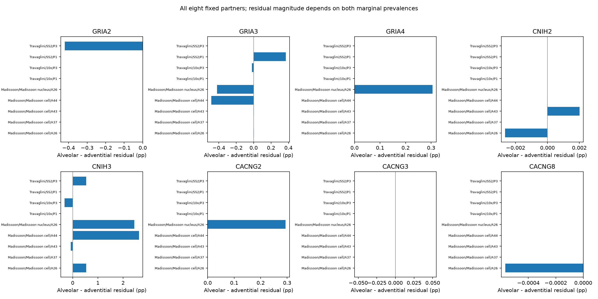

# A31: GRIA1 RNA context and acute fibroblast response

## Organizing Biological Q

Does GRIA1 contribute to an acute glutamate response in independently identified
adult alveolar fibroblasts? Published expression and the local atlas contrasts
motivate testing this question without establishing functional competence. The
completed screens have narrowed the premise: GRIA1 marginal
enrichment persists, but its partner context is heterogeneous. **CNIH3 is a
conditional RNA lead**, with opposing donor/assay contexts, not a universal
receptor configuration.

The question can advance through a useful localization/context comparison or a
suitably qualified acute functional comparison. A separate localization study is
not an obligatory first step. Neither function nor its absence has been
demonstrated by the current RNA evidence.

Current synthesis: 4 November 2026. [Question card](../../RESEARCH_QUESTIONS.md#a31)
· [Literature context](LITERATURE_CONTEXT.md) · [Dossier](../../docs/research_dossiers/A31.md).

## Literature context & visual hypothesis

[Travaglini/Nabhan and Madissoon source findings](LITERATURE_CONTEXT.md#published-starting-point)
supply fibroblast expression and a neural-expression specificity rival. Related
cardiac glutamate-response work is a different organ/receptor context. The
[published-source review](../../docs/portfolio_extensions/2026-10-07/g2_niche/LITERATURE.md)
limits broad novelty claims and does not transfer those functions into adult
alveolar fibroblasts.

The [registered illustration](#registered-scope-and-illustration) depicts the
proposed acute-response comparison. Its channel-class inset is conditional;
the measured partner display below reports RNA detection, not receptor assembly.

## Evidence, analyses and next steps

The [Nb4-P09 expression result](../../docs/portfolio_extensions/2026-10-07/g2_niche/RESULTS.md)
finds separate GRIA1 and SCN7A enrichment in eligible matched alveolar-versus-
adventitial fibroblast donor/region/assay contrasts. Source SS2/10x assays repeat
donors, and external cell/nucleus donor sets overlap. SCN7A is context, not a
required double-positive gate or a neuronal identity claim.

The [first partner screen](../../RQ_Specified/A31_gria1_fibroblast_response/reports/PARTNER_CONTEXT_V1_RESULTS.md)
preserves GRIA1 enrichment but finds heterogeneous partners: GRIA3 usually favors
adventitial fibroblasts, CNIH3 varies, and several targets are sparse or
assay-specific. Ten donor/assay contexts are not ten independent people.
This challenged the inference from one enriched receptor transcript to a
coordinated partner configuration.

The [newest shared-depth analysis](../../RQ_Specified/A31_gria1_fibroblast_response/reports/DEPTH_CONDITIONED_PARTNER_V1_RESULTS.md)
then asks whether joint detection exceeds what the marginal detection rates
predict within shared library-depth bins. It compares
observed-minus-marginal-expected joint detection between alveolar and adventitial
labels, using identical overlap weights. Fourteen primary strata qualify:
**112 estimated and 120 held partner-stratum rows**, summarized in **nine
donor/assay contexts** that still reuse people. The estimate describes selected
common-depth overlap cells, not every fibroblast.

| Conditional partner finding | Interpretation |
|---|---|
| CNIH3: 4 positive, 2 negative and 3 exact-zero contexts; range -0.322493 to +2.631652 pp | An exploratory source-dependent lead. P3 has opposite directions in SS2 and 10x. |
| Other seven partners: sparse, opposing, zero or single-nucleus-donor patterns | No uniformly coordinated partner configuration; all results remain in the display. |
| Exact-zero residuals | Arithmetic zeros can follow from absent marginal detection. They establish neither biological independence nor absent receptor machinery. |

Shared state, annotation, ambient RNA and residual depth within bins remain
alternatives. Conditioning the same sources is not independent replication of
GRIA1 enrichment, and assay-specific read/UMI protocols remain distinct.

All eight fixed partners are retained. Panel axes differ: compare their
numeric scales, not bar lengths. Repeated donors across assays remain linked.
Zero/absent bars are eligible arithmetic zeros, not proof that receptors or
functional responses are absent. The source report links the complementary
observed-versus-expected display and all held rows.

## Does the evidence warrant the narrowing?

**Rationale verdict: exploratory context lead and a useful diagnostic boundary;
a stable complex is unsupported.** Published and local GRIA1 enrichment motivate
the acute-response question. The newer endpoint is conditional joint RNA
detection in a selected common-depth population. CNIH3's four positive, two
negative and three zero donor/assay contexts, including an opposing P3 assay
contrast, warrant a conditional lead rather than a broadly conserved partner
claim. Nine contexts reuse people; they are not independent replication.

The [conditional specification](../../docs/research_reviews/2026-11-03-tool-assisted-screening-review/prerequisites/A31_CONDITIONING_SPEC_V1.md)
was prospective for its new endpoint on an already exposed source. All eight
fixed partners remain reported; highlighting CNIH3 after seeing these results
does not validate its selection. Depth restriction addresses one technical
explanation while changing the target population; state/annotation, ambient RNA
and remaining depth or assay effects persist. Weakening a uniform partner
account does not support a special CNIH3 mechanism or functional absence. A
nonoverlapping context, protein localization or a qualified direct functional
comparison could each be informative. The existing evidence cannot decide
whether the opposing contexts reflect biological heterogeneity or technical/
sampling variation.

## What the result changes and the next decision

A compatible, nonoverlapping donor source could test whether the RNA context
transports. Same-cell protein localization could test whether the nominated
transcripts correspond to relevant protein context. Either could narrow the
interpretation, but neither must precede a directly informative acute functional
comparison if that comparison has adequate identity, assay and perturbation
qualification.

For the registered functional question, a measured challenge-minus-vehicle
response that changes under qualified GRIA1 perturbation would support a
contribution in that preparation. A response without a resolved perturbation
effect leaves GRIA1 dependence unsupported at the achieved precision. A
calibrated nonresponse would constrain that context; an identity/viability change
would make attribution ambiguous. None proves universal functional absence.
The current RNA screens supply no acute response, target-engagement or repair
measurement and authorize no new source or intervention.

## Registered scope and illustration

The unchanged registered functional hypothesis and qualitative illustration
remain proposals. CNIH3 is not inserted into that hypothesis as an accepted
mediator, and the conditional RNA lead does not replace the other partner
results. Localization is a possible discriminator, not a universal assay gate.

[Full unchanged working hypothesis](../../docs/research_dossiers/A31.md#working-hypothesis).

<!-- literature-visual-context:start -->

## Literature context & visual hypothesis

[Published findings, repository observations and interpretation limits](LITERATURE_CONTEXT.md).

GPT-generated matte illustration, 3 November 2026. Proposed relationships and
cell counts are qualitative. [Editorial review](../../docs/audits/2026-11-02-rq-schematic-review/MATTE_PUBLICATION_2026-11-03.md) · [Selected edit prompt](schematics/A31_gpt_matte_v1.prompt.txt). Earlier artwork is retained as history.
<!-- literature-visual-context:end -->

## Evidence and planning records

[Newest conditional report](reports/DEPTH_CONDITIONED_PARTNER_V1_RESULTS.md) ·
[Earlier marginal partner report](reports/PARTNER_CONTEXT_V1_RESULTS.md) ·
[Nb4-P09 source analysis](../../docs/portfolio_extensions/2026-10-07/g2_niche/RESULTS.md) ·
[Development plan](PLAN.md) ·
[Question-overlap review](../../docs/portfolio_extensions/2026-10-07/g2_niche/NEW_QUESTION_CANDIDATE.md).
Nb4-P09 retains ownership of the source expression result. Existing figures,
tables, frozen contracts and receipts remain unchanged; a distant unmeasured
functional link does not erase the useful intermediate RNA findings.

Preserved review and follow-through records

The complete earlier blocks below are retained. Current owning result reports
supply scientific interpretation; execution and review do not confer human
acceptance or promote a claim.

<!-- evidence-followthrough:start -->
**Evidence follow-through — 3 November 2026:** Exclude the affirmative claim
“GRIA1 RNA establishes receptor response, a sensory cell type or repair.” from current conclusions.
[Bounded fill, stop rule and reopening evidence](../../docs/audits/2026-11-03-rq-evidence-trajectory/CUT_OR_FILL_PLAN.md#a31).
The hypothesis remains a proposal where its decisive comparison is untested.
<!-- evidence-followthrough:end -->

