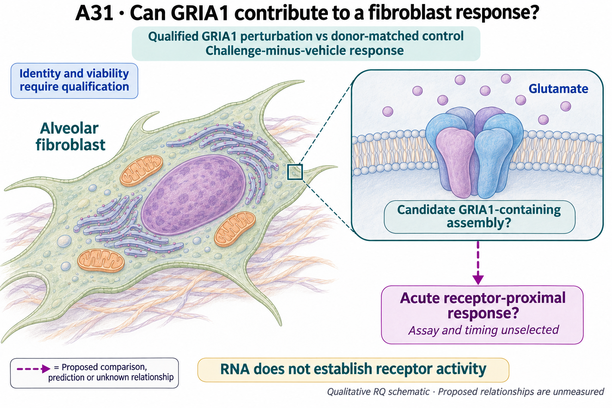

# A31: GRIA1-dependent acute glutamate response in adult alveolar fibroblasts

## Organizing Biological Q

An RNA-defined lung fibroblast population can express neurotransmitter-receptor
genes without having a corresponding acute functional response. A31 asks whether
GRIA1 contributes to glutamate responsiveness in adult alveolar fibroblasts. It
does not presume that these cells are neurons, electrically excitable, a newly
discovered sensory population, or mediators of epithelial repair.

**Unresolved gap:** No current repository measurement establishes membrane-localized GRIA1, acute
glutamate response, target engagement or a response change after GRIA1
perturbation in adult alveolar fibroblasts. RNA co-detection does not bridge
those gaps. Functional assay choice, donor availability, response variability,
meaningful effect margin and sample-size justification remain unknown.

[Full working hypothesis and alternatives](../../docs/research_dossiers/A31.md#working-hypothesis).

<!-- literature-visual-context:start -->

## Literature context & visual hypothesis

[Published findings, repository observations and interpretation limits](LITERATURE_CONTEXT.md).

GPT-generated matte illustration, 3 November 2026. Proposed relationships and
cell counts are qualitative. [Editorial review](../../docs/audits/2026-11-02-rq-schematic-review/MATTE_PUBLICATION_2026-11-03.md) · [Selected edit prompt](schematics/A31_gpt_matte_v1.prompt.txt). Earlier artwork is retained as history.
<!-- literature-visual-context:end -->

## Evidence, analyses and next steps

<!-- evidence-followthrough:start -->
**Evidence follow-through — 3 November 2026:** Exclude the affirmative claim
“GRIA1 RNA establishes receptor response, a sensory cell type or repair.” from current conclusions.
[Bounded fill, stop rule and reopening evidence](../../docs/audits/2026-11-03-rq-evidence-trajectory/CUT_OR_FILL_PLAN.md#a31).
The hypothesis remains a proposal where its decisive comparison is untested.
<!-- evidence-followthrough:end -->

The existing analysis records below retain their scope. Read the latest linked result or amendment before an older plan.

**Proposed — 7 October 2026.** This question follows an exposed Nb4-P09
expression-specificity analysis. It is not an established sensory phenotype or
an executed functional experiment.

[Canonical card](../../RESEARCH_QUESTIONS.md#a31) ·
[Dossier](../../docs/research_dossiers/A31.md) · [Development plan](PLAN.md) ·
[Primary-source context](LITERATURE_CONTEXT.md) ·
[Measured source evidence](../../docs/portfolio_extensions/2026-10-07/g2_niche/RESULTS.md)

### Biological question

Does GRIA1 contribute to a measurable acute glutamate response in independently
identified adult human alveolar fibroblasts? The atlas expression pattern makes
this a testable possibility; it does not supply the response measurement.

The drawing is a qualitative proposal. Its arrows are planned comparisons;
no cell counts, effect sizes or functional results are depicted. SCN7A is
expression context, not a mandatory double-positive gate. Existing source
donors and repeated assays are not counted as new experimental replicates.

### Current status and next step

The article-local RNA run is complete and preserved. The functional test is
unexecuted. Qualify cell identity independently of the candidate genes, adult
anatomical source, surface receptor/target engagement, acute assay validity and
independent donor structure with repeated preparations nested. Then select the primary response,
timing, meaningful effect and precision before freezing a numerical design.
Keep all calibrated nonresponses and ambiguous perturbation outcomes.

No other canonical question is retired. This folder owns the proposed functional
question; Nb4-P09 continues to own its source expression result.
