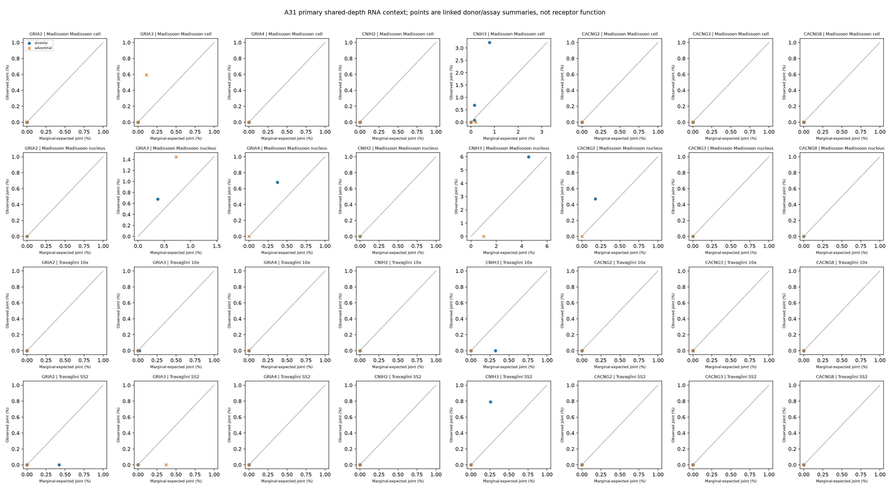
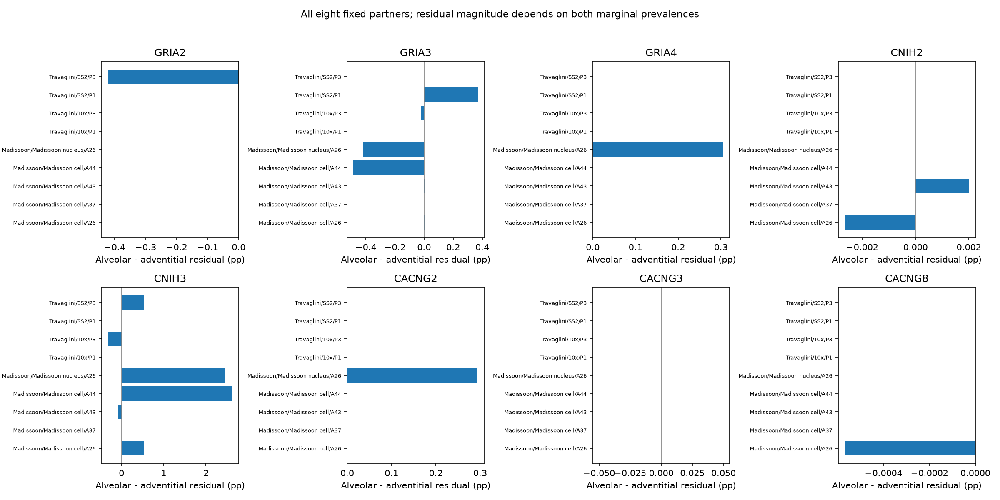

# A31: depth-conditioned receptor-partner RNA context

3 November 2026. [Reviewed specification](../../../docs/research_reviews/2026-11-03-tool-assisted-screening-review/prerequisites/A31_CONDITIONING_SPEC_V1.md), freeze `6b1fe38`, [receipt](../../../analysis/research/runs/A31_depth_conditioned_partner_v1_20261103/receipt.json). The receipt verifies. Independent coordinator arithmetic review passed 81,500 checks (maximum error 1.39e-17); biological and figure review also passed. Review clearance concerns this bounded report, not scientific acceptance of the functional hypothesis. The [prior marginal screen](PARTNER_CONTEXT_V1_RESULTS.md) remains unchanged.

The biological link under examination is whether adult alveolar fibroblasts with GRIA1 RNA also carry a coordinated partner context beyond marginal detection and shared library-depth range. **The result remains source- and partner-dependent, rather than a uniform partner configuration.** CNIH3 shows positive alveolar-minus-adventitial residuals in several contexts, but also negative and zero contexts; the P3 direction differs between SS2 and 10x. Other fixed partners are sparse, negative, heterogeneous or limited to the single supported nucleus donor. This can narrow a localization/context follow-up but does not demonstrate assembled receptors or an acute GRIA1-dependent response.

The endpoint is observed joint detection minus the product of the two marginal detection fractions within shared depth bins, standardized with identical overlap weights for both labels. Primary bins have a maximum/minimum library ratio below approximately 1.414. The coarser two-fold bins are sensitivity only. The original 20-cell floor remains, with at least 20 retained common-bin cells per label and five per label/bin. No target-positive gate, cell-level significance, new score or receptor-activity claim was added.

All 29 original attempted matched strata and eight partners remain output at both widths (464 attempted partner-stratum rows). Fourteen primary strata qualify, giving 112 estimated primary rows and 120 held primary rows; 15 coarse strata qualify. The primary donor summaries contain nine donor/assay contexts: four Madissoon cell donors, one Madissoon nucleus donor, and two Travaglini donors in each of SS2 and 10x. P1/P3 and A26 repeat across assays; these are not nine independent people. Common support retains 31.1–99.3% of alveolar and 44.1–98.1% of adventitial cells across eligible strata, so the result describes a selected overlap population.

All eight fixed partners are shown below. Values are the range across eligible donor/assay summaries of alveolar-minus-adventitial residuals, in percentage points; they are not ranked and cannot be pooled as independent donor replicates. Zero is exact arithmetic, not a test of equivalence or biological independence.

| Partner | Positive / negative / zero contexts | Residual-difference range (pp) |
|---|---:|---:|
| GRIA2 | 0 / 1 / 8 | -0.420673 to +0.000000 |
| GRIA3 | 3 / 3 / 3 | -0.485427 to +0.370370 |
| GRIA4 | 1 / 0 / 8 | +0.000000 to +0.305428 |
| CNIH2 | 1 / 1 / 7 | -0.002659 to +0.002012 |
| CNIH3 | 4 / 2 / 3 | -0.322493 to +2.631652 |
| CACNG2 | 1 / 0 / 8 | +0.000000 to +0.294384 |
| CACNG3 | 0 / 0 / 9 | +0.000000 to +0.000000 |
| CACNG8 | 0 / 1 / 8 | -0.000569 to +0.000000 |

Residual magnitude depends on both marginal prevalences. A target absent in a bin forces its observed and expected joint frequencies to zero; such a result does not establish independence or absent receptor machinery. The [bin primitives](../../../analysis/research/runs/A31_depth_conditioned_partner_v1_20261103/bin_partner_primitives.tsv) retain both marginals, observed and expected joint counts/fractions, weights and support. [All standardized strata](../../../analysis/research/runs/A31_depth_conditioned_partner_v1_20261103/stratum_standardized_context.tsv), [all donor/assay dispositions](../../../analysis/research/runs/A31_depth_conditioned_partner_v1_20261103/donor_context.tsv), [donor influence](../../../analysis/research/runs/A31_depth_conditioned_partner_v1_20261103/donor_influence.tsv) and [depth retention](../../../analysis/research/runs/A31_depth_conditioned_partner_v1_20261103/depth_support.tsv) retain the complete result.

Figure reading: panel axes differ; compare numeric scales, not bar lengths. Zero or absent bars are arithmetic zeros in eligible contexts, not demonstrated independence or absent receptor machinery. Repeated donors across assays remain linked.

The concrete unresolved link is same-cell GRIA1/partner protein localization and function in the stated fibroblast context. The source-dependent CNIH3 RNA pattern is an exploratory context lead, with opposing assay/donor observations retained, not an accepted causal partner or a reason to discard the other seven results. Shared cell state, annotation, ambient RNA and remaining within-bin depth can explain residual association. A genuinely nonoverlapping, compatible donor source could test transport of this RNA context; protein localization and acute-response evidence would address stronger parts of the biological chain. No additional source or intervention is declared qualified here.

The original GRIA1 marginal enrichment is neither replaced nor independently replicated by this conditional reanalysis. SS2 reads, 10x UMIs and external source-count protocols remain explicit. No human retain/reject decision, claim-grade promotion or laboratory-readiness claim follows. Figures were visually inspected for labels and layout; frozen output bytes are retained.
