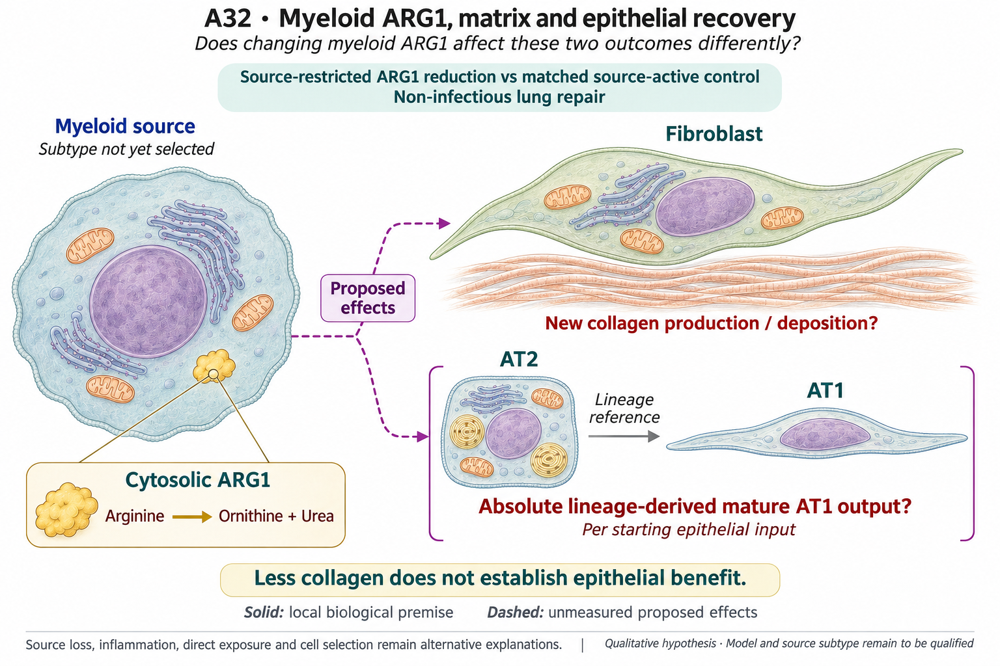

# A32: literature context and current argument

[Question home](README.md) · [Scientific dossier](../../docs/research_dossiers/A32.md).

Synthesis updated 4 November 2026 using the recorded primary-source reviews and
current owning results. Their actual search dates, versions, access and figure
locators remain in the records below. No new literature search or biological run
was performed for this documentation batch.

## Published starting point

| Primary source / version | Finding and exact locator | Reading coverage and role |
|---|---|---|
| [Yadav et al., JCI 2025](https://doi.org/10.1172/JCI188734), published 28 August, issue 3 November 2025 | Fig. 3E/J: ARG1-related source/intervention effects on fibrosis/collagen. Fig. 2 distinguishes the prominent human source from the mouse macrophage setting. | Prior article review reused; current indexed primary Results/Fig. 3 text checked. JCI full-page open timed out; PMC challenged. Published matrix premise, not a mature lineage-output result. |
| [Hamanaka et al., Biochem. J. 2025](https://doi.org/10.1042/BCJ20253033), published 17 June 2025 | Figs. 3–6 distinguish fibroblast arginine handling from its requirement for activation/signaling. | Prior full-JATS/figure/supplement qualification reused; current indexed primary Results checked. Nutrient/recipient-context alternative; this is not source ARG1 perturbation evidence. |
| [Li et al., Stem Cell Reports 2026](https://doi.org/10.1016/j.stemcr.2026.102979), online 2 July, collection 14 July 2026 | Fig. 6H–J measures organoid formation/diameter; Fig. 6K–M adds RNA and staining evidence for differentiation under mesenchymal Atg5 loss. | Current PMC Results and caption read; prior T0 full-JATS, Fig. 2/6 and supplement review reused. A different perturbation and endpoint precedent, not a qualified ARG1-dependent mature-function test. |
| [PLOS ONE 2013 primary study](https://doi.org/10.1371/journal.pone.0061961), *Role of Arginase 1 from Myeloid Cells in Th2-Dominated Lung Inflammation* | Abstract reports no detected collagen/inflammatory phenotype across its tested contexts despite myeloid Arg1 loss. | Indexed primary abstract only; direct PMC challenge and PLOS timeout. A boundary against universal ARG1 claims; no claim that those models are interchangeable with Yadav or the proposed comparison. |

The [31 October T0 report](../Yadav_followups_20261031/T0_RESULTS.md) records
exact earlier source versions, figure/supplement access and local hashed
qualification. These reads and reanalyses share source lineages; they do not
create independent replication. Reviews and commercial search hits were not
used as primary evidence.

Yadav's ARG1-related fibrosis result supplies a matrix premise; Hamanaka's fibroblast arginine work supplies a recipient-context alternative. Li's Atg5 study measures distinct organoid and differentiation endpoints under another perturbation, and the older myeloid Arg1-loss study cautions against universal effects. The [dated primary-source review](../../RQ_Specified/A32_myeloid_arg1_matrix_epithelial_recovery/LITERATURE_CONTEXT.md#published-starting-point) keeps those findings separate. Truchi's public resolution atlas motivates the completed RNA context screen; it is not an ARG1 intervention or independent replication of its own publication.

## Repository observation

The [current GSE234197 result](../../RQ_Specified/A32_myeloid_arg1_matrix_epithelial_recovery/reports/RESOLUTION_CONTEXT_RESULTS_V1.md) uses 36 source mice in six age/day captures, with three BLM and three PBS mice per capture. Days are cross-sectional. Source-defined mouse/state log2(CPM+1) RNA is compared as equal-mouse mean BLM minus PBS; cells and repeated genes do not add biological units.

| Fixed family | Estimated / planned | What the support permits |
|---|---:|---|
| Source myeloid states | 66 / 180 | Selected state/gene contrasts; missing support remains explicit. |
| Fibroblasts | 4 / 24 | Only young D14 has full arm support. |
| AT1/AT2 | 0 / 84 | All epithelial contrasts are unestimated, not null. |
| Pooled AM_all, secondary | 18 / 18 | Composition-sensitive context, not restored within-state support. |

The full panel has 306 dispositions: 88 estimates and 218 unsupported comparisons. Young-D14 AM1 Arg1 and fibroblast Col1a1/Col3a1/Fn1 differences are positive. BLM AM2/AM3 carry more observed Arg1 RNA than AM1, including after library-size normalization, but their PBS support is insufficient for within-state induction estimates. Young-D60 AM1's positive transformed contrast comes from only **2–5 Arg1 UMIs per BLM mouse**; it does not establish persistent programme activity. These are RNA observations, not ARG1 protein activity, deposited collagen or epithelial output.

The [Speth GSE328925 access record](../../RQ_Specified/A32_myeloid_arg1_matrix_epithelial_recovery/reports/RESOLUTION_SCREEN_HOLD_V1.md) documents a separate private-source hold checked on 3 November. Its earlier public-alternative nomination is superseded by the completed GSE234197 report; the access hold does not mean no public RNA analysis ran.

## Does the evidence warrant the narrowing?

**Rationale verdict: an exploratory source-population lead and a useful support boundary; the joint functional inference is incomplete.** The completion count is not biological narrowing. AM2/AM3 are candidates for observed Arg1-bearing populations under early injury, not validated source-specific ARG1 induction or a source–matrix circuit. Early AM1/fibroblast co-occurrence cannot assign direction or mediation. Sparse late counts cannot establish persistence.

Published narratives and prior outcomes were exposed; the panel and support rule preceded new expression estimates. Highlighting a source label after inspecting the fixed panel does not establish target priority. Shared injury severity, capture, relative recovery, within-label composition and background RNA remain alternatives. Raw age/day differences are capture-confounded, and the same deposited mice do not become independent validation. Nothing here selects a favorable epithelial response or demonstrates random noise.

## What remains unmeasured

Linked source ARG1 exposure, matrix production/deposition and mature epithelial output are missing. The public dataset cannot estimate the intended epithelial comparison and supplies no ARG1 perturbation. AM2/AM3 labels are not automatically another paper's myeloid subtype.

The unchanged registered hypothesis below is a proposal. The rationale assessment
does not select its mechanism or confer scientific acceptance.

## Current hypothesis and rival

This is perturbation-effect estimation with no invented direction for epithelial
function. Compare a qualified source-restricted myeloid ARG1 reduction with
matched source-active control in a non-infectious lung-repair system. Estimate
absolute lineage-derived mature AT1 output per starting epithelial input and,
separately, newly produced/deposited collagen in the same biological design.
Actual source/fibroblast/epithelial donors or animals and their crossing/nesting
define units. Timing, species/model, mature-function assay and effect margin
remain unspecified until qualification.

The principal threat is source loss, altered inflammation, direct recipient
exposure or epithelial/fibroblast selection being mistaken for restored niche
support or maturation. Those explanations need measurement appropriate to the
claim; a bounded intervention effect does not automatically identify mediation.

## What the comparison would teach

A qualified source-restricted ARG1 contrast could yield less matrix with higher mature output, or less matrix with poorer output; both are informative joint effects. An imprecise epithelial result leaves uncertainty, not preserved function. Estimating those effects does not automatically identify fibroblast mediation. A narrower source/context description can also be useful without claiming the joint function.

Retain the completed RNA context result and the separate access hold. Reopening the registered comparison requires a source with linked biological units, credible source restriction and suitable matrix/mature-output measurements. Further expression summaries in the same sparsely epithelial atlas cannot supply that missing joint endpoint. A new source or intervention needs its own specific rationale; no old plan restarts automatically.

## Hypothesis schematic

GPT-generated matte illustration, 3 November 2026. Proposed relationships and cell counts are qualitative; the owning context defines the comparison and interpretation limits. [Editorial review](../../docs/audits/2026-11-02-rq-schematic-review/MATTE_PUBLICATION_2026-11-03.md) · [Selected edit prompt](schematics/A32_gpt_matte_v1.prompt.txt). Earlier SVG files are retained as history.

A linked cytosolic callout retains the local ARG1 conversion of arginine to ornithine and urea without asserting metabolite transfer or a complete intercellular mechanism. The myeloid subtype remains unspecified. Fibroblast collagen production/deposition and absolute lineage-derived mature AT1 output are separate proposed effects; the compact AT2-to-AT1 reference does not establish the effect or matrix mediation.

Class-level glyphs and qualitative geometry are not molecular structures, organelle measurements or evidence of functional assembly. Neutral epithelial/stromal shapes do not assert subtype identity or organelle loss, and icon counts are illustrative. Read locally labelled solid premises/references separately from dashed proposed comparisons; no complete mechanism follows from their juxtaposition.

Both endpoints remain separate. Source restriction, lineage and mature-function qualification precede interpretation. The rejected text-only draft remains in [history](../../docs/history/2026-11-02-navigation-hygiene/A32_hypothesis_v1.svg). Source records stay under Yd1-P02/Wg-P06 and the paper package; [PLAN.md](PLAN.md) retains the eligibility steps.

## Earlier source and development records

The following records preserve dated searches, access limits, outcome exposure,
earlier interpretations and review blocks. Read current results/amendments above
before any older plan. Planned queries remain plans; an absent hit never proves
novelty or global data absence. A newly specified comparison needs its relevant
source review under the [literature workflow](../../docs/governance/LITERATURE_WORKFLOW.md).

Dated source searches and retained development notes

[Question home](README.md) · [Scientific dossier](../../docs/research_dossiers/A32.md).

<!-- full-priority-screening-20261103:start -->
**Screening follow-through — 3 November 2026:** Reuse the public GSE234197 compartment screen: 306 contrast dispositions include 88 estimates and 218 unsupported comparisons. Myeloid ARG1 and matrix RNA can be described in supported contexts; epithelial contrasts remain unsupported. Sparse AT1/AT2 sampling leaves all 84 epithelial contrasts unestimated. Linked ARG1 exposure, matrix function and mature epithelial recovery are missing, and the previously checked GSE328925 release remains private. These are distinct limits, not a completed joint-outcome mechanism. [Reviewed screening sequence](../../docs/research_reviews/2026-11-03-full-priority-screening/PLANS.md) · [Coordination and review](../../docs/research_reviews/2026-11-03-full-priority-screening/README.md).
<!-- full-priority-screening-20261103:end -->

2 November 2026, Asia/Seoul. Codex review following the owner's authorization to
assess and register distinct RQs. Base source revision: main `96e6a8d`.
Reuses the reviewed Yd1-P02 source/design record of 31 October, with a targeted
primary-literature refresh today. Published and repository outcomes were already
exposed. Registration adds no new numerical experiment or novelty certification.

## Repository observation

The prior [Yd1-P02 plan](../Yadav_followups_20261031/RQ3_MATRIX_AND_REPAIR.md)
already separates collagen from absolute mature epithelial output. The
[reviewed T2 disposition](../Yadav_followups_20261031/T2_DISPOSITION.md) found no
qualified joint dataset or confirmed model/assay access. The Hamanaka-derived
[T1-B description](../Yadav_followups_20261031/T1B_RESULTS.md) is processed-source
substrate evidence under Wg-P06, not an epithelial effect. Existing A13 proxy
failure and A8/A19/A20 functional holds are retained, not rescued by this proposal.

## What this question could add

The contribution is a proposed **joint functional-endpoint extension**: estimate
matrix and mature epithelial consequences of the same source-restricted ARG1
comparison. It does not rediscover myeloid–fibroblast crosstalk or assume that
less matrix restores a niche. Unlike A8's prediction, A13's specified fibroblast
output, A20's Fzd2/Fzd1 contrast and A19's receptor-input schedule, the primary
estimand concerns a myeloid metabolic source intervention and two linked outcomes.
The source-study distinction is insufficient by itself; that changed contrast
and endpoint relationship is the reason for separate registration.

## What the comparison would teach

Reduced matrix with improved mature output supports a favorable joint response
in the tested context; reduced matrix with poorer output identifies a possible
tradeoff. An unresolved epithelial effect retains uncertainty rather than
implying preserved function. Source/recipient loss can limit attribution even
when both outcomes change. RNA, organoid size and proportions cannot substitute
for lineage and a calibrated mature endpoint. No composite repair score or
cross-paper correlation is proposed.

## Next literature check

Actual service/date: web search/open/find, 2 November 2026. Recent coverage
considered 2024–2026 plus an unrestricted older boundary search. Queries:

- `myeloid arginase 1 pulmonary fibrosis alveolar epithelial regeneration collagen 2025 2026`
- `fibroblast Atg5 alveolar regeneration organoid 2026 arginine arginase`
- `arginase 1 myeloid deletion lung fibrosis epithelial repair no effect arginase 2014 2025`
- `"Arginine promotes the activation of human lung fibroblasts independent of its metabolism"`
- `"myeloid" "ARG1" "alveolar" "regeneration" "2026"`
- `"arg inase" collagen mature epithelial repair lineage` (misspelled discovery query; not evidence)
- `"188734" "correction" OR "retraction" "Atg5 deficiency"`
- `"10.1016/j.stemcr.2026.102979" correction retraction`
- `"10.1042/BCJ20253033" correction retraction`
- `"10.1172/JCI188734" correction retraction`
- `site:jci.org/articles/view/188734 "Figure 3" "Figure 6"`
- `site:journals.plos.org/plosone/article?id=10.1371/journal.pone.0061961 "collagen" "Figure"` (unrelated hits excluded)

Known primary records were followed from search to publisher/PMC/PubMed pages;
no systematic forward-citation export or new supplement-wide audit was done.
The current full-text Atg5 read and indexed Yadav/Hamanaka Results supplement,
rather than replace, the prior source qualification. Exact-DOI correction queries
surfaced no specific notice in inspected hits; this is not integrity clearance.

An indexed [2026 lineage-tracing study](https://doi.org/10.1038/s41421-025-00859-0)
was a new lead, but the publisher identity redirect prevented a full Results/
methods inspection; it is not supporting proof of an ARG1 effect. Other metabolic
and mesothelial preprints/reviews remain unassessed leads. No source-access
challenge was bypassed. Missing search hits do not establish novelty.

Reopen the review when a specific model, source intervention, mature endpoint
or linked dataset is nominated. That is when its closest comparison and strongest
alternative must be refreshed; broad literature coverage cannot supply those
missing laboratory facts.

## Literature-informed screening disposition — 3 November 2026

The Speth temporal screen is held because the cited GEO series is currently private despite the article data statement. Source pooling also prevents assumed mouse independence. No ARG1/matrix/epithelial temporal effect was computed. [Exact source evidence and reopening condition](reports/RESOLUTION_SCREEN_HOLD_V1.md). No canonical hypothesis, registered illustration or scientific acceptance changes.

## Public resolution-context branch — 3 November 2026

The owner authorized a GSE234197 screen after the Speth access hold. This is a
bounded shared-source RNA reanalysis, not the canonical ARG1 perturbation test.
The [prospective specification](reports/RESOLUTION_SCREEN_SPEC_V1.md) and
[execution ledger](reports/RESOLUTION_EXECUTION_LEDGER_V1.md) own its state.

Today's targeted primary-source refresh used web search/open and public
EuropePMC full-text XML. Queries included `"Evidence for a lipofibroblast-to-Cthrc1" "resolution" Truchi`,
`"bleomycin" "resolution" "Arg1" "2025" macrophage epithelial`,
`"Strunz" "2020" "Krt8" "Cldn4"`,
`"Collagen-producing lung cell atlas" "Fn1"`, and
`"Inflammatory Signals Induce AT2" "PMC"`. Coverage was 2024–2026 resolution
work plus close 2020 precedents; the broader 2 November scan above is reused.
This is targeted coverage, not a systematic review or novelty clearance.

| Primary source/version and exact locator | Role and limit |
|---|---|
| [Truchi 2025](https://doi.org/10.1038/s41467-025-62431-4), PMC12328796 current XML; Fig. 2A–C, S2E/F, Methods HTO/integration/DE | Whole-lung age×stage design; similar macrophage-subset abundance dynamics across ages is contrary context. Published reads and source-code inspection completed; deposited support is a separate check. |
| [Speth 2026 preprint v1](https://pmc.ncbi.nlm.nih.gov/articles/PMC13082050/), Fig. 3D/E and mesenchymal Results/Discussion | Arg1/Spp1/Trem2 as separate contextual myeloid features. Reported lack of substantial Cthrc1 in that model cautions against a universal fibrosis marker. Public full XML read; its data access/pooling hold is unchanged. |
| [Tsukui 2020](https://doi.org/10.1038/s41467-020-15647-5), Results “Cthrc1+ cells express pathologic ECM genes”, Fig. 4A | Cthrc1, Col1a1, Col3a1 and Fn1 motivate four separate fibroblast RNA endpoints. Indexed primary Results and published-paper excerpt read; no protein deposition is inferred. |
| [Choi 2020](https://pmc.ncbi.nlm.nih.gov/articles/PMC7487779/), Figs. 1D, 2I/J, 4H/I, 7A–C/E | Sftpc/Abca3 AT2 context, Krt8/Cldn4 transition-associated RNA, Hopx early-AT1 and Aqp5 later-AT1 reference. Current full XML/captions read. The paper itself separates early identity from later differentiation; these RNA features do not measure mature function here. |
| [Strunz 2020](https://pmc.ncbi.nlm.nih.gov/articles/PMC7366678/), Fig. 7A–F and Fig. 8A–E | Sftpc and Ager lineage/identity reference and Krt8 transition context. Current XML Results/captions read; this cross-sectional screen has no lineage tracing. |
| [Lingampally et al., ERJ 2025 (online 2024)](https://publications.ersnet.org/content/erj/65/2/2300482), indexed Results Fig. 2A–C | Closest recent Cthrc1 resolution precedent. Publisher full-page access returned 403; only indexed primary excerpts read. No claim of complete reading, independent source replication or novel reversible-switch discovery. |

The chain is published population/marker results → the repository's unresolved
joint-outcome question → a time-matched descriptive RNA screen → possible
concordant, divergent or unsupported stages. This is context nomination, not
new evidence for the published metabolic mechanism. Shared severity, capture,
selection and within-label substate composition remain alternatives. Source
histology/hydroxyproline are not linked to sequenced mice without identity proof.

The completed [public-source result](reports/RESOLUTION_CONTEXT_RESULTS_V1.md)
retains early BLM AM2/AM3 as source-population leads based on observed Arg1 RNA,
with no supported within-state PBS comparison. Young-D14 fibroblast matrix RNA
co-occurs with myeloid Arg1 observations; later matrix and all epithelial
condition contrasts remain unestimated. The late AM1 signal is only 2–5 UMIs
per BLM mouse, not evidence of a maintained programme. The intended joint
resolution discriminator therefore remains unanswered; no mechanism or claim
grade was promoted.

