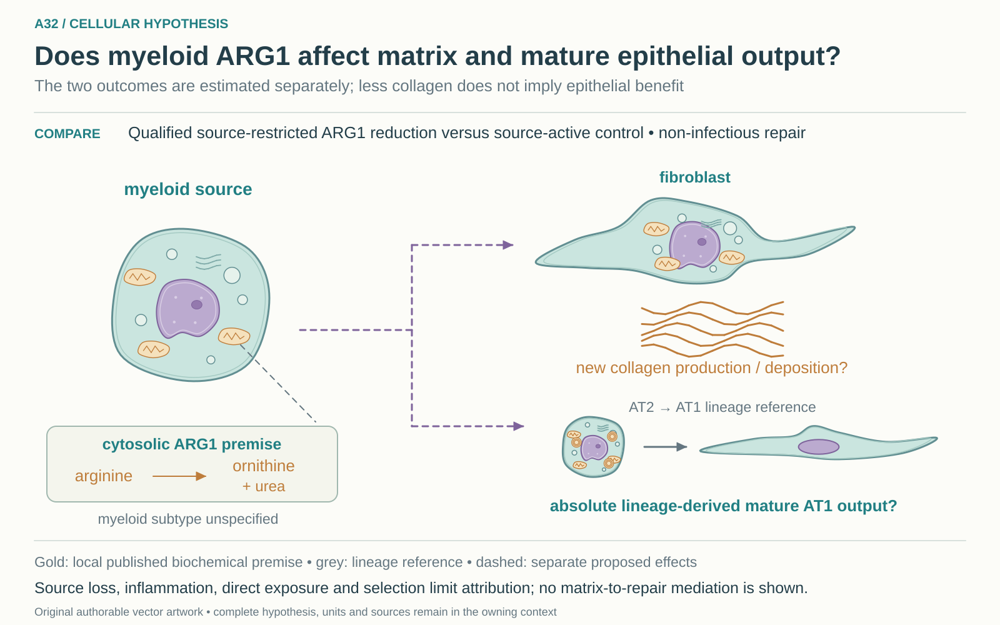

# A32: literature context and proposed joint-outcome comparison

2 November 2026, Asia/Seoul. Codex review following the owner's authorization to
assess and register distinct RQs. Base source revision: main `96e6a8d`.
Reuses the reviewed Yd1-P02 source/design record of 31 October, with a targeted
primary-literature refresh today. Published and repository outcomes were already
exposed. Registration adds no new numerical experiment or novelty certification.

## Published starting point

| Primary source / version | Finding and exact locator | Reading coverage and role |
|---|---|---|
| [Yadav et al., JCI 2025](https://doi.org/10.1172/JCI188734), published 28 August, issue 3 November 2025 | Fig. 3E/J: ARG1-related source/intervention effects on fibrosis/collagen. Fig. 2 distinguishes the prominent human source from the mouse macrophage setting. | Prior article review reused; current indexed primary Results/Fig. 3 text checked. JCI full-page open timed out; PMC challenged. Published matrix premise, not a mature lineage-output result. |
| [Hamanaka et al., Biochem. J. 2025](https://doi.org/10.1042/BCJ20253033), published 17 June 2025 | Figs. 3–6 distinguish fibroblast arginine handling from its requirement for activation/signaling. | Prior full-JATS/figure/supplement qualification reused; current indexed primary Results checked. Nutrient/recipient-context alternative; this is not source ARG1 perturbation evidence. |
| [Li et al., Stem Cell Reports 2026](https://doi.org/10.1016/j.stemcr.2026.102979), online 2 July, collection 14 July 2026 | Fig. 6H–J measures organoid formation/diameter; Fig. 6K–M adds RNA and staining evidence for differentiation under mesenchymal Atg5 loss. | Current PMC Results and caption read; prior T0 full-JATS, Fig. 2/6 and supplement review reused. A different perturbation and endpoint precedent, not a qualified ARG1-dependent mature-function test. |
| [PLOS ONE 2013 primary study](https://doi.org/10.1371/journal.pone.0061961), *Role of Arginase 1 from Myeloid Cells in Th2-Dominated Lung Inflammation* | Abstract reports no detected collagen/inflammatory phenotype across its tested contexts despite myeloid Arg1 loss. | Indexed primary abstract only; direct PMC challenge and PLOS timeout. A boundary against universal ARG1 claims; no claim that those models are interchangeable with Yadav or the proposed comparison. |

The [31 October T0 report](../Yadav_followups_20261031/T0_RESULTS.md) records
exact earlier source versions, figure/supplement access and local hashed
qualification. These reads and reanalyses share source lineages; they do not
create independent replication. Reviews and commercial search hits were not
used as primary evidence.

## Repository observation

The prior [Yd1-P02 plan](../Yadav_followups_20261031/RQ3_MATRIX_AND_REPAIR.md)
already separates collagen from absolute mature epithelial output. The
[reviewed T2 disposition](../Yadav_followups_20261031/T2_DISPOSITION.md) found no
qualified joint dataset or confirmed model/assay access. The Hamanaka-derived
[T1-B description](../Yadav_followups_20261031/T1B_RESULTS.md) is processed-source
substrate evidence under Wg-P06, not an epithelial effect. Existing A13 proxy
failure and A8/A19/A20 functional holds are retained, not rescued by this proposal.

## What this question could add

The contribution is a proposed **joint functional-endpoint extension**: estimate
matrix and mature epithelial consequences of the same source-restricted ARG1
comparison. It does not rediscover myeloid–fibroblast crosstalk or assume that
less matrix restores a niche. Unlike A8's prediction, A13's specified fibroblast
output, A20's Fzd2/Fzd1 contrast and A19's receptor-input schedule, the primary
estimand concerns a myeloid metabolic source intervention and two linked outcomes.
The source-study distinction is insufficient by itself; that changed contrast
and endpoint relationship is the reason for separate registration.

## Current hypothesis and rival

This is perturbation-effect estimation with no invented direction for epithelial
function. Compare a qualified source-restricted myeloid ARG1 reduction with
matched source-active control in a non-infectious lung-repair system. Estimate
absolute lineage-derived mature AT1 output per starting epithelial input and,
separately, newly produced/deposited collagen in the same biological design.
Actual source/fibroblast/epithelial donors or animals and their crossing/nesting
define units. Timing, species/model, mature-function assay and effect margin
remain unspecified until qualification.

The principal threat is source loss, altered inflammation, direct recipient
exposure or epithelial/fibroblast selection being mistaken for restored niche
support or maturation. Those explanations need measurement appropriate to the
claim; a bounded intervention effect does not automatically identify mediation.

## What the comparison would teach

Reduced matrix with improved mature output supports a favorable joint response
in the tested context; reduced matrix with poorer output identifies a possible
tradeoff. An unresolved epithelial effect retains uncertainty rather than
implying preserved function. Source/recipient loss can limit attribution even
when both outcomes change. RNA, organoid size and proportions cannot substitute
for lineage and a calibrated mature endpoint. No composite repair score or
cross-paper correlation is proposed.

## Hypothesis schematic

[Editable cellular SVG](schematics/hypothesis_cellular_v1.svg), source revision `862f3335bad7700ba89ce8d5bcc794c7c9094fbc`. This 2 November 2026 redraw supersedes the [prior illustration](schematics/hypothesis_v2.svg) for display; that SVG remains unchanged. The working hypothesis, source evidence and scientific disposition are unchanged.

A linked cytosolic callout retains the local ARG1 conversion of arginine to ornithine and urea without asserting metabolite transfer or a complete intercellular mechanism. The myeloid subtype remains unspecified. Fibroblast collagen production/deposition and absolute lineage-derived mature AT1 output are separate proposed effects; the compact AT2-to-AT1 reference does not establish the effect or matrix mediation.

Class-level glyphs and qualitative geometry are not molecular structures, organelle measurements or evidence of functional assembly. Neutral epithelial/stromal shapes do not assert subtype identity or organelle loss, and icon counts are illustrative. Read locally labelled solid premises/references separately from dashed proposed comparisons; no complete mechanism follows from their juxtaposition.

Both endpoints remain separate. Source restriction, lineage and mature-function qualification precede interpretation. The rejected text-only draft remains in [history](../../docs/history/2026-11-02-navigation-hygiene/A32_hypothesis_v1.svg). Source records stay under Yd1-P02/Wg-P06 and the paper package; [PLAN.md](PLAN.md) retains the eligibility steps.

## Next literature check

Actual service/date: web search/open/find, 2 November 2026. Recent coverage
considered 2024–2026 plus an unrestricted older boundary search. Queries:

- `myeloid arginase 1 pulmonary fibrosis alveolar epithelial regeneration collagen 2025 2026`
- `fibroblast Atg5 alveolar regeneration organoid 2026 arginine arginase`
- `arginase 1 myeloid deletion lung fibrosis epithelial repair no effect arginase 2014 2025`
- `"Arginine promotes the activation of human lung fibroblasts independent of its metabolism"`
- `"myeloid" "ARG1" "alveolar" "regeneration" "2026"`
- `"arg inase" collagen mature epithelial repair lineage` (misspelled discovery query; not evidence)
- `"188734" "correction" OR "retraction" "Atg5 deficiency"`
- `"10.1016/j.stemcr.2026.102979" correction retraction`
- `"10.1042/BCJ20253033" correction retraction`
- `"10.1172/JCI188734" correction retraction`
- `site:jci.org/articles/view/188734 "Figure 3" "Figure 6"`
- `site:journals.plos.org/plosone/article?id=10.1371/journal.pone.0061961 "collagen" "Figure"` (unrelated hits excluded)

Known primary records were followed from search to publisher/PMC/PubMed pages;
no systematic forward-citation export or new supplement-wide audit was done.
The current full-text Atg5 read and indexed Yadav/Hamanaka Results supplement,
rather than replace, the prior source qualification. Exact-DOI correction queries
surfaced no specific notice in inspected hits; this is not integrity clearance.

An indexed [2026 lineage-tracing study](https://doi.org/10.1038/s41421-025-00859-0)
was a new lead, but the publisher identity redirect prevented a full Results/
methods inspection; it is not supporting proof of an ARG1 effect. Other metabolic
and mesothelial preprints/reviews remain unassessed leads. No source-access
challenge was bypassed. Missing search hits do not establish novelty.

Reopen the review when a specific model, source intervention, mature endpoint
or linked dataset is nominated. That is when its closest comparison and strongest
alternative must be refreshed; broad literature coverage cannot supply those
missing laboratory facts.
