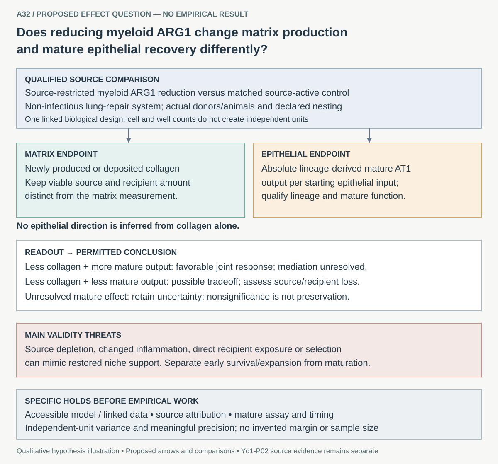

# A32: myeloid ARG1, matrix production and mature epithelial recovery

**Proposed — 2 November 2026.** Does source-restricted myeloid ARG1 reduction
change matrix production and mature epithelial recovery differently? This
canonical question develops Yd1-P02's existing functional-extension plan.
Its empirical effects have not been measured here; registration does not imply
scientific acceptance or readiness to run an experiment.

[Canonical card](../../RESEARCH_QUESTIONS.md#a32) ·
[Dossier](../../docs/research_dossiers/A32.md) · [Plan](PLAN.md) ·
[Literature context](LITERATURE_CONTEXT.md) ·
[Registration assessment](../../docs/audits/2026-11-02-navigation-hygiene/RQ_ASSESSMENT.md).

The illustration is a qualitative proposed comparison, not a measured result.
Reduced collagen does not assign the direction of epithelial recovery.

| Element | Current specification |
|---|---|
| Purpose | Estimate separate matrix and epithelial effects in one qualified biological design |
| Comparison | Source-restricted myeloid ARG1 reduction versus matched source-active control in a non-infectious lung-repair system |
| Biological units | Actual source, fibroblast and epithelial donors/animals with declared crossing/nesting; images, cells and wells are nested |
| Endpoints | Absolute lineage-derived mature AT1 output per starting epithelial input; separately, newly produced/deposited collagen |
| Main validity threat | Source loss, changed inflammation, direct recipient exposure or cell selection misread as niche-mediated maturation |
| Informative outcomes | Favorable joint response, matrix/epithelial tradeoff, or an unresolved epithelial effect; retain every outcome |

## Evidence and present holds

The [original source/endpoint review](../Yadav_followups_20261031/T0_RESULTS.md)
and [reviewed disposition](../Yadav_followups_20261031/T2_DISPOSITION.md) found no
eligible joint dataset or confirmed host model. Existing isotope/RNA/organoid
descriptions do not constitute an A32 perturbation effect. The assay for mature
function, timing, source attribution, independent-unit variance and meaningful
effect/precision must still be qualified. A marker panel or organoid diameter
cannot substitute for those measurements.

## Ownership and next step

This folder owns future A32 development. The historical
[Yd1-P02 plan](../Yadav_followups_20261031/RQ3_MATRIX_AND_REPAIR.md), source reports,
Wg-P06 substrate work and all frozen contracts/receipts stay at their existing
paths. Their prior exposure and unfavorable results remain explicit.

Next: qualify the specific linked model/data and endpoints in [PLAN.md](PLAN.md).
No numerical or bench execution follows automatically from registration, and
no existing canonical question is retired or reworded.
