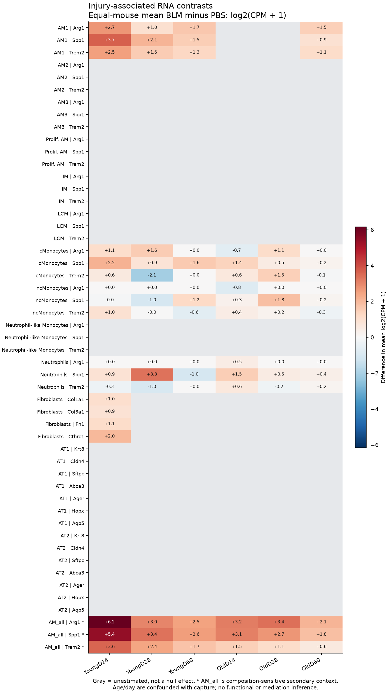

# A32: myeloid ARG1, matrix and epithelial recovery

## Organizing Biological Q

Does reducing source-restricted myeloid ARG1 change matrix production and mature epithelial recovery in the same repair context? Less collagen does not determine the direction of the epithelial effect. The completed public RNA screen supplies early source/context observations, while the registered joint functional comparison remains unmeasured.

Current synthesis: 4 November 2026. [Literature context](LITERATURE_CONTEXT.md) ·
[Dossier](../../docs/research_dossiers/A32.md) · [Canonical card](../../RESEARCH_QUESTIONS.md#a32).

<!-- literature-visual-context:start -->

## Literature context & visual hypothesis

[Published findings, repository observations and interpretation limits](LITERATURE_CONTEXT.md).

GPT-generated matte illustration, 3 November 2026. Proposed relationships and
cell counts are qualitative. [Editorial review](../../docs/audits/2026-11-02-rq-schematic-review/MATTE_PUBLICATION_2026-11-03.md) · [Selected edit prompt](schematics/A32_gpt_matte_v1.prompt.txt). Earlier artwork is retained as history.
<!-- literature-visual-context:end -->

Yadav's ARG1-related fibrosis result supplies a matrix premise; Hamanaka's fibroblast arginine work supplies a recipient-context alternative. Li's Atg5 study measures distinct organoid and differentiation endpoints under another perturbation, and the older myeloid Arg1-loss study cautions against universal effects. The [dated primary-source review](../../RQ_Specified/A32_myeloid_arg1_matrix_epithelial_recovery/LITERATURE_CONTEXT.md#published-starting-point) keeps those findings separate. Truchi's public resolution atlas motivates the completed RNA context screen; it is not an ARG1 intervention or independent replication of its own publication.

The retained illustration describes the registered proposal. Its dashed relationships
are unmeasured; the completed comparisons below have their own narrower endpoints.

## Evidence, analyses and next steps

The [current GSE234197 result](../../RQ_Specified/A32_myeloid_arg1_matrix_epithelial_recovery/reports/RESOLUTION_CONTEXT_RESULTS_V1.md) uses 36 source mice in six age/day captures, with three BLM and three PBS mice per capture. Days are cross-sectional. Source-defined mouse/state log2(CPM+1) RNA is compared as equal-mouse mean BLM minus PBS; cells and repeated genes do not add biological units.

| Fixed family | Estimated / planned | What the support permits |
|---|---:|---|
| Source myeloid states | 66 / 180 | Selected state/gene contrasts; missing support remains explicit. |
| Fibroblasts | 4 / 24 | Only young D14 has full arm support. |
| AT1/AT2 | 0 / 84 | All epithelial contrasts are unestimated, not null. |
| Pooled AM_all, secondary | 18 / 18 | Composition-sensitive context, not restored within-state support. |

The full panel has 306 dispositions: 88 estimates and 218 unsupported comparisons. Young-D14 AM1 Arg1 and fibroblast Col1a1/Col3a1/Fn1 differences are positive. BLM AM2/AM3 carry more observed Arg1 RNA than AM1, including after library-size normalization, but their PBS support is insufficient for within-state induction estimates. Young-D60 AM1's positive transformed contrast comes from only **2–5 Arg1 UMIs per BLM mouse**; it does not establish persistent programme activity. These are RNA observations, not ARG1 protein activity, deposited collagen or epithelial output.

The [Speth GSE328925 access record](../../RQ_Specified/A32_myeloid_arg1_matrix_epithelial_recovery/reports/RESOLUTION_SCREEN_HOLD_V1.md) documents a separate private-source hold checked on 3 November. Its earlier public-alternative nomination is superseded by the completed GSE234197 report; the access hold does not mean no public RNA analysis ran.

The complete fixed panel retains unsupported gray contrasts. Gray is unestimated, not absence of expression or effect; AM2/AM3 have observed BLM Arg1 RNA but insufficient PBS support. AM_all is composition-sensitive. The owning report retains pointwise intervals, sparse counts and all mouse values.

## Does the evidence warrant the narrowing?

**Rationale verdict: an exploratory source-population lead and a useful support boundary; the joint functional inference is incomplete.** The completion count is not biological narrowing. AM2/AM3 are candidates for observed Arg1-bearing populations under early injury, not validated source-specific ARG1 induction or a source–matrix circuit. Early AM1/fibroblast co-occurrence cannot assign direction or mediation. Sparse late counts cannot establish persistence.

Published narratives and prior outcomes were exposed; the panel and support rule preceded new expression estimates. Highlighting a source label after inspecting the fixed panel does not establish target priority. Shared injury severity, capture, relative recovery, within-label composition and background RNA remain alternatives. Raw age/day differences are capture-confounded, and the same deposited mice do not become independent validation. Nothing here selects a favorable epithelial response or demonstrates random noise.

## What a further comparison would decide

A qualified source-restricted ARG1 contrast could yield less matrix with higher mature output, or less matrix with poorer output; both are informative joint effects. An imprecise epithelial result leaves uncertainty, not preserved function. Estimating those effects does not automatically identify fibroblast mediation. A narrower source/context description can also be useful without claiming the joint function.

Retain the completed RNA context result and the separate access hold. Reopening the registered comparison requires a source with linked biological units, credible source restriction and suitable matrix/mature-output measurements. Further expression summaries in the same sparsely epithelial atlas cannot supply that missing joint endpoint. A new source or intervention needs its own specific rationale; no old plan restarts automatically.

**Current boundary:** RNA abundance is not ARG1 activity, collagen deposition, lineage-derived mature function or repair. The epithelial direction remains unspecified. Source restrictions, species/context and actual assay access are unresolved; no intervention setting or effect margin is selected.

## Registered scope and earlier records

The complete earlier framing below retains its dated scope and registered hypotheses.
Current results and amendments govern interpretation. Older unfinished-work, source-access
or priority statements do not supersede this synthesis or start an execution queue.
Registration and completed analysis confer neither human acceptance nor a claim promotion.

Registered framing, source links and retained development history

## Organizing Biological Q

Does a source-restricted change in myeloid ARG1 have different consequences for
matrix production and mature epithelial recovery in a qualified lung repair
context? Reduced fibrosis-related measurements do not by themselves establish
regeneration. A32 asks for those two effects in the same interpretable design,
with fibroblast involvement assessed rather than assumed.

**Unresolved gap:** The missing information is the paired biological-unit effect on newly produced
or deposited matrix and absolute lineage-derived mature epithelial output under
qualified myeloid-source ARG1 restriction. Neither an unlinked atlas nor a
matrix/RNA score supplies that joint effect. Source identity, intervention
specificity, mature endpoint validity, model access and precision are unresolved.

[Full working hypothesis and alternatives](../../docs/research_dossiers/A32.md#working-hypothesis).

## Evidence, analyses and next steps

<!-- full-priority-screening-20261103:start -->
**Screening follow-through — 3 November 2026.** Reuse the public GSE234197 compartment screen: 306 contrast dispositions include 88 estimates and 218 unsupported comparisons. Myeloid ARG1 and matrix RNA can be described in supported contexts; epithelial contrasts remain unsupported.

**Remaining discriminator:** Sparse AT1/AT2 sampling leaves all 84 epithelial contrasts unestimated. Linked ARG1 exposure, matrix function and mature epithelial recovery are missing, and the previously checked GSE328925 release remains private. These are distinct limits, not a completed joint-outcome mechanism.

[Reviewed screening sequence](../../docs/research_reviews/2026-11-03-full-priority-screening/PLANS.md) · [Coordination and review](../../docs/research_reviews/2026-11-03-full-priority-screening/README.md). This reuses reviewed evidence and does not record human scientific acceptance.
<!-- full-priority-screening-20261103:end -->

<!-- evidence-followthrough:start -->
**Evidence follow-through — 3 November 2026:** Exclude the affirmative claim
“Lower matrix output implies mature epithelial recovery.” from current conclusions.
[Bounded fill, stop rule and reopening evidence](../../docs/audits/2026-11-03-rq-evidence-trajectory/CUT_OR_FILL_PLAN.md#a32).
The hypothesis remains a proposal where its decisive comparison is untested.
<!-- evidence-followthrough:end -->

The existing analysis records below retain their scope. Read the latest linked result or amendment before an older plan.

**Proposed — 2 November 2026.** Does source-restricted myeloid ARG1 reduction
change matrix production and mature epithelial recovery differently? This
canonical question develops Yd1-P02's existing functional-extension plan.
Its empirical effects have not been measured here; registration does not imply
scientific acceptance or readiness to run an experiment.

[Canonical card](../../RESEARCH_QUESTIONS.md#a32) ·
[Dossier](../../docs/research_dossiers/A32.md) · [Plan](PLAN.md) ·
[Literature context](LITERATURE_CONTEXT.md) ·
[Registration assessment](../../docs/audits/2026-11-02-navigation-hygiene/RQ_ASSESSMENT.md).

The illustration shows a generic myeloid source, ARG1-catalysed arginine to
ornithine conversion, a fibroblast, collagen fibres and alveolar AT2/AT1 cells.
Solid arrows show biological relationships or context-specific published
premises; dashed links mark the proposed, unmeasured comparison. They do not
establish the full metabolic chain or matrix-mediated epithelial recovery in
the proposed model. Reduced collagen does not assign the epithelial direction.

Version 2 supersedes the owner's rejected text-box draft, preserved byte-for-byte
in [documentation history](../../docs/history/2026-11-02-navigation-hygiene/A32_hypothesis_v1.svg)
and its original commit `cecdabad8e97a257d1954ecaa84b8af35cd5f97b`. This is original
editable vector artwork, not a BioRender export. No numerical result was added.

| Element | Current specification |
|---|---|
| Purpose | Estimate separate matrix and epithelial effects in one qualified biological design |
| Comparison | Source-restricted myeloid ARG1 reduction versus matched source-active control in a non-infectious lung-repair system |
| Biological units | Actual source, fibroblast and epithelial donors/animals with declared crossing/nesting; images, cells and wells are nested |
| Endpoints | Absolute lineage-derived mature AT1 output per starting epithelial input; separately, newly produced/deposited collagen |
| Main validity threat | Source loss, changed inflammation, direct recipient exposure or cell selection misread as niche-mediated maturation |
| Informative outcomes | Favorable joint response, matrix/epithelial tradeoff, or an unresolved epithelial effect; retain every outcome |

### Evidence and present holds

The [original source/endpoint review](../Yadav_followups_20261031/T0_RESULTS.md)
and [reviewed disposition](../Yadav_followups_20261031/T2_DISPOSITION.md) found no
eligible joint dataset or confirmed host model. Existing isotope/RNA/organoid
descriptions do not constitute an A32 perturbation effect. The assay for mature
function, timing, source attribution, independent-unit variance and meaningful
effect/precision must still be qualified. A marker panel or organoid diameter
cannot substitute for those measurements.

### Ownership and next step

This folder owns future A32 development. The historical
[Yd1-P02 plan](../Yadav_followups_20261031/RQ3_MATRIX_AND_REPAIR.md), source reports,
Wg-P06 substrate work and all frozen contracts/receipts stay at their existing
paths. Their prior exposure and unfavorable results remain explicit.

Next: qualify the specific linked model/data and endpoints in [PLAN.md](PLAN.md).
No numerical or bench execution follows automatically from registration, and
no existing canonical question is retired or reworded.

## Literature-informed screening disposition — 3 November 2026

The Speth temporal screen is held because the cited GEO series is currently private despite the article data statement. Source pooling also prevents assumed mouse independence. No ARG1/matrix/epithelial temporal effect was computed. [Exact source evidence and reopening condition](reports/RESOLUTION_SCREEN_HOLD_V1.md). No canonical hypothesis, registered illustration or scientific acceptance changes.

## Public GSE234197 RNA context screen — 3 November 2026

[Full result and measured figures](reports/RESOLUTION_CONTEXT_RESULTS_V1.md) ·
[fixed prospective design](reports/RESOLUTION_SCREEN_SPEC_V1.md) ·
[execution ledger](reports/RESOLUTION_EXECUTION_LEDGER_V1.md).
The frozen run and independent arithmetic checks completed; all figures were inspected.

The metadata-qualified scope retains myeloid comparisons and young-D14
fibroblasts. It cannot test joint resolution across myeloid, matrix and
epithelium: AT1/AT2 support is inadequate and later fibroblast contrasts are
unestimated. All 14 fixed genes and unsupported rows remain in the results.

Young-D14 BLM AM2/AM3 carry much of the observed Arg1 RNA and are candidate
source populations for subsequent qualification. Their sparse PBS counterparts
prevent a within-state induction estimate. Early fibroblast matrix RNA rises;
this does not establish collagen deposition or ARG1 mediation. The late AM1
Arg1 observation is only 2–5 UMIs per BLM mouse and cannot establish a maintained
programme. Canonical functional and Speth access holds remain unchanged.

