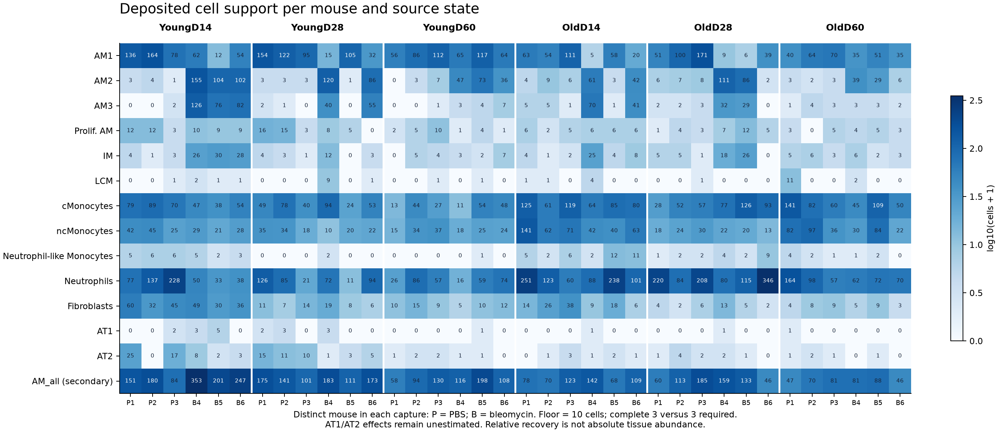
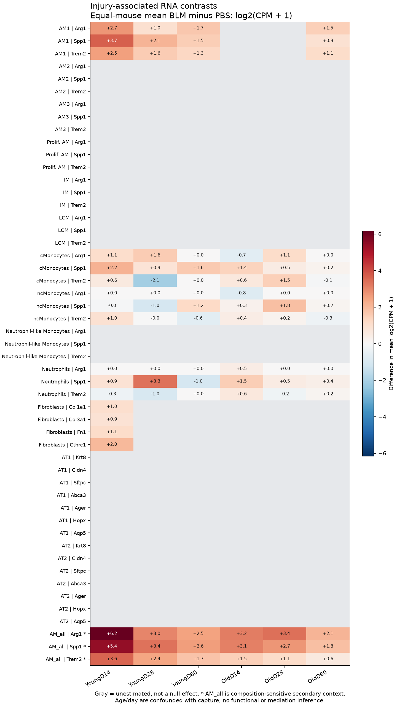
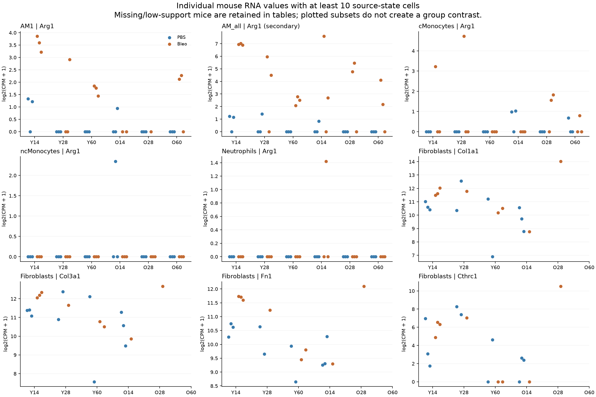

# A32: public resolution-context RNA screen

3 November 2026. Prospective expression freeze `f63050d`, following metadata
freeze `7132cc0`. Both governed runs completed and their receipts verified. The independent
original-count calculation, coordinating arithmetic review and all three
figure inspections passed. Execution completion is not scientific acceptance.

## What this screen can establish

GSE234197 supports a bounded myeloid RNA comparison and an early fibroblast
comparison. It cannot decide whether myeloid, matrix and epithelial programmes
retain or decouple across resolution: epithelial recovery is too sparse and
only young D14 supports the full fibroblast BLM/PBS comparison. This preserves
the original A32 functional hold and the separate Speth access hold.

The clearest source-population lead is young-D14 BLM AM2/AM3: these source
labels carry substantially more observed Arg1 RNA than AM1, including after
library-size normalization. Their PBS counterparts are too sparse for a
within-state induction estimate. At young D14, the supported AM1 Arg1 and
fibroblast Col1a1/Col3a1/Fn1 RNA contrasts are positive. That is early RNA co-occurrence, not collagen deposition,
source-ARG1 mediation or improved epithelial output. The late young AM1 Arg1
observation consists of only 2–5 UMIs per BLM mouse; it cannot establish a
maintained Arg1 programme or functional persistence.

## Design, source and support

[Prospective specification](RESOLUTION_SCREEN_SPEC_V1.md) ·
[literature context](../LITERATURE_CONTEXT.md#public-resolution-context-branch--3-november-2026) ·
[expression contract](../config/resolution_context_contract_v1.json) ·
[run receipt](../../../analysis/research/runs/A32_resolution_context_v1_20261103/receipt.json).
The source is [Truchi et al. 2025](https://doi.org/10.1038/s41467-025-62431-4),
Fig. 2/S2 and Methods; [GSE234197](https://www.ncbi.nlm.nih.gov/geo/query/acc.cgi?acc=GSE234197).
Published sources and prior repository results were exposed. This is a
shared-source descriptive reanalysis, not an independent replication.

The recovered object contains 45,311 unique cells, 41 source labels and 36
source mice: three PBS and three BLM in each young/old × D14/D28/D60 capture.
A mouse is capture plus HTO; the same tag across captures is not the same animal.
Days are cross-sectional. The source reports male mice. Source selection and
celltype labels were preserved, including the original 25% mitochondrial
fraction rule as implemented in author code. No marker-based relabelling.

The pre-outcome rule requires at least ten cells per mouse/state and all three
mice in each arm for a condition contrast. Every low/zero-support mouse/state
remains in the tables. This is a pragmatic measurement-support floor, not a
power calculation. AT1 has only 22 cells overall and AT2 130; fibroblasts have
559 cells, with full six-mouse support only at young D14.

| Fixed comparison family | Planned | Estimated | Unestimated |
|---|---:|---:|---:|
| Ten source myeloid labels × three genes × six captures | 180 | 66 | 114 |
| Fibroblasts × four genes × six captures | 24 | 4 | 20 |
| AT1/AT2 × seven genes × six captures | 84 | 0 | 84 |
| AM_all × three genes × six captures, secondary | 18 | 18 | 0 |
| Total | 306 | 88 | 218 |

AM_all pools AM1/AM2/AM3/Prolif. AM and is explicitly composition-sensitive.
It does not rescue within-state support. Proportions describe relative recovery
among all deposited cells, not absolute tissue abundance.

## RNA results and their limits

Each mouse/state endpoint is log2(CPM + 1), with all raw RNA UMIs as the CPM
denominator. Differences are equal-mouse mean BLM minus PBS, unpaired within
capture. These are differences of transformed expression, not direct raw
count fold changes. Intervals are 95% pointwise Welch-t descriptions with
three mice per arm; normality is unverifiable and intervals are not simultaneous.
No p-values, significance selection or equivalence claim. Twelve estimated
contrasts have zero observed variance and retain NA intervals, not perfect precision.

| Young D14 endpoint | Mean difference | Pointwise interval |
|---|---:|---:|
| AM1 Arg1 | +2.708 | +1.150 to +4.266 |
| Fibroblast Col1a1 | +1.031 | +0.350 to +1.712 |
| Fibroblast Col3a1 | +0.915 | +0.537 to +1.292 |
| Fibroblast Fn1 | +1.136 | +0.570 to +1.701 |
| Fibroblast Cthrc1 | +1.988 | −3.984 to +7.959 |
| AM_all Arg1, secondary | +6.165 | +4.494 to +7.836 |

The early matrix-RNA directions coexist with AM1 Arg1 RNA enrichment. Cthrc1
is much less precise; no universal Cthrc1-defined programme is established.
The larger AM_all contrast mixes source states and their abundances. The source
paper's reported similar macrophage population dynamics across ages (S2E/F)
remains relevant context; our within-state RNA summaries are distinct endpoints.

For target screening, the existing fixed mouse table also identifies the early
injury AM2/AM3 labels as candidate source populations carrying much of the
observed Arg1 RNA. The three young-D14 BLM mice show:

| BLM HTO | AM1: cells / Arg1 UMIs / CPM | AM2: cells / Arg1 UMIs / CPM | AM3: cells / Arg1 UMIs / CPM |
|---|---|---|---|
| A0304 | 62 / 15 / 13.47 | 155 / 244 / 83.10 | 126 / 626 / 211.05 |
| A0305 | 12 / 2 / 11.05 | 104 / 157 / 86.44 | 76 / 341 / 177.07 |
| A0306 | 54 / 6 / 8.30 | 102 / 245 / 136.81 | 82 / 322 / 145.23 |

These are observed per-mouse source-state measurements from the predeclared
panel, not a newly selected test. PBS AM2/AM3 support is insufficient, so their
BLM/PBS contrasts remain unestimated. Neither within-state induction nor ARG1
protein activity is established. Different state abundance and RNA content
help explain the large composition-sensitive AM_all contrast. Source AM2/AM3
labels are not automatically equivalent to another paper's C2/FAM labels.

At young D60, AM1 Arg1 has a +1.684 transformed difference (pointwise interval
+1.146 to +2.222), but the underlying observations are sparse:

| Mouse | AM1 cells | Arg1 UMIs | Cells with an Arg1 UMI | CPM |
|---|---:|---:|---:|---:|
| Young_D60.A0301_PBS | 56 | 0 | 0 | 0 |
| Young_D60.A0302_PBS | 86 | 0 | 0 | 0 |
| Young_D60.A0303_PBS | 112 | 0 | 0 | 0 |
| Young_D60.A0304_Bleo | 65 | 3 | 3 | 2.599 |
| Young_D60.A0305_Bleo | 117 | 5 | 4 | 2.401 |
| Young_D60.A0306_Bleo | 64 | 2 | 2 | 1.710 |

The log offset, sparse sampling, possible ambient/background RNA and source
selection matter here. The interval excluding zero does not turn ten total
BLM UMIs into a maintained biological programme. No post-outcome threshold
was changed. Zero detection in other panels is likewise not biological absence.

Spp1 and Trem2, all fixed states/genes and every unsupported comparison remain
in the [complete contrasts](../../../analysis/research/runs/A32_resolution_context_v1_20261103/condition_contrasts.tsv)
and [individual mouse table](../../../analysis/research/runs/A32_resolution_context_v1_20261103/mouse_expression.tsv).
Old-group Arg1 contrasts are variable and do not establish an age effect.
Raw age/day comparisons are confounded with capture; subtracting same-run PBS
cannot eliminate capture×condition effects. Across-stage curves cannot show
within-animal persistence, and the study supplies no linked ARG1 intervention,
deposited matrix or mature-function endpoint for this screen.

## Measured figures

Every mouse/state remains visible. Zero or low support is not zero expression;
source fractions are relative recovery, not absolute tissue abundance.

Gray means unestimated, not a null effect. AM2/AM3 have observed BLM RNA values
above but insufficient PBS support; their gray contrast rows do not mean absent
Arg1. AM_all is composition-sensitive secondary context. Colors show point
differences only; pointwise intervals and degenerate flags are in the table.

These focal panels were chosen before outcomes. The full fixed panel remains
in the heatmap/tables. Low-support subsets shown as points do not create an
eligible comparison. In the AM1/Arg1 Y60 panel, BLM values arise from only
3, 5 and 2 UMIs versus zero in PBS; normalization and the log offset do not
establish a maintained programme. Fibroblast RNA is not deposited matrix.

## Verification and reproducibility

The original 2.515 GB double-gzip Seurat deposit was preserved. A separately
frozen bounded R serialization transform removed ten large numeric assay
payloads, then native R recovered metadata. Native-R fixtures established
byte-identical unmodified v2/v3 serialization, metadata/order parity, factors,
data frames, S4 attributes, references/ALTREP and nested gzip; unsupported types
and truncation fail closed. The temporary stripped object was not an expression
source. [Metadata receipt](../../../analysis/research/runs/A32_resolution_metadata_v1_20261103/receipt.json).

All expression comes from the original GEO RAW.tar. Every retained cell in all
six captures matched its source barcode, RNA UMI total and detected-feature count
exactly. [Source parity table](../../../analysis/research/runs/A32_resolution_context_v1_20261103/source_checks.tsv).
A second native-R original-YoungD14 matrix calculation matched all 306
state/gene/mouse rows, including raw gene counts, positive cells, total UMIs
and eligible log-expression. Native R also verified all 306 contrast statuses
and the 88 estimated contrasts' uncertainty policies: 76 nondegenerate Welch
intervals and 12 zero-variance cases with NA intervals.
[Independent verification](../../../analysis/research/runs/A32_resolution_context_v1_20261103/independent_verification.txt).
Coordinating-chat checks of support, CPM/log and contrast arithmetic passed
separately (4,308 checks; reported maximum arithmetic difference 3.67e-15).
Same-data verification is not biological replication. Figures were visually
inspected for labels, complete unsupported rows and secondary-context wording.
Required compile, 170 unit tests (one skipped), claims and archived-evidence
checks passed. Research gate against fresh `origin/main` (`445a0ca`) and repository validation
passed (15,249 checks); final patch whitespace check passed. The coordinator
owns the final result-deposit commit/push/PR.

Public files were retrieved on 3 November 2026 from the [GEO supplement directory](https://ftp.ncbi.nlm.nih.gov/geo/series/GSE234nnn/GSE234197/suppl/). Exact source hashes:

| File | SHA256 |
|---|---|
| GSE234197_Truchi_et_al_seuratobj.rds.gz | `48f6a6d963843cad061dbc60681cfd7f73c88365ae5758f530443ff144c026a0` |
| GSE234197_RAW.tar | `ae5801ad3283c5a08bf29d28ad2bd78486b25d6dc8de9c4c6a20c713415f19ec` |
| GSE234197_HTOs_assignment.xlsx | `e34ad56b6ae21615b673baaf6178744b722388057ff33727239c50dc2357f682` |

Author preprocessing/integration source was read at [commit b822811](https://github.com/marintruchi/Aging_affects_reprogramming_of_PCEC/tree/b822811cb96de4811be6c5ce33bb9d5f57f760f7); the expression contract binds those cached source bytes. The derived metadata hash and recovery code are bound in the separate metadata receipt and downstream contract.

## Decision and next step

Young D14 is the source-supported early myeloid/fibroblast RNA context, and
its BLM AM2/AM3 labels are candidate source populations for subsequent
qualification. This does not establish within-state induction, source-restricted
activity or selection of a functional experimental stage. The source does not nominate
a stage of matrix/epithelial decoupling and cannot answer the joint A32 question.
Any later functional or alternative-source study needs its own rationale,
qualified linkage and prospective contract. No cohort expansion was undertaken
to obtain a positive joint finding. Canonical hypothesis, illustration, claim
grade and human scientific acceptance remain unchanged.
