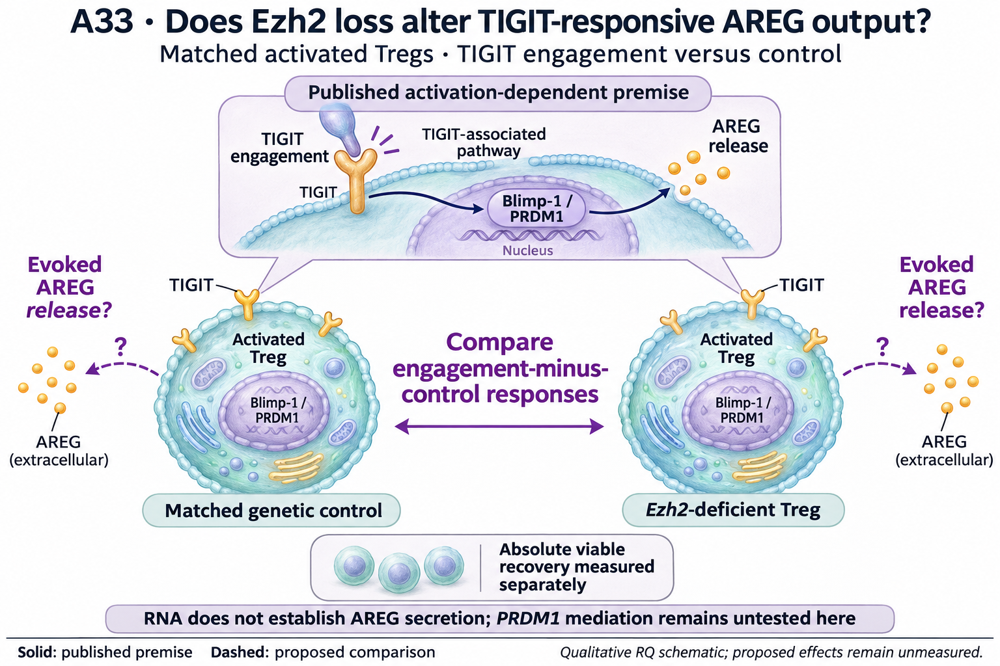

# A33: literature context

Current synthesis: 8 November 2026; underlying literature searches/read checks: 7 November. Source revision `4ae13c09383c9afbd350e662094d0655bd7fe347`. This revision reorganizes the existing bounded review and completed results; it does not claim a new exhaustive search. [Question](README.md) · [Dossier](../../docs/research_dossiers/A33.md).

## Published starting point

| Primary source | Exact locator / measured context | Relevance to this question | Access and limit |
|---|---|---|---|
| [DuPage 2015](https://doi.org/10.1016/j.immuni.2015.01.007) | Figure 6A–F: sorted Foxp3-positive Treg RNA and external regulatory context; Figures 5 and 7: lineage/functional observations | Motivates the Ezh2/state problem; source RNA is not an activation intervention. | Earlier local full-text/source read; exact replay remains adapted. |
| [Panetti 2025](https://doi.org/10.1038/s41590-025-02300-w) | Figures 5–6, Extended Data 8; activation/priming and Blimp-1-related AREG output | Published premise for the output assay. Broader T-cell deletion does not establish Treg-restricted PRDM1 mediation here. | Full primary Results and relevant Methods read previously; reusable same-day audit. |
| [Peeters 2024](https://doi.org/10.1016/j.celrep.2024.114724) | Figure 7F–G, S7H and RNA-seq STAR Methods | EZH2 gain/TIGIT already has precedent; fresh protein and cultured RNA are different endpoints. | Primary XML/Methods inspected; selected rlog deposit qualified. |

Publication versions, source identity and detailed read/access history are recorded in the [article source audit](../../Research%20Article/gate3_09_dupage_2015/candidates/SOURCE_QUALIFICATION.md) and [refresh record](../../Research%20Article/gate3_09_dupage_2015/rq_derivation/README.md#search-record). No absent search hit establishes novelty or absence of a correction.

## Repository observation

Lower Tigit and Prdm1 RNA in DuPage KO-low Tregs motivates an output-response question. The follow-up makes that question more specific: the two transcripts reverse direction between fresh and cultured EZH2-gain samples, while Areg does not follow their cultured decrease. No AREG secretion or response deficit has yet been measured.

[DuPage coding screen](../../Research%20Article/gate3_09_dupage_2015/TARGET_SCREEN_RESULT.md) · [executed gain-context follow-up](../../Research%20Article/gate3_09_dupage_2015/CANDIDATE_ANALYSIS_RESULT_V1.md). The [question-page table](README.md#evidence-analyses-and-next-steps) shows candidate-specific values and unfavorable anchors. DuPage values are differences of mean log2(FPKM + 1), from 11 retained libraries; Peeters values are mean published rlog differences, from 12 libraries (three/group) in an author-selected matrix. These are different units and populations, not comparable effect magnitudes. Animals/pools and pairing remain unverified. Library-omission stability is not a confidence interval or independent replication.

## Does the evidence warrant the narrowing?

**Rationale verdict: a context-dependent RNA lead supporting an output-response question.** The gene directions and the published TIGIT mechanism justify asking about evoked AREG, but do not establish that the Ezh2-deficient cells have lost this function. The unfavorable Areg sensitivity and the gain-context discordance remain part of the rationale. PRDM1 is a conditional mediation question, not an independently validated second target.

All original DuPage outcomes and relevant published narratives were exposed. The selected Peeters candidate run was frozen for its descriptive comparison, but that later freeze does not erase earlier exposure. Shared-source reanalysis is not independent replication, and unlike alleles/states do not identify a causal inverse-response model.

## What this question could add

A context/boundary test of whether Ezh2 loss changes a receptor-evoked output, rather than another expression association. This can be informative even if the published TIGIT mechanism is reproduced. PRDM1 is a conditional mediator question, not a second independently selected target.

A2 and A9 concern epithelial AREG delivery and fibroblast recipient competence. A33 concerns receptor-evoked output from Tregs under Ezh2 perturbation, with no recipient-repair claim. A12 concerns IL-1 recipient context, not this source response.

## Current hypothesis and rival

Under a common, demonstrably responsive activation context, Ezh2-deficient murine Tregs have a smaller TIGIT-engagement-minus-control AREG release response than matched genetic controls. This is an output-response hypothesis; it does not assert PRDM1 mediation or tissue repair.

Different activation history, receptor availability, cell selection or loss, and accessory/Fc effects can alter the response. A response deficit does not alone identify PRDM1 mediation.

## What the comparison would teach

The immediate decision is whether the engagement-minus-control AREG response differs between genotypes under a common responsive activation context. A retained response would narrow the interpretation toward context or expression differences; an output deficit would justify asking whether receptor availability, general cell fitness or PRDM1 contributes. Measuring a genotype response effect does not require proving the entire pathway first.

A smaller KO response with comparable recovery supports an output deficit in the qualified assay. A comparable response weakens that prediction without negating the RNA result. A deficit tracking broad activation failure or cell loss leaves a general fitness account. If neither control responds, the assay cannot test the genotype prediction.

Common TCR/co-stimulation; TIGIT engagement versus matched reagent control in aliquots from Ezh2-deficient and matched-control preparations. Estimate the genotype difference in engagement-minus-control AREG release, retaining the two simple responses and baseline output.

Secreted AREG, assay background, absolute viable recovery and supportive TIGIT/Blimp-1 protein measurements. AREG per viable cell and total recovered output answer different questions; report both when interpretable.

Independent mice/preparations define units, with nested aliquots/wells. Model availability, actual alleles/control, tissue, timing, variance and precision are unresolved. Registration does not authorize or imply a new numerical run, laboratory execution, or a target-mediated causal claim.

## Reading the registered illustration

The upper inset is the published activation-dependent premise. The two Tregs depict a proposed genotype comparison, not measured receptor amounts or equal output. The central double-headed arrow denotes comparison only. AREG dots and cell counts are qualitative; PRDM1 mediation and recipient repair remain untested. Anatomical, cell and protein glyphs are illustrative, not measured counts or molecular structures. The drawing cannot resolve the source and functional uncertainties described above.

## Hypothesis schematic

GPT-generated matte illustration, 8 November 2026. The upper inset is the published activation-dependent premise. The two Tregs depict a proposed genotype comparison, not measured receptor amounts or equal output. The central double-headed arrow denotes comparison only. AREG dots and cell counts are qualitative; PRDM1 mediation and recipient repair remain untested. [Editorial review](../../Research%20Article/gate3_09_dupage_2015/rq_derivation/FIGURE_REVIEW_20261108.md) · [Selected prompt](schematics/A33_gpt_matte_v1.prompt.txt). The initial vector comparison is retained as source history.

## Next literature check

The [7 November query/access record](../../Research%20Article/gate3_09_dupage_2015/rq_derivation/README.md#search-record) distinguishes completed reads from uninspected leads and incomplete methods. Reuse this bounded review until the model, perturbation or endpoint changes. Before executable design, retrieve the closest remaining methods/supplement needed for that exact comparison; source-wide absence or experimental readiness is not established by partial access.
