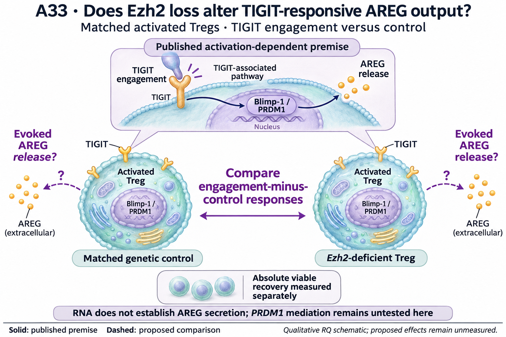

# A33: TIGIT-responsive output in the Ezh2 context

## Organizing Biological Q

Does Ezh2 loss alter the AREG response to TIGIT engagement in activated Tregs?

Lower Tigit and Prdm1 RNA in DuPage KO-low Tregs motivates an output-response question. The follow-up makes that question more specific: the two transcripts reverse direction between fresh and cultured EZH2-gain samples, while Areg does not follow their cultured decrease. No AREG secretion or response deficit has yet been measured.

Current synthesis: 12 November 2026. [Question card](../../RESEARCH_QUESTIONS.md#a33) · [Literature context](LITERATURE_CONTEXT.md) · [Dossier](../../docs/research_dossiers/A33.md).

## Literature context & visual hypothesis

A context/boundary test of whether Ezh2 loss changes a receptor-evoked output, rather than another expression association. This can be informative even if the published TIGIT mechanism is reproduced. PRDM1 is a conditional mediator question, not a second independently selected target. The [local source table](LITERATURE_CONTEXT.md#published-starting-point) separates published premises, contrary evidence and partial access.

GPT-generated matte illustration, 8 November 2026. The upper inset is the published activation-dependent premise. The two Tregs depict a proposed genotype comparison, not measured receptor amounts or equal output. The central double-headed arrow denotes comparison only. AREG dots and cell counts are qualitative; PRDM1 mediation and recipient repair remain untested. [Editorial review](../../Research%20Article/gate3_09_dupage_2015/rq_derivation/FIGURE_REVIEW_20261108.md) · [Selected prompt](schematics/A33_gpt_matte_v1.prompt.txt). The initial vector comparison is retained as source history.

## Evidence, analyses and next steps

Wang adds lower Tigit and Prdm1 but higher Areg RNA after four days of culture. All three directions persist in the recorded strict-control and library-omission checks. This strengthens the reason to separate basal abundance from the TIGIT-evoked AREG response; it neither confirms nor falsifies the registered smaller-response prediction. [Wang fixed-panel result](../../Research%20Article/gate3_10_wang_2018_ezh2/RESULTS_V1.md#s4--five-exposed-genes-across-separate-activation-contexts) · [Source limits and interpretation](../../Research%20Article/gate3_10_wang_2018_ezh2/BIOLOGICAL_INTERPRETATION_V1.md). Wang adds a descriptive context check; the values below remain the prior DuPage/Peeters lookups.

The completed [DuPage coding screen](../../Research%20Article/gate3_09_dupage_2015/TARGET_SCREEN_RESULT.md) · [executed gain-context follow-up](../../Research%20Article/gate3_09_dupage_2015/CANDIDATE_ANALYSIS_RESULT_V1.md) remain owned by Dp1-P01. Values below are rounded lookups from the existing tables, not a new analysis.

| Gene | DuPage KO − HET, CD62L-low | Peeters gain − WT, fresh | Peeters gain − WT, day 4 | What this changes |
|---|---:|---:|---:|---|
| Tigit | -1.777 | +1.390 | -0.801 | Stable signed low-state and interaction RNA contrasts in the recorded DuPage sensitivity set; not evidence of secretion. |
| Prdm1 | -1.357 | +0.884 | -1.292 | Both genotypes retain positive observed high-to-low state contrasts; attenuation is not pathway disappearance. |
| Areg | -0.293 | +0.501 | +0.324 | Endpoint anchor: DuPage and gain-context interaction signs are omission-sensitive; cultured Areg does not follow Tigit/Prdm1. |

DuPage values are differences of mean log2(FPKM + 1), from 11 retained libraries; Peeters values are mean published rlog differences, from 12 libraries (three/group) in an author-selected matrix. These are different units and populations, not comparable effect magnitudes. Animals/pools and pairing remain unverified. Library-omission stability is not a confidence interval or independent replication.

[Measured sample profiles and direction comparisons](../../Research%20Article/gate3_09_dupage_2015/CANDIDATE_ANALYSIS_RESULT_V1.md#figures-and-source-values) · [screening gallery](../../Research%20Article/gate3_09_dupage_2015/TARGET_SCREEN_FIGURES.md). These figures remain at their source paths; the proposed illustration above is separate.

## Does the evidence warrant the narrowing?

**Rationale verdict: a context-dependent RNA lead supporting an output-response question.** The gene directions and the published TIGIT mechanism justify asking about evoked AREG, but do not establish that the Ezh2-deficient cells have lost this function. The unfavorable Areg sensitivity and the gain-context discordance remain part of the rationale. PRDM1 is a conditional mediation question, not an independently validated second target.

The coding reading frontier and three-route focus were outcome-exposed and literature-informed. The top-ten rule limits reading scope; it does not identify statistically validated targets. Neither successful execution nor an RQ identifier ranks this route above the rest of the frontier. The different Ezh2 alleles, genetic controls, observed states and culture contexts prevent a matched loss/gain causal interpretation.

The [public-source audit](../../Research%20Article/gate3_10_wang_2018_ezh2/public_gap_followup_20261112/G1_SOURCE_AUDIT_V1.md) narrowed assay qualification: Panetti Figure 6h measures cellular AREG induction with transport/shedding inhibitors, not extracellular release. Public evidence therefore qualifies a stimulation comparison, while the Ezh2-conditioned extracellular response remains unmeasured. The next step is the [revised measurement sequence](PLAN.md#public-source-checkpoint-and-revised-sequence). This is newly incorporated published evidence, not a new functional result from the repository; no eligible numerical contrast was recovered.

## What the result changes and the next decision

The neighboring-paper review adds an optional comparison of AREG responsiveness and conventional-T-cell suppression in aliquots from the same Treg preparations. Their relationship under Ezh2 loss remains unmeasured; AREG alone is not tissue repair. The primary response hypothesis is unchanged. [Neighbor-paper flow review](../../Research%20Article/gate3_10_wang_2018_ezh2/RQ_FOLLOWUP_REVIEW_20261112.md#neighboring-article-flow-and-revisited-gaps) · [Model and linked measurements](PLAN.md#model-choice-and-linked-measurements).

First qualify surface TIGIT and a responsive AREG release assay under a common activation context. In matched aliquots, retain basal/reagent-control output, the engagement-minus-control response and absolute viable lineage recovery. Estimate the genotype difference between those two within-preparation responses. A higher basal output can coexist with a smaller inducible increment; neither should be hidden by reporting only fold induction or a final-cell-normalized value. Accessory/Fc effects and source attribution remain assay requirements. See the plan for the conditional activation-context extension; PRDM1 mediation and recipient repair require separate evidence.

The [revised development plan](PLAN.md) separates the immediate comparison from its [conditional extension](PLAN.md#conditional-extension). A qualified null or opposite direction remains informative. The [literature refresh](../../Research%20Article/gate3_10_wang_2018_ezh2/RQ_FOLLOWUP_REVIEW_20261112.md) records what is already published and what the proposed extension would add. Shared recovery/state measurements can support this RQ; Wang F3 does not execute this functional comparison or become a compulsory prerequisite.

## Registered scope and evidence records

Proposed registration requested on 7 November; presentation revisions approved on 8 November. The working hypothesis and all prior measured evidence are preserved. Scientific acceptance, target validation and experimental readiness are not inferred.

[Full hypothesis and alternatives](../../docs/research_dossiers/A33.md#working-hypothesis) · [Derivation and overlap](../../Research%20Article/gate3_09_dupage_2015/rq_derivation/README.md) · [Source qualification](../../Research%20Article/gate3_09_dupage_2015/candidates/SOURCE_QUALIFICATION.md) · [Plan](PLAN.md).
