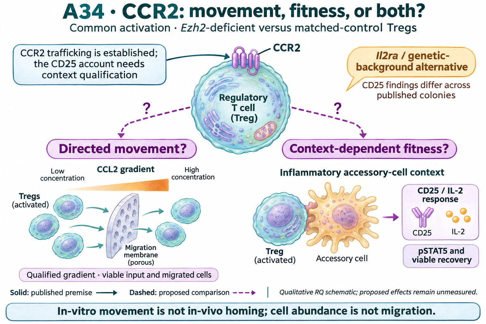

# A34: literature context

Current synthesis: 12 November 2026; underlying review: 7 November, with a [bounded Wang-informed refresh](../../Research%20Article/gate3_10_wang_2018_ezh2/RQ_FOLLOWUP_REVIEW_20261112.md). Source revisions: original review `4ae13c0`, Wang evidence `5f8caee`; refreshed integration base `30a4a7b`. Search queries, exact locators, versions and access limits are recorded in the refresh; this is not an exhaustive novelty assessment. [Question](README.md) · [Dossier](../../docs/research_dossiers/A34.md).

## Published starting point

| Primary source | Exact locator / measured context | Relevance to this question | Access and limit |
|---|---|---|---|
| [Zhan, online 2018 / issue 2020](https://doi.org/10.1038/s41423-018-0187-8) | Figures 5–6; mixed-cell inflammatory stimulation and chimeras | A conditional CD25/fitness account. Purified CCL2 alone is not the established responsive assay. | Indexed primary Results/legends; full supplement and direct XML access incomplete. |
| [Chorro 2018](https://doi.org/10.1038/s41467-018-07806-6) | Figure 1; isolation of Il2ra mutant; relevant transfection Methods | A distinct Il2ra mutation explained low CD25 in one Ccr2-knockout colony. This is a background alternative, not identification of Zhan's colony. | Primary publisher Results/legend/Methods read on 7 November. |
| [Peeters 2024](https://doi.org/10.1016/j.celrep.2024.114724) | RNA-seq STAR Methods and GSE262130 | Provides a different gain/culture context; cannot test migration or homing. | Primary XML/Methods and selected matrix qualified. |
| [Immune microniches, 2024](https://doi.org/10.1038/s41586-024-07251-0) | Figure 5 and Extended Data 9 | Spatial context is relevant but supplies no CCR2 intervention for this comparison. | Indexed primary Results/legends; no new spatial analysis. |

Publication versions, source identity and detailed read/access history are recorded in the [article source audit](../../Research%20Article/gate3_09_dupage_2015/candidates/SOURCE_QUALIFICATION.md) and [refresh record](../../Research%20Article/gate3_09_dupage_2015/rq_derivation/README.md#search-record). No absent search hit establishes novelty or absence of a correction.

## Repository observation

Wang adds a positive Ccr2 point contrast with a library-omission range crossing zero, unlike the DuPage decrease. A universal Ezh2-loss-to-CCR2-reduction account is therefore unsupported across these sources. The reduction named in this RQ is a context-qualified premise to verify in the chosen model, not an established property of all Ezh2-deficient Tregs. Increased, unchanged and decreased functional responses must all be retained. [Wang table](../../analysis/research/runs/wang18_s4_context_v1/context_directions.tsv) · [Interpretation](../../Research%20Article/gate3_10_wang_2018_ezh2/BIOLOGICAL_INTERPRETATION_V1.md).

Wang uses four deficient and five deposited-control libraries, with a four-library +/+ sensitivity. Mouse/pool and processing assignments remain unresolved, and the supplement disagrees with deposited control labels. The five-gene panel was outcome-exposed. Its different source scales permit descriptive direction checks, not a pooled effect, population inference or independent biological replication.

Lower Ccr2 RNA in DuPage KO-low Tregs motivates separating directed movement from signaling and viable recovery. Il2ra RNA supplies no matching stable deficit, and the gain-context Ccr2 direction changes after culture. The published CD25 account also has a genetic-background counterexample that the initial review missed.

[DuPage coding screen](../../Research%20Article/gate3_09_dupage_2015/TARGET_SCREEN_RESULT.md) · [executed gain-context follow-up](../../Research%20Article/gate3_09_dupage_2015/CANDIDATE_ANALYSIS_RESULT_V1.md). The [question-page table](README.md#evidence-analyses-and-next-steps) shows candidate-specific values and unfavorable anchors. DuPage values are differences of mean log2(FPKM + 1), from 11 retained libraries; Peeters values are mean published rlog differences, from 12 libraries (three/group) in an author-selected matrix. These are different units and populations, not comparable effect magnitudes. Animals/pools and pairing remain unverified. Library-omission stability is not a confidence interval or independent replication.

## Does the evidence warrant the narrowing?

**Rationale verdict: an exploratory receptor-context lead; neither movement loss nor a CCR2-to-CD25 mechanism is selected.** The source RNA supports a qualified movement/fitness comparison. The Il2ra/background precedent makes CD25 attribution a specific uncertainty rather than a universal CCR2 consequence. It does not demonstrate that Zhan used the affected colony or invalidate its inhibitor/chimera observations.

All original DuPage outcomes and relevant published narratives were exposed. The selected Peeters candidate run was frozen for its descriptive comparison, but that later freeze does not erase earlier exposure. Shared-source reanalysis is not independent replication, and unlike alleles/states do not identify a causal inverse-response model.

## What this question could add

The neighboring-paper review leaves movement versus fitness as the immediate question. It makes perturbation history and linked protein/response measurements explicit; entry, retention and tissue access remain separate from the in-vitro movement endpoint. The [12 November neighboring-paper pass](../../Research%20Article/gate3_10_wang_2018_ezh2/RQ_FOLLOWUP_REVIEW_20261112.md#neighboring-article-flow-and-revisited-gaps) records DuPage/Peeters/Wang/Panetti, Zhang, Saxton and Yadav flows, the earlier Bockman lead and source-access limits; the later full-main-paper review below supersedes that access state. Published premises remain separate from this proposed comparison.

The 12 November refresh adds [Watanabe et al. (2024)](https://doi.org/10.1186/s12974-024-03144-1), Figure 5A–H and Migration assay Methods: CNS tissue context accompanies different receptor profiles and chemokine responses. Spinal Tregs tended toward greater CCL12 migration; this is not an Ezh2 perturbation or proof of CCR2 necessity. [Loyher et al. (2016)](https://aacrjournals.org/cancerres/article/76/22/6483/614914/CCR2-Influences-T-Regulatory-Cell-Migration-to), Figure 1, is an older tumor-trafficking precedent; the initial publisher route failed, but the later G1 audit read the public author manuscript, including Figure 2/S3 receptor-detection qualification. The extension tests the abundance/response relationship in the Ezh2 context, rather than claiming CCR2 trafficking is new. [Search/version/access record](../../Research%20Article/gate3_10_wang_2018_ezh2/RQ_FOLLOWUP_REVIEW_20261112.md#bounded-literature-refresh).

Separate directed movement from receptor/signaling and recovery responses in the Ezh2 context. The CD25 branch is a conditional published account to reproduce and qualify, not an established universal CCR2 mechanism. A CCR2-independent CD25 result would also be informative.

A26–A27 concern CD8 receptor repertoires, A28 Th17 outputs, and A30 paired CSF/blood RNA. None measures directed Treg movement or separates it from the specified recovery/signaling responses. Shared lymphocyte tags do not merge these estimands.

## Public-source qualification, 12 November 2026

Loyher reports specific fluorescent CCL2 binding despite an antibody stain that did not detect Treg CCR2. Bonfiglio reports impaired movement of bulk Ezh2-deficient CD4 cells to CCL19/CCL22; this is a general movement precedent, not a CCR2-dependent Treg result. See [Loyher Figure 2/S3](https://krummel.org/images/Publications/loyher-pub-2016-01.pdf) and [Bonfiglio Figure 8](https://pmc.ncbi.nlm.nih.gov/articles/PMC12063685/#F8). The [technical audit](../../Research%20Article/gate3_10_wang_2018_ezh2/public_gap_followup_20261112/G1_SOURCE_AUDIT_V1.md) records versions, searches, sample crosswalks and access boundaries. The [review and revised sequence](../../Research%20Article/gate3_10_wang_2018_ezh2/PUBLIC_GAP_REVIEW_20261112.md) retain useful published precedents while holding only unsupported comparisons. Wang S4D resolves an acute established-Treg model precedent, not actual implementation or paired RNA/protein/recovery measurements. Bockman's [completed full-main-paper read](../../Research%20Article/gate3_10_wang_2018_ezh2/BOCKMAN_FULL_READ_20261112.md) supersedes the earlier abstract-only tumor lead without creating a result for this RQ.

## Current hypothesis and rival

After common activation, Ezh2-deficient murine Tregs may show a CCR2-related directed-movement deficit, an inflammatory-context fitness deficit, both, or neither. The first comparison estimates those separate genotype-associated responses; attribution to CCR2 requires a target-restricted test and qualified genetic background.

General activation/viability differences, accessory-cell effects, or an independent Il2ra/background defect can mimic a CCR2-linked fitness result. The source RNA comparison cannot distinguish them.

## What the comparison would teach

Qualify CCR2 protein and ligand responsiveness in the actual genetic and activation context before interpreting a reduction. If reduction is absent, report that boundary; a qualified movement comparison can still estimate an Ezh2-associated phenotype without calling it CCR2 loss. Measure viable input, absolute traversing cells and a viable-input fraction, with no-gradient/equal-concentration controls. Keep CD25/IL-2 signaling and recovery in separate aliquots and qualify Il2ra/background for that branch. Target-restricted attribution is conditional on a qualified phenotype, not supplied by a mixed-cell antagonist. The [conditional extension](PLAN.md#conditional-extension) is a proposed comparison, not a result or a new RQ.

First determine which qualified responses differ: directed movement, inflammatory-context CD25/IL-2 response, viable recovery, both branches, or neither. This distinguishes phenotypes before assigning them to CCR2. Actual Il2ra/background status and target-restricted specificity become essential when making a CCR2-mediated claim; a simple genotype comparison can report a bounded phenotype.

Movement-only loss supports a movement phenotype; signaling/recovery-only loss supports a separate fitness phenotype; both allow shared state effects or joint contributions. No resolved difference weakens a deficit prediction only when assays and precision are adequate; an increased response is a contrary result to retain. A CD25 difference attributable to Il2ra/background cannot be assigned to CCR2.

Matched activated Ezh2-deficient and genetic-control Treg preparations in a qualified CCR2-ligand gradient, with no-gradient/equal-concentration controls. In separate aliquots, assess a qualified inflammatory accessory-cell condition and downstream IL-2 response. Do not assume purified-cell CCL2 alone induces CD25.

Absolute viable cells traversing the assay and fraction of viable input; separately CD25 protein, IL-2-induced pSTAT5 and absolute recovery. Proliferation requires a division assay. None of these is a direct in-vivo homing measurement.

Independent mice/preparations define units, with nested aliquots/wells. Model availability, actual alleles/control, tissue, timing, variance and precision are unresolved. Registration does not authorize or imply a new numerical run, laboratory execution, or a target-mediated causal claim.

## Reading the registered illustration

The existing illustration still depicts the unexecuted comparison. Wang adds RNA context, not measured receptor/protein amounts or functional outcomes; the working hypothesis and versioned artwork are unchanged.

The two dashed branches are alternative or coexisting response questions. Gradient arrows illustrate the migration assay, not an observed genotype difference. The accessory-cell/CD25 inset represents a context to qualify, not an autonomous CCR2-to-CD25 pathway. Cell counts, receptor shapes and ligand amounts are illustrative. Anatomical, cell and protein glyphs are illustrative, not measured counts or molecular structures. The drawing cannot resolve the source and functional uncertainties described above.

## Hypothesis schematic

GPT-generated matte illustration, 8 November 2026. The two dashed branches are alternative or coexisting response questions. Gradient arrows illustrate the migration assay, not an observed genotype difference. The accessory-cell/CD25 inset represents a context to qualify, not an autonomous CCR2-to-CD25 pathway. Cell counts, receptor shapes and ligand amounts are illustrative. [Editorial review](../../Research%20Article/gate3_09_dupage_2015/rq_derivation/FIGURE_REVIEW_20261108.md) · [Selected prompt](schematics/A34_gpt_matte_v1.prompt.txt). The initial vector comparison is retained as source history.

## Next literature check

The [7 November query/access record](../../Research%20Article/gate3_09_dupage_2015/rq_derivation/README.md#search-record) distinguishes completed reads from uninspected leads and incomplete methods. The 12 November refresh qualifies the conditional extensions; refresh again when the actual model, perturbation or endpoint changes. Before executable design, retrieve the closest remaining methods/supplement needed for that exact comparison; source-wide absence or experimental readiness is not established by partial access.
